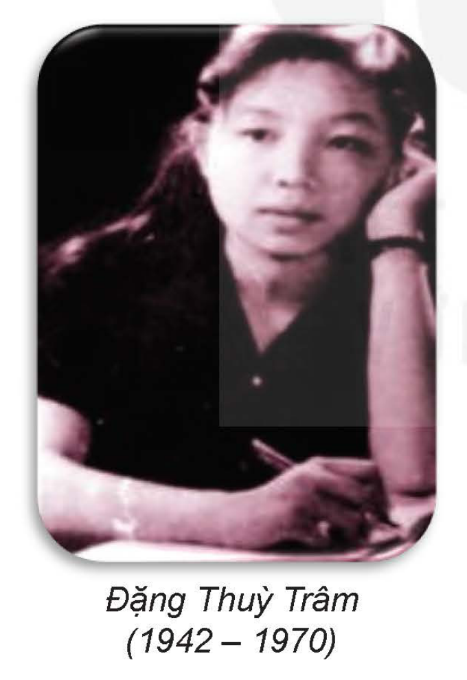
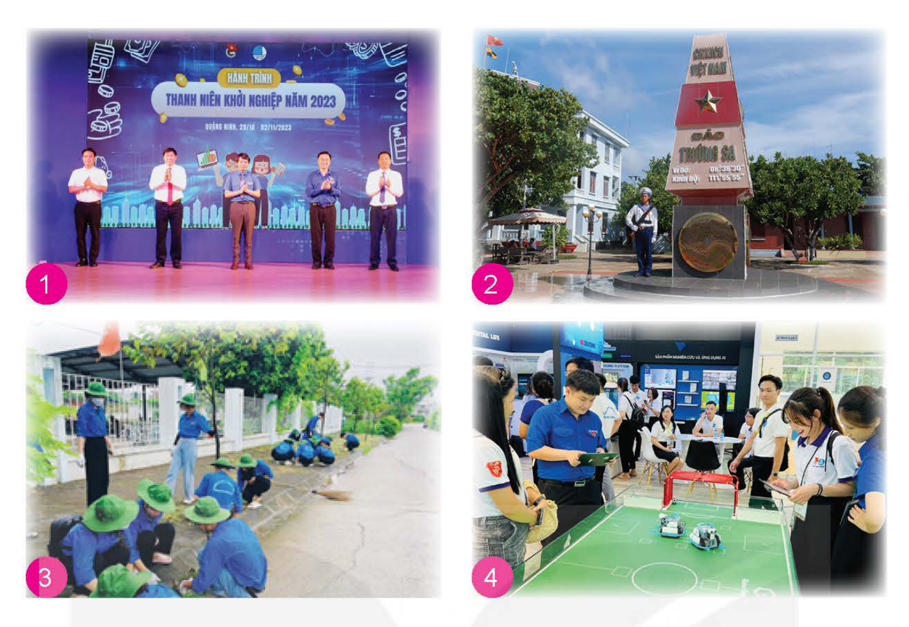

<!-- pdf:7 -->

# BÀI 1: SỐNG CÓ LÍ TƯỞNG

## 🎯 MỤC TIÊU:

- Nêu được khái niệm sống có lí tưởng.
- Giải thích được ý nghĩa của việc sống có lí tưởng.
- Nhận biết được lí tưởng sống của thanh niên Việt Nam.
- Xác định được lí tưởng sống của bản thân và nỗ lực học tập, rèn luyện theo lí tưởng.

## 🔴 Mở đầu

**Lí tưởng** là mục đích cao đẹp nhất mà con người mong muốn đạt tới. Khi sống có lí tưởng, con người sẽ có kế hoạch cho tương lai, có động lực để vượt qua khó khăn, thử thách, phấn đấu để đạt được những thành công trong cuộc sống và giúp ích cho cộng đồng.

Em hãy chỉ ra những ca từ thể hiện ước muốn của nhân vật trong lời bài hát sau và cho biết ý nghĩa của những ước muốn đó.

> “Nếu là chim tôi sẽ là loài bồ câu trắng
> Nếu là hoa tôi sẽ là một đoá hướng dương
> Nếu là mây tôi sẽ là một vầng mây ấm
> Là người tôi sẽ chết cho quê hương...”
>
> (“Tự nguyện”, nhạc và lời: Trương Quốc Khánh)

## KHÁM PHÁ

## 1. Khái niệm, ý nghĩa của việc sống có lí tưởng

Em hãy đọc các thông tin sau và trả lời câu hỏi:

> 1. Trả lời các nhà báo nước ngoài, Chủ tịch Hồ Chí Minh khẳng định: “Tôi tuyệt nhiên không ham muốn công danh phú quý chút nào. Bây giờ phải gánh chức Chủ tịch là vì đồng bào uỷ thác thì tôi phải gắng sức làm, cũng như một người lính vâng mệnh lệnh của quốc dân ra trước mặt trận. Bao giờ đồng bào cho tôi lui thì tôi rất vui lòng lui. Tôi chỉ có một sự ham muốn, ham muốn tột bậc, là làm sao cho nước ta được hoàn toàn độc lập, dân ta được hoàn toàn tự do, đồng bào ai cũng có cơm ăn áo mặc, ai cũng được học hành. Riêng phần tôi thì làm một cái nhà nho nhỏ, nơi có non xanh,

<!-- pdf:8 -->

> nước biếc để câu cá, trồng hoa, sớm chiều làm bạn với các cụ già hái củi, em trẻ chăn trâu, không dính líu gì với vòng danh lợi”.
>
> (Theo Hồ Chí Minh (2011), *Toàn tập*, tập 4, NXB Chính trị quốc gia, trang 187)

> - a) Em hãy nêu mong muốn của Chủ tịch Hồ Chí Minh trong thông tin trên.
> - b) Chủ tịch Hồ Chí Minh đã thực hiện mong muốn trên như thế nào? Ý nghĩa của mong muốn đó với dân tộc Việt Nam?

> 2. Tại chiến trường Đức Phổ, Quảng Ngãi, khi một sĩ quan Mỹ định châm lửa đốt quyển sổ tay thu được sau một trận càn, người thông dịch của ông đã cản: "Đừng đốt. Bản thân nó đã có lửa rồi!". Đó là cuốn nhật kí chứa đựng một tình yêu bao la với Tổ quốc, nhân dân, đồng đội, thể hiện lí tưởng sống cao đẹp của nữ bác sĩ Đặng Thuỳ Trâm. Tấm gương người nữ anh hùng hi sinh khi tuổi đời còn rất trẻ đã tiếp thêm động lực cho những người ở lại quyết tâm chiến đấu vì lí tưởng cao cả: quyết tử cho Tổ quốc quyết sinh!
>
> *“30.6.68. “Đời phải trải qua giông tố nhưng chớ cúi đầu trước giông tố”... Th. hãy bằng nghị lực, bằng niềm tin ở chính nghĩa, bằng lí tưởng cuộc đời mình mà đi tiếp những bước đường gai góc gian lao...*
>
> 
>
> *Đặng Thuỳ Trâm (1942 – 1970)*
>
> *01.9.68. Th. hãy ngẩng cao đầu mà sống, sống với tình cảm trong sáng, với lí tưởng cao đẹp của mình. “Hãy giữ vững tinh thần của người cộng sản, tinh thần trong suốt như pha lê, cứng rắn như kim cương và chói lọi muôn nghìn hào quang của lòng tin tưởng”...*
>
> *14.7.69... Ba má và các em yêu thương ở ngoài đó làm sao thấy hết được cuộc sống ở đây. Cuộc sống vô cùng anh dũng, vô cùng gian nan, chết chóc, hi sinh còn dễ dàng hơn ăn một bát cơm. Vậy mà người ta vẫn bền gan chiến đấu. Con cũng là một trong muôn nghìn người đó, con sống, chiến đấu và nghĩ rằng mình sẽ ngã xuống vì ngày mai của dân tộc... Con tự hào vì đã dâng trọn đời mình cho Tổ quốc”.*
>
> (Theo Đặng Kim Trâm chỉnh lí, Vương Trí Nhàn giới thiệu (2005), *Nhật kí Đặng Thuỳ Trâm*, NXB Hội Nhà văn, trang 46, 68, 160)

> - a) Em hãy chỉ ra mục đích sống của bác sĩ Đặng Thuỳ Trâm và đồng đội.
> - b) Chi tiết nào trong những dòng nhật kí trên thể hiện suy nghĩ và hành động để đạt được mục đích đó?
> - c) Em hãy cho biết thế nào là sống có lí tưởng và ý nghĩa của sống có lí tưởng.

<!-- pdf:9 -->

## 2. Lí tưởng sống của thanh niên Việt Nam ngày nay

Em hãy đọc các thông tin sau và trả lời câu hỏi:

> 1. Trong Bài phát biểu tại Hội nghị cán bộ Đoàn Thanh niên Lao động Việt Nam toàn miền Bắc tháng 9/1962, Chủ tịch Hồ Chí Minh căn dặn: “Thanh niên phải xung phong đến những nơi khó khăn gian khổ nhất, nơi nào người khác làm ít kết quả, thanh niên phải xung phong đến làm cho tốt... Thanh niên phải luôn luôn rèn luyện đạo đức cách mạng...
> - **Trung thành:** Trọn đời trung thành với sự nghiệp cách mạng, với Tổ quốc, với Đảng, với giai cấp.
> - **Dũng cảm:** Không sợ khổ, không sợ khó, thực hiện: "Đâu cần thanh niên có, việc gì khó thanh niên làm", "gian khổ thì đi trước, hưởng thụ sau mọi người".
>
> (Theo Hồ Chí Minh (2011), *Toàn tập*, tập 13, NXB Chính trị quốc gia, trang 470, 471)

> 2. Điều lệ Đoàn Thanh niên Cộng sản Hồ Chí Minh quy định:
>
> “**Điều 2:** Đoàn viên có nhiệm vụ:
>
> 1. Luôn luôn phấn đấu vì lí tưởng của Đảng và Bác Hồ. Tích cực học tập, lao động rèn luyện, tham gia các hoạt động xã hội, xây dựng và bảo vệ Tổ quốc.
> 2. Gương mẫu chấp hành và vận động thanh thiếu nhi thực hiện đường lối, chủ trương của Đảng, chính sách và pháp luật của Nhà nước. Tham gia xây dựng, bảo vệ Đảng, chính quyền và các đoàn thể nhân dân. Chấp hành Điều lệ Đoàn và các nghị quyết của Đoàn; tích cực tuyên truyền về tổ chức Đoàn trong thanh niên; sinh hoạt Đoàn và đóng đoàn phí đúng quy định”.
>
> (Theo *Điều lệ Đoàn Thanh niên Cộng sản Hồ Chí Minh*)

> - a) Dựa vào các thông tin trên, em hãy xác định nhiệm vụ của thanh niên Việt Nam và những việc thanh niên cần phải làm để thực hiện nhiệm vụ đó.
> - b) Theo em, học sinh cần làm gì để thực hiện nhiệm vụ của thanh niên Việt Nam ngày nay?

<!-- pdf:10 -->

## 📌 Ghi nhớ

> 1. **Sống có lí tưởng** là xác định được mục đích cao đẹp và có kế hoạch, quyết tâm phấn đấu để đạt được mục đích nhằm đóng góp cho lợi ích của cộng đồng, quốc gia, nhân loại.

<!-- term: Ý nghĩa của việc sống có lí tưởng -->
> 2. Sống có lí tưởng giúp mỗi người có động lực phấn đấu hoàn thành mục tiêu của bản thân, góp phần xây dựng đất nước giàu mạnh, văn minh. Người sống có lí tưởng được xã hội công nhận, tôn trọng và tin tưởng.

> 3. **Lí tưởng sống của thanh niên Việt Nam hiện nay** là phấn đấu vì độc lập dân tộc và chủ nghĩa xã hội; tích cực học tập và làm theo tư tưởng, đạo đức, phong cách Hồ Chí Minh; nỗ lực rèn luyện sức khoẻ, học tập để trở thành người có năng lực, bản lĩnh và người công dân tốt; tích cực tham gia vào sự nghiệp đẩy mạnh công nghiệp hoá, hiện đại hoá đất nước, xây dựng và bảo vệ Tổ quốc Việt Nam xã hội chủ nghĩa.

> 4. Học sinh cần xác định được lí tưởng sống của bản thân và từng bước hiện thực hoá lí tưởng đó qua việc tích cực học tập, lao động, rèn luyện sức khoẻ, tham gia các hoạt động tập thể, đóng góp cho sự phát triển của cộng đồng, dân tộc và nhân loại.

## ✏️ Luyện tập

**1.** Em đồng tình hay không đồng tình với quan điểm nào dưới đây? Vì sao?
- a) Tất cả những người sống có mục đích đều là những người sống có lí tưởng.
- b) Người sống có lí tưởng là người luôn suy nghĩ và hành động để thực hiện mục tiêu chung của dân tộc.
- c) Những ai tích cực làm giàu đều là người sống có lí tưởng.
- d) Ở mỗi thời đại khác nhau, con người có lí tưởng sống khác nhau.
- e) Người sống có lí tưởng là người có nhiều ước mơ, hoài bão.
- g) Đối với học sinh, tích cực học tập để mai sau lập nghiệp, góp phần xây dựng quê hương, đất nước chính là sống có lí tưởng.

**2.** Từ quan điểm dưới đây, em hãy viết bài thuyết trình về ý nghĩa của việc sống có lí tưởng:

> Lí tưởng là ngọn đèn chỉ đường. Không có lí tưởng thì không có phương hướng kiên định, mà không có phương hướng thì không có cuộc sống.
>
> (Lev Nikolayevich Tolsoy)

<!-- pdf:11 -->

**3.** Em hãy nhận xét về việc làm của thanh niên trong các bức ảnh dưới đây và nêu ý nghĩa của những việc làm đó.

**4.** Em hãy kể về một tấm gương thanh niên Việt Nam tiêu biểu trong hoạt động học tập/ nghiên cứu khoa học/ khởi nghiệp/ thiện nguyện... và rút ra bài học cho bản thân.

**5.** Dựa vào nhiệm vụ của thanh niên Việt Nam, em hãy xác định nhiệm vụ mà bản thân phải thực hiện trong học tập và cuộc sống, từ đó xây dựng kế hoạch để thực hiện những nhiệm vụ đó.

## 🚀 Vận dụng

1. Hãy thiết kế một thông điệp về lí tưởng sống và trang trí ở góc học tập làm mục tiêu phấn đấu của em.

2. Em hãy thực hiện kế hoạch rèn luyện theo lí tưởng và chia sẻ với các bạn về những kết quả mà em đã đạt được, những điều chưa đạt được theo kế hoạch và phương hướng phấn đấu của em.

## 📷 Danh sách hình trong bài

| Mã hình | Trang PDF | Vị trí trong bài | Chú thích gốc |
| --- | --- | --- | --- |
| H9-giao_duc_cong_dan-b01-01 | 8 | Khám phá, mục 1, thông tin 2 | Đặng Thuỳ Trâm (1942 – 1970) |
| H9-giao_duc_cong_dan-b01-02 | 11 | Luyện tập, bài 3 | Các bức ảnh (1, 2, 3, 4) về việc làm của thanh niên Việt Nam |
