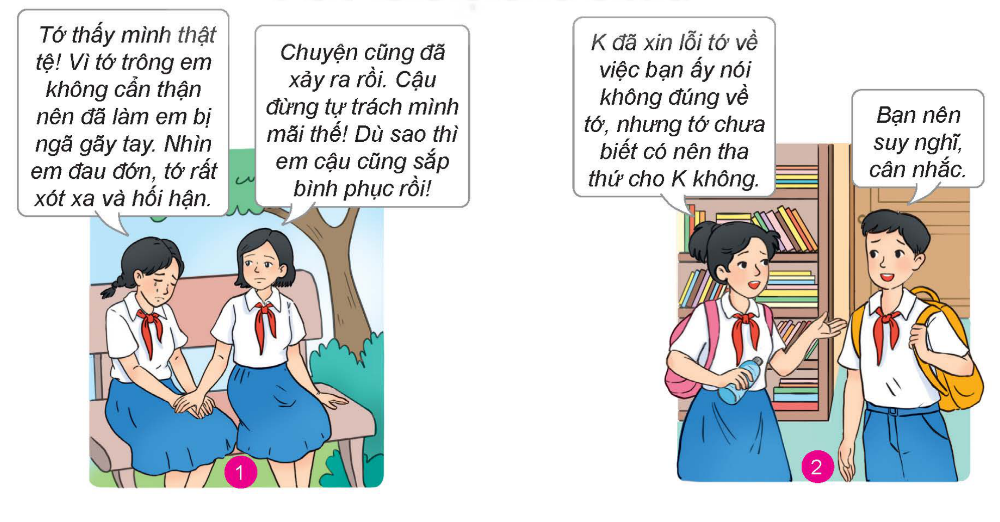

<!-- pdf:12 -->

# BÀI 2: KHOAN DUNG

## 🎯 MỤC TIÊU:

- Nêu được khái niệm khoan dung và biểu hiện của khoan dung.
- Nhận biết được giá trị của khoan dung.
- Thực hiện được những việc làm thể hiện sự khoan dung trong những tình huống cụ thể, phù hợp với lứa tuổi.
- Phê phán các biểu hiện thiếu khoan dung.

## 🔴 Mở đầu

Khoan dung là một trong những truyền thống văn hoá tốt đẹp của dân tộc Việt Nam. Truyền thống này được thể hiện qua cách ứng xử của con người trong các mối quan hệ xã hội.

Em hiểu như thế nào về lời chia sẻ sau đây của nhạc sĩ Trịnh Công Sơn?

"Giận hờn, trách móc mà làm gì bởi vì cuộc đời sẽ xoá hết những vết bầm trong tâm hồn chúng ta nếu lòng ta biết độ lượng. Ta biết tha thứ những điều nhỏ thì cuộc đời sẽ tha thứ cho ta những điều lớn hơn".

## KHÁM PHÁ

## 1. Khái niệm, biểu hiện và giá trị của khoan dung

Em hãy đọc các thông tin sau và trả lời câu hỏi:

> 1. Trải qua 10 năm (1418 – 1427), cuộc kháng chiến chống quân Minh do Bình Định vương Lê Lợi lãnh đạo đã giành thắng lợi, kết thúc bằng Hội thề Đông Quan. Tướng giặc Vương Thông cùng 10 vạn quân sĩ nhà Minh thề trước núi sông Việt Nam phải thực lòng chấm dứt chiến tranh, rút quân về nước. Căm thù quân Minh đã gây nhiều tội ác cho nhân dân, các tướng lĩnh liền cùng nhau tới khuyên vua nên giết bọn chúng. Vua trả lời rằng: “Trả thù báo oán là chuyện thường tình của mọi người, nhưng không thích giết người là bản tâm của bậc nhân đức. Vả lại, người ta đã hàng mà mình lại giết thì là điềm xấu không gì lớn bằng. Nếu cốt để hả nỗi căm giận trong chốc lát mà mang tiếng với muôn đời là giết kẻ đã hàng, thì chi bằng tha mạng sống cho ức vạn người, để dập tắt mối chiến tranh cho đời sau, sử xanh ghi chép tiếng thơm muôn đời, há chẳng lớn lao sao?”. Vua bèn hạ lệnh: “Cánh đường thuỷ, cấp 500 chiếc thuyền, cho Phương Chính, Mã Kỳ lãnh nhận. Cánh đường bộ, cấp lương thảo, cho Sơn Thọ, Hoàng Phúc lãnh nhận. Còn hơn 2 vạn người bị bắt hoặc đầu hàng và 2 vạn con ngựa thì do Mã Anh lãnh nhận... Tất cả đều tới dinh Bồ Đề lạy tạ mà về”. Bọn Phương Chính vừa xúc động vừa hổ thẹn đến rơi nước mắt.
>
> (Theo *Đại Việt sử ký toàn thư*, tập 2 (2003), NXB Văn hoá – Thông tin, trang 438, 439)

<!-- pdf:13 -->

> 2. Trong thư gửi đồng bào Nam Bộ ngày 31 – 5 – 1946, Chủ tịch Hồ Chí Minh khuyên: “Năm ngón tay cũng có ngón vắn ngón dài. Nhưng vắn dài đều họp nhau lại nơi bàn tay. Trong mấy triệu người cũng có người thế này thế khác, nhưng thế này hay thế khác đều dòng dõi của tổ tiên ta. Vậy nên ta phải khoan hồng đại độ. Ta phải nhận rằng đã là con Lạc cháu Hồng thì ai cũng có ít hay nhiều lòng ái quốc. Đối với những đồng bào lạc lối lầm đường, ta phải lấy tinh thần thân ái mà cảm hoá họ”.
>
> Trong thư gửi tù binh Pháp nhân dịp Noel ngày 24 – 12 – 1946, Người viết: “Tôi mong một ngày gần đây, hai dân tộc Pháp – Việt có thể cùng cộng tác trong vòng hoà bình và thân ái để mưu cầu hạnh phúc chung cho hai dân tộc. Trong khi chờ đợi, các bạn hãy yên lòng và sống dưới sự che chở của chúng tôi, cho đến khi hết chiến tranh, khi đó các bạn sẽ được tự do. Tôi chúc các bạn một ngày Noel vui và một năm tốt đẹp”.
>
> (Theo Hồ Chí Minh (2011), *Toàn tập*, tập 4, NXB Chính trị quốc gia, trang 280, 281, 543)

> - a) Em hãy nêu những việc làm của Bình Định vương Lê Lợi đối với quân Minh. Những việc làm đó thể hiện truyền thống nào của dân tộc Việt Nam? Nêu ý nghĩa của những việc làm đó.
> - b) Em hãy tìm những chi tiết thể hiện lòng khoan dung của Bác Hồ trong thông tin 2 và nêu ý nghĩa của lòng khoan dung đó.
> - c) Theo em, thế nào là lòng khoan dung? Hãy nêu những biểu hiện và ý nghĩa của lòng khoan dung trong cuộc sống.

## 2. Thực hiện những việc làm thể hiện sự khoan dung trong cuộc sống

Em hãy quan sát các hình ảnh, kết hợp đọc những trường hợp sau để trả lời câu hỏi:

> - **Hình 1:** *"Tớ thấy mình thật tệ! Vì tớ trông em không cẩn thận nên đã làm em bị ngã gãy tay. Nhìn em đau đớn, tớ rất xót xa và hối hận."* — *"Chuyện cũng đã xảy ra rồi. Cậu đừng tự trách mình mãi thế! Dù sao thì em cậu cũng sắp bình phục rồi!"*
> - **Hình 2:** *"K đã xin lỗi tớ về việc bạn ấy nói không đúng về tớ, nhưng tớ chưa biết có nên tha thứ cho K không."* — *"Bạn nên suy nghĩ, cân nhắc."*

<!-- pdf:14 -->

> Do gây tai nạn nghiêm trọng trong một lần ngủ gật khi đang lái xe khách, anh H phải chấp hành hình phạt tù. Sau khi chấp hành hình phạt, trở về nhà, anh thường lủi thủi một mình, không dám giao tiếp với ai vì ngại bị phân biệt, kì thị. Thấy vậy, T rất thương anh vì trước kia, anh rất vui vẻ, hoà đồng với mọi người. T bàn với các bạn trong xóm tìm cách để gần gũi, động viên, chia sẻ, giúp anh vượt qua được mặc cảm, nhanh chóng hoà nhập với cộng đồng.

> - a) Dựa vào biểu hiện của lòng khoan dung, em có nhận xét gì về lời nói, việc làm của các chủ thể trong những hình ảnh và trường hợp trên?
> - b) Em có lời khuyên gì đối với những chủ thể thiếu khoan dung trong những hình ảnh và trường hợp trên?
> - c) Theo em, để có lòng khoan dung, chúng ta cần làm gì?

## 📌 Ghi nhớ

> 1. **Khoan dung** là rộng lòng tha thứ. **Biểu hiện của khoan dung** là: tha thứ cho chính mình và người khác khi đã biết hối hận và sửa chữa lỗi lầm; lắng nghe và tôn trọng sự khác biệt của người khác, không cố chấp, hẹp hòi, định kiến.

<!-- term: Giá trị của lòng khoan dung -->
> 2. Người có lòng khoan dung sẽ được mọi người yêu mến, tin cậy. Người được tha thứ sẽ có cơ hội sửa chữa lỗi lầm để trở thành người tốt. Nhờ có lòng khoan dung, mối quan hệ giữa người với người sẽ tốt đẹp hơn.

<!-- term: Rèn luyện lòng khoan dung -->
> 3. Để trở thành người có lòng khoan dung, mỗi chúng ta đều cần sống chân thành, rộng lượng; tôn trọng và chấp nhận cá tính, sở thích, thói quen của người khác; phê phán sự ích kỉ, hẹp hòi, thiếu khoan dung, độ lượng.

## ✏️ Luyện tập

**1.** Em hãy tìm những câu ca dao, tục ngữ, thành ngữ, danh ngôn về lòng khoan dung, từ đó xác định biểu hiện, ý nghĩa và rút ra bài học về lòng khoan dung.

**2.** Em đồng tình/ không đồng tình với ý kiến nào dưới đây về lòng khoan dung? Vì sao?
- a) Khoan dung là bỏ qua mọi lỗi lầm của người khác.
- b) Không biết tha thứ cho bản thân mình là không khoan dung.
- c) Khoan dung là phải quyết liệt phê phán tất cả những người mắc sai lầm.
- d) Khoan dung là chấp nhận mọi sở thích, thói quen của người khác.

<!-- pdf:15 -->

**3.** Từ câu danh ngôn dưới đây, em hãy viết một đoạn văn về tác hại của sự thiếu khoan dung trong cuộc sống:

> Không khoan dung cũng là một hình thức bạo lực và là trở ngại cho sự phát triển của một tinh thần dân chủ thực sự.
>
> (Mahatma Gandhi)

**4.** Em hãy đọc các tình huống sau để trả lời câu hỏi:
- a) D luôn cảm thấy day dứt vì đã mắc lỗi với ông nội. Bây giờ, ông đã mất, D càng cảm thấy ân hận vì không còn cơ hội để nhận lỗi với ông nữa.
  *Nếu là bạn của D, em sẽ khuyên D điều gì?*
- b) Do không tìm hiểu kĩ, Q nói với thầy giáo rằng P làm hỏng thiết bị của phòng thí nghiệm. Bị phê bình oan, P giận và nói sẽ không bao giờ chơi với Q nữa. Cuối năm học, Q cùng gia đình chuyển tới nơi khác. Trước khi đi, Q nhắn tin muốn gặp để chào và xin lỗi P. Khi ấy, P vẫn còn giận Q nên băn khoăn không biết có nên gặp Q không.
  *Theo em, P nên làm gì?*
- c) K rủ T tham gia một nhóm bạn. Trong nhóm đó có một số người hay bình luận khiếm nhã về trang phục, hình dáng và đời tư của người khác.
  *Nếu là T, em sẽ nói gì với K?*

**5.** Em hãy nêu một số tình huống thường gặp trong cuộc sống đòi hỏi lòng khoan dung và đưa ra cách ứng xử theo bảng gợi ý sau:

| Không gian | Tình huống | Cách ứng xử |
| --- | --- | --- |
| Gia đình | ... | ... |
| Nhà trường | ... | ... |
| Xã hội | ... | ... |
<!-- ocr-ok: đối chiếu ảnh trang PDF 15 khớp nguyên văn bảng gợi ý (OCR đọc nhầm nét gạch chéo trong ô trống) -->

## 🚀 Vận dụng

1. Em hãy thiết kế một sản phẩm (bức tranh, thông điệp, tiểu phẩm, đoạn thơ,...) về vai trò của lòng khoan dung trong cuộc sống và chia sẻ ý nghĩa của sản phẩm đó.

2. Em hãy viết một bức thư gửi tới người mà em cảm thấy ân hận khi đã từng ứng xử thiếu khoan dung với họ.

## 📷 Danh sách hình trong bài

| Mã hình | Trang PDF | Vị trí trong bài | Chú thích gốc |
| --- | --- | --- | --- |
| H9-giao_duc_cong_dan-b02-01 | 13 | Khám phá, mục 2 | Các hình ảnh (1, 2) về thực hiện những việc làm thể hiện sự khoan dung trong cuộc sống |
