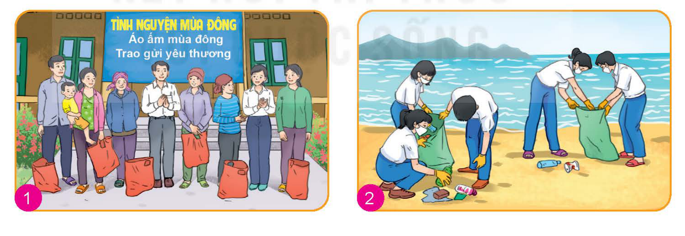
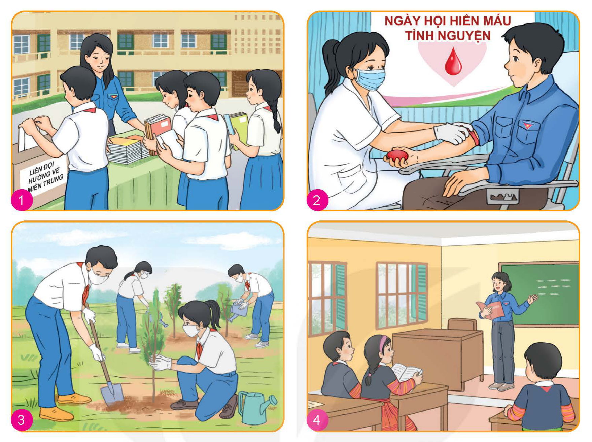

<!-- pdf:16 -->

# BÀI 3: TÍCH CỰC THAM GIA CÁC HOẠT ĐỘNG CỘNG ĐỒNG

## 🎯 MỤC TIÊU:

- Hiểu được thế nào là hoạt động cộng đồng; nêu được một số hoạt động cộng đồng.
- Giải thích được sự cần thiết phải tham gia các hoạt động cộng đồng.
- Nhận biết được trách nhiệm của học sinh trong việc tham gia vào các hoạt động cộng đồng.
- Tham gia tích cực, tự giác các hoạt động chung của cộng đồng phù hợp với lứa tuổi do lớp, trường, địa phương tổ chức.
- Phê phán biểu hiện thờ ơ, thiếu trách nhiệm với các hoạt động cộng đồng.

## 🔴 Mở đầu

Mỗi chúng ta không chỉ cần có trách nhiệm với bản thân mà còn cần có trách nhiệm với gia đình, cộng đồng. Tham gia các hoạt động cộng đồng sẽ giúp lan toả những giá trị tích cực, góp phần xây dựng, phát triển cộng đồng, bên cạnh đó còn giúp bản thân mỗi người mở rộng hiểu biết, nâng cao giá trị bản thân, giúp chúng ta sống có trách nhiệm hơn.

Em hãy quan sát các hình ảnh dưới đây và cho biết tên, ý nghĩa của những hoạt động cộng đồng được thể hiện trong các hình ảnh đó.

## KHÁM PHÁ

## 1. Hoạt động cộng đồng và sự cần thiết phải tham gia hoạt động cộng đồng

Em hãy đọc thông tin sau và trả lời câu hỏi:

> Theo Văn kiện Đại hội đại biểu toàn quốc lần thứ XII (2022 – 2027) của Đoàn Thanh niên Cộng sản Hồ Chí Minh, Thanh niên tình nguyện là phong trào

<!-- pdf:17 -->

> chủ lực của Đoàn các cấp, đã cổ vũ và phát huy tinh thần xung kích, tình nguyện của thanh niên với các hoạt động tiêu biểu như: tình nguyện chung tay xây dựng nông thôn mới; tham gia xây dựng đô thị văn minh; bảo vệ môi trường, ứng phó với biến đổi khí hậu; tham gia đảm bảo trật tự an toàn giao thông; đảm bảo an sinh xã hội;...
>
> Hoạt động tình nguyện chung tay xây dựng nông thôn mới được triển khai rộng khắp, trở thành phong trào thi đua sôi nổi, thu hút đông đảo thanh niên và người dân tham gia. Tập trung vào việc xây dựng kết cấu hạ tầng, đời sống văn hoá ở nông thôn, bài trừ các hủ tục lạc hậu, tổ chức các hoạt động văn hoá, văn nghệ, thể dục thể thao, xây dựng các sân chơi cho thiếu nhi, sửa chữa và làm đẹp các công trình, di tích lịch sử, văn hoá của địa phương; tham gia phát triển kinh tế ở nông thôn;... Trong nhiệm kì, Đoàn thanh niên cả nước đã tham gia thắp sáng hơn 5.800 km đường giao thông nông thôn, xây dựng hơn 4.100 tuyến đường nông thôn mới kiểu mẫu, làm mới hơn 7.100 km đường giao thông nông thôn và hơn 2.300 cầu nông thôn; xây dựng hơn 400 nhà văn hoá; tổ chức đồng loạt 29.433 “Ngày Chủ nhật xanh” với sự tham gia của gần 8,75 triệu lượt đoàn viên, thanh niên.
>
> Hoạt động tình nguyện đảm bảo an sinh xã hội với các việc làm như: tham gia phát triển cộng đồng, hỗ trợ trẻ em có hoàn cảnh khó khăn, người già neo đơn, thanh niên yếu thế, dễ bị tổn thương thông qua các chương trình: Nhà nhân ái; Trường đẹp cho em; Nhà bán trú cho em; Hành trình nhân ái vì sức khoẻ cộng đồng; Mang âm nhạc đến bệnh viện; Cùng sống khoẻ; Tiếp sức người bệnh; Ngày Chủ nhật đỏ;...
>
> Thông qua những hoạt động cộng đồng này, phong trào đã cổ vũ, khơi dậy tinh thần tương thân tương ái, tính xung kích, tình nguyện của thanh niên Việt Nam; là môi trường để thanh niên cống hiến, trưởng thành và phát huy trách nhiệm của tuổi trẻ với cộng đồng và xã hội, củng cố niềm tin, rèn luyện ý chí, nghị lực và xây dựng quan điểm sống tích cực cho thanh niên.

> - a) Em hãy kể tên những hoạt động cộng đồng trong thông tin trên.
> - b) Em hãy nêu mục đích, đối tượng tham gia và ý nghĩa của những hoạt động đó.
> - c) Theo em, thế nào là hoạt động cộng đồng? Em hãy nêu ý nghĩa của hoạt động cộng đồng.

<!-- pdf:18 -->

## 2. Tham gia các hoạt động cộng đồng

Em hãy quan sát các hình ảnh, kết hợp đọc những trường hợp sau để trả lời câu hỏi:

> 1. Tuy còn nhỏ tuổi nhưng B đã là thành viên của Câu lạc bộ hát quan họ của xã. Vào cuối tuần, B thường tích cực tham gia cùng các thành viên trong câu lạc bộ tập luyện và biểu diễn phục vụ bà con mỗi khi có dịp lễ hội. Không những thế, B còn động viên nhiều bạn trong xóm cùng tham gia.

> 2. Nhân ngày Thương binh – Liệt sĩ 27/7, nhà trường tổ chức hoạt động chăm sóc, thăm viếng nghĩa trang liệt sĩ của xã. Hai bạn C và H được phân công nhiệm vụ làm vệ sinh khu vực đài tưởng niệm nhưng cả hai chỉ mải nói chuyện, không hoàn thành công việc được giao.

> - a) Hoạt động nào trong các hình ảnh trên đã được trường, lớp, địa phương em tổ chức?
> - b) Em có nhận xét gì về tinh thần, thái độ của các nhân vật khi tham gia hoạt động cộng đồng trong các trường hợp trên? Hãy đưa ra lời khuyên cho những bạn chưa tích cực, tự giác khi tham gia hoạt động cộng đồng.
> - c) Em đã tham gia những hoạt động cộng đồng nào? Hãy chia sẻ những việc em đã làm khi tham gia các hoạt động đó và nêu những điều em thấy hài lòng, chưa hài lòng khi tham gia.

<!-- pdf:19 -->

## 📌 Ghi nhớ

> 1. **Hoạt động cộng đồng** là những hoạt động được tổ chức bởi các cá nhân, tập thể nhằm mang lại lợi ích chung cho cộng đồng.

> 2. Một số hoạt động cộng đồng tiêu biểu như: thiện nguyện, nhân đạo; đền ơn đáp nghĩa; bảo vệ môi trường, cảnh quan; phòng, chống tệ nạn xã hội; gìn giữ và phát huy truyền thống văn hoá dân tộc;...

<!-- term: Ý nghĩa của việc tham gia các hoạt động cộng đồng -->
> 3. Ý nghĩa của việc tham gia các hoạt động cộng đồng:
> - **Đối với cá nhân:** giúp mở rộng tầm hiểu biết, rèn luyện kĩ năng; có tinh thần trách nhiệm đóng góp công sức và trí tuệ của mình vào công việc chung của tập thể, xã hội; nâng cao giá trị của bản thân và được mọi người yêu mến;...
> - **Đối với cộng đồng:** phát huy sức mạnh của các lực lượng xã hội; tạo ra sự kết nối các thành viên trong cộng đồng; xây dựng mối quan hệ đoàn kết, nhân ái, lan toả những giá trị tích cực; góp phần xây dựng đất nước văn minh, giàu mạnh.

<!-- term: Trách nhiệm của học sinh trong việc tham gia các hoạt động cộng đồng -->
> 4. Học sinh cần chủ động, tích cực tham gia các hoạt động cộng đồng do nhà trường, địa phương tổ chức; tích cực vận động người thân, bạn bè cùng tham gia; phê phán những biểu hiện thờ ơ, thiếu trách nhiệm với các hoạt động cộng đồng.

## ✏️ Luyện tập

**1.** Em đồng tình/ không đồng tình với ý kiến nào dưới đây? Vì sao?
- a) Khi có nhiều cá nhân tham gia vào một hoạt động chung thì đó là hoạt động cộng đồng.
- b) Tích cực tham gia hoạt động cộng đồng giúp mỗi cá nhân hoàn thiện bản thân và lan toả các giá trị tốt đẹp.
- c) Chỉ những cá nhân có điều kiện kinh tế mới tham gia được hoạt động cộng đồng.
- d) Học sinh không chỉ tích cực tham gia hoạt động cộng đồng mà còn cần động viên người thân, bạn bè cùng tham gia.

**2.** Em hãy nêu ý nghĩa của các hoạt động cộng đồng trong những trường hợp dưới đây:
- a) Anh S và các đồng nghiệp trong văn phòng luật sư đã tích cực tham gia các hoạt động trợ giúp pháp lí cho những người nghèo, người yếu thế ở địa phương.
- b) Anh H cùng đoàn y, bác sĩ của Trung tâm Y tế huyện tổ chức chương trình khám chữa bệnh nhân đạo, cấp thuốc miễn phí cho bà con dân tộc thiểu số, người dân tại các địa bàn vùng sâu, vùng xa, vùng biên giới đặc biệt khó khăn.

<!-- pdf:20 -->

- c) Vào thời gian nghỉ hè, chị B thường cùng các bạn trong Đoàn Thanh niên tham gia Đội tuyên truyền phòng, chống tệ nạn xã hội ở địa phương.
- d) Câu lạc bộ Bảo vệ hành tinh xanh thực hiện dự án thu gom pin đã qua sử dụng để mang tới nơi xử lí an toàn.

**3.** Em hãy đọc trường hợp sau và trả lời câu hỏi:

Chủ nhật, T cùng bố mẹ tham gia nhóm từ thiện do Hội Chữ thập đỏ xã tổ chức, nấu những nồi cháo để tặng những bệnh nhân nghèo đang điều trị tại các bệnh viện đóng trên địa bàn. Mẹ nhắc em gái T (đang học lớp 7) cùng tham gia nhưng em từ chối vì muốn được nghỉ ngơi, vui chơi sau một tuần học tập.

*Em có nhận xét gì về thái độ của em gái T? Hãy đưa ra lời khuyên cho em gái T.*

**4.** Em hãy cùng nhóm bạn xây dựng kế hoạch thực hiện một hoạt động cộng đồng theo gợi ý dưới đây:

> **KẾ HOẠCH**
> Tên hoạt động: ...
> 1. Mục đích của hoạt động: ...
> 2. Những việc cần làm:
> - Nhiệm vụ 1: ...
> - Nhiệm vụ 2: ...
> 3. Thời gian, địa điểm: ...
> 4. Cách thức thực hiện: ...
> 5. Người phối hợp thực hiện: ...

## 🚀 Vận dụng

1. Em hãy cùng các bạn trong nhóm thực hiện kế hoạch tham gia hoạt động cộng đồng đã được xây dựng trong hoạt động luyện tập và báo cáo kết quả thực hiện (thông qua bài thu hoạch, clip, tranh ảnh,...).

2. Em hãy cùng các bạn trong nhóm viết bài tuyên truyền về chương trình “Giờ Trái Đất” để vận động mọi người cùng tham gia hưởng ứng.

## 📷 Danh sách hình trong bài

| Mã hình | Trang PDF | Vị trí trong bài | Chú thích gốc |
| --- | --- | --- | --- |
| H9-giao_duc_cong_dan-b03-01 | 16 | Mở đầu | Các hình ảnh (1, 2) về hoạt động cộng đồng (Tình nguyện mùa đông; dọn rác bảo vệ môi trường biển) |
| H9-giao_duc_cong_dan-b03-02 | 18 | Khám phá, mục 2 | Các hình ảnh (1, 2, 3, 4) về tham gia các hoạt động cộng đồng |
