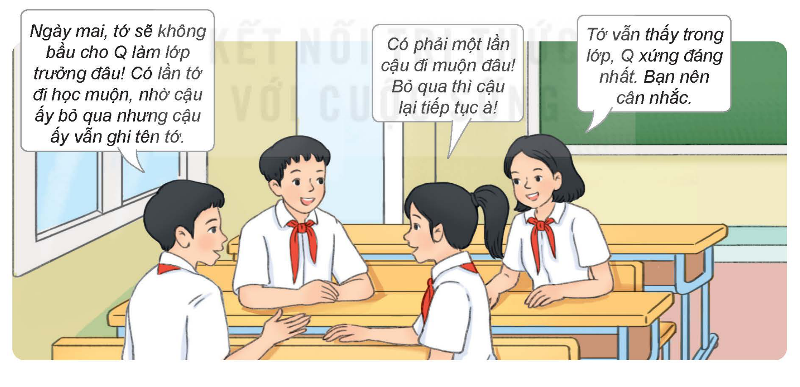

<!-- pdf:21 -->

# BÀI 4: KHÁCH QUAN VÀ CÔNG BẰNG

## 🎯 MỤC TIÊU:

- Nhận biết được những biểu hiện khách quan, công bằng.
- Hiểu được ý nghĩa của khách quan, công bằng; tác hại của sự thiếu khách quan, công bằng.
- Thể hiện được thái độ khách quan, công bằng trong cuộc sống hằng ngày.
- Phê phán những biểu hiện không khách quan, công bằng.

## 🔴 Mở đầu

Trong xã hội, mỗi cá nhân, mỗi nhóm người có những nhu cầu và lợi ích khác nhau. Để đảm bảo lợi ích chính đáng cho mỗi cá nhân và giải quyết hài hoà các mối quan hệ, góp phần xây dựng xã hội văn minh, tiến bộ, chúng ta cần phải có sự khách quan, công bằng trong đánh giá và ứng xử.

Em hãy kể về một trường hợp thể hiện sự khách quan, công bằng trong cuộc sống mà em được chứng kiến.

## KHÁM PHÁ

## 1. Khách quan và biểu hiện của khách quan

Em hãy đọc thông tin sau và trả lời câu hỏi:

> **Khách quan** là nhìn nhận sự vật, sự việc, con người một cách thực tế, chính xác, không thiên vị hay thành kiến mà phải dựa trên chứng cứ và dữ liệu xác đáng. Ngành kiểm sát với những công việc liên quan trực tiếp đến sinh mệnh, tự do, danh dự nhân phẩm của con người, càng cần đảm bảo tính khách quan. Chủ tịch Hồ Chí Minh căn dặn: “Cán bộ kiểm sát phải công minh, chính trực, khách quan, thận trọng, khiêm tốn”, trong đó, tính khách quan là một yêu cầu quan trọng, được cụ thể hoá trong Quyết định số 21/QĐ-VKSTC năm 2023 về Quy tắc chuẩn mực đạo đức nghề nghiệp của người cán bộ kiểm sát: "Tính khách quan là phương pháp làm việc của người cán bộ kiểm sát; theo đó, cán bộ kiểm sát đáp ứng các yêu cầu: (1) Phải chí công vô tư, luôn tôn trọng sự thật khách quan; giải quyết công việc theo đúng pháp luật và quy định của Ngành; không vì lợi ích cá nhân, lợi ích nhóm, không thiên vị hoặc áp đặt định kiến cá nhân chủ quan bất cứ bên nào trong giải quyết

<!-- pdf:22 -->

> vụ án, vụ việc. (2) Không can thiệp trái pháp luật vào hoạt động thực thi công vụ của các cá nhân, cơ quan, đơn vị trong và ngoài ngành kiểm sát...". Làm tốt điều này sẽ giảm bớt được oan sai, xét xử đúng người, đúng tội, củng cố niềm tin trong nhân dân, làm cho bộ máy nhà nước thực sự có hiệu lực, sức mạnh. Khách quan không chỉ quan trọng với người cán bộ kiểm sát mà với mọi người, mọi ngành nghề trong xã hội, giúp chúng ta có cái nhìn đúng đắn và xây dựng mối quan hệ tốt đẹp với mọi người.

> - a) Để thực hiện được tính khách quan, người cán bộ kiểm sát phải làm gì? Điều gì sẽ xảy ra nếu họ thiếu khách quan trong công việc?
> - b) Qua thông tin trên, em hãy chỉ ra các biểu hiện và ý nghĩa của khách quan.
> - c) Theo em, nhận thức và hành vi thiếu khách quan sẽ có tác hại gì?

## 2. Công bằng và biểu hiện của công bằng

Em hãy đọc thông tin và trường hợp sau để trả lời câu hỏi:

> 1. Công bằng vừa là mục tiêu vừa là động lực phát triển của xã hội Việt Nam. **Công bằng** được hiểu là *sự bình đẳng về quyền lợi và nghĩa vụ của con người trước pháp luật. Cốt lõi của công bằng là công bằng về cơ hội phát triển, nghĩa là tạo cơ hội như nhau cho mọi người, có tính đến yếu tố khác biệt*, người yếu thế hơn sẽ được tạo điều kiện tốt hơn để có cơ hội như người mạnh hơn. Đại hội XIII của Đảng nhấn mạnh: “Phát triển vì con người, tạo điều kiện cho mọi người, nhất là trẻ em, nhóm yếu thế, đồng bào dân tộc thiểu số, người di cư hoà nhập, tiếp cận bình đẳng nguồn lực, cơ hội phát triển và hưởng thụ công bằng các dịch vụ xã hội cơ bản. Tiếp tục hoàn thiện và thực hiện các chính sách dân tộc bình đẳng, đoàn kết, cùng phát triển”.
>
> (Theo Đảng Cộng sản Việt Nam (2021), *Văn kiện Đại hội đại biểu toàn quốc lần thứ XIII*, tập 1, NXB Chính trị Quốc gia Sự thật, trang 264)

> 2. H sinh ra và lớn lên ở một vùng cao hẻo lánh. Học hết Tiểu học, H định nghỉ học vì điểm trường Trung học cơ sở cách rất xa nhà em. Nếu muốn đi học, H phải dậy từ 4 giờ sáng để kịp vào học lúc 7 giờ. Nhưng may mắn, H trúng tuyển vào học ở trường phổ thông dân tộc nội trú tỉnh, được hưởng những chính sách ưu đãi của Nhà nước dành cho học sinh dân tộc thiểu số. Nhờ vậy, H đã thực hiện được mong muốn tiếp tục học tập của mình.

<!-- pdf:23 -->

> 3. Phòng khám Bệnh viện D thường rất đông nên cô C phải đi sớm xếp hàng chờ đến lượt được khám bệnh, trong khi anh Y là người cùng phố với cô vừa đến nơi đã được mời vào khám trước do có người quen là nhân viên làm việc ở đây.

> - a) Em hãy chỉ ra những biểu hiện của công bằng/ thiếu công bằng trong các thông tin, trường hợp trên.
> - b) Em hãy nêu ý nghĩa của công bằng, tác hại của sự thiếu công bằng trong cuộc sống.

## 3. Rèn luyện thái độ khách quan, công bằng

Em hãy đọc trường hợp, kết hợp quan sát hình ảnh sau để trả lời câu hỏi:

> Một nhóm sinh viên đại học về trường của K để khảo sát hứng thú học tập của học sinh. K nhận hai phiếu và viết luôn cho G. Thấy vậy, B hỏi: “Hứng thú học tập của G có giống cậu đâu mà cậu lại viết giúp G vậy?”. K cười đáp: “Chúng mình đều là học sinh, học chung lớp, chung trường, nên sẽ có hứng thú giống nhau!”.

> - *"Ngày mai, tớ sẽ không bầu cho Q làm lớp trưởng đâu! Có lần tớ đi học muộn, nhờ cậu ấy bỏ qua nhưng cậu ấy vẫn ghi tên tớ."*
> - *"Có phải một lần cậu đi muộn đâu! Bỏ qua thì cậu lại tiếp tục à!"*
> - *"Tớ vẫn thấy trong lớp, Q xứng đáng nhất. Bạn nên cân nhắc."*
<!-- ocr-ok: đối chiếu ảnh trang PDF 23 khớp nguyên văn lời thoại trong tranh minh hoạ -->

> - a) Em có nhận xét gì về lời nói và hành động của các nhân vật trong những trường hợp trên?
> - b) Nếu ở trong các trường hợp đó, em sẽ làm gì?

<!-- pdf:24 -->

## 📌 Ghi nhớ

> 1. **Biểu hiện của khách quan** là nhìn nhận sự vật, hiện tượng chính xác, trung thực, không định kiến, thiên vị.

<!-- term: Vai trò của khách quan -->
> Khách quan có vai trò giúp chúng ta nhìn nhận, đánh giá đúng bản chất của sự vật, sự việc, con người, từ đó có các quyết định chính xác trong công việc và cách ứng xử văn hoá trong các mối quan hệ. Trái lại, thiếu khách quan sẽ dẫn tới những sai lầm trong công việc và ứng xử, ảnh hưởng tiêu cực tới các mối quan hệ.

> 2. **Biểu hiện của công bằng** là đối xử bình đẳng, không thiên vị, không phân biệt đối xử.

<!-- term: Vai trò của công bằng -->
> Công bằng có vai trò quan trọng trong việc bảo vệ quyền lợi chính đáng của mỗi cá nhân, giúp con người có cơ hội phát triển bình đẳng với nhau, giúp họ cảm thấy được tôn trọng, tự tin hơn trong cuộc sống. Công bằng cũng góp phần xây dựng xã hội bình đẳng, dân chủ, văn minh. Trái lại, thiếu công bằng sẽ dẫn tới bất công, bất bình đẳng, mâu thuẫn, xung đột trong các mối quan hệ.

> 3. Mỗi người đều cần rèn luyện thái độ nhìn nhận, đánh giá sự vật, hiện tượng khách quan, tôn trọng, bảo vệ lẽ phải; không định kiến, thiên vị trong việc đánh giá hành vi, việc làm của bản thân và những người xung quanh; phê phán các biểu hiện thiếu khách quan, công bằng.

## ✏️ Luyện tập

**1.** Trong các câu ca dao, tục ngữ, thành ngữ dưới đây, câu nào nói về sự khách quan, công bằng? Câu nào nói về sự thiếu khách quan, công bằng? Vì sao?
- a) Nói có sách, mách có chứng.
- b) Yêu nhau củ ấu cũng tròn / Ghét nhau thì quả bồ hòn cũng vuông.
- c) Nhất bên trọng nhất bên khinh.
- d) Quân pháp bất vị thân.
- e) Ăn cho đều, kêu cho sòng.
- g) Công ai nấy nhớ, tội ai nấy chịu.

**2.** Trường hợp nào dưới đây thể hiện/ không thể hiện sự khách quan, công bằng? Vì sao?
- a) Vì thấy đa số các bạn ủng hộ ý kiến của T nên M cũng ủng hộ mặc dù biết rằng đó là ý kiến sai.

<!-- pdf:25 -->

- b) Mặc dù ông B hàng xóm là ân nhân của gia đình V nhưng bố mẹ V vẫn không ủng hộ một số việc làm vi phạm pháp luật của ông.
- c) Trong gia đình G, chỉ có mẹ và chị gái G làm công việc nội trợ.
- d) P và M chơi thân với nhau. Trong buổi lao động trồng cây ở vườn trường, P đã cố ý phân công cho M công việc nhẹ nhàng.
- e) Chị gái của H được cộng điểm ưu tiên vào đại học vì là người dân tộc thiểu số.
- g) Mặc dù có sự chênh lệch về nội dung và hình thức giữa tập san của các tổ, K vẫn cho điểm bằng nhau vì không muốn làm mất lòng các bạn ở tổ có tập san kém hơn.

**3.** Từ quan niệm “Không có sự khách quan và công bằng, không thể có niềm tin và sự đồng lòng của mọi người”, em hãy viết một đoạn văn và thuyết trình trước lớp về ý nghĩa của sự khách quan, công bằng và tác hại của sự thiếu khách quan, công bằng.

**4.** Em hãy đọc các tình huống sau và trả lời câu hỏi:
- a) H được làm trọng tài trong trận bóng đá giữa hai lớp 9A và 9B. Vì chơi thân với đội trưởng của đội bóng lớp 9A nên H bỏ qua lỗi việt vị của đội này, dẫn tới bàn thua cho đội bóng lớp 9B. Thấy thế, một số bạn của đội bóng lớp 9B đã rời sân khi trận đấu chưa kết thúc.
  *Em có nhận xét gì về việc làm của bạn H? Theo em, bạn H cần làm gì để đảm bảo tính khách quan, công bằng?*
- b) Làm việc trong một phân xưởng sản xuất cơ khí gia công tư nhân, anh C thắc mắc: các lao động trong xưởng có thời gian lao động và độ vất vả như nhau nhưng mức thu nhập lại khác nhau và cho rằng như vậy là không công bằng.
  *Bằng hiểu biết về công bằng xã hội, em hãy giải đáp thắc mắc cho anh C.*

**5.** Em hãy kể về một số biểu hiện thiếu khách quan, công bằng trong cuộc sống và đề xuất cách khắc phục phù hợp.

## 🚀 Vận dụng

1. Em hãy sưu tầm câu chuyện về sự khách quan, công bằng và rút ra bài học cho bản thân.

2. Em hãy cùng nhóm bạn thiết kế một áp phích tuyên truyền về vai trò của sự công bằng trong xã hội.

## 📷 Danh sách hình trong bài

| Mã hình | Trang PDF | Vị trí trong bài | Chú thích gốc |
| --- | --- | --- | --- |
| H9-giao_duc_cong_dan-b04-01 | 23 | Khám phá, mục 3 | Tình huống thảo luận bầu lớp trưởng về thái độ khách quan, công bằng |
