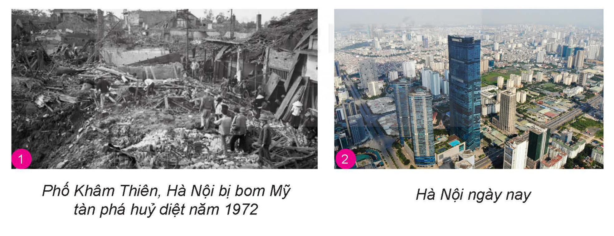
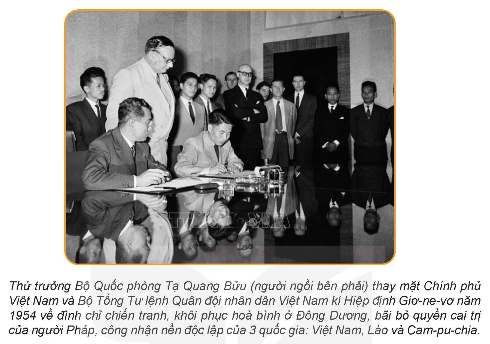
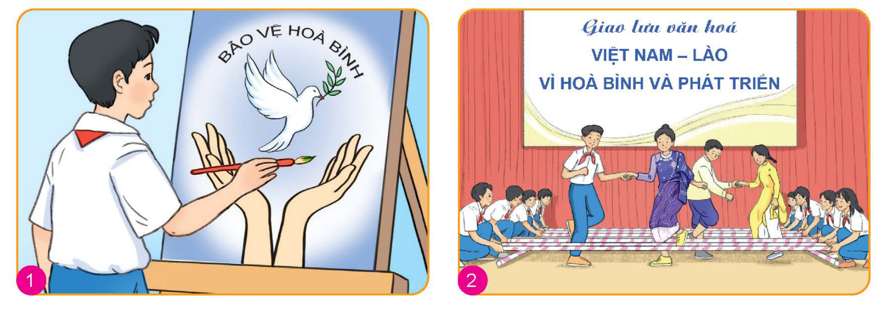
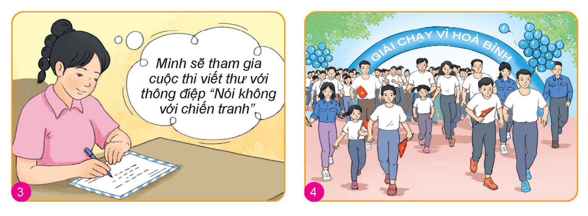

<!-- pdf:26 -->

# BÀI 5: BẢO VỆ HOÀ BÌNH

## 🎯 MỤC TIÊU:

- Nêu được thế nào là hoà bình và bảo vệ hoà bình; các biểu hiện của hoà bình.
- Giải thích được vì sao cần phải bảo vệ hoà bình.
- Nhận ra được những biện pháp để thúc đẩy và bảo vệ hoà bình.
- Biết lựa chọn và tham gia những hoạt động phù hợp để bảo vệ hoà bình.
- Phê phán xung đột sắc tộc và chiến tranh phi nghĩa.

## 🔴 Mở đầu

Thế giới đã phải trải qua nhiều cuộc chiến tranh tàn khốc, đau thương. Vì vậy, được sống trong hoà bình là khát vọng của toàn nhân loại. Để giữ gìn cuộc sống bình yên và xây dựng xã hội văn minh, giàu đẹp, mỗi chúng ta cần tích cực đấu tranh bảo vệ hoà bình.

Em hãy đọc đoạn trích lời bài hát “Chúng em cần hoà bình” (sáng tác: Hoàng Long – Hoàng Lân) và chia sẻ suy nghĩ của em về cuộc sống hoà bình.

> “Để loài người chung sống trong hoà bình
> Để đàn em được vui ca học hành
> Để ngàn cây lá hoa vươn mầm xanh
> Bạn bè sống với nhau trong tình yêu thương
> Chúng em cần bầu trời hoà bình
> Chúng em cần bầu trời hoà bình
> Trên Trái Đất không còn chiến tranh
> Đấu tranh vì một nền hoà bình
> Đấu tranh vì một nền hoà bình
> Không còn tiếng súng tiếng bom trên hành tinh...”
<!-- ocr-ok: đối chiếu ảnh trang PDF 26 khớp nguyên văn lời bài hát in phông trang trí -->

## KHÁM PHÁ

## 1. Hoà bình và các biểu hiện của hoà bình

Em hãy đọc thông tin, kết hợp quan sát các hình ảnh sau để trả lời câu hỏi:

> Trong cuộc chiến tranh xâm lược Việt Nam, đế quốc Mỹ đã giội hàng triệu tấn bom đạn xuống làng mạc, trường học, bệnh viện,... gây biết bao đau thương tang tóc trên khắp đất nước ta, trong đó có cuộc tập kích chiến lược

<!-- pdf:27 -->

> 12 ngày đêm bằng không quân với quy mô lớn chưa từng có trong lịch sử chiến tranh vào Thủ đô Hà Nội và thành phố cảng Hải Phòng, từ ngày 18 đến 29 tháng 12 năm 1972.
>
> Riêng tại khu vực Hà Nội, Mỹ đã sử dụng 444 lần chiếc máy bay chiến lược B52, hơn 1.000 lần chiếc máy bay chiến thuật chiến đấu với số lượng bom đạn là 4 vạn tấn. Nhờ chuẩn bị tốt cả về tư tưởng và tổ chức, lực lượng và phương tiện, quân dân Hà Nội đã đánh bại hoàn toàn cuộc tập kích của đế quốc Mỹ. Ngày 27 – 1 – 1973, Hiệp định Paris về chấm dứt chiến tranh lập lại hoà bình ở Việt Nam được kí kết. Sau Hiệp định, nhân dân Hà Nội đã tranh thủ điều kiện hoà bình để hàn gắn vết thương chiến tranh, đẩy mạnh sản xuất, khôi phục và phát triển kinh tế, văn hoá, ổn định đời sống, cùng nhân dân miền Bắc làm hậu phương lớn, góp phần chi viện cho tiền tuyến, giải phóng miền Nam, thống nhất đất nước.
>
> Ngày nay, Hà Nội đang từng bước đổi mới, phát triển, đạt được nhiều thành tựu to lớn trên tất cả các lĩnh vực, đời sống của nhân dân ngày càng ấm no, hạnh phúc. Hà Nội thực sự đã trở thành trung tâm kinh tế, chính trị và văn hoá của cả nước. Ngày 16 – 7 – 1999, Hà Nội được UNESCO vinh danh là “Thành phố vì hoà bình”. Đây là sự ghi nhận của cộng đồng quốc tế về những thành tựu trong quá trình đổi mới cũng như khát vọng hoà bình của người dân Việt Nam.
>
> (Theo Lê Mậu Hãn (Chủ biên) (2001), *Đại cương lịch sử Việt Nam*, tập III, NXB Giáo dục, trang 243, 244, 248)

*1. Phố Khâm Thiên, Hà Nội bị bom Mỹ tàn phá huỷ diệt năm 1972 — 2. Hà Nội ngày nay*

> - a) Từ thông tin và các hình ảnh trên, em hãy cho biết cuộc chiến tranh xâm lược của đế quốc Mỹ đã gây ra hậu quả gì với Thủ đô Hà Nội? Cuộc sống của người dân và sự phát triển của Hà Nội trong chiến tranh và trong hoà bình có sự khác nhau như thế nào?
> - b) Theo em, hoà bình là gì? Hãy nêu các biểu hiện của hoà bình.

<!-- pdf:28 -->

## 2. Bảo vệ hoà bình và các biện pháp bảo vệ hoà bình

Em hãy đọc các thông tin sau và trả lời câu hỏi:

> 1. Trong lịch sử nhân loại, đã có nhiều cuộc chiến tranh xâm lược huỷ diệt và tàn phá sự sống của loài người như Chiến tranh thế giới thứ nhất (1914 – 1918) và Chiến tranh thế giới hai (1939 – 1945). Riêng Chiến tranh thế giới thứ hai, đã khiến cho 76 nước bị đưa vào vòng chiến, khoảng 60 triệu người chết, 90 triệu người bị tàn phế, thiệt hại về vật chất ước tính khoảng 4.000 tỉ đô la (tính theo giá đương thời). Nền văn minh vật chất và tinh thần của nhân loại bị tàn phá nặng nề.
>
> Ngày nay, hoà bình, hợp tác phát triển là xu thế lớn song các điểm nóng cạnh tranh, xung đột vẫn rất phức tạp, đặc biệt là xung đột sắc tộc, tôn giáo trở thành nhân tố gây mất ổn định ở một số vùng, lãnh thổ,... khiến cho dân thường vô tội nơi đây phải sống trong tình trạng căng thẳng, lo âu và sợ hãi.
>
> (Theo Phan Ngọc Liên (Chủ biên) (2016), *Lịch sử thế giới cận đại*, tập II, NXB Đại học Sư phạm, trang 72)

> 2. Mọi dân tộc, quốc gia trên thế giới đều có quyền và nghĩa vụ bảo vệ, gìn giữ hoà bình, giải quyết các cuộc xung đột quốc tế bằng biện pháp hoà bình, tránh sử dụng vũ lực, ngăn chặn, xoá bỏ những mối đe doạ chiến tranh.
>
> Là một quốc gia đã trải qua nhiều cuộc chiến tranh nên hoà bình luôn là mong ước, khát vọng ngàn đời của dân tộc Việt Nam. Bảo vệ Tổ quốc, gìn giữ hoà bình luôn được xác định là nhiệm vụ quan trọng hàng đầu. Văn kiện Đại hội Đảng toàn quốc lần thứ XIII đã xác định rõ mục tiêu xây dựng và bảo vệ vững chắc Tổ quốc, giữ vững môi trường hoà bình, ổn định; Xác định nhiệm vụ chủ động ngăn ngừa các nguy cơ chiến tranh, xung đột từ sớm, từ xa; Kiên quyết, kiên trì bảo vệ vững chắc độc lập, chủ quyền, thống nhất, toàn vẹn lãnh thổ, bảo đảm an ninh quốc gia, trật tự an toàn xã hội; Tiếp tục xây dựng quân đội nhân dân – công an nhân dân cách mạng, chính quy, tinh nhuệ, từng bước hiện đại. Xây dựng thế trận quốc phòng toàn dân và an ninh nhân dân vững chắc là nền tảng cho sự nghiệp bảo vệ Tổ quốc.
>
> (Theo Đảng Cộng sản Việt Nam (2021), *Văn kiện Đại hội đại biểu toàn quốc lần thứ XIII*, tập 1, NXB Chính trị Quốc gia Sự thật, trang 35, 48, 49, 50)

<!-- pdf:29 -->

*Thứ trưởng Bộ Quốc phòng Tạ Quang Bửu (người ngồi bên phải) thay mặt Chính phủ Việt Nam và Bộ Tổng Tư lệnh Quân đội nhân dân Việt Nam kí Hiệp định Giơ-ne-vơ năm 1954 về đình chỉ chiến tranh, khôi phục hoà bình ở Đông Dương, bãi bỏ quyền cai trị của người Pháp, công nhận nền độc lập của 3 quốc gia: Việt Nam, Lào và Cam-pu-chia.*

> - a) Từ các thông tin và hình ảnh trên, em hãy giải thích vì sao cần phải bảo vệ hoà bình và cho biết các biện pháp góp phần thúc đẩy và bảo vệ hoà bình.
> - b) Từ thực tiễn cuộc sống, em hãy lấy ví dụ về xung đột sắc tộc, chiến tranh phi nghĩa trên thế giới và bày tỏ quan điểm của mình về những sự kiện đó.
> - c) Theo em, bảo vệ hoà bình là gì? Hãy kể thêm những biện pháp thúc đẩy và bảo vệ hoà bình mà em biết.

## 📌 Ghi nhớ

> 1. **Hoà bình** là tình trạng không có chiến tranh hay xung đột vũ trang; con người được sống trong một môi trường xã hội an toàn, hạnh phúc.

> **Biểu hiện của hoà bình** là cuộc sống bình yên, con người được học tập, lao động, phát triển, chung sống hoà thuận cùng nhau; các quốc gia tôn trọng, hợp tác cùng phát triển.

> 2. **Bảo vệ hoà bình** là giữ gìn cuộc sống bình yên; dùng thương lượng, đàm phán giải quyết mọi mâu thuẫn, xung đột giữa các dân tộc, tôn giáo và quốc gia, không để xảy ra chiến tranh hay xung đột vũ trang.

<!-- term: Ý nghĩa của việc bảo vệ hoà bình -->
> Hoà bình mang lại cuộc sống ấm no, hạnh phúc và bình yên cho mỗi người, mỗi gia đình và xã hội; Bảo vệ hoà bình để ngăn chặn chiến tranh, nhằm phát triển kinh tế – xã hội; thúc đẩy và xây dựng các mối quan hệ bình đẳng, hữu nghị, hợp tác giữa các quốc gia, dân tộc.

<!-- pdf:30 -->

<!-- term: Biện pháp bảo vệ hoà bình -->
> 3. Biện pháp bảo vệ hoà bình:
> - Chủ động giải quyết mâu thuẫn bằng biện pháp hoà bình qua thương lượng, đàm phán.
> - Giải quyết mâu thuẫn khi xảy ra xung đột, mâu thuẫn căn cứ theo pháp luật quốc tế, dựa trên công lí và chính nghĩa, không thoả hiệp vô nguyên tắc với tội ác và bất công xã hội.

> 4. Học sinh cần học điều hay, lẽ phải; học cách sống hài hoà, văn minh; biết giải quyết các mâu thuẫn bằng hoà giải; chủ động can ngăn các bất đồng; hưởng ứng các phong trào về hoà bình mà trường, lớp tổ chức; biết tôn trọng và không phân biệt kì thị văn hoá, dân tộc, sắc tộc; lên án chiến tranh phi nghĩa.

## ✏️ Luyện tập

**1.** Em đồng tình/ không đồng tình với ý kiến nào sau đây? Vì sao?
- a) Hoà bình là khát vọng của những nước đang có chiến tranh.
- b) Hoà bình, hợp tác, liên kết và phát triển vẫn là xu thế tất yếu của thời đại.
- c) Mỗi quốc gia có ý thức xây dựng mối quan hệ tôn trọng, bình đẳng, thân thiện sẽ góp phần bảo vệ hoà bình.
- d) Bảo vệ hoà bình là trách nhiệm của những nước có tiềm năng quân sự.

**2.** Em hãy quan sát các hình ảnh sau và trả lời câu hỏi:

<!-- pdf:31 -->

- *Em có nhận xét gì về hành động góp phần bảo vệ hoà bình của các bạn trong những hình ảnh trên?*
- *Hãy kể về một số việc em đã làm để góp phần bảo vệ hoà bình. Cảm xúc của em khi đó như thế nào?*

**3.** Em hãy kể tên một địa điểm trên thế giới đã từng xảy ra chiến tranh, khủng bố hoặc xung đột vũ trang gần đây và cho biết nguyên nhân, hậu quả của cuộc chiến tranh, khủng bố hoặc xung đột vũ trang đó.

Theo em, mỗi cá nhân, tổ chức cần làm gì để phòng chống chiến tranh, khủng bố và xung đột vũ trang?

**4.** Em hãy sưu tầm một số câu nói mang tính chất tuyên ngôn về hoà bình và bảo vệ hoà bình của một số nguyên thủ quốc gia và cho biết ý nghĩa của các câu nói đó.

## 🚀 Vận dụng

1. Em hãy sưu tầm hình ảnh về hoạt động bảo vệ hoà bình, chống chiến tranh của nhân dân Việt Nam và các nước trên thế giới và viết lời bình cho hoạt động đó.

2. Em hãy viết đoạn văn bày tỏ quan điểm về câu nói sau:

> Hoà bình là đức hạnh của nhân loại.
> Chiến tranh là tội ác.
>
> (Victor Hugo)
<!-- ocr-ok: đối chiếu ảnh trang PDF 31 khớp nguyên văn câu nói của Victor Hugo in phông trang trí -->

## 📷 Danh sách hình trong bài

| Mã hình | Trang PDF | Vị trí trong bài | Chú thích gốc |
| --- | --- | --- | --- |
| H9-giao_duc_cong_dan-b05-01 | 27 | Khám phá, mục 1 | 1. Phố Khâm Thiên, Hà Nội bị bom Mỹ tàn phá huỷ diệt năm 1972; 2. Hà Nội ngày nay |
| H9-giao_duc_cong_dan-b05-02 | 29 | Khám phá, mục 2 | Thứ trưởng Bộ Quốc phòng Tạ Quang Bửu (người ngồi bên phải) thay mặt Chính phủ Việt Nam và Bộ Tổng Tư lệnh Quân đội nhân dân Việt Nam kí Hiệp định Giơ-ne-vơ năm 1954 về đình chỉ chiến tranh, khôi phục hoà bình ở Đông Dương, bãi bỏ quyền cai trị của người Pháp, công nhận nền độc lập của 3 quốc gia: Việt Nam, Lào và Cam-pu-chia. |
| H9-giao_duc_cong_dan-b05-03 | 30 | Luyện tập, bài 2 | Hình ảnh (1, 2) hoạt động vẽ tranh bảo vệ hoà bình và giao lưu văn hoá Việt Nam – Lào vì hoà bình và phát triển |
| H9-giao_duc_cong_dan-b05-04 | 31 | Luyện tập, bài 2 | Hình ảnh (3, 4) tham gia cuộc thi viết thư “Nói không với chiến tranh” và giải chạy vì hoà bình |
