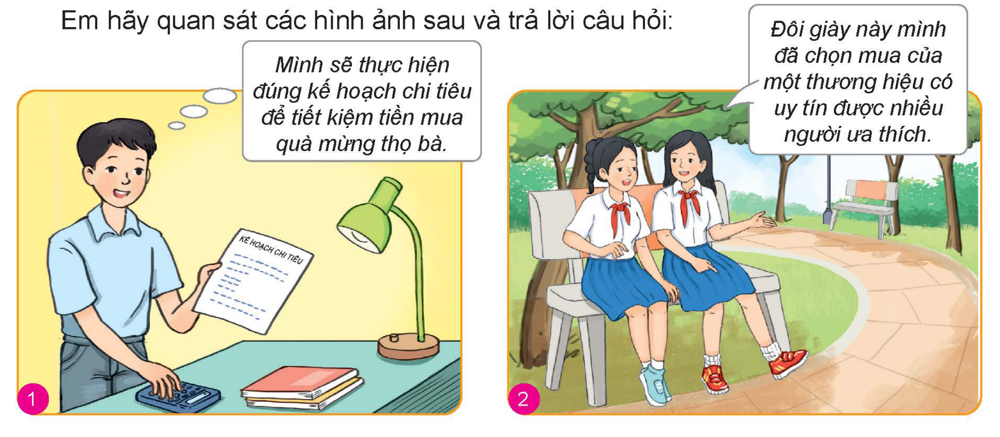
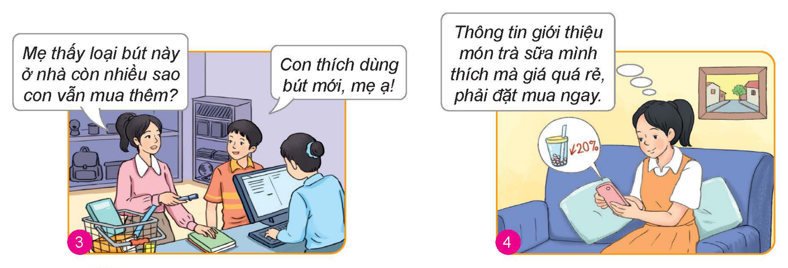
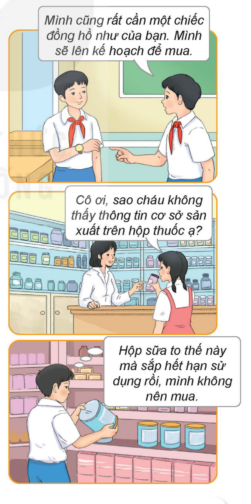
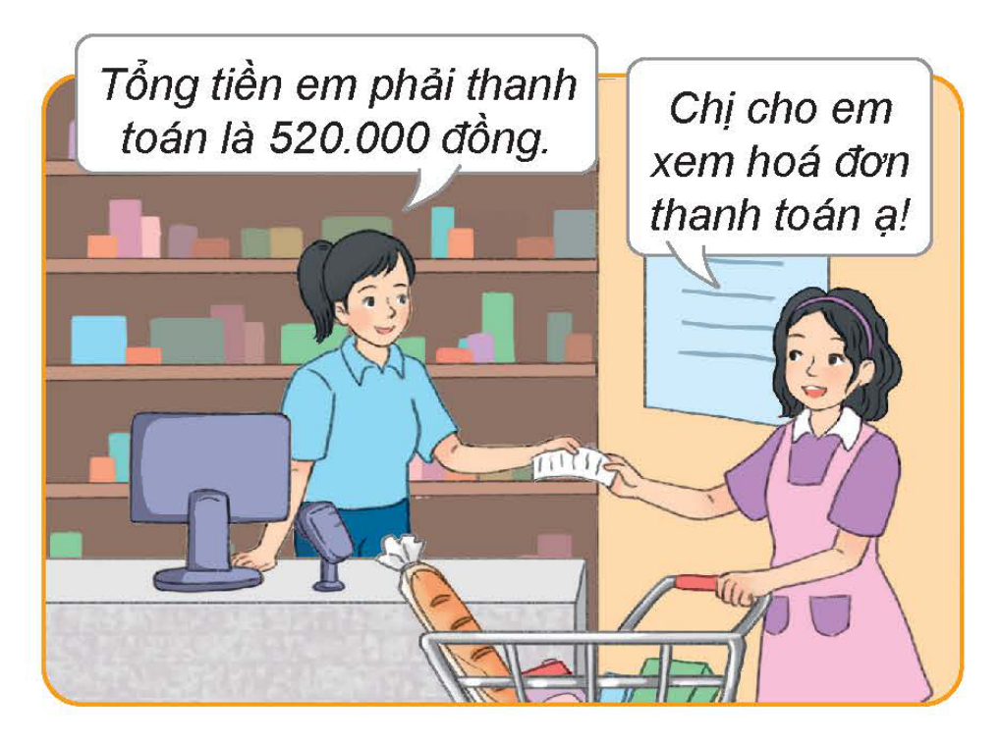

<!-- pdf:40 -->

# BÀI 8: TIÊU DÙNG THÔNG MINH

## 🎯 MỤC TIÊU:

- Nhận biết được thế nào là tiêu dùng thông minh; lợi ích của tiêu dùng thông minh.
- Đánh giá được các hành vi tiêu dùng thông minh và kém thông minh.
- Nêu được các cách tiêu dùng thông minh (nắm bắt thông tin về sản phẩm, sử dụng sản phẩm an toàn, nhận biết được những hình thức quảng cáo khác nhau, xác định phương thức thanh toán,...).
- Thực hiện được hành vi tiêu dùng thông minh trong một số tình huống cụ thể.
- Khích lệ, giúp đỡ người thân, bạn bè trở thành người tiêu dùng thông minh.

## 🔴 Mở đầu

Cuộc sống ngày càng hiện đại, đòi hỏi con người càng phải thông minh hơn trong cách tiêu dùng để vừa đảm bảo mục đích tiêu dùng vừa tiết kiệm được tiền bạc, thời gian, công sức. Tuy nhiên, cũng có nhiều trường hợp người tiêu dùng đầu tư nhiều tiền bạc nhưng vẫn không lựa chọn được đồ dùng phù hợp, gây lãng phí.

Em hãy chia sẻ thói quen tiêu dùng của bản thân hoặc người thân trong gia đình và nêu kết quả của mỗi thói quen đó.

## KHÁM PHÁ

## 1. Tiêu dùng thông minh và lợi ích của tiêu dùng thông minh

Em hãy quan sát các hình ảnh sau và trả lời câu hỏi:

> - **Hình 1:** *"Mình sẽ thực hiện đúng kế hoạch chi tiêu để tiết kiệm tiền mua quà mừng thọ bà."*
> - **Hình 2:** *"Đôi giày này mình đã chọn mua của một thương hiệu có uy tín được nhiều người ưa thích."*

<!-- pdf:41 -->

> - **Hình 3:** *"Mẹ thấy loại bút này ở nhà còn nhiều sao con vẫn mua thêm?"* — *"Con thích dùng bút mới, mẹ ạ!"*
> - **Hình 4:** *"Thông tin giới thiệu món trà sữa mình thích mà giá quá rẻ, phải đặt mua ngay."*
<!-- ocr-ok: đối chiếu ảnh trang PDF 41 khớp nguyên văn lời thoại trong tranh minh hoạ 3 và 4 -->

> - a) Trong các hình ảnh trên, bạn nào có thói quen tiêu dùng tốt, bạn nào có thói quen tiêu dùng chưa tốt? Vì sao?
> - b) Theo em, thế nào là tiêu dùng thông minh?
> - c) Từ những hình ảnh trên, em hãy cho biết biểu hiện của người tiêu dùng thông minh và người tiêu dùng kém thông minh. Những hành vi tiêu dùng thông minh mang lại lợi ích gì?

## 2. Cách tiêu dùng thông minh

Để trở thành người tiêu dùng thông minh, cần chú ý thực hiện một số cách sau đây:

- *Xây dựng kế hoạch chi tiêu hợp lí*

<!-- term: Xây dựng kế hoạch chi tiêu hợp lí -->
Chỉ mua những vật dụng phục vụ cho nhu cầu thiết yếu của cuộc sống, phù hợp với khả năng thanh toán và nhu cầu của bản thân như: thức ăn, nước uống, đồ dùng cá nhân, đồ dùng học tập cần thiết, đi lại,...

- *Tìm hiểu các thông tin sản phẩm*

<!-- term: Tìm hiểu các thông tin sản phẩm -->
Khi cần mua sản phẩm nên tìm hiểu các thông tin về chất lượng, giá cả, công dụng, mẫu mã,... bằng cách tham khảo nhiều nguồn thông tin về sản phẩm được in trên bao bì, qua các kênh quảng cáo, trang thông tin điện tử của nhà sản xuất, quét mã vạch truy xuất nguồn gốc,... để chọn lọc thông tin về sản phẩm chính xác.

- *Sử dụng sản phẩm an toàn*

<!-- term: Sử dụng sản phẩm an toàn -->
Chỉ sử dụng những sản phẩm có nguồn gốc, đảm bảo chất lượng, đọc kĩ hướng dẫn sử dụng trước khi dùng và sử dụng đúng cách, tìm hiểu quyền lợi của người tiêu dùng để bảo vệ mình trong những trường hợp cần thiết.

> - *"Mình cũng rất cần một chiếc đồng hồ như của bạn. Mình sẽ lên kế hoạch để mua."*
> - *"Cô ơi, sao cháu không thấy thông tin cơ sở sản xuất trên hộp thuốc ạ?"*
> - *"Hộp sữa to thế này mà sắp hết hạn sử dụng rồi, mình không nên mua."*
<!-- ocr-ok: đối chiếu ảnh trang PDF 41 khớp nguyên văn lời thoại trong các tranh minh hoạ mục 2 -->

<!-- pdf:42 -->

- *Lựa chọn phương thức thanh toán phù hợp*

<!-- term: Lựa chọn phương thức thanh toán phù hợp -->
Khi mua hàng, có thể thanh toán bằng tiền mặt hoặc thanh toán trực tuyến. Trước khi thanh toán, cần kiểm tra kĩ sản phẩm, giá cả, số tiền phải thanh toán. Khi mua hàng trực tuyến, cần kiểm tra kĩ hàng hoá khi nhận, chỉ thanh toán trước đối với các thương hiệu uy tín; bảo mật thông tin, tài khoản và lưu lại hoá đơn, chứng từ giao dịch để xử lí khi cần thiết,...

> *"Tổng tiền em phải thanh toán là 520.000 đồng."* — *"Chị cho em xem hoá đơn thanh toán ạ!"*

> - a) Từ các thông tin và hình ảnh trên, em hãy nêu những điểm cần lưu ý trong việc xây dựng kế hoạch chi tiêu, tìm hiểu thông tin sản phẩm, sử dụng sản phẩm an toàn và lựa chọn phương thức thanh toán. Theo em, những việc làm đó mang lại lợi ích gì cho người tiêu dùng?
> - b) Dựa vào hướng dẫn trên, em hãy nhận xét việc thực hiện các cách tiêu dùng thông minh của bản thân. Nêu ví dụ minh hoạ.

## 📌 Ghi nhớ

> 1. **Tiêu dùng thông minh** là việc biết chi tiêu có kế hoạch, tiết kiệm, hiệu quả, phù hợp với đặc điểm của bản thân.

<!-- term: Lợi ích của tiêu dùng thông minh -->
> 2. Tiêu dùng thông minh giúp người tiêu dùng mua được sản phẩm có chất lượng, phù hợp với mục đích tiêu dùng của cá nhân, tiết kiệm thời gian, tiền bạc, thực hiện được kế hoạch chi tiêu, bảo vệ sức khoẻ và quyền lợi của người tiêu dùng.

<!-- term: Cách tiêu dùng thông minh -->
> 3. Cách tiêu dùng thông minh:
> - Xây dựng kế hoạch chi tiêu hợp lí: Chỉ mua những vật dụng thiết yếu, phù hợp với nhu cầu, khả năng thanh toán của bản thân.
> - Tìm hiểu các thông tin sản phẩm (chất lượng, mẫu mã, giá cả, công dụng,...) qua nhiều kênh khác nhau để chọn lọc được thông tin chính xác.
> - Sử dụng sản phẩm an toàn: theo hướng dẫn sử dụng, đảm bảo chất lượng, an toàn cho sức khoẻ.
> - Lựa chọn phương thức thanh toán phù hợp: thanh toán bằng tiền mặt hoặc thanh toán trực tuyến tuỳ vào tình hình thực tế và điều kiện của bản thân; kiểm tra kĩ sản phẩm, hoá đơn trước khi thanh toán và lưu giữ chứng từ giao dịch để xử lí khi cần thiết.

> 4. Học sinh cần rèn luyện thói quen và thực hiện cách tiêu dùng thông minh để đảm bảo an toàn tài chính, sức khoẻ cho bản thân và gia đình. Đồng thời khích lệ, giúp đỡ người thân, bạn bè trở thành những người tiêu dùng thông minh.

<!-- pdf:43 -->

## ✏️ Luyện tập

**1.** Trong các trường hợp dưới đây, ai là người tiêu dùng thông minh, ai là người tiêu dùng kém thông minh? Vì sao?
- a) Khi mua hàng, chị A luôn quan tâm đến chất lượng sản phẩm.
- b) Anh C có thói quen chỉ mua sắm những sản phẩm của nước ngoài nhập khẩu vào Việt Nam.
- c) Khi mua rau, củ, quả, bạn Q tìm mua sản phẩm có nguồn gốc, xuất xứ rõ ràng ở các địa chỉ tin cậy.
- d) Khi mua hàng trực tuyến, bạn B thường tham khảo thêm các ý kiến của khách hàng đã sử dụng sản phẩm ở cơ sở định mua để ra quyết định.

**2.** Vận dụng cách tiêu dùng thông minh để nhận xét hành vi mua sắm của các nhân vật trong những trường hợp dưới đây:
- a) Bạn H được mẹ giao nhiệm vụ cùng em gái 10 tuổi đi mua vở, đồ dùng học tập chuẩn bị cho năm học mới. Thấy hai anh em chuẩn bị đến cửa hàng văn phòng phẩm, mẹ nhắc H ghi ra những thứ cần mua nhưng H cho rằng cứ đến cửa hàng là sẽ mua được đầy đủ.
- b) Bạn D rất thích các món ăn chế biến từ hải sản. Thấy ở chợ có người bán hộp thịt cua, ghẹ với giá rẻ hơn hẳn so với mua hàng tươi sống, D quyết định mua mặc dù không rõ nguồn gốc.
- c) Một người bạn thân trong lớp gửi thông tin về loại áo chống nắng rất hợp với tuổi học sinh, được giảm giá 20% nếu mua từ 2 áo trở lên và rủ C cùng mua để được hưởng khuyến mại. C cân nhắc và quyết định từ chối vì không có nhu cầu.

**3.** Hãy nêu lợi ích của những hành vi tiêu dùng thông minh dưới đây:
- a) Chị A thường tìm mua những đồ gia dụng có nhiều chức năng và nghiên cứu để sử dụng hiệu quả các chức năng đó.
- b) Đang chuẩn bị xây nhà, anh B chủ động tham khảo chất lượng và giá cả sản phẩm từ nhiều nguồn cung ứng vật liệu khác nhau để ra quyết định mua.
- c) Bạn H thường tìm những kênh bán hàng trực tuyến có uy tín để mua sắm.

**4.** Tư vấn cho nhân vật trong các trường hợp dưới đây thực hiện cách tiêu dùng thông minh:
- a) Lên lớp 9, K được mua xe đạp mới để đi học. Em hãy gợi ý cho bạn K cách tìm hiểu thông tin sản phẩm để chọn được chiếc xe đạp phù hợp.
- b) Y được mẹ giao nhiệm vụ đi chợ mua thức ăn cho cả nhà. Em hãy tư vấn giúp Y lập kế hoạch mua sắm và lựa chọn sản phẩm an toàn.

## 🚀 Vận dụng

Hãy liệt kê một số việc em đã vận dụng cách tiêu dùng thông minh trong cuộc sống hằng ngày, nêu kết quả và chia sẻ với các bạn.

## 📷 Danh sách hình trong bài

| Mã hình | Trang PDF | Vị trí trong bài | Chú thích gốc |
| --- | --- | --- | --- |
| H9-giao_duc_cong_dan-b08-01 | 40 | Khám phá, mục 1 | Hình ảnh (1, 2) về các thói quen tiêu dùng |
| H9-giao_duc_cong_dan-b08-02 | 41 | Khám phá, mục 1 | Hình ảnh (3, 4) về các thói quen tiêu dùng |
| H9-giao_duc_cong_dan-b08-03 | 41 | Khám phá, mục 2 | Minh hoạ xây dựng kế hoạch chi tiêu hợp lí, tìm hiểu thông tin sản phẩm và sử dụng sản phẩm an toàn |
| H9-giao_duc_cong_dan-b08-04 | 42 | Khám phá, mục 2 | Minh hoạ kiểm tra hoá đơn thanh toán khi mua hàng |
