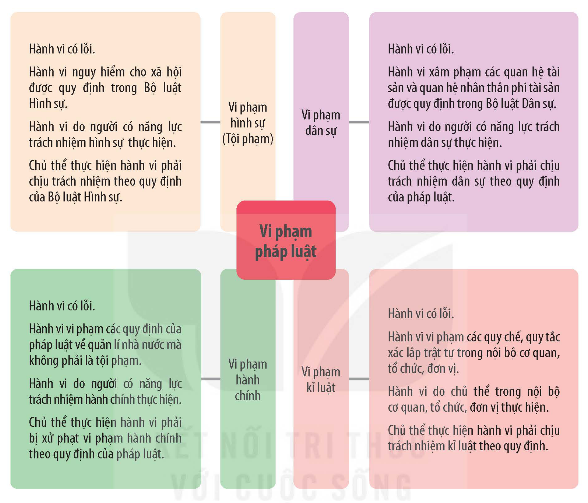

<!-- pdf:44 -->

# BÀI 9: VI PHẠM PHÁP LUẬT VÀ TRÁCH NHIỆM PHÁP LÍ

## 🎯 MỤC TIÊU:

- Nêu được khái niệm vi phạm pháp luật và trách nhiệm pháp lí; các loại vi phạm pháp luật và trách nhiệm pháp lí.
- Nêu được ý nghĩa của trách nhiệm pháp lí.
- Phân tích, đánh giá được các hành vi vi phạm pháp luật và trách nhiệm pháp lí trong một số tình huống cụ thể.
- Nghiêm chỉnh chấp hành pháp luật; tích cực ngăn ngừa và đấu tranh với các hành vi vi phạm pháp luật.

## 🔴 Mở đầu

**Pháp luật** là những quy định do Nhà nước ban hành và có tính bắt buộc chung, mọi người đều phải tôn trọng, chấp hành. Tuy nhiên, trong thực tế vẫn còn nhiều người có hành vi vi phạm pháp luật, gây ra những hậu quả với bản thân, gia đình và xã hội. Vì vậy, mỗi chúng ta cần nghiêm chỉnh chấp hành pháp luật, tích cực ngăn ngừa và đấu tranh với các hành vi vi phạm pháp luật.

Hãy kể một số hành vi vi phạm pháp luật mà em biết và nêu hậu quả của hành vi đó.

## KHÁM PHÁ

## 1. Vi phạm pháp luật

Em hãy đọc các nội dung, trường hợp sau và trả lời câu hỏi:

- *Dấu hiệu của vi phạm pháp luật*

<!-- term: Dấu hiệu của vi phạm pháp luật -->
> - **Hành vi trái pháp luật:** làm việc mà pháp luật cấm; không thực hiện các nghĩa vụ mà Nhà nước quy định; thực hiện không đúng các quy định của pháp luật;...
> - **Hành vi do chủ thể có năng lực trách nhiệm pháp lí thực hiện:** người thực hiện hành vi đã đạt một độ tuổi nhất định theo quy định của pháp luật, có thể nhận thức và điều khiển được hành vi của mình, tự quyết định cách xử sự của mình.
> - **Hành vi có lỗi của chủ thể:** Bao gồm lỗi cố ý và lỗi vô ý.
> - **Hành vi gây nguy hiểm cho xã hội:** hành vi đó đe doạ gây ra thiệt hại hoặc gây ra thiệt hại cho các quan hệ xã hội được pháp luật bảo vệ.

<!-- pdf:45 -->

- *Phân loại vi phạm pháp luật*

<!-- term: Vi phạm hình sự -->
> - *Vi phạm hình sự (Tội phạm):* Hành vi có lỗi. Hành vi nguy hiểm cho xã hội được quy định trong Bộ luật Hình sự. Hành vi do người có năng lực trách nhiệm hình sự thực hiện. Chủ thể thực hiện hành vi phải chịu trách nhiệm theo quy định của Bộ luật Hình sự.

<!-- term: Vi phạm dân sự -->
> - *Vi phạm dân sự:* Hành vi có lỗi. Hành vi xâm phạm các quan hệ tài sản và quan hệ nhân thân phi tài sản được quy định trong Bộ luật Dân sự. Hành vi do người có năng lực trách nhiệm dân sự thực hiện. Chủ thể thực hiện hành vi phải chịu trách nhiệm dân sự theo quy định của pháp luật.

<!-- term: Vi phạm hành chính -->
> - *Vi phạm hành chính:* Hành vi có lỗi. Hành vi vi phạm các quy định của pháp luật về quản lí nhà nước mà không phải là tội phạm. Hành vi do người có năng lực trách nhiệm hành chính thực hiện. Chủ thể thực hiện hành vi phải bị xử phạt vi phạm hành chính theo quy định của pháp luật.

<!-- term: Vi phạm kỉ luật -->
> - *Vi phạm kỉ luật:* Hành vi có lỗi. Hành vi vi phạm các quy chế, quy tắc xác lập trật tự trong nội bộ cơ quan, tổ chức, đơn vị. Hành vi do chủ thể trong nội bộ cơ quan, tổ chức, đơn vị thực hiện. Chủ thể thực hiện hành vi phải chịu trách nhiệm kỉ luật theo quy định.

**Em có biết?**

> **Tội phạm** là hành vi nguy hiểm cho xã hội được quy định trong Bộ luật Hình sự, do người có năng lực trách nhiệm hình sự hoặc pháp nhân thương mại thực hiện một cách cố ý hoặc vô ý, xâm phạm độc lập, chủ quyền, thống nhất, toàn vẹn lãnh thổ Tổ quốc, xâm phạm chế độ chính trị, chế độ kinh tế, nền văn hoá, quốc phòng, an ninh, trật tự, an toàn xã hội, quyền, lợi ích hợp pháp của tổ chức, xâm phạm quyền con người, quyền, lợi ích hợp pháp của công dân, xâm phạm những lĩnh vực khác của trật tự pháp luật xã hội chủ nghĩa mà theo quy định của Bộ luật này phải bị xử lí hình sự.
>
> *(Theo Khoản 1 Điều 8 Bộ luật Hình sự năm 2015 (sửa đổi, bổ sung năm 2017))*

<!-- pdf:46 -->

> 1. Anh M (19 tuổi) không đội mũ bảo hiểm điều khiển xe máy vượt đèn đỏ, lạng lách, đánh võng, tạt đầu các phương tiện khác, gây nguy hiểm, bức xúc cho nhiều người tham gia giao thông. Sau khi nhận được phản ánh của người dân, công an thành phố H đã rà soát, trích xuất camera giám sát, triệu tập anh M tới cơ quan công an để làm rõ hành vi vi phạm.

> 2. Ông A cho bà B vay 500 triệu đồng. Trong giấy tờ vay nợ ghi rõ thoả thuận thời hạn trả nợ là 6 tháng. Đến hạn, ông A đến đòi tiền thì bà B không chịu trả. Ông A đã làm đơn khởi kiện gửi Toà án đề nghị xem xét giải quyết.

> 3. Công ty Y quy định giờ bắt đầu làm việc của nhân viên là 8h00' hằng ngày từ thứ Hai đến thứ Sáu. Tuần vừa rồi, anh P – nhân viên trong công ty nhiều lần đi muộn không rõ lí do và không hoàn thành các công việc được giao.

> 4. Anh T (26 tuổi) và anh Q (27 tuổi) đang trên đường vận chuyển 1 kg ma tuý tổng hợp từ biên giới vào lãnh thổ Việt Nam bán lại cho các đối tượng nghiện hút để kiếm lời thì bị cơ quan công an phát hiện và bắt giữ.

> - a) Em hãy dựa vào nội dung về dấu hiệu của các loại vi phạm pháp luật để xác định dấu hiệu vi phạm pháp luật và phân loại vi phạm pháp luật của mỗi chủ thể trong các trường hợp 1, 2, 3, 4.
> - b) Theo em, vi phạm pháp luật là gì? Có những loại vi phạm pháp luật nào?

## 2. Trách nhiệm pháp lí

Em hãy đọc các nội dung sau và trả lời câu hỏi:

- *Đặc điểm của trách nhiệm pháp lí*

<!-- term: Đặc điểm của trách nhiệm pháp lí -->
- Trách nhiệm pháp lí là loại trách nhiệm do pháp luật quy định.
- Trách nhiệm pháp lí chỉ phát sinh khi có chủ thể vi phạm pháp luật.
- Trách nhiệm pháp lí do cá nhân hoặc cơ quan nhà nước có thẩm quyền áp dụng đối với chủ thể vi phạm pháp luật.
- Trách nhiệm pháp lí gắn với các biện pháp cưỡng chế của Nhà nước, có giá trị pháp lí bắt buộc thực hiện đối với các chủ thể vi phạm pháp luật.
- Trách nhiệm pháp lí là hậu quả bất lợi đối với chủ thể vi phạm pháp luật.

<!-- pdf:47 -->

- *Phân loại trách nhiệm pháp lí*

<!-- term: Trách nhiệm hình sự -->
> *\* Trách nhiệm hình sự:*
> - Trách nhiệm hình sự được quy định trong Bộ luật Hình sự.
> - Trách nhiệm hình sự phát sinh khi có chủ thể có hành vi vi phạm hình sự.
> - Trách nhiệm hình sự do Toà án áp dụng đối với chủ thể vi phạm hình sự.
> - Trách nhiệm hình sự tước bỏ quyền, lợi ích của chủ thể vi phạm hình sự.
> - Trách nhiệm hình sự gắn với các biện pháp cưỡng chế như: phạt tiền, phạt tù, tử hình,...

<!-- term: Trách nhiệm dân sự -->
> *\* Trách nhiệm dân sự:*
> - Trách nhiệm dân sự được quy định trong Bộ luật Dân sự và các văn bản quy phạm pháp luật khác có liên quan.
> - Trách nhiệm dân sự phát sinh khi chủ thể có hành vi vi phạm dân sự.
> - Trách nhiệm dân sự do Toà án hoặc chủ thể có thẩm quyền áp dụng đối với chủ thể vi phạm dân sự.
> - Trách nhiệm dân sự buộc chủ thể vi phạm dân sự gánh chịu thiệt hại về tài sản, nhân thân,... để khôi phục tình trạng ban đầu của các quyền dân sự bị vi phạm.
> - Trách nhiệm dân sự gắn với các biện pháp cưỡng chế như: buộc xin lỗi, cải chính công khai; buộc bồi thường thiệt hại; buộc thực hiện nghĩa vụ dân sự;...

<!-- term: Trách nhiệm hành chính -->
> *\* Trách nhiệm hành chính:*
> - Trách nhiệm hành chính được quy định trong Luật Xử lí vi phạm hành chính và các văn bản quy phạm pháp luật khác có liên quan.
> - Trách nhiệm hành chính phát sinh khi chủ thể có hành vi vi phạm hành chính.
> - Trách nhiệm hành chính do các chủ thể và cơ quan nhà nước có thẩm quyền áp dụng đối với chủ thể vi phạm hành chính.
> - Trách nhiệm hành chính buộc chủ thể vi phạm hành chính phải gánh chịu thiệt hại về tài sản, công việc,...
> - Trách nhiệm hành chính gắn liền với các biện pháp cưỡng chế như: phạt tiền; tước quyền sử dụng giấy phép có thời hạn; tịch thu tang vật, phương tiện vi phạm,...

<!-- pdf:48 -->

<!-- term: Trách nhiệm kỉ luật -->
> *\* Trách nhiệm kỉ luật:*
> - Trách nhiệm kỉ luật được quy định trong Bộ luật Lao động; Luật Cán bộ, công chức; Luật Viên chức;...
> - Trách nhiệm kỉ luật phát sinh khi chủ thể có hành vi vi phạm kỉ luật.
> - Trách nhiệm kỉ luật do người đứng đầu cơ quan, tổ chức áp dụng đối với chủ thể vi phạm kỉ luật.
> - Trách nhiệm kỉ luật buộc chủ thể vi phạm kỉ luật phải gánh chịu thiệt hại về danh dự, uy tín, công việc, thu nhập,...
> - Trách nhiệm kỉ luật gắn liền với các biện pháp cưỡng chế như: khiển trách, cảnh cáo, hạ bậc lương, buộc thôi việc,...

<!-- term: Mục đích của hình phạt -->
> Bộ luật Hình sự năm 2015 (sửa đổi, bổ sung năm 2017)
> Điều 31. Mục đích của hình phạt
> Hình phạt không chỉ nhằm trừng trị người, pháp nhân thương mại phạm tội mà còn giáo dục họ ý thức tuân theo pháp luật và các quy tắc của cuộc sống, ngăn ngừa họ phạm tội mới; giáo dục người, pháp nhân thương mại khác tôn trọng pháp luật, phòng ngừa và đấu tranh chống tội phạm.

> - a) Em hãy dựa vào nội dung về đặc điểm của các loại trách nhiệm pháp lí để xác định loại trách nhiệm pháp lí tương ứng với hành vi vi phạm của mỗi chủ thể trong các trường hợp 1, 2, 3, 4 (ở mục 1).
> - b) Theo em, trách nhiệm pháp lí là gì? Có những loại trách nhiệm pháp lí nào?
> - c) Em hãy cho biết trách nhiệm pháp lí có ý nghĩa gì. Giải thích và nêu ví dụ minh hoạ.

## 📌 Ghi nhớ

> 1. **Vi phạm pháp luật** là hành vi trái pháp luật, có lỗi do chủ thể có năng lực trách nhiệm pháp lí thực hiện, xâm hại các quan hệ xã hội được pháp luật bảo vệ.
>
> Vi phạm pháp luật bao gồm: vi phạm hình sự (tội phạm), vi phạm dân sự, vi phạm hành chính, vi phạm kỉ luật.

> 2. **Trách nhiệm pháp lí** là nghĩa vụ mà các chủ thể phải gánh chịu hậu quả bất lợi do Nhà nước quy định từ hành vi vi phạm pháp luật của mình.
>
> Trách nhiệm pháp lí bao gồm: trách nhiệm hình sự, trách nhiệm dân sự, trách nhiệm hành chính, trách nhiệm kỉ luật.

<!-- pdf:49 -->

<!-- term: Ý nghĩa của trách nhiệm pháp lí -->
> 3. Ý nghĩa của trách nhiệm pháp lí:
> - Thể hiện tính tôn nghiêm của pháp luật.
> - Là sự trừng phạt nghiêm khắc của pháp luật đối với các chủ thể vi phạm pháp luật.
> - Giáo dục mọi người có ý thức tôn trọng pháp luật, tuân theo quy định của pháp luật và các quy tắc của cuộc sống; nâng cao ý thức phòng ngừa và đấu tranh chống tội phạm.
> - Củng cố lòng tin của người dân vào pháp luật.
> - Góp phần duy trì trật tự an toàn xã hội.

## ✏️ Luyện tập

**1.** Em hãy cho biết các ý kiến dưới đây đúng hay sai. Giải thích vì sao.
- a) Tất cả những hành vi trái pháp luật, xâm hại tới các quan hệ xã hội được pháp luật bảo vệ đều là hành vi vi phạm pháp luật.
- b) Người say rượu không nhận thức được hành vi của mình nên mọi hành vi trái pháp luật do người say rượu gây ra đều không phải là hành vi vi phạm pháp luật.
- c) Trách nhiệm pháp lí gắn liền với các hậu quả bất lợi mà các chủ thể vi phạm pháp luật phải chịu nên chỉ mang lại những ý nghĩa tiêu cực.
- d) Trách nhiệm pháp lí góp phần ngăn ngừa các hành vi vi phạm pháp luật trong cuộc sống.

**2.** Em hãy chỉ ra các dấu hiệu vi phạm pháp luật, đặc điểm trách nhiệm pháp lí của mỗi chủ thể dưới đây và xác định loại vi phạm pháp luật, trách nhiệm pháp lí tương ứng của từng chủ thể.
- a) Ông P tổ chức hoạt động chống phá Nhà nước, gây rối an ninh trật tự địa phương nên bị Toà án tuyên phạt 9 năm tù giam.
- b) Anh N (20 tuổi) điều khiển xe mô tô đi ngược chiều trên đường cao tốc nên bị cảnh sát giao thông lập biên bản phạt tiền và tước quyền sử dụng Giấy phép lái xe 3 tháng.
- c) Bạn T bị Ban Giám hiệu nhà trường khiển trách vì thường xuyên trốn học đi chơi.
- d) Toà soạn báo G đăng tải bài viết sai sự thật, gây ảnh hưởng xấu đến danh dự, nhân phẩm của chị A nên bị Toà án buộc cải chính thông tin và xin lỗi chị A công khai.
- e) Anh B bị chính quyền địa phương lập biên bản xử phạt vì gây mất an ninh trật tự khi kinh doanh.
- g) Chị O không thực hiện đúng các thoả thuận trong hợp đồng lao động với công ty nên bị Giám đốc công ty ra quyết định buộc thôi việc.

<!-- pdf:50 -->

**3.** Em hãy phân tích, đánh giá các hành vi vi phạm pháp luật của các chủ thể trong những tình huống sau để xác định loại vi phạm pháp luật và trách nhiệm pháp lí tương ứng.
- a) Anh V (26 tuổi) quen chị D (18 tuổi) và biết chị đang có nhu cầu tìm việc làm nên đã rủ chị sang nước ngoài làm thuê nhưng mục đích là để lừa bán. Chị D nghe theo và bị anh V đưa ra nước ngoài bán. Hơn một năm sau, chị D bỏ trốn về Việt Nam và tố cáo hành vi của anh V với cơ quan chức năng.
- b) Tan học, anh Q (16 tuổi) thấy một chiếc ví của ai đó rơi trên đường nên dừng xe kiểm tra và phát hiện trong ví có gần 6 triệu đồng cùng một số giấy tờ cá nhân. Quan sát xung quanh thấy vắng vẻ, anh Q quyết định giữ lại khoản tiền và chiếc ví để sử dụng, còn những giấy tờ cá nhân kia thì vứt xuống mương nước ven đường.
- c) Khi li hôn, ông H đồng ý để bà N nuôi hai con nhỏ, còn mình sẽ có trách nhiệm chu cấp tiền nuôi con hằng tháng. Tuy nhiên, sau đó ông không chịu đóng góp chi phí cấp dưỡng cho con như đã thoả thuận khiến bà N và các con gặp nhiều khó khăn trong cuộc sống. Không đồng tình với hành vi của ông H, bà N đã làm đơn khởi kiện gửi Toà án đề nghị xem xét giải quyết.
- d) Công ty chế biến thực phẩm A quy định tất cả các công nhân phải đeo găng tay, sử dụng mũ trùm đầu, đeo khẩu trang trong quá trình làm việc để đảm bảo vệ sinh. Tuy nhiên, chị P (công nhân của công ty) cho rằng đeo khẩu trang vướng víu, khó thở nên thường kéo khẩu trang xuống dưới cằm, không che miệng và mũi.

**4.** Em hãy nhận xét hành vi của mỗi chủ thể trong các tình huống sau và tư vấn cho các chủ thể để phòng tránh các hành vi vi phạm pháp luật.
- a) Hai bạn H và C (15 tuổi) chơi thân với nhau từ nhỏ. Một lần, H vô tình biết C đang có ý định tụ tập cùng nhóm bạn xấu gây gổ đánh nhau. H lo lắng nếu C đánh nhau sẽ bị công an bắt nên can ngăn nhưng bị C gạt đi vì cho rằng mình còn nhỏ nên có đánh nhau cũng không bị xử phạt.
- b) Bạn Y đang tưới nước cho cây cảnh ở trước cổng thì A (15 tuổi) – bạn cùng thôn đạp xe qua rủ đi giao hàng cùng. A lấy từ chiếc ba lô của mình một gói đồ được bọc kín trong túi bóng màu đen và vui mừng khoe với Y rằng mình sẽ được bà D trả 200.000 đồng tiền công nếu qua xã bên giao gói đồ này hộ bà. Y cảm thấy băn khoăn trong gói đồ đó chứa gì, nhưng A cũng không biết và chỉ muốn nhanh chóng giao xong đồ để được nhận tiền công.

## 🚀 Vận dụng

Hãy chia sẻ những việc em đã làm và dự định sẽ làm trong cuộc sống hằng ngày để phòng ngừa các hành vi vi phạm pháp luật.

## 📷 Danh sách hình trong bài

| Mã hình | Trang PDF | Vị trí trong bài | Chú thích gốc |
| --- | --- | --- | --- |
| H9-giao_duc_cong_dan-b09-01 | 44 | Khám phá, mục 1 | Sơ đồ Dấu hiệu vi phạm pháp luật |
| H9-giao_duc_cong_dan-b09-02 | 45 | Khám phá, mục 1 | Sơ đồ Phân loại vi phạm pháp luật |
