<!-- pdf:8 -->

# BÀI 1: NHẬN BIẾT MỘT SỐ DỤNG CỤ, HOÁ CHẤT. THUYẾT TRÌNH MỘT VẤN ĐỀ KHOA HỌC

## 🎯 Mục tiêu

- Nhận biết được một số dụng cụ và hoá chất sử dụng trong dạy học môn Khoa học tự nhiên 9.
- Trình bày được các bước viết và trình bày báo cáo; làm được bài thuyết trình một vấn đề khoa học.

## 🔴 Mở đầu

Để kiểm chứng các dự đoán trong lĩnh vực khoa học tự nhiên, cần tiến hành thí nghiệm. Làm thế nào lựa chọn được dụng cụ, hoá chất phù hợp để thực hiện thí nghiệm thành công và an toàn?

## I. Giới thiệu một số dụng cụ và cách sử dụng

Các dụng cụ cơ bản trong môn Khoa học tự nhiên lớp 9 bao gồm các dụng cụ thí nghiệm quang học, điện từ và thí nghiệm tìm hiểu về chất và sự biến đổi chất.

### 1. Một số dụng cụ thí nghiệm quang học

**a) Nguồn sáng**

Để tạo ra chùm sáng hẹp được biểu diễn bằng tia sáng ta có thể sử dụng một đèn dây tóc được nối với nguồn điện $12\text{ V}$ và các tấm chắn sáng có một hoặc nhiều khe sáng (Hình 1.1a). Cũng có thể sử dụng nguồn laser trong phòng thí nghiệm (Hình 1.1b), mỗi tia sáng được điều khiển bằng một công tắc trên đèn.

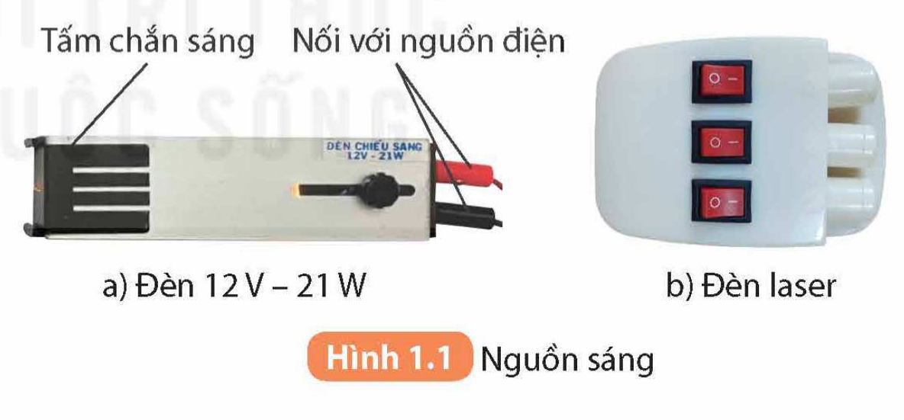

Hình 1.1. Nguồn sáng: a) Đèn $12\text{ V} - 21\text{ W}$; b) Đèn laser

> *Lưu ý:* Không để tia laser chiếu vào mắt.

**b) Bản bán trụ và bảng chia độ**

**Bản bán trụ** là một khối thuỷ tinh trong suốt. **Bảng chia độ** được sử dụng để đọc giá trị góc tới, góc khúc xạ và góc phản xạ khi nghiên cứu hiện tượng khúc xạ ánh sáng và hiện tượng phản xạ toàn phần (Hình 1.2).

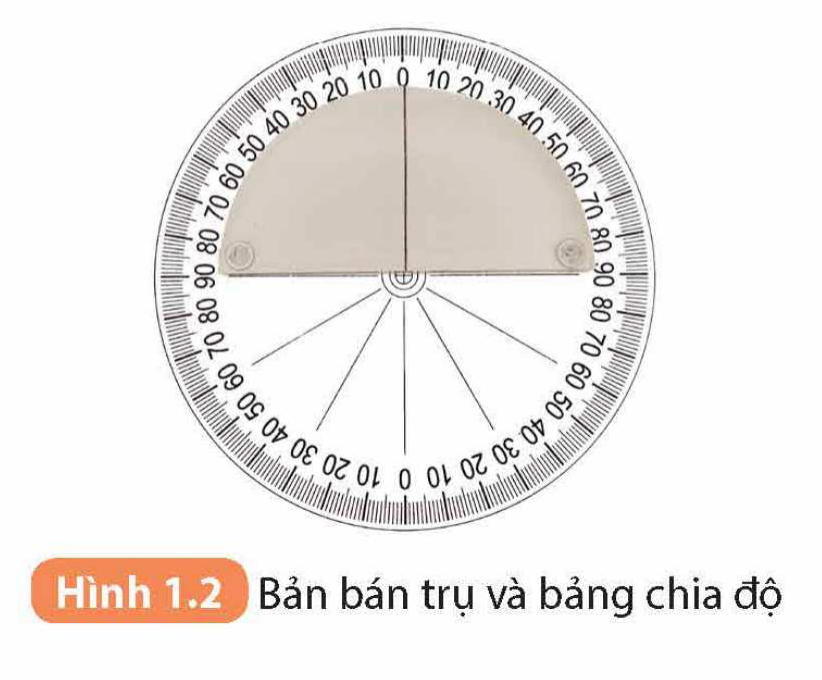

Hình 1.2. Bản bán trụ và bảng chia độ

<!-- pdf:9 -->

**c) Bộ dụng cụ tìm hiểu tính chất ảnh qua thấu kính**

Bộ dụng cụ tìm hiểu tính chất ảnh qua thấu kính (Hình 1.3) bao gồm: thấu kính hội tụ (1), thấu kính phân kì (2), màn chắn (3) và vật sáng được tạo ra bằng cách chiếu sáng từ đèn (4) qua khe hình chữ F (5). Để dịch chuyển vật sáng, thấu kính và màn chắn một cách dễ dàng, người ta sử dụng giá quang học đồng trục (6).

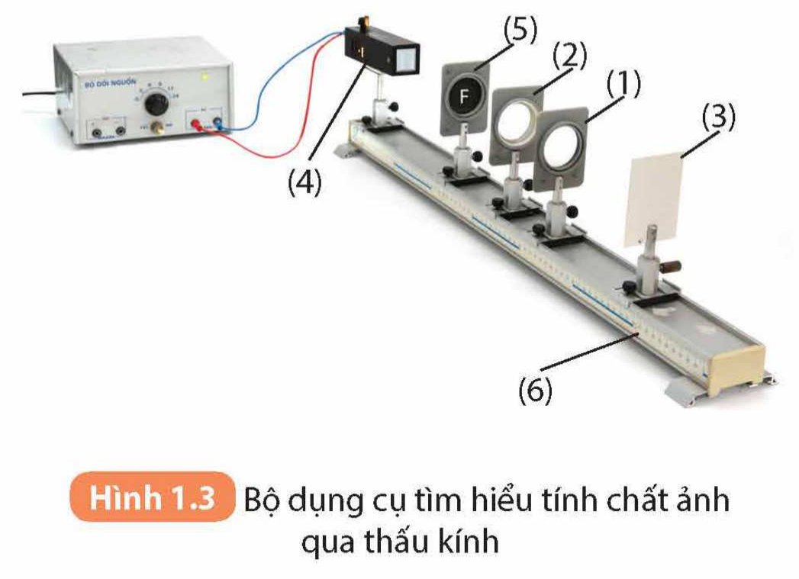

Hình 1.3. Bộ dụng cụ tìm hiểu tính chất ảnh qua thấu kính

> ❓ Để tạo ra tia sáng, chùm sáng, có thể dùng đèn dây tóc và các tấm chắn sáng có khe hẹp. Em hãy đề xuất một cách làm khác.

### 2. Một số dụng cụ thí nghiệm điện từ

**a) Điện kế**

**Điện kế** (Hình 1.4) là dụng cụ dùng để phát hiện dòng điện cảm ứng. Khi dòng điện đi vào chốt $\text{G}_0$ (hoặc $\text{G}_1$) và đi ra từ chốt âm ($-$) thì kim điện kế lệch sang phải. Khi dòng điện đi vào chốt âm và đi ra từ chốt $\text{G}_0$ (hoặc $\text{G}_1$) thì kim điện kế lệch sang trái.

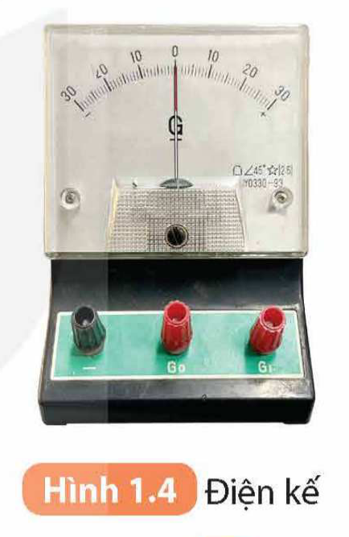

Hình 1.4. Điện kế

> Quan sát điện kế, giải thích vì sao vạch 0 nằm giữa thang đo.

**b) Đồng hồ đo điện đa năng**

**Đồng hồ đo điện đa năng** (Hình 1.5) cho phép đo được các đại lượng khác nhau như cường độ dòng điện, hiệu điện thế, điện trở,... trong mạch điện một chiều cũng như mạch điện xoay chiều.

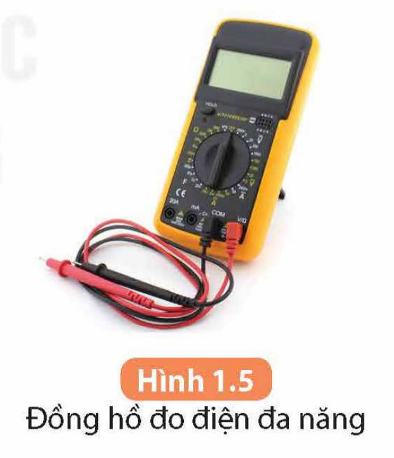

Hình 1.5. Đồng hồ đo điện đa năng

**c) Cuộn dây dẫn có hai đèn LED**

Sử dụng cuộn dây dẫn có hai đầu dây nối với hai đèn LED mắc song song, ngược cực theo sơ đồ Hình 1.6a để phát hiện dòng điện cảm ứng.

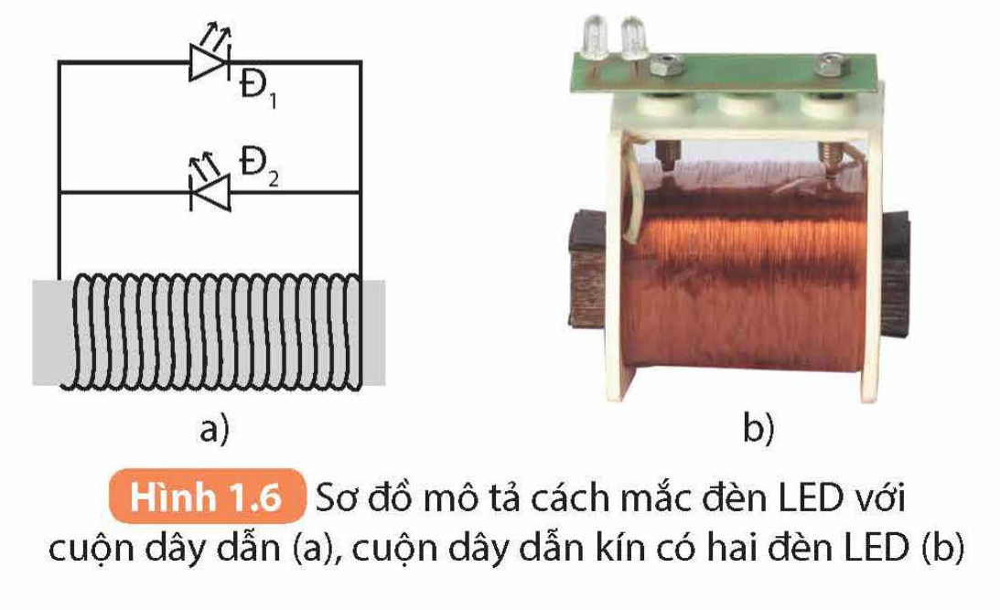

Hình 1.6. Sơ đồ mô tả cách mắc đèn LED với cuộn dây dẫn (a), cuộn dây dẫn kín có hai đèn LED (b)

<!-- pdf:10 -->

### 3. Một số dụng cụ thí nghiệm tìm hiểu về chất và sự biến đổi chất

| Dụng cụ | Chức năng | Dụng cụ | Chức năng |
| --- | --- | --- | --- |
| 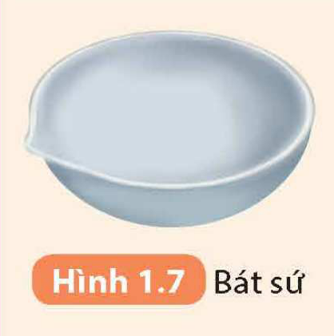 Hình 1.7. **Bát sứ** | Trộn hoặc đun nóng chảy các chất rắn, cô đặc dung dịch. Thực hiện một số phản ứng toả nhiệt mạnh. | 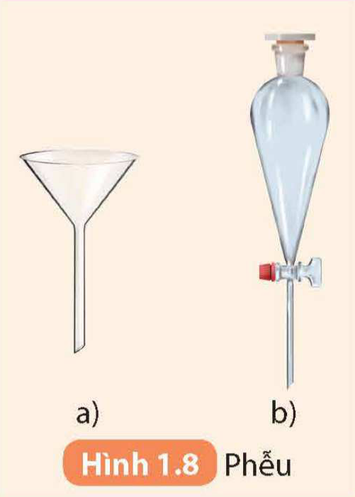 Hình 1.8. Phễu | a) **Phễu** dùng để rót chất lỏng hoặc dùng để lọc. b) **Phễu chiết** dùng để tách chất theo phương pháp chiết. |
| 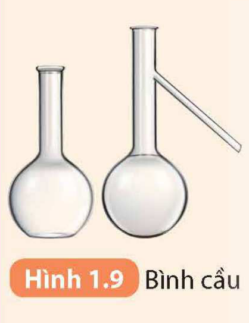 Hình 1.9. **Bình cầu** | Đựng chất lỏng, pha chế dung dịch, đun nóng, chưng cất. | 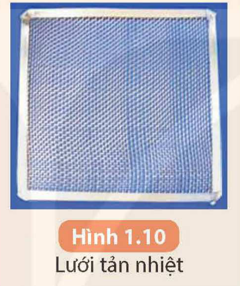 Hình 1.10. **Lưới tản nhiệt** | Dùng để phân tán nhiệt khi đốt. |

> ❓ 1. Phễu, phễu chiết, bình cầu trong phòng thí nghiệm thường được làm bằng vật liệu gì? Cần lưu ý điều gì khi sử dụng chúng?
> 2. Khi cần đun nóng dung dịch trong cốc thủy tinh, tại sao cần phải dùng lưới tản nhiệt?

### 4. Một số dụng cụ dùng trong quan sát nhiễm sắc thể

Để quan sát nhiễm sắc thể (NST) cần sử dụng kính hiển vi và các tiêu bản cố định NST (Hình 1.11).

<!-- term: Dầu soi kính hiển vi -->
Khi quan sát tiêu bản ở độ phóng đại lớn ($100\times$) cần sử dụng dầu soi kính hiển vi. Dùng dầu soi kính hiển vi giúp quan sát rõ các mẫu vật có kích thước rất nhỏ do đặc tính trong suốt, chỉ số khúc xạ cao.

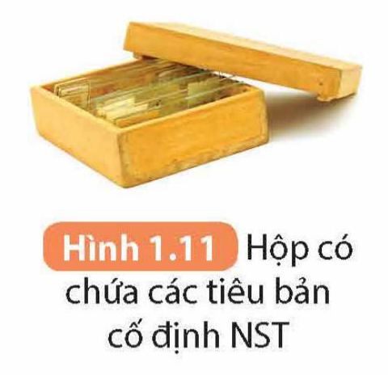

Hình 1.11. Hộp có chứa các tiêu bản cố định NST

## II. Một số hoá chất cơ bản trong phòng thí nghiệm

Trong phòng thí nghiệm hoá học ở trường phổ thông có các hoá chất cơ bản là: kim loại ($\ce{Na}$, $\ce{Fe}$, $\ce{Cu}$,...), phi kim ($\ce{S}$, $\ce{I2}$,...), oxide ($\ce{CuO}$, $\ce{CaO}$, $\ce{MnO2}$,...), acid ($\ce{HCl}$, $\ce{H2SO4}$,...), base ($\ce{NaOH}$, $\ce{NH3}$,...), chất hữu cơ ($\ce{C2H5OH}$, $\ce{C6H12O6}$,...), chất chỉ thị (giấy pH, phenolphthalein,...).

<!-- pdf:11 -->

Các hoá chất cần được bảo quản trong chai hoặc lọ, có nắp đậy và được dán nhãn ghi thông tin về hoá chất. Những hoá chất dễ bị phân huỷ bởi ánh sáng như $\ce{KMnO4}$, $\ce{AgNO3}$,... cần được đựng trong các lọ tối màu và để ở chỗ tối hoặc bọc kín bằng giấy màu đen phía ngoài lọ.

> **Sử dụng hoá chất và dụng cụ trong phòng thí nghiệm**
>
> Đề xuất dụng cụ, hoá chất và thực hiện thí nghiệm chứng minh tính chất hoá học chung của acid hoặc base.

> ❓ 1. Khi thực hiện lấy hoá chất rắn, lỏng, cần lưu ý gì để các hoá chất đảm bảo được độ tinh khiết và bảo quản được lâu dài?
> 2. Tại sao cần phải đọc cẩn thận nhãn hoá chất trước khi sử dụng?
> 3. Tại sao không được tự ý nghiền, trộn các hoá chất?
> 4. Em cần lưu ý gì khi sử dụng các hoá chất dễ bay hơi; hoá chất độc hại; hoá chất nguy hiểm ($\ce{H2SO4}$ đặc,...)?

## III. Viết và trình bày báo cáo một vấn đề khoa học
<!-- ocr-ok: đã đối chiếu ảnh trang 11, OCR bỏ sót tiêu đề mục III màu cam -->

<!-- term: Báo cáo một vấn đề khoa học -->
Kết quả nghiên cứu khoa học được người nghiên cứu trình bày dưới dạng các báo cáo theo cách thức quy định chung để người đọc có thể dễ dàng tra cứu, tìm hiểu và sử dụng.

<!-- term: Báo cáo một vấn đề khoa học -->
Thông thường bài báo cáo một vấn đề khoa học có cấu trúc như sau:

1. Tiêu đề: Cần chính xác và mô tả rõ ràng nội dung của báo cáo.
2. Tóm tắt: Một đoạn văn ngắn, tổng hợp nội dung chính của báo cáo, bao gồm mục tiêu, phương pháp, kết quả và kết luận.
3. Giới thiệu: Mô tả vấn đề nghiên cứu và tầm quan trọng của vấn đề; mục tiêu của nghiên cứu.
4. Phương pháp: Mô tả quá trình thực hiện thí nghiệm hoặc quá trình thu thập dữ liệu; xử lí dữ liệu; liệt kê vật liệu, hoá chất và dụng cụ sử dụng.
5. Kết quả: Trình bày dữ liệu thu được một cách rõ ràng, sử dụng biểu đồ, hình ảnh hoặc bảng.
6. Thảo luận: Phân tích và giải thích ý nghĩa của kết quả; so sánh với các nghiên cứu khác (nếu có).
7. Kết luận: Tóm tắt những phát hiện chính và gợi ý cho những nghiên cứu sau này.
8. Tài liệu tham khảo: Liệt kê tất cả nguồn thông tin đã sử dụng.

<!-- pdf:12 -->

Ví dụ về viết báo cáo một vấn đề khoa học:

> **BÁO CÁO KẾT QUẢ KHẢO SÁT THỰC TẾ VỀ MỘT SỐ BỆNH ĐƯỜNG TIÊU HOÁ VÀ VẤN ĐỀ VỆ SINH AN TOÀN THỰC PHẨM TẠI ĐỊA PHƯƠNG**
>
> Tóm tắt: Báo cáo này trình bày kết quả từ cuộc khảo sát thực tế về các bệnh đường tiêu hoá và vấn đề an toàn thực phẩm tại địa phương. Đối tượng khảo sát gồm 30 chủ hộ gia đình và cán bộ địa phương. Kết quả khảo sát cho thấy tác động của các bệnh đường tiêu hoá và vấn đề vệ sinh an toàn thực phẩm đối với sức khoẻ cộng đồng, qua đó hướng tới mục đích nâng cao ý thức và ngăn chặn các bệnh đường tiêu hoá.
>
> **I. Giới thiệu**
>
> Bệnh đường tiêu hoá và vệ sinh an toàn thực phẩm đang là những vấn đề quan trọng liên quan đến sức khoẻ cộng đồng, đặc biệt ở địa phương. Điều tra và nghiên cứu về các bệnh này sẽ cung cấp thông tin quan trọng để nâng cao ý thức về vệ sinh an toàn thực phẩm và phòng ngừa bệnh tật đường tiêu hoá.
>
> *Mục tiêu của nghiên cứu này là:*
> - Điều tra được thực trạng các bệnh đường tiêu hoá hiện nay ở địa phương và tình trạng mất an toàn thực phẩm, nguyên nhân của các bệnh đường tiêu hoá.
> - Trên cơ sở kết quả điều tra đề xuất các giải pháp khắc phục tình trạng mất an toàn thực phẩm ở địa phương.
>
> **II. Phương pháp**
>
> *1. Phương pháp và công cụ khảo sát thực tế*
>
> Phương pháp: Điều tra bằng phiếu hỏi.
>
> Phỏng vấn trực tiếp một số đối tượng.
>
> Công cụ: Bộ phiếu hỏi và đề cương phỏng vấn trực tiếp.
>
> *2. Đối tượng, địa bàn khảo sát*
> - Đối tượng: 30 chủ hộ gia đình và cán bộ địa phương (trưởng thôn/tổ dân phố, đoàn thanh niên, hội phụ nữ).
> - Địa bàn khảo sát: các thôn/tổ dân phố ... thuộc xã/phường ...
>
> **III. Kết quả**
>
> *1. Nhận thức của người dân về tầm quan trọng của an toàn thực phẩm*
>
> Trình bày kết quả xử lí phiếu hỏi các đối tượng thành các bảng, từ các bảng số liệu phân tích, rút ra kết luận về nhận thức của người dân đối với vấn đề an toàn thực phẩm.
>
> *2. Thực trạng các bệnh đường tiêu hoá ở địa phương*
>
> Bảng số liệu kết quả xử lí các phiếu hỏi về các loại bệnh đường tiêu hoá và nguyên nhân gây bệnh. Từ bảng số liệu phân tích rút ra kết luận.
>
> *3. Thực trạng việc sử dụng các loại thực phẩm ở các gia đình*
>
> Tổng hợp các ý kiến qua phỏng vấn các đối tượng, phân tích, rút ra kết luận.
>
> **IV. Thảo luận**
>
> Đánh giá thực trạng nhận thức của người dân về tầm quan trọng của an toàn thực phẩm.
>
> **V. Kết luận**

<!-- pdf:13 -->

> - Nhận thức về tác động quan trọng của các bệnh đường tiêu hoá và sự quan trọng của an toàn thực phẩm đối với sức khoẻ cộng đồng còn nhiều hạn chế.
> - Các biện pháp cần thực hiện để nâng cao nhận thức.
>
> *Tài liệu tham khảo*
> 1. Nguyễn Văn A (2002), Về bệnh đường tiêu hoá và nguyên nhân..., Tạp chí Khoa học và đời sống, số .../2002, Tr. 5-7.
> 2. Trần Đình B (2022), Một số biện pháp phòng, chống bệnh đường tiêu hoá ở nhà trường..., Tạp chí giáo dục, số .../2022, Tr. 6-8.

> 1. Em hãy so sánh cấu trúc của bài báo cáo một vấn đề khoa học theo cách thức quy định chung với các bài báo cáo thực hành hay báo cáo thí nghiệm, điều tra mà em đã thực hiện.
> 2. Lựa chọn một hoạt động nghiên cứu hoặc hoạt động thực hành và viết báo cáo cho hoạt động này.

## IV. Bài thuyết trình một vấn đề khoa học

<!-- term: Bài thuyết trình một vấn đề khoa học -->
Bài thuyết trình thể hiện các nội dung cô đọng, trực quan của bài báo cáo một vấn đề khoa học.

### 1. Thuyết trình trên các phần mềm trình chiếu

Cấu trúc bài thuyết trình trên các phần mềm trình chiếu bám sát cấu trúc của bản báo cáo một vấn đề khoa học:

1. Trang tiêu đề: Tiêu đề của báo cáo và tên của tác giả.
2. Trang giới thiệu: Giới thiệu vấn đề nghiên cứu; tầm quan trọng của vấn đề.
3. Trang mục tiêu nghiên cứu: Trình bày mục tiêu nghiên cứu cần có tính khả thi, rõ ràng và phản ánh tên đề tài cũng như bao quát nội dung nghiên cứu.
4. Trang phương pháp: Trình bày quá trình thực hiện thí nghiệm hoặc thu thập dữ liệu; xử lí dữ liệu; liệt kê vật liệu, hoá chất và dụng cụ.
5. Trang kết quả: Sử dụng biểu đồ, hình ảnh hoặc bảng để minh hoạ.
6. Trang thảo luận: Phân tích kết quả và so sánh (nếu có) với các nghiên cứu khác.
7. Trang kết luận: Tóm tắt những phát hiện chính.
8. Trang câu hỏi: Câu hỏi từ người tham dự và trả lời của người thuyết trình.

Lưu ý khi thuyết trình: Sử dụng ngôn ngữ đơn giản, rõ ràng; tập trung vào việc truyền đạt thông điệp chính và tương tác với người nghe.

<!-- pdf:14 -->

Ví dụ bài thuyết trình một vấn đề khoa học trên phần mềm trình chiếu (Hình 1.12):

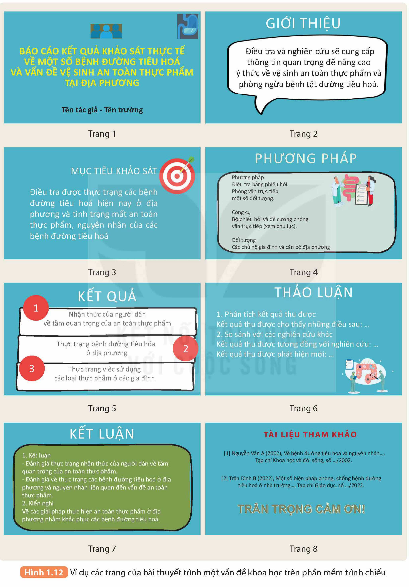

Hình 1.12. Ví dụ các trang của bài thuyết trình một vấn đề khoa học trên phần mềm trình chiếu

<!-- pdf:15 -->

> 1. Để thực hiện thuyết trình báo cáo kết quả nghiên cứu, thực hành, em hãy xây dựng bản trình chiếu trên phần mềm.
> 2. Trình bày báo cáo với các bạn trong lớp về một vấn đề khoa học mà em đã lựa chọn.

### 2. Báo cáo treo tường

**Báo cáo treo tường** là một hình thức trình bày báo cáo kết quả nghiên cứu và được xây dựng như sau:

1. Kích thước và định dạng: Kích thước tiêu chuẩn cho báo cáo treo tường là A0 hoặc A1. Chọn định dạng dọc hoặc ngang tuỳ thuộc vào nội dung và sở thích cá nhân.
2. Tiêu đề và thông tin tác giả: Tiêu đề rõ ràng và dễ đọc từ khoảng cách xa; tên tác giả của báo cáo nên nằm dưới tiêu đề.
3. Định dạng nội dung và thiết kế:
   - Chia báo cáo treo tường thành các phần/khu vực rõ ràng như: giới thiệu, phương pháp, kết quả, thảo luận và kết luận. Sử dụng hình ảnh, biểu đồ và đồ thị để trình bày thông tin một cách trực quan.
   - Cân nhắc việc sử dụng màu sắc: Màu nền không nên quá rực rỡ và nên có sự đối lập giữa màu chữ và màu nền. Font chữ nên đơn giản và dễ đọc, kích thước chữ phù hợp.
4. Nội dung báo cáo treo tường:
   - Giới thiệu: Mô tả ngắn gọn về vấn đề nghiên cứu và mục tiêu.
   - Phương pháp: Mô tả cách thức thu thập dữ liệu và tiếp cận vấn đề.
   - Kết quả: Trình bày dữ liệu thông qua hình ảnh, biểu đồ, đồ thị.
   - Thảo luận: Phân tích kết quả và so sánh với các nghiên cứu khác (nếu có).
   - Kết luận: Tóm tắt những phát hiện và đưa ra các gợi ý hoặc hướng nghiên cứu tiếp theo.
   - Tài liệu tham khảo: Liệt kê nguồn tham khảo đã sử dụng. Có thể sử dụng chữ nhỏ hơn ở phần này để tiết kiệm không gian.

*Lưu ý khi trình bày:* Dùng ít chữ và tập trung vào việc truyền đạt thông điệp chính thông qua hình ảnh và đồ thị; đảm bảo hình ảnh và văn bản rõ ràng, sắc nét (ví dụ như Hình 1.13); trưng bày báo cáo treo tường ở nơi dễ nhìn và tiếp cận được.

<!-- pdf:16 -->

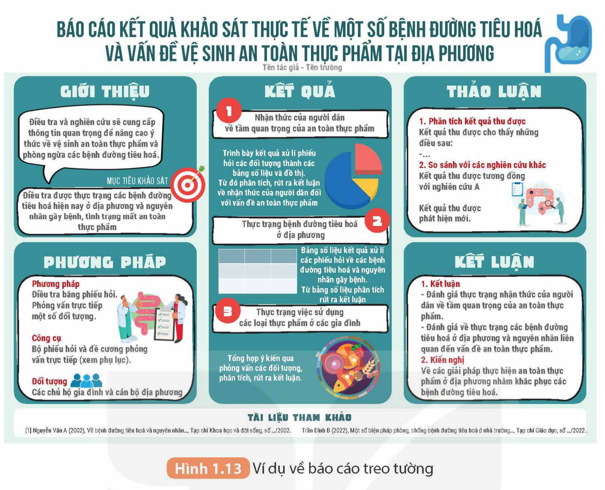

Hình 1.13. Ví dụ về báo cáo treo tường

> Em hãy thiết kế một báo cáo treo tường để trình bày kết quả của một nghiên cứu khoa học hoặc một bài thực hành mà em đã thực hiện trong môn Khoa học tự nhiên.

> ❓ Em hãy so sánh ưu, nhược điểm của hai cách thuyết trình báo cáo: sử dụng phần mềm trình chiếu và sử dụng báo cáo treo tường.

## 📌 Em đã học

- Tên một số dụng cụ thí nghiệm và chức năng sử dụng; các lưu ý khi sử dụng các dụng cụ và cách bảo quản chúng.
- Các hoá chất cơ bản trong phòng thí nghiệm; cách bảo quản và sử dụng chúng.
- Cấu trúc của bài báo cáo một vấn đề khoa học: 1. Tiêu đề; 2. Tóm tắt; 3. Giới thiệu; 4. Phương pháp; 5. Kết quả; 6. Thảo luận; 7. Kết luận; 8. Tài liệu tham khảo.

## ✏️ Em có thể

- Lựa chọn được các dụng cụ, hoá chất để thiết kế các thí nghiệm, thực hiện các nhiệm vụ học tập theo yêu cầu của giáo viên.
- Trình bày được kết quả nghiên cứu bằng bảng số liệu, biểu đồ, đồ thị. Trình bày được báo cáo một vấn đề khoa học dựa trên phần mềm trình chiếu hoặc báo cáo treo tường.

## 📷 Danh sách hình trong bài

| Mã hình | Trang PDF | Vị trí trong bài | Chú thích gốc |
| --- | :---: | --- | --- |
| H9-khoa_hoc_tu_nhien-b01-01 | 8 | Mục I.1.a | Hình 1.1. Nguồn sáng: a) Đèn 12 V – 21 W; b) Đèn laser |
| H9-khoa_hoc_tu_nhien-b01-02 | 8 | Mục I.1.b | Hình 1.2. Bản bán trụ và bảng chia độ |
| H9-khoa_hoc_tu_nhien-b01-03 | 9 | Mục I.1.c | Hình 1.3. Bộ dụng cụ tìm hiểu tính chất ảnh qua thấu kính |
| H9-khoa_hoc_tu_nhien-b01-04 | 9 | Mục I.2.a | Hình 1.4. Điện kế |
| H9-khoa_hoc_tu_nhien-b01-05 | 9 | Mục I.2.b | Hình 1.5. Đồng hồ đo điện đa năng |
| H9-khoa_hoc_tu_nhien-b01-06 | 9 | Mục I.2.c | Hình 1.6. Sơ đồ mô tả cách mắc đèn LED với cuộn dây dẫn (a), cuộn dây dẫn kín có hai đèn LED (b) |
| H9-khoa_hoc_tu_nhien-b01-07 | 10 | Mục I.3 | Hình 1.7. Bát sứ |
| H9-khoa_hoc_tu_nhien-b01-08 | 10 | Mục I.3 | Hình 1.8. Phễu |
| H9-khoa_hoc_tu_nhien-b01-09 | 10 | Mục I.3 | Hình 1.9. Bình cầu |
| H9-khoa_hoc_tu_nhien-b01-10 | 10 | Mục I.3 | Hình 1.10. Lưới tản nhiệt |
| H9-khoa_hoc_tu_nhien-b01-11 | 10 | Mục I.4 | Hình 1.11. Hộp có chứa các tiêu bản cố định NST |
| H9-khoa_hoc_tu_nhien-b01-12 | 14 | Mục IV.1 | Hình 1.12. Ví dụ các trang của bài thuyết trình một vấn đề khoa học trên phần mềm trình chiếu |
| H9-khoa_hoc_tu_nhien-b01-13 | 16 | Mục IV.2 | Hình 1.13. Ví dụ về báo cáo treo tường |
