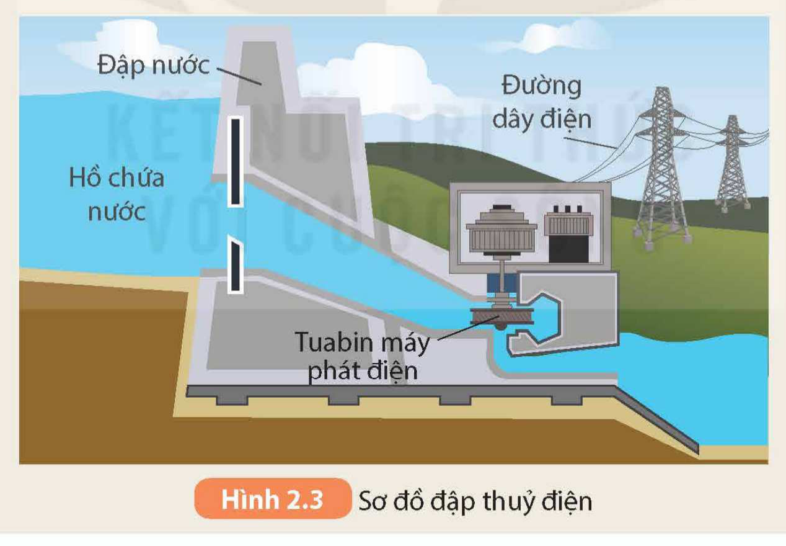
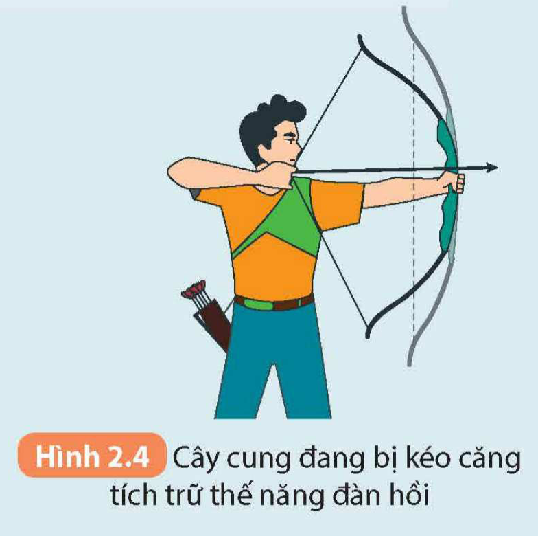

<!-- pdf:17 -->

# BÀI 2: ĐỘNG NĂNG. THẾ NĂNG

## 🎯 Mục tiêu

- Viết được biểu thức tính động năng của vật.
- Viết được biểu thức tính thế năng của vật ở gần mặt đất.

## 🔴 Mở đầu

Khi chơi xích đu, động năng của người chơi thay đổi như thế nào trong khi chuyển động từ vị trí cao nhất $A$ tới vị trí thấp nhất $O$?

## I. Động năng

Một quả bóng bi-a chuyển động đến đập vào quả bóng bi-a khác làm cho chúng biến đổi chuyển động. Các phần tử khí chuyển động tạo thành gió có thể làm di chuyển thuyền buồm, làm quay tuabin của máy phát điện gió. Dòng nước chảy có thể làm quay các cọn nước. Năng lượng mà vật có được do chuyển động như trong các ví dụ trên gọi là **động năng**.

Trong ví dụ ở Hình 2.1, nếu búa có khối lượng càng lớn và chuyển động càng nhanh thì khi đập vào thanh thép sẽ làm thanh thép biến dạng càng nhiều, chứng tỏ động năng của búa càng lớn.

Hình 2.1. Búa chuyển động đập vào thanh thép, làm biến dạng thanh thép

Động năng của vật phụ thuộc vào khối lượng và tốc độ của nó.

> Quan sát Hình 2.2 và cho biết vật nào có động năng lớn nhất. Hãy lí giải câu trả lời của em.
>
> 
>
> Hình 2.2. Một số vật có động năng: a) Quả bóng đang bay tới rổ; b) Ô tô đang di chuyển trên đường cao tốc; c) Máy bay đang chuyển động trên bầu trời

<!-- pdf:18 -->

Một vật có khối lượng $m$ đang chuyển động với tốc độ $v$ thì động năng của vật là:

$W_{\text{đ}} = \dfrac{1}{2}mv^2$

Trong đó:
- $m$ là khối lượng của vật, đơn vị đo là $\text{kg}$.
- $v$ là tốc độ của vật, đơn vị đo là $\text{m/s}$.
- $W_{\text{đ}}$ là động năng của vật, đơn vị đo là jun ($\text{J}$).

> ❓ 1. Động năng của một xe ô tô thay đổi như thế nào nếu tốc độ của xe tăng gấp đôi?
> 2. Tính động năng của quả bóng đá có khối lượng $m = 0,45\text{ kg}$, đang bay với tốc độ $v = 10\text{ m/s}$.
> 3. Trả lời câu hỏi ở phần mở bài.

## II. Thế năng

**Thế năng trọng trường** (gọi tắt là thế năng) là năng lượng của một vật khi nó ở một độ cao nhất định so với mặt đất hoặc so với một vật được chọn làm gốc để tính độ cao.

> Để dự trữ năng lượng, người ta xây dựng những đập nước ngăn các dòng chảy để tạo thành những hồ chứa nước. Lượng nước trong hồ chứa càng lớn thì năng lượng được tích trữ càng lớn. Hãy giải thích vì sao để khai thác được tối đa thế năng của nước trong hồ chứa, người ta thường bố trí sao cho vị trí đặt máy phát càng thấp so với mực nước hồ chứa (Hình 2.3).
>
> 
>
> Hình 2.3. Sơ đồ đập thuỷ điện

Độ lớn của thế năng trọng trường được tính bằng công thức:

$W_{\text{t}} = Ph$

Trong đó:
- $P$ là trọng lượng của vật, đơn vị đo là niutơn ($\text{N}$).
- $h$ là độ cao của vật so với vị trí chọn làm gốc, đơn vị đo là mét ($\text{m}$).
- $W_{\text{t}}$ là thế năng trọng trường của vật, đơn vị đo là jun ($\text{J}$).

Giá trị của thế năng phụ thuộc vào gốc chọn để tính độ cao, hay còn gọi là **gốc thế năng**. Người ta thường chọn mặt đất làm gốc để tính độ cao.

<!-- pdf:19 -->

> ❓ 1. So sánh thế năng trọng trường của hai vật ở cùng một độ cao so với gốc thế năng, biết khối lượng của vật thứ nhất gấp 3 lần khối lượng của vật thứ hai.
> 2. Một công nhân vác một bao xi măng có trọng lượng $500\text{ N}$ trên vai, đứng trên sân thượng toà nhà cao $20\text{ m}$ so với mặt đất. Độ cao của bao xi măng so với mặt sân thượng là $1,4\text{ m}$. Tính thế năng trọng trường của bao xi măng trong hai trường hợp sau:
>    a) Chọn gốc thế năng tại mặt sân thượng toà nhà.
>    b) Chọn gốc thế năng tại mặt đất.

## 📌 Em đã học

- Biểu thức tính động năng của vật: $W_{\text{đ}} = \dfrac{1}{2}mv^2$
  Trong đó:
  - $m$ là khối lượng của vật, đơn vị đo là $\text{kg}$.
  - $v$ là tốc độ của vật, đơn vị đo là $\text{m/s}$.
  - $W_{\text{đ}}$ là động năng của vật, đơn vị đo là jun ($\text{J}$).
- Biểu thức tính thế năng trọng trường của vật: $W_{\text{t}} = Ph$
  Trong đó:
  - $P$ là trọng lượng của vật, đơn vị đo là $\text{N}$.
  - $h$ là độ cao của vật so với vị trí chọn làm gốc thế năng, đơn vị đo là $\text{m}$.
  - $W_{\text{t}}$ là thế năng trọng trường của vật, đơn vị đo là jun ($\text{J}$).

## ✏️ Em có thể

Tính được động năng, thế năng của các vật và giải thích được nguyên lí tích trữ năng lượng dưới dạng thế năng trọng trường trong nhà máy thuỷ điện.

> 🔍 **Em có biết?**
>
> Ngoài thế năng trọng trường, trong thực tiễn vật còn có thể dự trữ năng lượng dưới các dạng thế năng sau:
> - **Thế năng đàn hồi**: xuất hiện khi một vật bị biến dạng đàn hồi. Ví dụ một cây cung đang bị kéo căng có thế năng đàn hồi (Hình 2.4).
> - **Thế năng tĩnh điện**: khi một điện tích đặt cạnh một điện tích khác, lực tương tác giữa các điện tích tạo ra thế năng của hệ điện tích.
>
> 
>
> Hình 2.4. Cây cung đang bị kéo căng tích trữ thế năng đàn hồi

## 📷 Danh sách hình trong bài

| Mã hình | Trang PDF | Vị trí trong bài | Chú thích gốc |
| --- | :---: | --- | --- |
| H9-khoa_hoc_tu_nhien-b02-01 | 17 | Mở đầu | (Hình mở đầu Bài 2: Chơi xích đu chuyển động từ vị trí A tới vị trí O) |
| H9-khoa_hoc_tu_nhien-b02-02 | 17 | Mục I | Hình 2.1. Búa chuyển động đập vào thanh thép, làm biến dạng thanh thép |
| H9-khoa_hoc_tu_nhien-b02-03 | 17 | Mục I | Hình 2.2. Một số vật có động năng: a) Quả bóng đang bay tới rổ; b) Ô tô đang di chuyển trên đường cao tốc; c) Máy bay đang chuyển động trên bầu trời |
| H9-khoa_hoc_tu_nhien-b02-04 | 18 | Mục II | Hình 2.3. Sơ đồ đập thuỷ điện |
| H9-khoa_hoc_tu_nhien-b02-05 | 19 | Em có biết? | Hình 2.4. Cây cung đang bị kéo căng tích trữ thế năng đàn hồi |
