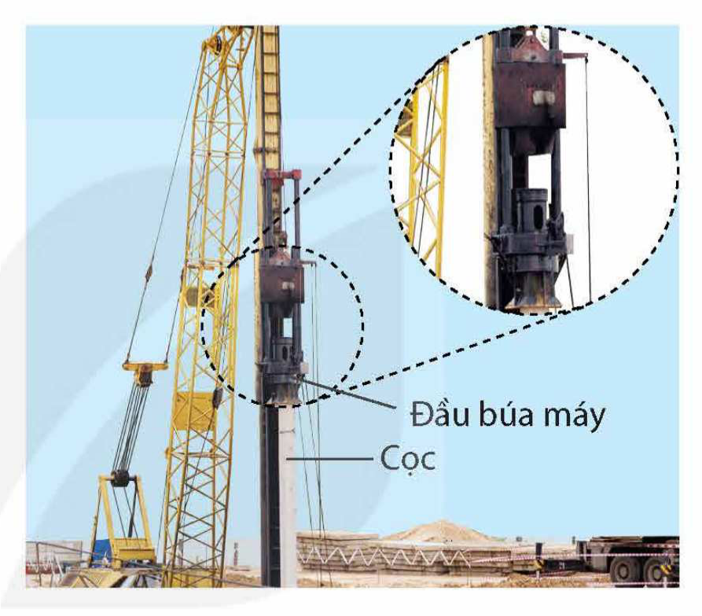
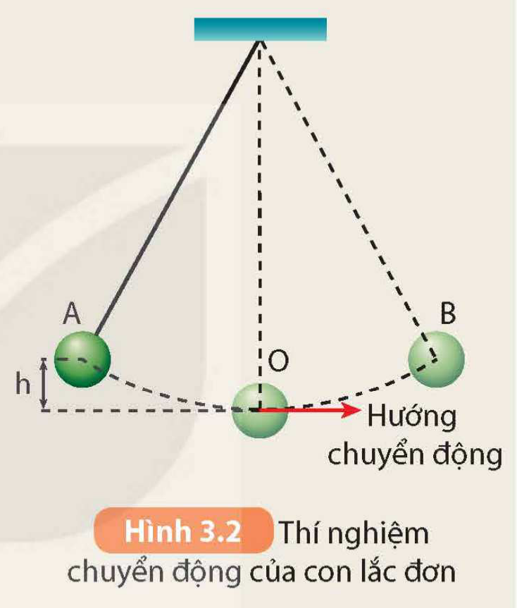
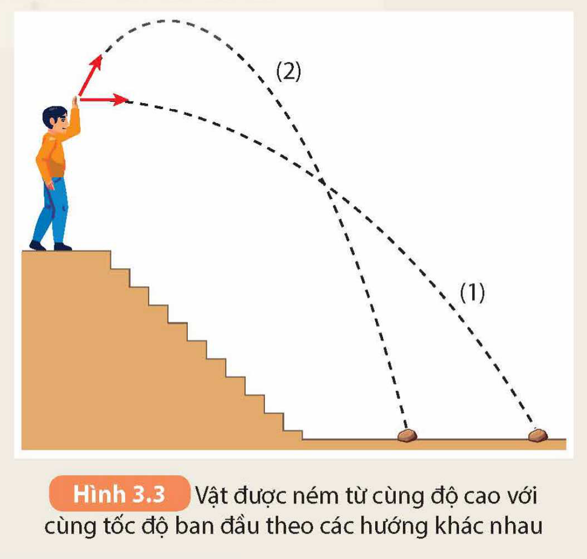
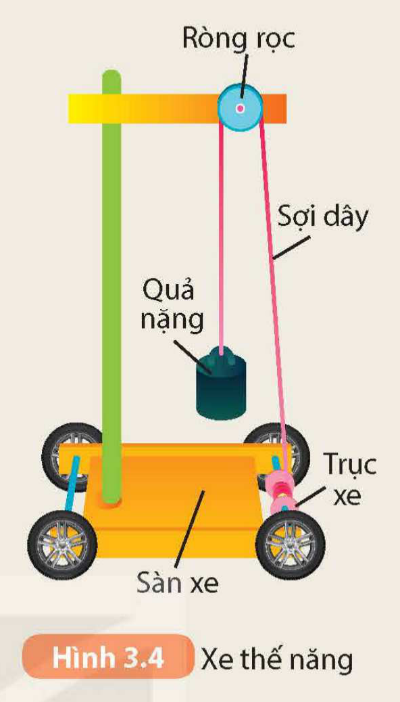

<!-- pdf:20 -->

# BÀI 3: CƠ NĂNG

## 🎯 Mục tiêu

- Nêu được cơ năng là tổng động năng và thế năng của vật.
- Vận dụng khái niệm cơ năng phân tích được sự chuyển hoá năng lượng trong một số trường hợp đơn giản.

## 🔴 Mở đầu

Khi sử dụng búa máy để đóng cọc, đầu búa được nâng lên đến một độ cao nhất định rồi thả cho rơi xuống cọc cần đóng.

Trong quá trình rơi, động năng và thế năng của đầu búa chuyển hoá qua lại lẫn nhau như thế nào?

## I. Cơ năng

Trong trò chơi tung hứng (Hình 3.1), khi xét giai đoạn vật chuyển động lên trên, độ cao của vật tăng dần nên thế năng của vật tăng dần; đồng thời tốc độ của vật giảm dần nên động năng của vật giảm dần. Xét giai đoạn vật rơi xuống, thế năng của vật giảm dần, động năng của vật lại tăng dần. Động năng và thế năng có thể chuyển hoá qua lại lẫn nhau.

Tổng động năng và thế năng được gọi là **cơ năng** của vật:

$W_{\text{C}} = W_{\text{đ}} + W_{\text{t}} = \dfrac{1}{2}mv^2 + Ph$

Đơn vị của cơ năng là jun ($\text{J}$).

Hình 3.1. Người chơi tung hứng bóng

> Lấy ví dụ về trường hợp vật vừa có động năng, vừa có thế năng. Mô tả sự chuyển hoá giữa động năng và thế năng của vật đó.

<!-- pdf:21 -->

> ❓ Một vật có khối lượng $m = 1,5\text{ kg}$ được thả rơi từ độ cao $h = 4\text{ m}$ so với mặt đất. Chọn gốc thế năng ở mặt đất, tính tốc độ của vật ngay trước khi chạm đất. Biết toàn bộ thế năng của vật chuyển hoá thành động năng của vật.

## II. Sự chuyển hoá năng lượng

<!-- term: Bảo toàn cơ năng -->
Nếu cơ năng của vật không chuyển hoá thành dạng năng lượng khác thì tổng động năng và thế năng của vật luôn không đổi, cơ năng của vật được bảo toàn.

<!-- term: Bảo toàn cơ năng -->
Trong nhiều trường hợp, cơ năng có thể chuyển hoá thành các dạng năng lượng khác, khi đó cơ năng không được bảo toàn.

> **Thí nghiệm về sự chuyển hoá động năng – thế năng**
>
> *Chuẩn bị:* Con lắc đơn (gồm vật nặng, sợi dây không dãn) được treo vào giá thí nghiệm.
>
> *Tiến hành:*
> - Kéo vật nặng đến vị trí $A$ ở độ cao $h$ rồi thả nhẹ, vật nặng chuyển động đến vị trí thấp nhất $O$ rồi tiếp tục đi lên, rồi dừng lại tại điểm $B$ (Hình 3.2), sau đó chuyển động ngược lại.
> - So sánh độ cao điểm $B$ với độ cao điểm $A$.
> - Quan sát vật nặng chuyển động qua lại điểm $O$ sau một khoảng thời gian.
>
> 
>
> Hình 3.2. Thí nghiệm chuyển động của con lắc đơn
>
> *Trả lời các câu hỏi sau:*
> 1. Có nhận xét gì về sự chuyển hoá giữa động năng và thế năng của vật nặng?
> 2. Vì sao sau một thời gian chuyển động, độ cao của vật nặng giảm dần?

> ❓ Nếu bỏ qua lực cản của không khí, hãy mô tả sự chuyển hoá động năng và thế năng của các vật được ném với cùng tốc độ ban đầu (Hình 3.3) trong hai trường hợp:
> - Ném theo phương ngang, vật chuyển động theo quỹ đạo (1).
> - Ném theo hướng chếch lên trên, vật chuyển động theo quỹ đạo (2).
>
> 
>
> Hình 3.3. Vật được ném từ cùng độ cao với cùng tốc độ ban đầu theo các hướng khác nhau

<!-- pdf:22 -->

> Xe thế năng có cấu tạo được mô tả trong Hình 3.4. Quả nặng được nối với trục xe qua một ròng rọc cố định bởi một sợi dây mềm, không dãn. Sợi dây được quấn nhiều vòng quanh trục xe.
>
> Khi thả quả nặng chuyển động từ trên xuống, sợi dây sẽ kéo trục bánh xe làm bánh xe lăn, xe sẽ chuyển động.
> a) Mô tả sự chuyển hoá năng lượng từ khi thả quả nặng đến khi quả nặng chạm sàn xe.
> b) Cho độ cao ban đầu của quả nặng so với sàn xe là $8\text{ cm}$, khối lượng của quả nặng là $m_1 = 20\text{ g}$, khối lượng của xe là $m_2 = 50\text{ g}$. Tính tốc độ của xe ngay khi quả nặng chạm sàn xe, nếu coi toàn bộ thế năng của quả nặng chuyển hoá thành động năng.
> c) Trong thực tế, giá trị tốc độ thu được của xe khi quả nặng chạm sàn xe sẽ nhỏ hơn giá trị tính toán ở câu b. Hãy giải thích tại sao.
>
> 
>
> Hình 3.4. Xe thế năng

## 📌 Em đã học

- Động năng và thế năng có thể chuyển hoá qua lại lẫn nhau.
- Cơ năng của một vật là tổng động năng và thế năng:
  $W_{\text{C}} = W_{\text{đ}} + W_{\text{t}} = \dfrac{1}{2}mv^2 + Ph$
  Trong đó: $W_{\text{C}}$ là cơ năng có đơn vị là jun ($\text{J}$).

## ✏️ Em có thể

- Giải thích được vì sao để nhảy được xa, người ta cần chạy lấy đà đủ nhanh và bật cao tại vị trí giậm nhảy.

> 🔍 **Em có biết?**
>
> Cơ năng có thể chuyển hoá thành nhiệt năng do trong quá trình chuyển động vật chịu tác dụng của lực ma sát, lực cản của môi trường. Khi cơ năng chuyển hoá thành nhiệt năng, cơ năng sẽ không còn bảo toàn nhưng năng lượng vẫn được bảo toàn.

## 📷 Danh sách hình trong bài

| Mã hình | Trang PDF | Vị trí trong bài | Chú thích gốc |
| --- | :---: | --- | --- |
| H9-khoa_hoc_tu_nhien-b03-01 | 20 | Mở đầu | (Hình mở đầu Bài 3: Búa máy đóng cọc) |
| H9-khoa_hoc_tu_nhien-b03-02 | 20 | Mục I | Hình 3.1. Người chơi tung hứng bóng |
| H9-khoa_hoc_tu_nhien-b03-03 | 21 | Mục II | Hình 3.2. Thí nghiệm chuyển động của con lắc đơn |
| H9-khoa_hoc_tu_nhien-b03-04 | 21 | Mục II | Hình 3.3. Vật được ném từ cùng độ cao với cùng tốc độ ban đầu theo các hướng khác nhau |
| H9-khoa_hoc_tu_nhien-b03-05 | 22 | Mục II | Hình 3.4. Xe thế năng |
