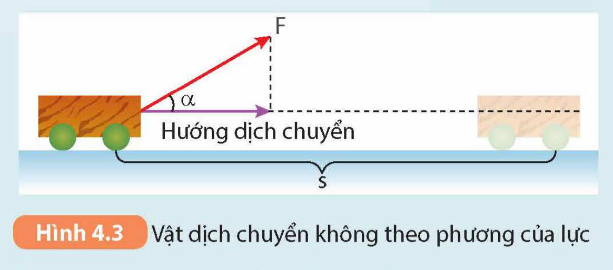

<!-- pdf:23 -->

# BÀI 4: CÔNG VÀ CÔNG SUẤT

## 🎯 Mục tiêu

- Phân tích ví dụ cụ thể để rút ra được: công có giá trị bằng lực nhân với quãng đường dịch chuyển theo hướng của lực, công suất là tốc độ thực hiện công.
- Liệt kê được một số đơn vị thường dùng đo công và công suất.
- Tính được công và công suất trong một số trường hợp đơn giản.

## 🔴 Mở đầu

Trong đời sống, ta thường nói cần "tốn công" khi thực hiện các công việc như cấy lúa, xây nhà, ngồi đợi xe,... Công trong mỗi trường hợp đó được xác định như thế nào?

## I. Công

Trong tự nhiên, khi các vật tương tác với nhau, năng lượng có thể được truyền từ vật này sang vật khác. Có hai hình thức truyền năng lượng phổ biến là: truyền nhiệt và thực hiện công. Trong bài này ta sẽ tìm hiểu hình thức truyền năng lượng bằng cách thực hiện công.

Một người đẩy một xe hàng chuyển động trên mặt sàn nằm ngang (Hình 4.1). Sau khi dịch chuyển một quãng đường $s$ trên mặt sàn, xe hàng có tốc độ $v$, nghĩa là nó có một động năng nhất định. Động năng của xe hàng có được là do người đã thực hiện một công cơ học.

**Công cơ học** thường được gọi tắt là công, đó là số đo phần năng lượng được truyền từ vật này qua vật khác trong tương tác giữa các vật. Trong ví dụ ở Hình 4.1, xe hàng nhận năng lượng nên động năng của nó tăng.

Hình 4.1. Lực đẩy $F$ làm xe hàng dịch chuyển một đoạn $s$ theo hướng của lực

Công $A$ của một lực $F$ không đổi làm vật dịch chuyển một quãng đường $s$ theo hướng của lực được xác định bởi biểu thức:

$A = Fs$

Trong đó:
- $F$ là lực tác dụng lên vật, đơn vị đo là niutơn ($\text{N}$);
- $s$ là quãng đường dịch chuyển theo hướng của lực, đơn vị đo là mét ($\text{m}$).

Khi lực $F = 1\text{ N}$ và quãng đường $s = 1\text{ m}$ thì công $A = 1\text{ N} \cdot 1\text{ m} = 1\text{ Nm}$.

Đơn vị của công là **jun**, kí hiệu là $\text{J}$ ($1\text{ J} = 1\text{ Nm}$).

Các bội của jun là kilôjun ($\text{kJ}$) và mêgajun ($\text{MJ}$):

$1\text{ kJ} = 10^3\text{ J}$

$1\text{ MJ} = 10^6\text{ J}$

<!-- term: Đơn vị đo công -->
Trong thực tế, người ta còn dùng các đơn vị công là BTU và calo ($\text{cal}$):

$1\text{ BTU} = 1055\text{ J}$

$1\text{ cal} = 4,186\text{ J}$

Bội của calo là kilôcalo ($\text{kcal}$): $1\text{ kcal} = 1\ 000\text{ cal} = 4\ 186\text{ J}$.

<!-- pdf:24 -->

> Hãy mô tả quá trình thực hiện công trong các ví dụ ở Hình 4.2 thông qua việc xác định lực tác dụng lên vật và quãng đường vật dịch chuyển theo hướng của lực.
>
> 
>
> Hình 4.2. Ví dụ các trường hợp thực hiện công cơ học và không thực hiện công cơ học: a) Đưa vật nặng lên cao; b) Vận động viên ném lao; c) Học sinh đang ngồi học; d) Vận động viên đứng yên giữ tạ

> 🔍 **Em có biết?**
>
> Trong trường hợp vật dịch chuyển không theo phương của lực (Hình 4.3), công của lực $F$ làm vật dịch chuyển một quãng đường $s$ được tính theo công thức:
>
> $A = Fs\cos\alpha$

> (với $\alpha$ là góc hợp bởi hướng của lực tác dụng và hướng dịch chuyển của vật).
>
> 
>
> Hình 4.3. Vật dịch chuyển không theo phương của lực
>
> Nếu vật dịch chuyển theo phương vuông góc với phương của lực thì công của lực đó bằng $0$.

> ❓ Một xe nâng tác dụng một lực hướng lên thẳng đứng, có độ lớn $700\text{ N}$ để nâng thùng hàng từ mặt đất lên độ cao $2\text{ m}$. Tính công của lực nâng.

<!-- pdf:25 -->

## II. Công suất

> Hai xe nâng hai thùng hàng từ mặt đất (điểm $A$) tới sàn xe có độ cao $1\text{ m}$ (điểm $B$). Xe thứ nhất nâng thùng hàng có trọng lượng $500\text{ N}$ hết thời gian $10\text{ s}$ (Hình 4.4). Xe thứ hai nâng thùng hàng có trọng lượng $700\text{ N}$ hết thời gian $15\text{ s}$.
> a) Tính công mà mỗi xe đã thực hiện để nâng các thùng hàng.
> b) Xe nào thực hiện công nhanh hơn?
>
> 
>
> Hình 4.4. Nâng thùng hàng bằng xe nâng

Để đánh giá việc thực hiện công của người hay thiết bị sinh công, người ta không chỉ quan tâm đến độ lớn của công thực hiện được mà còn quan tâm đến việc công này được thực hiện nhanh hay chậm. Tốc độ thực hiện công nhanh hay chậm của người hay thiết bị sinh công được gọi là **công suất**.

Nếu trong thời gian $t$, công thực hiện là $A$ thì công suất $\mathcal{P}$ được tính theo công thức:

$\mathcal{P} = \dfrac{A}{t}$

Trong đó:
- $A$ là công thực hiện được, đơn vị đo là jun ($\text{J}$).
- $t$ là thời gian thực hiện công, đơn vị đo là giây ($\text{s}$).

Đơn vị của công suất là **oát** ($\text{W}$): $1\text{ W} = \dfrac{1\text{ J}}{1\text{ s}}$

Các bội của oát là kilôoát ($\text{kW}$), mêgaoát ($\text{MW}$) và gigaoát ($\text{GW}$):

$1\text{ kW} = 10^3\text{ W}$

$1\text{ MW} = 10^6\text{ W}$

$1\text{ GW} = 10^9\text{ W}$

Người ta còn dùng đơn vị khác của công suất:
- **Mã lực** ($\text{HP}$): $1\text{ HP} = 746\text{ W}$.
- Đơn vị công suất của các thiết bị sưởi ấm hoặc làm lạnh là BTU trên giờ ($\text{BTU/h}$): $1\text{ BTU/h} = 0,293\text{ W}$

<!-- pdf:26 -->

Bảng 4.1. Một số giá trị công suất

| Đối tượng | Công suất $\mathcal{P}$ | Đối tượng | Công suất $\mathcal{P}$ |
| --- | --- | --- | --- |
| Ngựa | Khoảng $700\text{ W}$ | Tên lửa | Khoảng $2 \cdot 10^7\text{ W}$ |
| Ô tô | $2 \cdot 10^4\text{ W} - 3 \cdot 10^5\text{ W}$ | Nhà máy thuỷ điện Hoà Bình | Khoảng $5 \cdot 10^9\text{ W}$ |
| Đầu máy xe lửa | $10^6\text{ W} - 3 \cdot 10^6\text{ W}$ | Mặt Trời | Khoảng $37 \cdot 10^{25}\text{ W}$ |

> ❓ Cứ mỗi lần đập, tim người thực hiện một công khoảng $1\text{ J}$. Em hãy đề xuất cách đo công suất của tim bằng cách sử dụng một đồng hồ bấm giây.

## 📌 Em đã học

- Công có giá trị bằng lực nhân với quãng đường dịch chuyển theo hướng của lực:
  $A = Fs$
  Trong đó:
  - $F$ là lực tác dụng, đơn vị đo là niutơn ($\text{N}$);
  - $s$ là quãng đường dịch chuyển theo hướng của lực, đơn vị đo là mét ($\text{m}$);
  - $A$ là công cơ học, đơn vị đo là jun ($\text{J}$).
- Công suất là tốc độ thực hiện công: $\mathcal{P} = \dfrac{A}{t}$
  Trong đó:
  - $A$ là công cơ học, đơn vị đo là jun ($\text{J}$);
  - $t$ là thời gian, đơn vị đo là giây ($\text{s}$);
  - $\mathcal{P}$ là công suất, đơn vị đo là oát ($\text{W}$).

## ✏️ Em có thể

- Tính được công suất của thiết bị thực hiện công trong thực tế.

> 🔍 **Em có biết?**
>
> Công suất cũng được sử dụng để mô tả tốc độ chuyển hoá năng lượng của các dạng năng lượng khác như nhiệt năng, điện năng. Ví dụ như một bóng đèn có công suất $50\text{ W}$ có nghĩa là bóng đèn đó có thể chuyển hoá $50\text{ J}$ điện năng trong vòng $1\text{ s}$ thành các dạng năng lượng khác như quang năng, nhiệt năng.

## 📷 Danh sách hình trong bài

| Mã hình | Trang PDF | Vị trí trong bài | Chú thích gốc |
| --- | :---: | --- | --- |
| H9-khoa_hoc_tu_nhien-b04-01 | 23 | Mục I | Hình 4.1. Lực đẩy F làm xe hàng dịch chuyển một đoạn s theo hướng của lực |
| H9-khoa_hoc_tu_nhien-b04-02 | 24 | Mục I | Hình 4.2. Ví dụ các trường hợp thực hiện công cơ học và không thực hiện công cơ học: a) Đưa vật nặng lên cao; b) Vận động viên ném lao; c) Học sinh đang ngồi học; d) Vận động viên đứng yên giữ tạ |
| H9-khoa_hoc_tu_nhien-b04-03 | 24 | Mục I, Em có biết? | Hình 4.3. Vật dịch chuyển không theo phương của lực |
| H9-khoa_hoc_tu_nhien-b04-04 | 25 | Mục II | Hình 4.4. Nâng thùng hàng bằng xe nâng |
