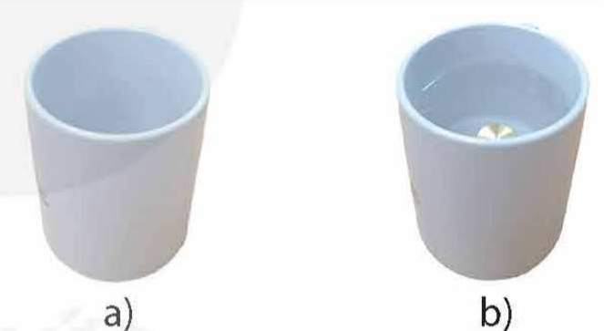
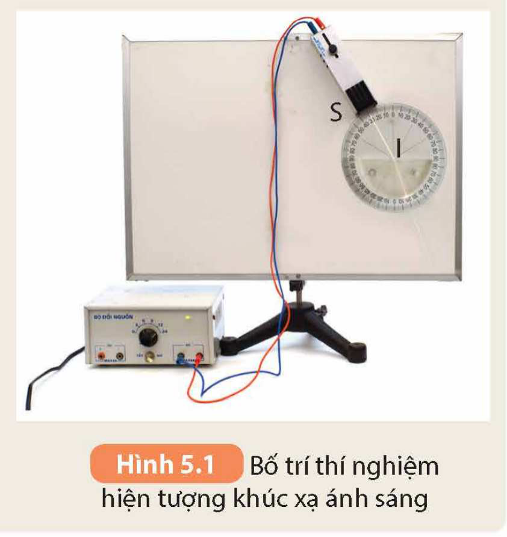
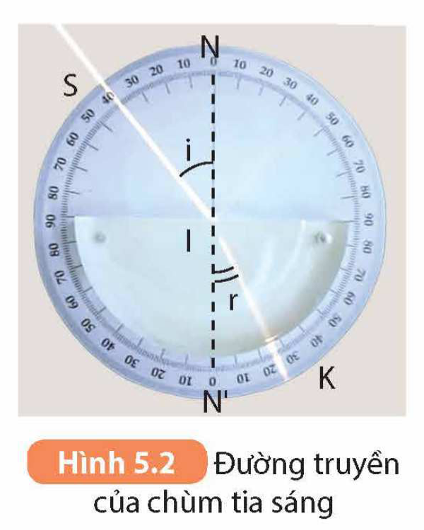
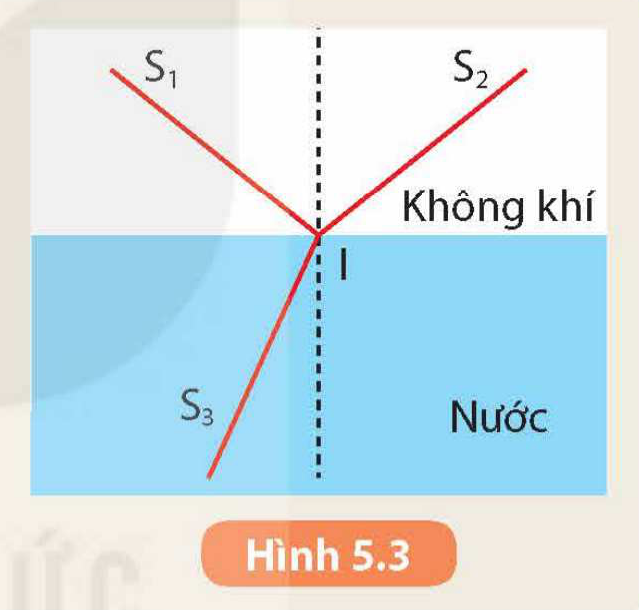
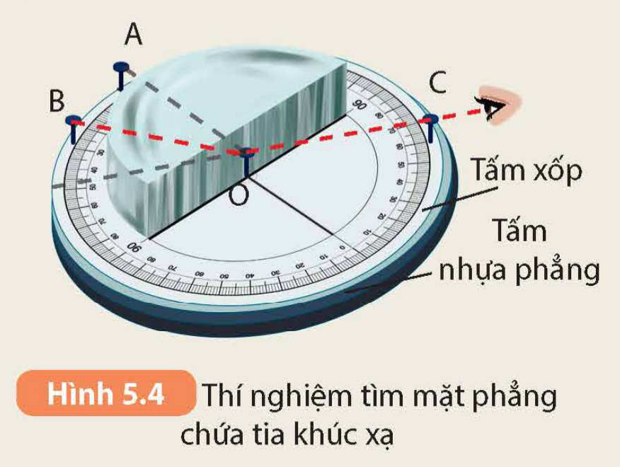
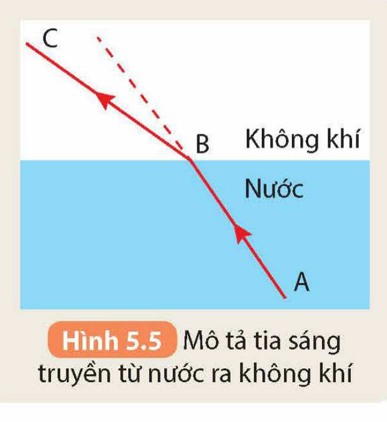
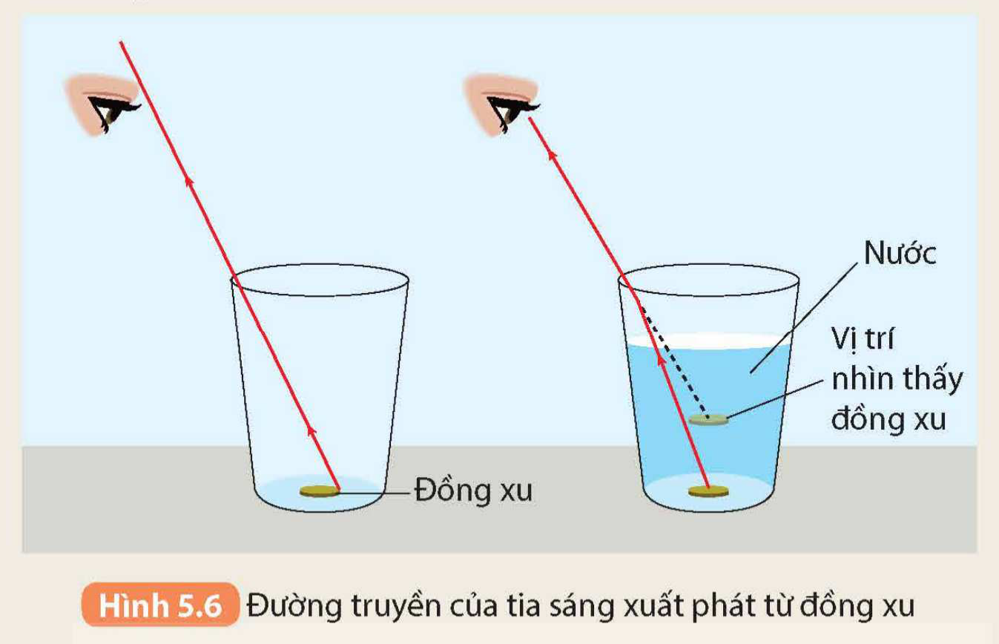

<!-- pdf:27 -->

# BÀI 5: KHÚC XẠ ÁNH SÁNG

## 🎯 Mục tiêu

- Thực hiện thí nghiệm chứng tỏ được khi truyền từ môi trường này sang môi trường khác, tia sáng có thể bị khúc xạ (bị lệch khỏi phương truyền ban đầu).
- Nêu được chiết suất có giá trị bằng tỉ số tốc độ ánh sáng trong không khí (hoặc chân không) với tốc độ ánh sáng trong môi trường.
- Thực hiện được thí nghiệm để rút ra và phát biểu được định luật khúc xạ ánh sáng.
- Vận dụng được biểu thức $n = \dfrac{\sin i}{\sin r}$ trong một số trường hợp đơn giản.
- Vận dụng kiến thức về sự khúc xạ ánh sáng để giải quyết một số hiện tượng đơn giản thường gặp trong thực tế.

## 🔴 Mở đầu

Tại sao khi trong cốc không có nước thì ta không thể nhìn thấy đồng xu (hình a), còn nếu vẫn giữ nguyên vị trí đặt mắt và cốc nhưng rót nước vào cốc thì ta lại nhìn thấy đồng xu (hình b)?

## I. Hiện tượng khúc xạ ánh sáng

> **Thí nghiệm 1: Tìm hiểu hiện tượng khúc xạ ánh sáng**
>
> *Chuẩn bị:*
> - Một bảng thí nghiệm có gắn tấm nhựa in vòng tròn chia độ;
> - Một bản bán trụ bằng thuỷ tinh;
> - Đèn $12\text{ V} - 21\text{ W}$ có khe cài bản chắn sáng;
> - Nguồn điện (biến áp nguồn).
>
> *Tiến hành:*
> - Bố trí thí nghiệm như Hình 5.1.
> - Chiếu một chùm sáng tới $SI$ (điểm tới $I$ là tâm của bản bán trụ).
> - Quan sát đường đi của chùm sáng.
>
> 
>
> Hình 5.1. Bố trí thí nghiệm hiện tượng khúc xạ ánh sáng
>
> *Trả lời câu hỏi sau:*
>
> Chùm sáng truyền từ không khí vào thuỷ tinh bị gãy khúc (lệch khỏi phương truyền) tại đâu?

<!-- pdf:28 -->

Trên Hình 5.2, quy ước gọi:
- $I$ là **điểm tới**;
- $SI$ là **tia tới**;
- $IK$ là **tia khúc xạ**;
- $NN'$ (vuông góc với mặt phân cách tại điểm tới) là **pháp tuyến**;
- $\widehat{SIN}$ là **góc tới**, kí hiệu là $i$;
- $\widehat{KIN'}$ là **góc khúc xạ**, kí hiệu là $r$;
- Mặt phẳng chứa tia tới $SI$ và pháp tuyến $NN'$ là **mặt phẳng tới**.

Hình 5.2. Đường truyền của chùm tia sáng

Tia sáng truyền từ không khí sang thuỷ tinh thì bị gãy khúc tại mặt phân cách giữa hai môi trường. Hiện tượng tia sáng bị gãy khúc cũng xảy ra tại mặt phân cách khi ánh sáng truyền từ môi trường trong suốt này sang môi trường trong suốt khác.

**Hiện tượng khúc xạ ánh sáng** là hiện tượng tia sáng bị gãy khúc (bị lệch khỏi phương truyền ban đầu) tại mặt phân cách khi truyền từ môi trường trong suốt này sang môi trường trong suốt khác.

> ❓ Một tia sáng truyền tới mặt nước tạo ra một tia phản xạ và một tia khúc xạ. Người vẽ đã quên ghi lại chiều truyền của các tia sáng này trong Hình 5.3. Hãy vẽ vào vở và bổ sung chiều mũi tên của các tia sáng trong hình.
>
> 
>
> Hình 5.3

## II. Định luật khúc xạ ánh sáng
<!-- ocr-ok: đã đối chiếu ảnh trang 28, OCR bỏ sót tiêu đề mục II màu cam -->

> **Thí nghiệm 2: Tìm hiểu mối liên hệ giữa góc khúc xạ và góc tới**
>
> *Chuẩn bị:*
>
> Dụng cụ thí nghiệm như thí nghiệm 1.
>
> *Tiến hành:*
> - Bố trí thí nghiệm như Hình 5.1.
> - Chiếu tia sáng tới mặt phân cách tại điểm tới $I$ (tâm của đường tròn chia độ) lần lượt với góc tới $0^\circ$, $20^\circ$, $40^\circ$, $60^\circ$, $80^\circ$.
> - Đọc giá trị của góc khúc xạ tương ứng và hoàn thành vào vở theo mẫu tương tự Bảng 5.1.
>
> Bảng 5.1.
>
> | Góc tới $i$ | Góc khúc xạ $r$ | Tính tỉ số $\dfrac{\sin i}{\sin r}$ |
> | :---: | :---: | :---: |
> | $0^\circ$ | $0^\circ$ | — |
> | $20^\circ$ | $13^\circ$ | ? |
> | $40^\circ$ | $25^\circ$ | ? |
> | $60^\circ$ | $35^\circ$ | ? |
> | $80^\circ$ | $41^\circ$ | ? |
>
> *Trả lời câu hỏi và thực hiện các yêu cầu sau:*
> 1. Tia khúc xạ nằm ở phía nào của pháp tuyến so với tia tới?
> 2. So sánh độ lớn góc tới và góc khúc xạ.
> 3. Nhận xét tỉ số giữa $\sin$ góc tới $i$ và $\sin$ góc khúc xạ $r$.

<!-- pdf:29 -->

> **Thí nghiệm 3: Khảo sát phương của tia khúc xạ**
>
> *Chuẩn bị:*
> - Bản bán trụ bằng thuỷ tinh trong suốt;
> - Một tấm xốp mỏng có gắn bảng chia độ;
> - Bốn chiếc đinh ghim giống nhau;
> - Một tấm nhựa phẳng.
>
> 
>
> Hình 5.4. Thí nghiệm tìm mặt phẳng chứa tia khúc xạ
>
> *Tiến hành:*
> - Bố trí thí nghiệm như Hình 5.4.
> - Cắm các đinh ghim tại $O$ và $A$ để xác định pháp tuyến $OA$.
> - Cắm đinh ghim ở $B$ để xác định tia tới là $BO$.
>   *Lưu ý:* Để các đinh ghim ở $O$, $A$, $B$ sao cho mũ đinh có chiều cao bằng $\dfrac{1}{2}$ bề dày bản bán trụ thuỷ tinh. Khi đó mặt phẳng tới đi qua ba đầu đinh ghim ở $O$, $A$, $B$ song song với tấm xốp.
> - Đặt mắt để nhìn vào mặt phẳng của bản bán trụ sao cho đầu mũ đinh ghim ở $O$ che khuất ảnh đầu mũ đinh ghim ở $B$.
> - Cắm đinh ghim ở $C$ trên đường truyền sáng từ $O$ tới mắt sao cho đầu mũ đinh ghim ở $C$ che khuất ảnh đầu đinh ghim ở $B$ và $O$. Khi đó tia khúc xạ sẽ là tia $OC$.
> - Bỏ bản bán trụ thuỷ tinh ra, dùng tấm nhựa phẳng để kiểm tra các tia $BO$, $OA$, $OC$ có đồng phẳng hay không?
>
> *Trả lời câu hỏi sau:*
>
> Kết quả thí nghiệm cho thấy tia khúc xạ nằm trong mặt phẳng nào?

Từ các thí nghiệm trên và nhiều thí nghiệm khác, rút ra kết luận:
- Tia khúc xạ nằm trong mặt phẳng tới và ở phía bên kia pháp tuyến so với tia tới.
- Với hai môi trường trong suốt nhất định, tỉ số giữa $\sin$ của góc tới ($\sin i$) và $\sin$ của góc khúc xạ ($\sin r$) luôn không đổi:
  $\dfrac{\sin i}{\sin r} = \text{hằng số}$

Kết luận trên là nội dung của định luật khúc xạ ánh sáng.

> ❓ 1. Hình 5.5 mô tả hiện tượng khúc xạ khi tia sáng truyền từ môi trường nước ra không khí. Chỉ ra điểm tới, tia tới, tia khúc xạ, vẽ pháp tuyến tại điểm tới. So sánh độ lớn của góc khúc xạ và góc tới.
>
> 
>
> Hình 5.5. Mô tả tia sáng truyền từ nước ra không khí

<!-- pdf:30 -->

> 2. Quan sát đường truyền của tia sáng trong Hình 5.6, vận dụng kiến thức đã học để trả lời câu hỏi ở phần mở bài.
>
> 
>
> Hình 5.6. Đường truyền của tia sáng xuất phát từ đồng xu

## III. Chiết suất của môi trường
<!-- ocr-ok: đã đối chiếu ảnh trang 30, OCR bỏ sót tiêu đề mục III màu cam -->

### 1. Chiết suất tỉ đối

Tỉ số không đổi $\dfrac{\sin i}{\sin r}$ trong hiện tượng khúc xạ được gọi là **chiết suất tỉ đối** $n_{21}$ của môi trường 2 (môi trường chứa tia khúc xạ) đối với môi trường 1 (môi trường chứa tia tới):

$\dfrac{\sin i}{\sin r} = n_{21} = \dfrac{n_2}{n_1}$

- Nếu $n_{21} > 1$ thì $r < i$: Tia khúc xạ bị lệch lại gần pháp tuyến hơn.
- Nếu $n_{21} < 1$ thì $r > i$: Tia khúc xạ bị lệch xa pháp tuyến hơn.

### 2. Chiết suất tuyệt đối

**Chiết suất tuyệt đối** (thường gọi tắt là **chiết suất**) của một môi trường là chiết suất tỉ đối của môi trường đó đối với chân không.

Nguyên nhân của hiện tượng khúc xạ là sự thay đổi tốc độ truyền ánh sáng. Người ta thiết lập được hệ thức về chiết suất tuyệt đối $n$ của một môi trường như sau:

$n = \dfrac{c}{v}$

Trong đó:
- $c$ là tốc độ ánh sáng trong chân không ($c = 3 \cdot 10^8\text{ m/s}$);
- $v$ là tốc độ ánh sáng trong môi trường.

Chiết suất của chân không là $1$, chiết suất của không khí là $1,00029$ (rất gần với chiết suất của chân không) nên thường được tính tròn là $1$ nếu không cần độ chính xác cao.

> ❓ 1. Khi một tia sáng đi từ môi trường này sang môi trường khác, chiết suất tỉ đối của hai môi trường cho ta biết điều gì về đường đi của tia sáng đó?
> 2. Tính chiết suất của nước. Biết tia sáng truyền từ không khí với góc tới là $i = 60^\circ$ thì góc khúc xạ trong nước là $r = 40^\circ$.

<!-- pdf:31 -->

> 🔍 **Em có biết?**
>
> Bảng 5.2. Chiết suất một số môi trường
>
> | Chất rắn ($20\text{ }^\circ\text{C}$) | Chiết suất | Chất lỏng ($20\text{ }^\circ\text{C}$) | Chiết suất |
> | --- | --- | --- | --- |
> | Kim cương | $2,419$ | Nước | $1,333$ |
> | Thuỷ tinh crown | $1,464$ đến $1,532$ | Ethylic alcohol | $1,361$ |
> | Thuỷ tinh flint | $1,603$ đến $1,865$ | **Chất khí ($0\text{ }^\circ\text{C}$; $1\text{ atm}$)** | **Chiết suất** |
> | Nước đá | $1,309$ | Không khí | $1,00029$ |
> | Muối ăn ($\ce{NaCl}$) | $1,544$ | Khí carbon dioxide | $1,00045$ |
<!-- ocr-ok: đã đối chiếu ảnh trang 31, hộp Em có biết chỉ in biểu tượng ống nhòm và các số liệu trong Bảng 5.2 đặt trong LaTeX -->

## 📌 Em đã học

- Hiện tượng tia sáng truyền từ môi trường trong suốt này sang môi trường trong suốt khác bị gãy khúc (lệch khỏi phương truyền) tại mặt phân cách giữa hai môi trường, gọi là hiện tượng khúc xạ ánh sáng.
- **Định luật khúc xạ ánh sáng**:
  - Tia khúc xạ nằm trong mặt phẳng tới và ở phía bên kia pháp tuyến so với tia tới.
  - Với hai môi trường trong suốt nhất định, tỉ số giữa $\sin$ của góc tới ($\sin i$) và $\sin$ của góc khúc xạ ($\sin r$) luôn không đổi: $\dfrac{\sin i}{\sin r} = \text{hằng số} = n_{21}$.
- Chiết suất tỉ đối: $n_{21} = \dfrac{n_2}{n_1}$.
- Chiết suất tuyệt đối (còn gọi tắt là chiết suất) có giá trị bằng tỉ số tốc độ ánh sáng trong không khí (hoặc chân không) với tốc độ ánh sáng trong môi trường: $n = \dfrac{c}{v}$.
  Trong đó:
  - $n$ là chiết suất;
  - $c$ là tốc độ ánh sáng trong chân không ($c = 3 \cdot 10^8\text{ m/s}$);
  - $v$ là tốc độ ánh sáng trong môi trường.

## ✏️ Em có thể

- Vẽ được đường đi của tia sáng khi truyền từ môi trường trong suốt này sang môi trường trong suốt khác khi biết góc tới và chiết suất của các môi trường.
- Tính được chiết suất tỉ đối giữa hai môi trường trong suốt khi biết góc tới và góc khúc xạ.
- Giải thích được một số hiện tượng trong thực tiễn: một ống hút thẳng cắm nghiêng trong một cốc nước dường như bị gãy khúc tại mặt phân cách, nhìn thấy một vật nằm ở đáy bể nước gần hơn so với vị trí thực của nó,...

## 📷 Danh sách hình trong bài

| Mã hình | Trang PDF | Vị trí trong bài | Chú thích gốc |
| --- | :---: | --- | --- |
| H9-khoa_hoc_tu_nhien-b05-01 | 27 | Mở đầu | (Hình mở đầu Bài 5: Cốc không có nước (a) và cốc có nước nhìn thấy đồng xu (b)) |
| H9-khoa_hoc_tu_nhien-b05-02 | 27 | Mục I | Hình 5.1. Bố trí thí nghiệm hiện tượng khúc xạ ánh sáng |
| H9-khoa_hoc_tu_nhien-b05-03 | 28 | Mục I | Hình 5.2. Đường truyền của chùm tia sáng |
| H9-khoa_hoc_tu_nhien-b05-04 | 28 | Mục I | Hình 5.3 |
| H9-khoa_hoc_tu_nhien-b05-05 | 29 | Mục II | Hình 5.4. Thí nghiệm tìm mặt phẳng chứa tia khúc xạ |
| H9-khoa_hoc_tu_nhien-b05-06 | 29 | Mục II | Hình 5.5. Mô tả tia sáng truyền từ nước ra không khí |
| H9-khoa_hoc_tu_nhien-b05-07 | 30 | Mục II | Hình 5.6. Đường truyền của tia sáng xuất phát từ đồng xu |
