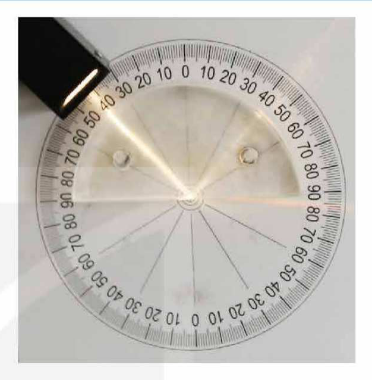
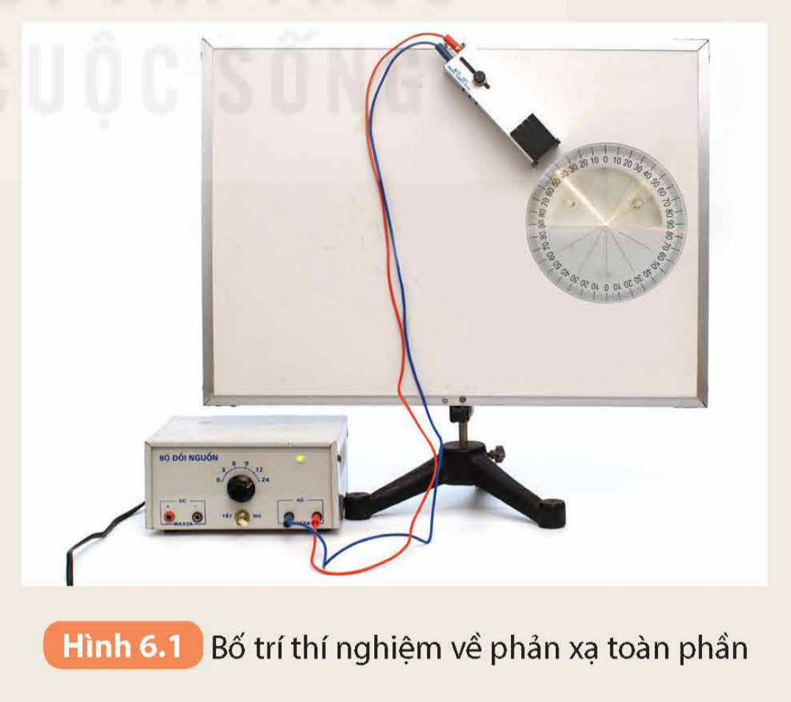
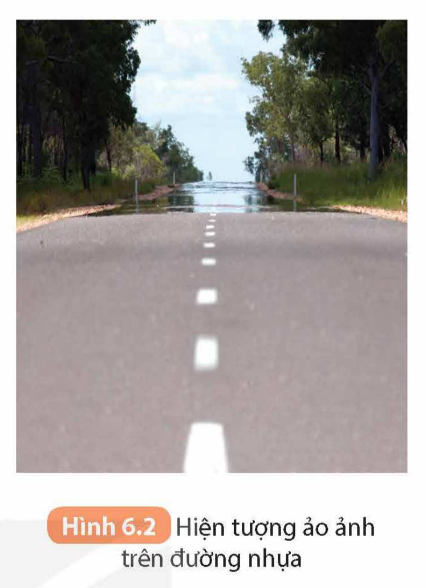
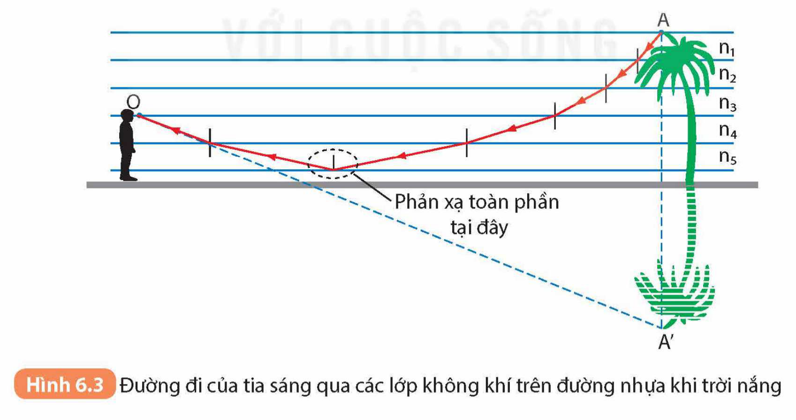
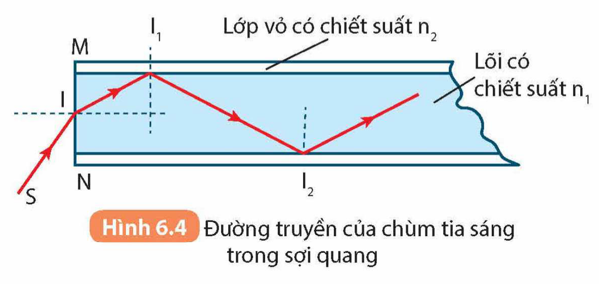

<!-- pdf:32 -->

# BÀI 6: PHẢN XẠ TOÀN PHẦN

## 🎯 Mục tiêu

- Thực hiện thí nghiệm để rút ra được điều kiện xảy ra phản xạ toàn phần và xác định được góc tới hạn.
- Vận dụng kiến thức về phản xạ toàn phần để giải thích một số hiện tượng đơn giản thường gặp trong thực tế.

## 🔴 Mở đầu

Xét sự truyền sáng từ bán trụ thuỷ tinh ra không khí, khi góc tới bằng $41^\circ$, ta quan sát được đồng thời tia phản xạ và tia khúc xạ với góc khúc xạ gần bằng $90^\circ$ như hình bên. Theo em, khi góc tới tiếp tục tăng lên tới giá trị $60^\circ$ thì tia sáng sẽ truyền như thế nào?

## I. Sự truyền ánh sáng từ môi trường chiết suất lớn vào môi trường chiết suất nhỏ hơn

> **Thí nghiệm về phản xạ toàn phần**
>
> *Chuẩn bị:*
> - Một bảng thí nghiệm có gắn tấm nhựa in vòng tròn chia độ;
> - Một bản bán trụ bằng thuỷ tinh;
> - Đèn $12\text{ V} - 21\text{ W}$ có khe cài bản chắn sáng;
> - Nguồn điện (biến áp nguồn).
>
> *Tiến hành:*
> - Bố trí thí nghiệm như Hình 6.1.
> - Chiếu chùm sáng hẹp truyền từ bản bán trụ ra không khí, tăng dần góc tới $i$ và quan sát chùm sáng phản xạ và chùm sáng khúc xạ ra không khí.
> - Quan sát và ghi chép vào vở theo mẫu Bảng 6.1 đặc điểm nhìn thấy của chùm sáng khúc xạ và phản xạ.
>
> 
>
> Hình 6.1. Bố trí thí nghiệm về phản xạ toàn phần

<!-- pdf:33 -->

> Bảng 6.1.
>
> | Góc tới | Tia khúc xạ | Tia phản xạ |
> | --- | :---: | :---: |
> | $i$ nhỏ | Độ sáng giảm dần khi tăng $i$ | Độ sáng tăng dần khi tăng $i$ |
> | $i = i_{\text{th}}$ | Bắt đầu không nhìn thấy | Rất sáng |
> | $i$ có giá trị lớn hơn $i_{\text{th}}$ | Không còn nhìn thấy | Rất sáng |
>
> *Trả lời các câu hỏi sau:*
> 1. Góc khúc xạ lớn hơn hay nhỏ hơn góc tới?
> 2. Khi nào sẽ xảy ra hiện tượng chỉ có tia phản xạ?

## II. Hiện tượng phản xạ toàn phần
<!-- ocr-ok: đã đối chiếu ảnh trang 33, OCR bỏ sót tiêu đề mục II màu cam -->

### 1. Định nghĩa

**Hiện tượng phản xạ toàn phần** là hiện tượng phản xạ toàn bộ tia tới, xảy ra ở mặt phân cách giữa hai môi trường trong suốt.

### 2. Góc tới hạn phản xạ toàn phần

- Khi có tia khúc xạ, ta có: $n_1\sin i = n_2\sin r$
  Suy ra: $\sin r = \dfrac{n_1}{n_2}\sin i$
  Nếu $n_1 > n_2$ thì: $\sin r > \sin i$, do đó: $r > i$. Tia khúc xạ lệch xa pháp tuyến hơn so với tia tới.
- Khi tăng góc tới $i$ thì góc khúc xạ $r$ cũng tăng ($r > i$). Khi $r$ bằng $90^\circ$ thì $i$ đạt giá trị $i_{\text{th}}$ gọi là **góc tới hạn** phản xạ toàn phần. Khi đó ta có:
  $n_1\sin i_{\text{th}} = n_2\sin 90^\circ$
  $\sin i_{\text{th}} = \dfrac{n_2}{n_1}$
  Khi $i \ge i_{\text{th}}$ thì không có tia khúc xạ, toàn bộ tia sáng bị phản xạ ở mặt phân cách. Đó là hiện tượng phản xạ toàn phần.

> 1. Tính góc tới hạn phản xạ toàn phần trong trường hợp tia sáng chiếu từ bản bán trụ thuỷ tinh (chiết suất $n_1 = 1,5$) ra không khí (chiết suất $n_2 = 1$).
> 2. Sử dụng dụng cụ thí nghiệm ở Hình 6.1 xác định giá trị $i_{\text{th}}$, so sánh kết quả với câu 1 và rút ra nhận xét.

### 3. Điều kiện để có phản xạ toàn phần

<!-- term: Điều kiện để có phản xạ toàn phần -->
- Ánh sáng truyền từ môi trường có chiết suất $n_1$ tới môi trường có chiết suất $n_2$ với: $n_1 > n_2$
- Góc tới lớn hơn hoặc bằng góc tới hạn: $i \ge i_{\text{th}}$

> ❓ Chiếu một tia sáng từ nước tới mặt phân cách giữa nước và không khí. Biết chiết suất của nước và không khí lần lượt là $n_1 = \dfrac{4}{3}$, $n_2 = 1$.
> a) Tính góc khúc xạ trong trường hợp góc tới bằng $30^\circ$.
> b) Khi góc tới bằng $60^\circ$ thì có tia khúc xạ không? Tại sao?

<!-- pdf:34 -->

## III. Một số ứng dụng của hiện tượng phản xạ toàn phần

### 1. Giải thích hiện tượng ảo ảnh

<!-- term: Hiện tượng ảo ảnh -->
Khi đi trên đường nhựa vào ngày nắng nóng, ta có thể thấy ở phía xa trên mặt đường dường như có lớp nước phản xạ ánh sáng, nhưng khi đến gần thì chỉ thấy mặt đường khô ráo. Hiện tượng trên là một trong những hiện tượng ảo ảnh thường thấy (Hình 6.2).

Hình 6.2. Hiện tượng ảo ảnh trên đường nhựa

Hiện tượng này được giải thích như sau:

<!-- term: Hiện tượng ảo ảnh -->
Lớp không khí càng ở gần mặt đường nhựa có nhiệt độ càng cao, vì nhận được nhiệt toả ra từ mặt đường nóng. Nhiệt độ càng cao thì chiết suất lớp không khí càng nhỏ. Do đó, càng lên cao, chiết suất của không khí càng tăng. Ta tưởng tượng chia không khí trên mặt đường nhựa thành nhiều lớp mỏng, chiết suất của các lớp này tăng dần khi càng lên cao.

Xét một tia sáng đi xiên xuống từ một điểm $A$, từ lớp khí (1) xuống lớp khí (2), góc khúc xạ sẽ lớn hơn góc tới (vì $n_2 < n_1$). Cứ như vậy, tia sáng bị gãy khúc liên tiếp như Hình 6.3 khi đi từ lớp khí trên xuống lớp khí dưới. Khi tia sáng xuống thấp tới lớp khí dưới có góc tới lớn hơn góc tới hạn $i_{\text{th}}$, tia sáng sẽ bị phản xạ toàn phần và hắt lên. Do đó, ta được một đường gấp khúc liên tiếp từ $A$ tới mắt, giả sử ở điểm $O$. Khi bề dày các lớp không khí vô cùng nhỏ thì đường gãy khúc trên trở thành một đường cong đều đặn đi xuống từ $A$ rồi đi lên tới mắt $O$. Tia sáng tới mắt dường như phát xuất từ điểm $A'$, đối xứng với $A$ qua mặt đường. Tập hợp rất nhiều tia sáng như vậy truyền đến mắt, khiến người quan sát thấy bóng mờ của vật thể phía trước thấp thoáng trên mặt đường, làm chúng ta có cảm giác như ở phía trước có lớp nước phản xạ ánh sáng.

Hình 6.3. Đường đi của tia sáng qua các lớp không khí trên đường nhựa khi trời nắng

> ❓ Giải thích vì sao chỉ quan sát được hiện tượng ảo ảnh ở khoảng cách rất xa, khi lại gần thì không nhìn thấy nữa.

<!-- pdf:35 -->

### 2. Tìm hiểu hoạt động của cáp quang

**Cáp quang** là bó sợi quang. Mỗi **sợi quang** là một dây trong suốt có tính dẫn sáng nhờ phản xạ toàn phần.

Sợi quang có lõi làm bằng thuỷ tinh hoặc chất dẻo trong suốt có chiết suất $n_1$, được bao quanh bằng một lớp vỏ có chiết suất $n_2$ nhỏ hơn $n_1$. Xét tia tới $SI$ đến điểm $I$ trên tiết diện $MN$ của sợi quang. Tia này bị khúc xạ khi đi vào sợi quang. Tia khúc xạ tới mặt tiếp xúc giữa lõi và lớp vỏ tại $I_1$ dưới góc tới $i$ lớn hơn góc tới hạn $i_{\text{th}}$ và bị phản xạ toàn phần. Hiện tượng phản xạ như vậy được lặp lại nhiều lần liên tiếp tại các điểm $I_2$,... (Hình 6.4).

Hình 6.4. Đường truyền của chùm tia sáng trong sợi quang

Trong công nghệ thông tin, sợi quang được dùng để truyền dữ liệu.

> Thực hiện yêu cầu sau:
> 1. Giải thích sự truyền ánh sáng trong sợi quang.
> 2. Nêu một số ứng dụng của sợi quang trong y học, công nghệ thông tin.

## 📌 Em đã học

- Hiện tượng phản xạ toàn phần là hiện tượng phản xạ toàn bộ tia tới, xảy ra ở mặt phân cách giữa hai môi trường trong suốt.
- Điều kiện để có phản xạ toàn phần:
  - Ánh sáng truyền từ môi trường có chiết suất $n_1$ tới môi trường có chiết suất $n_2$ với: $n_1 > n_2$.
  - Góc tới lớn hơn hoặc bằng góc tới hạn: $i \ge i_{\text{th}}$, với $\sin i_{\text{th}} = \dfrac{n_2}{n_1}$.

## ✏️ Em có thể

- Xác định được góc tới hạn để xảy ra hiện tượng phản xạ toàn phần.
- Giải thích được hiện tượng ảo ảnh trên sa mạc và nguyên tắc hoạt động của cáp quang sử dụng trong y học, công nghệ thông tin,...

## 📷 Danh sách hình trong bài

| Mã hình | Trang PDF | Vị trí trong bài | Chú thích gốc |
| --- | :---: | --- | --- |
| H9-khoa_hoc_tu_nhien-b06-01 | 32 | Mở đầu | (Hình mở đầu Bài 6: Sự truyền sáng từ bán trụ thuỷ tinh ra không khí khi góc tới bằng 41°) |
| H9-khoa_hoc_tu_nhien-b06-02 | 32 | Mục I | Hình 6.1. Bố trí thí nghiệm về phản xạ toàn phần |
| H9-khoa_hoc_tu_nhien-b06-03 | 34 | Mục III.1 | Hình 6.2. Hiện tượng ảo ảnh trên đường nhựa |
| H9-khoa_hoc_tu_nhien-b06-04 | 34 | Mục III.1 | Hình 6.3. Đường đi của tia sáng qua các lớp không khí trên đường nhựa khi trời nắng |
| H9-khoa_hoc_tu_nhien-b06-05 | 35 | Mục III.2 | Hình 6.4. Đường truyền của chùm tia sáng trong sợi quang |
