<!-- pdf:36 -->

# BÀI 7: LĂNG KÍNH

## 🎯 Mục tiêu

- Vẽ được sơ đồ đường truyền của tia sáng qua lăng kính.
- Thực hiện thí nghiệm với lăng kính tạo được quang phổ của ánh sáng trắng qua lăng kính.
- Giải thích được một cách định tính sự tán sắc ánh sáng mặt trời qua lăng kính.
- Từ kết quả thí nghiệm truyền ánh sáng qua lăng kính, nêu được khái niệm về ánh sáng màu.
- Nêu được màu sắc của một vật được nhìn thấy phụ thuộc vào màu sắc của ánh sáng bị vật đó hấp thụ và phản xạ.
- Vận dụng kiến thức về sự truyền ánh sáng, màu sắc ánh sáng, giải thích được một số hiện tượng đơn giản thường gặp trong thực tế.

## 🔴 Mở đầu

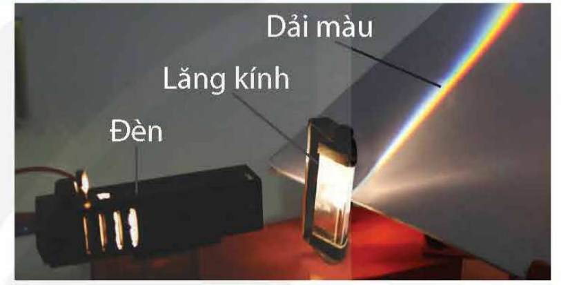

Ánh sáng từ đèn sợi đốt sau khi đi qua lăng kính tạo thành một chùm sáng có màu từ đỏ đến tím như hình bên. Lăng kính có tác dụng gì trong hiện tượng này?

## I. Cấu tạo của lăng kính

**Lăng kính** là một khối trong suốt, đồng chất, được giới hạn bởi hai mặt phẳng không song song, thường có dạng lăng trụ hình tam giác (Hình 7.1).

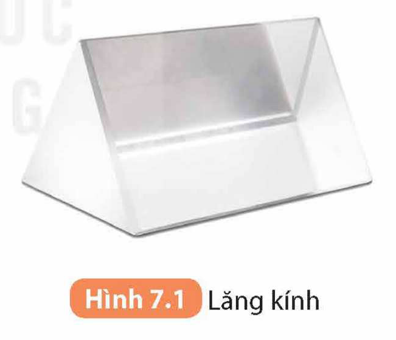

Hình 7.1. Lăng kính

Hai mặt phẳng giới hạn ở trên được gọi là **các mặt bên** của lăng kính, giao tuyến của hai mặt bên được gọi là **cạnh** của lăng kính. Mặt đối diện với cạnh là **đáy** của lăng kính.

Góc $A$ hợp bởi hai mặt bên của lăng kính được gọi là **góc chiết quang** hay **góc ở đỉnh** của lăng kính. Một mặt phẳng bất kì vuông góc với các cạnh được gọi là **mặt phẳng tiết diện chính** (Hình 7.3).

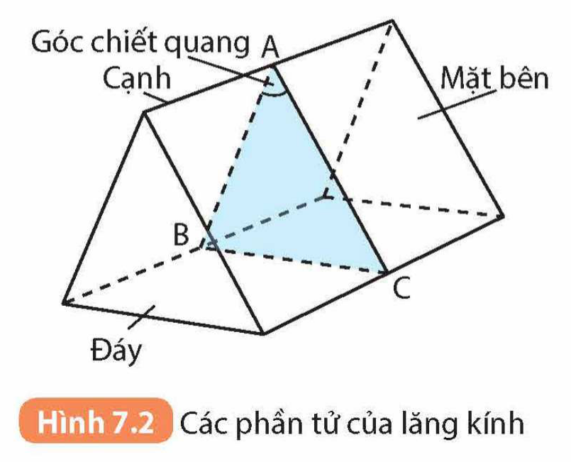

Hình 7.2. Các phần tử của lăng kính
<!-- ocr-ok: đã đối chiếu ảnh trang 36, OCR đọc sai nhãn màu cam Hình 7.2 -->

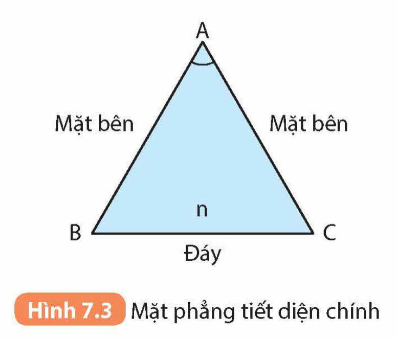

Hình 7.3. Mặt phẳng tiết diện chính

<!-- pdf:37 -->

Về phương diện quang học, một lăng kính được đặc trưng bởi: góc chiết quang $A$; chiết suất $n$ của chất làm lăng kính.

> Hãy chỉ ra góc chiết quang, mặt bên, cạnh và đáy của lăng kính có trong phòng thí nghiệm.

## II. Hiện tượng tán sắc ánh sáng

> **Thí nghiệm 1: Tìm hiểu hiện tượng tán sắc ánh sáng**
>
> *Chuẩn bị:*
> - Lăng kính gắn trên giá (1);
> - Đèn chiếu ánh sáng trắng có khe hẹp (2);
> - Màn hứng chùm sáng (3);
> - Nguồn điện và dây nối (4);
> - Tấm kính lọc sắc màu đỏ và tấm kính lọc sắc màu tím (5).
>
> 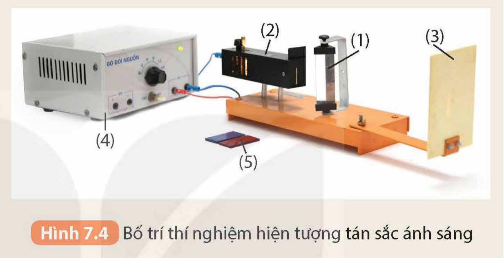
>
> Hình 7.4. Bố trí thí nghiệm hiện tượng tán sắc ánh sáng
>
> *Tiến hành:*
> - Bố trí thí nghiệm như Hình 7.4.
> - Chiếu chùm ánh sáng trắng từ đèn vào mặt bên của lăng kính, dùng màn chắn dịch chuyển phía sau lăng kính để hứng vệt sáng trên màn.
>
> *Thực hiện các yêu cầu và trả lời câu hỏi sau:*
> 1. Mô tả đường đi của tia sáng qua lăng kính mà em quan sát được.
> 2. Viết ra thứ tự các màu xuất hiện trên màn.
> 3. Những màu sắc khác nhau cho biết điều gì về thành phần của chùm ánh sáng chiếu tới?

Khi chiếu một chùm **ánh sáng trắng** hẹp đi qua lăng kính, ta sẽ thu được dải màu từ đỏ đến tím. Dải màu này là **quang phổ của ánh sáng trắng**. Hiện tượng này gọi là **hiện tượng tán sắc ánh sáng**.

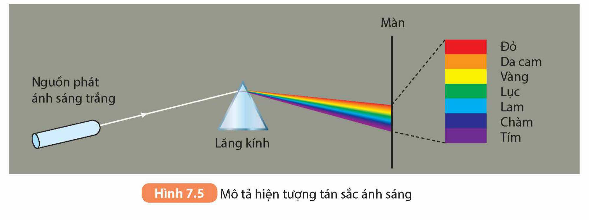

Hình 7.5. Mô tả hiện tượng tán sắc ánh sáng

<!-- pdf:38 -->

Khi chiếu một chùm sáng trắng hẹp đi qua một lăng kính thì ta sẽ thu được nhiều chùm sáng màu khác nhau nằm sát cạnh nhau, tạo thành một dải màu như cầu vồng. Dải này có các màu: đỏ, da cam, vàng, lục, lam, chàm, tím. Lăng kính có tác dụng tách riêng các chùm sáng màu có sẵn trong chùm sáng trắng cho mỗi chùm đi theo một phương khác nhau.

> **Thí nghiệm 2**
>
> *Chuẩn bị:*
>
> Dụng cụ thí nghiệm như thí nghiệm 1.
>
> *Tiến hành:*
> - Bố trí thí nghiệm như Hình 7.4.
> - Chiếu ánh sáng trắng từ đèn vào mặt bên của lăng kính.
> - Lần lượt dùng kính lọc sắc màu đỏ và màu tím chắn vào khe hẹp của nguồn sáng.
> - Dùng màn chắn dịch chuyển phía sau lăng kính để hứng vệt sáng trên màn.
>
> *Trả lời câu hỏi và thực hiện yêu cầu sau:*
> 1. Khi chiếu ánh sáng qua tấm kính lọc sắc đến mặt bên lăng kính, ánh sáng có bị tách thành nhiều màu không?
> 2. So sánh góc lệch của tia sáng màu đỏ và màu tím.

**Ánh sáng đơn sắc** là ánh sáng có một màu nhất định và không bị tán sắc khi đi qua lăng kính.

> ❓ Ở hoạt động khởi động, hãy giải thích sự tán sắc ánh sáng mặt trời qua lăng kính.

## III. Sự truyền ánh sáng đơn sắc qua lăng kính
<!-- ocr-ok: đã đối chiếu ảnh trang 38, OCR bỏ sót tiêu đề mục III màu cam -->

Xét lăng kính có chiết suất $n$ đặt trong không khí. Để đơn giản, ta chỉ xét các tia sáng nằm trong mặt phẳng tiết diện chính của lăng kính và là ánh sáng đơn sắc.

Chiếu tới mặt bên $AB$ của lăng kính một tia sáng $SI$. Tia sáng này sẽ bị khúc xạ tại $I$ với $i_1$ là góc tới, $r_1$ là góc khúc xạ. Khi tia sáng tới $J$ với góc tới $r_2$ thì bị khúc xạ và ló ra ngoài lăng kính theo tia ló $JR$ với góc khúc xạ $i_2$.

Đường đi của tia sáng ($SIJR$) nằm trong mặt phẳng tiết diện chính $ABC$.

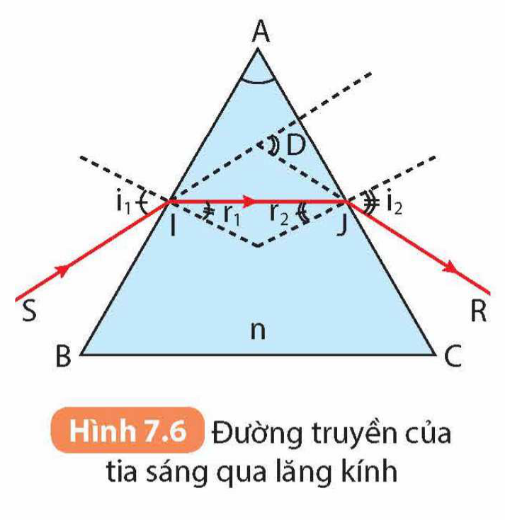

Hình 7.6. Đường truyền của tia sáng qua lăng kính

Góc $D$ hợp bởi tia tới $SI$ và tia ló $JR$ được gọi là **góc lệch** của tia sáng khi đi qua lăng kính.

Khi tia sáng truyền từ không khí đến mặt bên của lăng kính thì tia ló ra khỏi lăng kính lệch về phía đáy so với tia tới.

<!-- pdf:39 -->

> Quan sát Hình 7.6 và cho biết:
> 1. Khi ánh sáng truyền từ không khí vào lăng kính, tại sao tia khúc xạ $IJ$ lệch gần pháp tuyến hơn so với tia tới $SI$?
> 2. Khi ánh sáng truyền từ lăng kính ra không khí, tại sao tia khúc xạ $JR$ lệch xa pháp tuyến hơn so với tia tới $IJ$?
> 3. Dựa vào sự truyền sáng qua lăng kính, hãy giải thích hiện tượng tán sắc ánh sáng. Biết rằng chiết suất của lăng kính đối với các ánh sáng đơn sắc khác nhau là khác nhau, chiết suất lớn nhất với tia tím, chiết suất nhỏ nhất với tia đỏ.

> ❓ 1. Hình vẽ nào trong Hình 7.7 chỉ đúng đường đi của tia sáng qua lăng kính khi lăng kính đặt trong không khí?
>
> 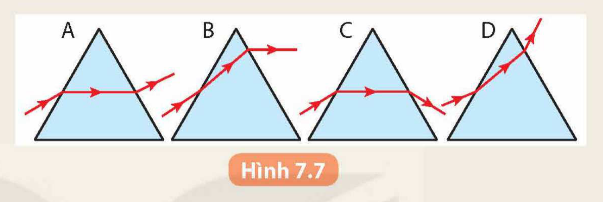
>
> Hình 7.7
>
> 2. Một lăng kính thuỷ tinh có chiết suất $n = 1,41$. Mặt phẳng tiết diện chính của lăng kính là tam giác đều $ABC$. Chiếu một tia sáng nằm trong mặt phẳng tiết diện chính tới mặt bên $AB$ của lăng kính với góc tới $i_1 = 45^\circ$. Vẽ đường truyền của tia sáng qua lăng kính.

## IV. Màu sắc của vật
<!-- ocr-ok: đã đối chiếu ảnh trang 39, OCR đọc thiếu tiền tố IV của tiêu đề mục màu cam -->

> 1. Nhớ lại kiến thức đã học, khi nào mắt ta nhìn thấy một vật?
> 2. Khi chúng ta thấy các vật màu xanh, đỏ, trắng thì có ánh sáng màu nào truyền từ vật tới mắt ta?
> 3. Ban đêm, khi không có nguồn sáng, ta nhìn thấy các vật có màu gì?

<!-- term: Màu sắc của vật -->
Màu sắc của một vật được nhìn thấy phụ thuộc vào màu sắc của ánh sáng bị vật đó hấp thụ và phản xạ.

<!-- term: Màu sắc của vật -->
Dưới ánh sáng trắng, vật có màu là do nó phản xạ ánh sáng màu đó vào mắt ta và hấp thụ những màu còn lại.

<!-- term: Màu sắc của vật -->
Vật màu đen hấp thụ tất cả các ánh sáng màu và không có ánh sáng phản xạ. Ta nhận ra vật có màu đen vì nó được đặt bên cạnh những vật có màu sắc khác.

Sự nhìn thấy màu sắc của vật dưới ánh sáng trắng được minh hoạ ở Hình 7.8.

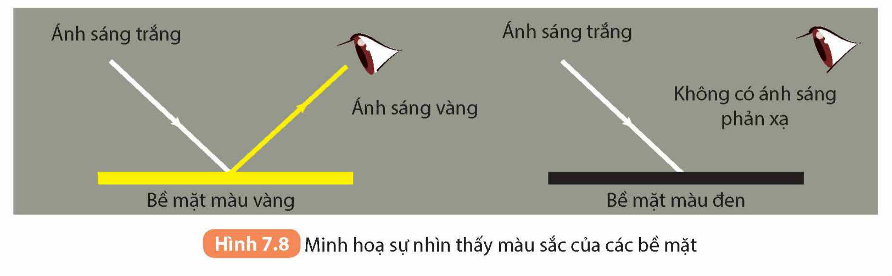

Hình 7.8. Minh hoạ sự nhìn thấy màu sắc của các bề mặt

<!-- pdf:40 -->

> ❓ 1. Em hãy biểu diễn các tia sáng đến mắt đối với vật ta quan sát thấy màu trắng (Hình 7.9).
>
> 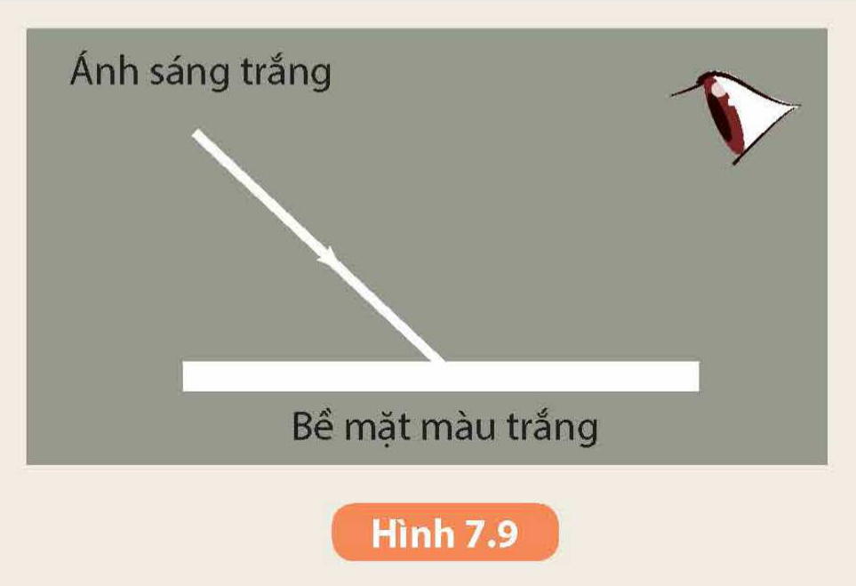
>
> Hình 7.9
>
> 2. Quan sát bông hoa hướng dương (Hình 7.10), giải thích tại sao chúng ta nhìn thấy cánh hoa màu vàng, lá màu xanh và phần nhuỵ có màu nâu.
>
> 
>
> Hình 7.10. Bông hoa hướng dương

Trong thực tế, người ta còn có thể tạo ra ánh sáng đơn sắc bằng cách chiếu ánh sáng trắng qua một **tấm lọc màu** (tấm lọc màu có thể là tấm kính màu hoặc mảnh giấy bóng có màu). Tấm lọc màu nào thì hấp thụ ít ánh sáng có màu đó nhưng hấp thụ mạnh ánh sáng có màu khác (Hình 7.11).

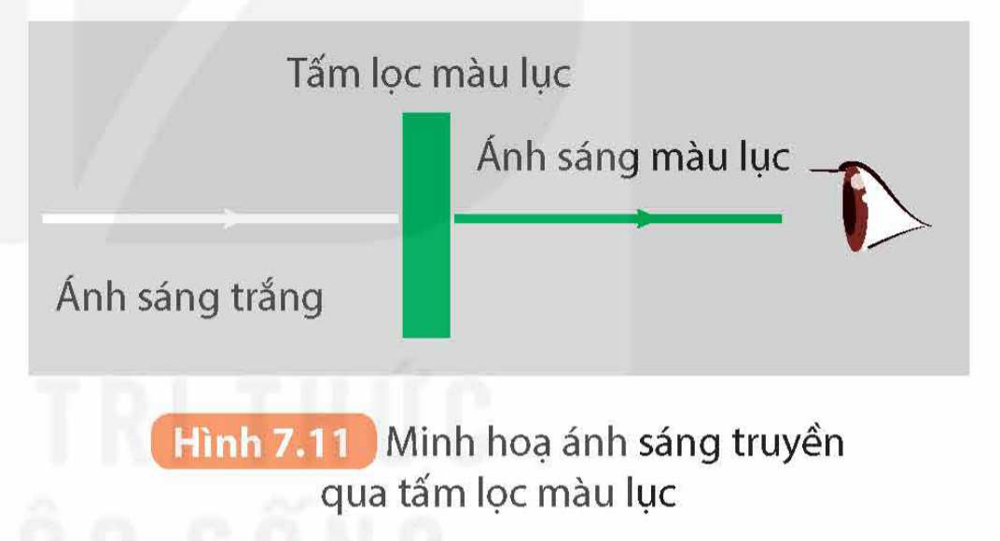

Hình 7.11. Minh hoạ ánh sáng truyền qua tấm lọc màu lục

## 📌 Em đã học

- Lăng kính là một khối chất trong suốt, đồng chất (thuỷ tinh, nhựa,...) thường có dạng lăng trụ tam giác.
- Lăng kính tạo được quang phổ của ánh sáng trắng.
- Khi chiếu một chùm sáng trắng hẹp đi qua một lăng kính thì ta sẽ thu được nhiều chùm sáng màu khác nhau nằm sát cạnh nhau, tạo thành một dải màu như cầu vồng. Dải này có các màu: đỏ, da cam, vàng, lục, lam, chàm, tím. Lăng kính có tác dụng tách riêng các chùm sáng màu có sẵn trong chùm sáng trắng cho mỗi chùm đi theo một phương khác nhau.
- Ánh sáng đơn sắc là ánh sáng có một màu nhất định và không bị tán sắc khi đi qua lăng kính.
- Vật màu đen hấp thụ tất cả các ánh sáng màu và không có ánh sáng phản xạ. Ta nhận ra vật có màu đen vì nó được đặt bên cạnh những vật có màu sắc khác.

<!-- pdf:41 -->

## ✏️ Em có thể

- Vẽ được đường truyền của tia sáng qua lăng kính.
- Giải thích được sự tán sắc ánh sáng mặt trời qua lăng kính.
- Giải thích được một số hiện tượng đơn giản về màu sắc của vật trong thực tế.
- Chế tạo được dụng cụ đơn giản để trộn màu ánh sáng như Hình 7.12 để chứng tỏ rằng bảy màu kết hợp với nhau sẽ tạo thành ánh sáng trắng từ các vật liệu:
  - Bìa cứng trắng.
  - Bút màu hoặc bút chì màu (đỏ, da cam, vàng, lục, lam, chàm, tím).
  - Sợi dây.
  - Kéo.

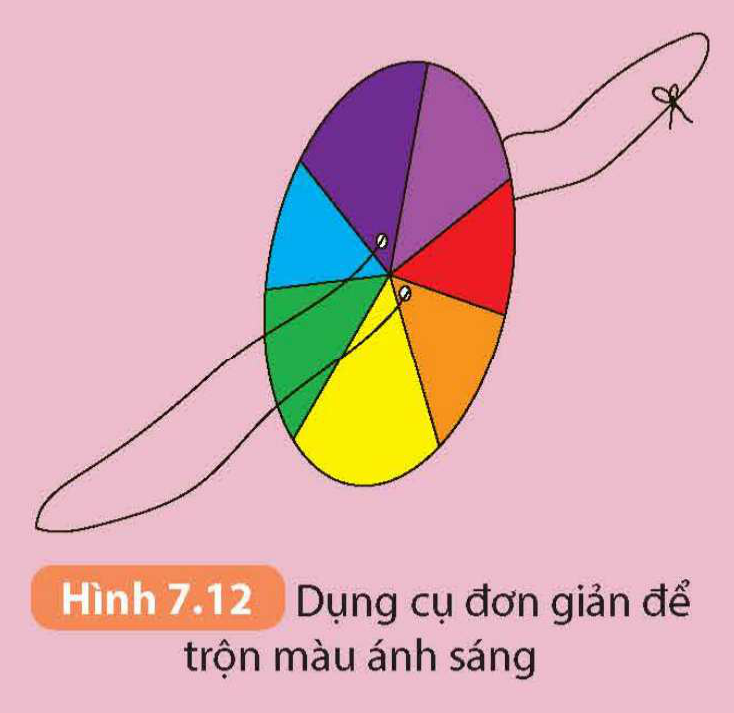

Hình 7.12. Dụng cụ đơn giản để trộn màu ánh sáng

> 🔍 **Em có biết?**
>
> **1. Chiết suất của môi trường**
>
> Chiết suất của một môi trường trong suốt đối với ánh sáng màu khác nhau thì khác nhau. Chiết suất có giá trị nhỏ nhất đối với ánh sáng đỏ, tăng dần đối với ánh sáng da cam, vàng,... và có giá trị lớn nhất đối với ánh sáng tím.
>
> **2. Cầu vồng**
>
> Mùa hè, sau cơn mưa, chúng ta có thể nhìn thấy một dải sáng hẹp hình cung tròn có nhiều màu, đó là hình ảnh **cầu vồng** (Hình 7.13a).
>
> Sau khi trời mưa và có nắng, những giọt nước mưa li ti vẫn còn lẫn trong bầu khí quyển. Các tia sáng mặt trời trước khi truyền đến mắt ta đã truyền qua các giọt nước li ti này. Bên trong các giọt nước, các tia sáng mặt trời bị khúc xạ, phản xạ toàn phần và tán sắc, mỗi ánh sáng màu khác nhau sẽ tới mắt người quan sát với các góc khác nhau. Ánh sáng mỗi màu đều tạo với phương ánh sáng tới của Mặt Trời một góc không đổi, do đó mắt ta nhận được các chùm sáng màu này theo một hình vòng cung tạo ra cầu vồng. Khi người quan sát hướng về phía cầu vồng thì Mặt Trời ở phía sau lưng người quan sát, hướng nhìn từ mắt tạo góc từ $40^\circ$ đến $42^\circ$ so với phương ánh sáng tới của Mặt Trời (Hình 7.13b).
>
> 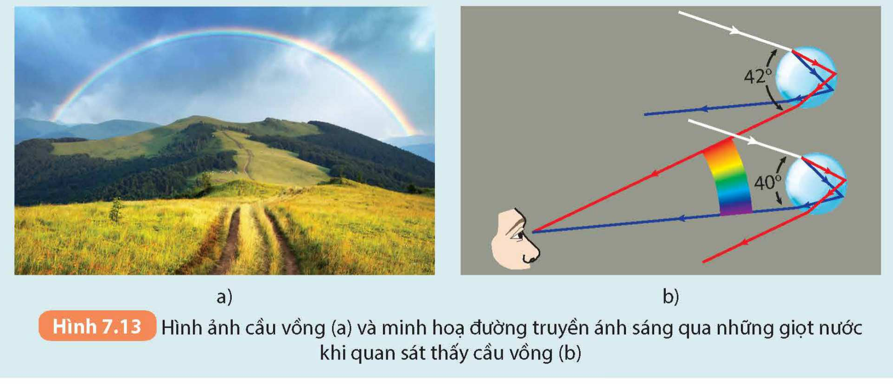
>
> Hình 7.13. Hình ảnh cầu vồng (a) và minh hoạ đường truyền ánh sáng qua những giọt nước khi quan sát thấy cầu vồng (b)

## 📷 Danh sách hình trong bài

| Mã hình | Trang PDF | Vị trí trong bài | Chú thích gốc |
| --- | :---: | --- | --- |
| H9-khoa_hoc_tu_nhien-b07-01 | 36 | Mở đầu | (Hình mở đầu Bài 7: Ánh sáng từ đèn sợi đốt đi qua lăng kính tạo thành dải màu) |
| H9-khoa_hoc_tu_nhien-b07-02 | 36 | Mục I | Hình 7.1. Lăng kính |
| H9-khoa_hoc_tu_nhien-b07-03 | 36 | Mục I | Hình 7.2. Các phần tử của lăng kính |
| H9-khoa_hoc_tu_nhien-b07-04 | 36 | Mục I | Hình 7.3. Mặt phẳng tiết diện chính |
| H9-khoa_hoc_tu_nhien-b07-05 | 37 | Mục II | Hình 7.4. Bố trí thí nghiệm hiện tượng tán sắc ánh sáng |
| H9-khoa_hoc_tu_nhien-b07-06 | 37 | Mục II | Hình 7.5. Mô tả hiện tượng tán sắc ánh sáng |
| H9-khoa_hoc_tu_nhien-b07-07 | 38 | Mục III | Hình 7.6. Đường truyền của tia sáng qua lăng kính |
| H9-khoa_hoc_tu_nhien-b07-08 | 39 | Mục III | Hình 7.7 |
| H9-khoa_hoc_tu_nhien-b07-09 | 39 | Mục IV | Hình 7.8. Minh hoạ sự nhìn thấy màu sắc của các bề mặt |
| H9-khoa_hoc_tu_nhien-b07-10 | 40 | Mục IV | Hình 7.9 |
| H9-khoa_hoc_tu_nhien-b07-11 | 40 | Mục IV | Hình 7.10. Bông hoa hướng dương |
| H9-khoa_hoc_tu_nhien-b07-12 | 40 | Mục IV | Hình 7.11. Minh hoạ ánh sáng truyền qua tấm lọc màu lục |
| H9-khoa_hoc_tu_nhien-b07-13 | 41 | Em có thể (allow_edge_ink: Hình 7.12 được in trực tiếp trên nền hồng của hộp Em có thể nên 4 cạnh khung cắt đều nằm trên nền màu của hộp) | Hình 7.12. Dụng cụ đơn giản để trộn màu ánh sáng |
| H9-khoa_hoc_tu_nhien-b07-14 | 41 | Em có biết? | Hình 7.13. Hình ảnh cầu vồng (a) và minh hoạ đường truyền ánh sáng qua những giọt nước khi quan sát thấy cầu vồng (b) |
