<!-- pdf:42 -->

# BÀI 8: THẤU KÍNH

## 🎯 Mục tiêu

- Nêu được các khái niệm: quang tâm, trục chính, tiêu điểm chính và tiêu cự của thấu kính.
- Tiến hành thí nghiệm rút ra được đường đi một số tia sáng qua thấu kính (tia qua quang tâm, tia song song quang trục chính).
- Giải thích được nguyên lí hoạt động của một số thấu kính bằng việc sử dụng sự khúc xạ của các lăng kính nhỏ.
- Vẽ được ảnh qua thấu kính.
- Thực hiện thí nghiệm khẳng định được: Ảnh thật là ảnh hứng được trên màn; ảnh ảo là ảnh không hứng được trên màn.

## 🔴 Mở đầu

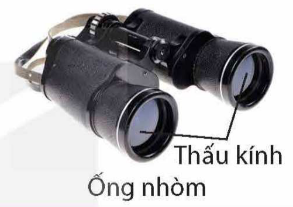

Thấu kính có trong các dụng cụ quen thuộc như ống nhòm, kính lúp, kính hiển vi hay trong chính mắt của chúng ta. Ánh sáng truyền qua thấu kính có thể tạo thành ảnh của các vật như thế nào?

## I. Cấu tạo thấu kính và phân loại
<!-- ocr-ok: đã đối chiếu ảnh trang 42, OCR bỏ sót tiêu đề mục I màu cam -->

**Thấu kính** là một khối đồng chất trong suốt (thuỷ tinh, nhựa,...) giới hạn bởi hai mặt cong hoặc một mặt cong và một mặt phẳng (Hình 8.1).

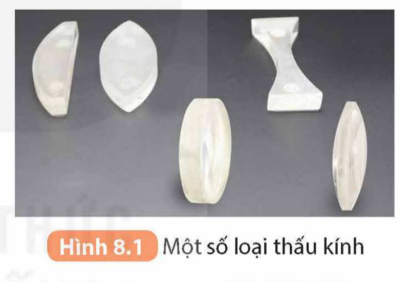

Hình 8.1. Một số loại thấu kính

Dựa trên hình dạng ta có thể phân thành hai loại: **thấu kính rìa mỏng** (có phần rìa thấu kính mỏng hơn phần giữa) và **thấu kính rìa dày** (có phần rìa thấu kính dày hơn phần giữa) (Hình 8.2).

Trong không khí:
- Khi chiếu chùm sáng song song qua thấu kính rìa mỏng ta thu được chùm tia ló hội tụ. Do đó, thấu kính rìa mỏng là **thấu kính hội tụ**.
- Khi chiếu chùm sáng song song qua thấu kính rìa dày ta thu được chùm tia ló phân kì. Do đó, thấu kính rìa dày là **thấu kính phân kì**.

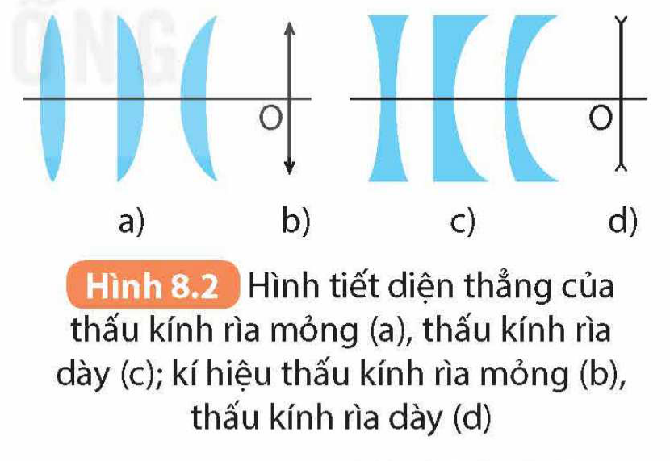

Hình 8.2. Hình tiết diện thẳng của thấu kính rìa mỏng (a), thấu kính rìa dày (c); kí hiệu thấu kính rìa mỏng (b), thấu kính rìa dày (d)

Hình 8.3 mô tả đường truyền của ba chùm sáng hẹp, song song qua thấu kính hội tụ (Hình 8.3a) và qua thấu kính phân kì (Hình 8.3b).

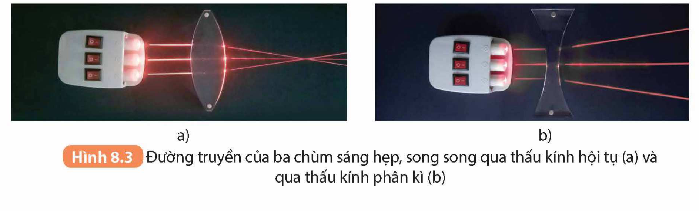

Hình 8.3. Đường truyền của ba chùm sáng hẹp, song song qua thấu kính hội tụ (a) và qua thấu kính phân kì (b)

<!-- pdf:43 -->

> 1. Quan sát để nhận ra độ dày, mỏng ở rìa so với phần giữa các thấu kính có trong phòng thí nghiệm, phân loại chúng thành thấu kính hội tụ hay thấu kính phân kì.
> 2. Ống kính máy ảnh có cấu tạo gồm nhiều thấu kính nhằm mục đích để thu được hình ảnh chất lượng rõ nét. Hình 8.4 mô tả hệ thống gồm các thấu kính ((1), (2), (3), (4)) trong ống kính của một máy ảnh. Hãy chỉ rõ đâu là thấu kính hội tụ và đâu là thấu kính phân kì trong hệ thống này.
>
> 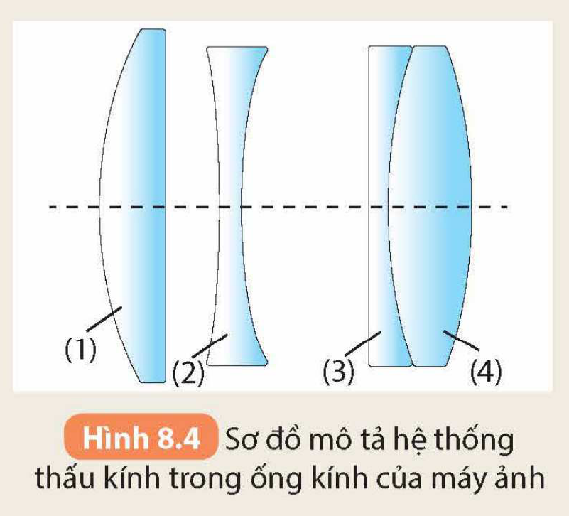
>
> Hình 8.4. Sơ đồ mô tả hệ thống thấu kính trong ống kính của máy ảnh

## II. Trục chính, quang tâm, tiêu điểm chính và tiêu cự của thấu kính
<!-- ocr-ok: đã đối chiếu ảnh trang 43, OCR bỏ sót tiêu đề mục II màu cam -->

Quan sát sự truyền của chùm sáng song song qua thấu kính hội tụ và thấu kính phân kì trong thí nghiệm Hình 8.3, ta biểu diễn được đường truyền của tia sáng như Hình 8.5.

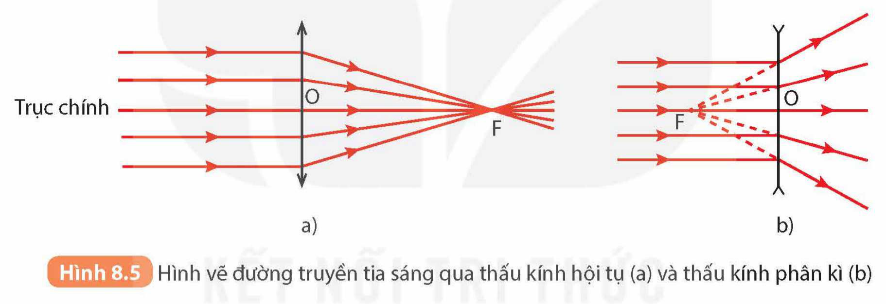

Hình 8.5. Hình vẽ đường truyền tia sáng qua thấu kính hội tụ (a) và thấu kính phân kì (b)

Trong Hình 8.5:
- *Quang tâm:* Có một điểm $O$ của thấu kính mà mọi tia sáng tới $O$ đều truyền thẳng qua thấu kính. Điểm $O$ gọi là **quang tâm** của thấu kính.
- *Trục chính:* Đường thẳng đi qua quang tâm $O$ và vuông góc với tiết diện thẳng của thấu kính gọi là **trục chính** của thấu kính.
- *Tiêu điểm chính:* Một chùm tia tới song song với trục chính của thấu kính cho chùm tia ló hội tụ tại một điểm $F$ nằm trên trục chính (đối với thấu kính hội tụ); hoặc đường kéo dài của chùm tia ló hội tụ tại một điểm $F$ nằm trên trục chính (đối với thấu kính phân kì). Điểm $F$ gọi là **tiêu điểm chính** của thấu kính.
- *Tiêu cự:* Khoảng cách từ quang tâm $O$ đến tiêu điểm chính $F$ của thấu kính, $OF = f$ gọi là **tiêu cự** của thấu kính.

> ❓ Hãy chỉ ra đâu là trục chính, quang tâm, tiêu điểm chính của các thấu kính trong Hình 8.3.

<!-- pdf:44 -->

## III. Đường truyền của tia sáng qua thấu kính
<!-- ocr-ok: đã đối chiếu ảnh trang 44, OCR bỏ sót tiêu đề mục III màu cam -->

### 1. Thí nghiệm

> **Thí nghiệm quan sát đường truyền ánh sáng qua thấu kính**
>
> *Chuẩn bị:*
> - Nguồn sáng;
> - Thấu kính hội tụ, thấu kính phân kì.
>
> *Tiến hành:*
> - Bố trí thí nghiệm như Hình 8.6 với thấu kính hội tụ.
> - Lần lượt chiếu tia sáng song song với trục chính tới thấu kính; tia sáng qua quang tâm $O$ của thấu kính.
> - Quan sát tia ló trong mỗi trường hợp (Hình 8.6a, b, c) và rút ra nhận xét.
>
> 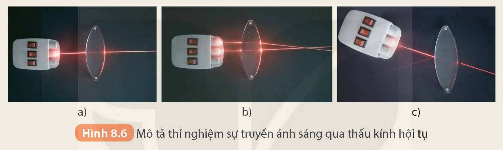
>
> Hình 8.6. Mô tả thí nghiệm sự truyền ánh sáng qua thấu kính hội tụ
>
> - Lặp lại thí nghiệm trên với thấu kính phân kì.
>
> *Thực hiện yêu cầu và trả lời câu hỏi sau:*
> 1. Biểu diễn đường đi của tia sáng qua thấu kính bằng hình vẽ.
> 2. Đường đi của các tia sáng tới quang tâm và tia sáng song song với trục chính của thấu kính có đặc điểm gì?

### 2. Giải thích sự truyền ánh sáng qua thấu kính

**a) Sự truyền ánh sáng qua thấu kính hội tụ**

Để giải thích đường truyền của tia sáng qua thấu kính, ta có thể hình dung thấu kính được tạo thành bởi các lăng kính nhỏ ghép liền nhau, ở giữa là một khối trong suốt có hai mặt song song. Các lăng kính có đáy hướng về trục chính (Hình 8.7). Do các tia sáng qua lăng kính bị lệch về đáy, còn tia sáng chính giữa vuông góc với hai mặt của khối trong suốt nên truyền thẳng, vì vậy chùm sáng song song qua thấu kính hội tụ trở thành chùm sáng hội tụ.

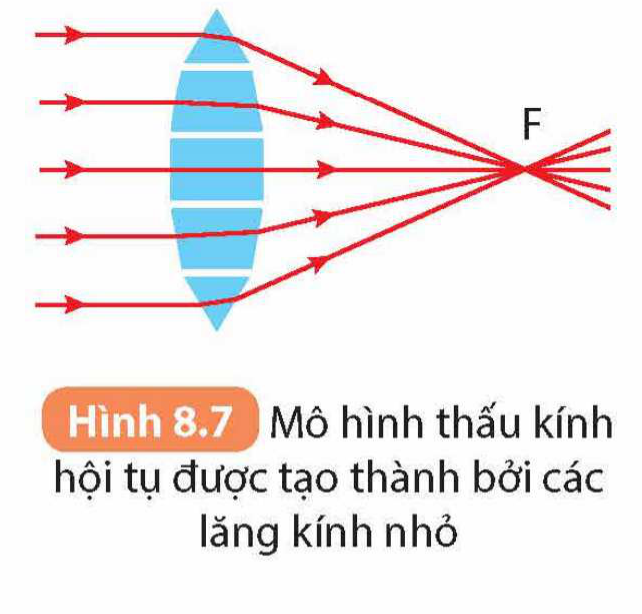

Hình 8.7. Mô hình thấu kính hội tụ được tạo thành bởi các lăng kính nhỏ

*Lưu ý:* Khi giải thích đường truyền ánh sáng qua thấu kính, ta không xem xét tác dụng tán sắc ánh sáng của các lăng kính trong mô hình thấu kính được tạo thành bởi các lăng kính ghép liền nhau này.

<!-- pdf:45 -->

**b) Sự truyền ánh sáng qua thấu kính phân kì**

> Hãy phân tích tương tự và giải thích sự truyền ánh sáng qua thấu kính phân kì (Hình 8.8).
>
> 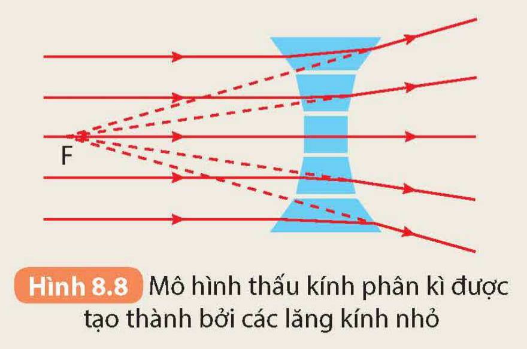
>
> Hình 8.8. Mô hình thấu kính phân kì được tạo thành bởi các lăng kính nhỏ

> ❓ So sánh độ lệch của tia sáng ở gần rìa thấu kính với tia sáng ở gần trục chính của thấu kính sau khi đi qua thấu kính.

## IV. Sự tạo ảnh của một vật qua thấu kính

Quan sát ảnh của vật tạo bởi thấu kính hội tụ (Hình 8.9a) và thấu kính phân kì (Hình 8.9b)

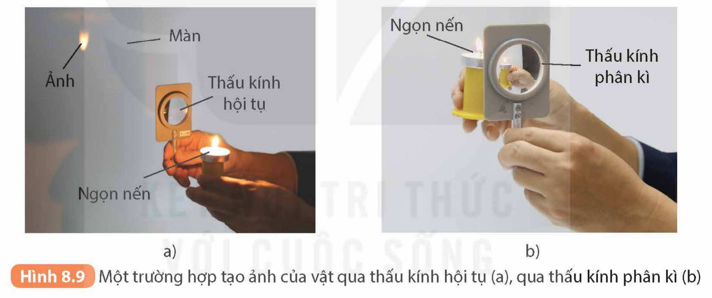

Hình 8.9. Một trường hợp tạo ảnh của vật qua thấu kính hội tụ (a), qua thấu kính phân kì (b)
<!-- ocr-ok: đã đối chiếu ảnh trang 45, OCR bỏ sót dòng chú thích Hình 8.9 -->

- Khi dịch chuyển một thấu kính hội tụ trong khoảng giữa vật và màn, ta quan sát được có vị trí của thấu kính cho ảnh của vật rõ nét trên màn và ngược chiều với vật (Hình 8.9a), nếu dịch thấu kính khỏi vị trí cho ảnh rõ nét thì ảnh của vật trên bị nhoè hoặc không xuất hiện trên màn nữa.
- Khi dịch chuyển một thấu kính phân kì trong khoảng giữa vật và màn, ta không quan sát được có vị trí nào của thấu kính cho ảnh của vật rõ nét trên màn, nhưng nếu đặt mắt nhìn qua thấu kính thì ta thấy có ảnh của vật cùng chiều và nhỏ hơn vật (Hình 8.9b).

Ở môn Khoa học tự nhiên lớp 7, ta đã biết:
- Ảnh không hứng được trên màn gọi là **ảnh ảo**. Ảnh ảo của vật qua gương phẳng được tạo thành bởi đường kéo dài của các tia phản xạ qua gương. Điều này cũng tương tự với ảnh ảo của vật qua thấu kính phân kì, đó là ảnh tạo bởi các đường kéo dài của chùm tia ló qua thấu kính.
- Ảnh hứng được trên màn được gọi là **ảnh thật**. Ảnh thật của vật qua thấu kính hội tụ được tạo bởi các tia ló qua thấu kính.

<!-- pdf:46 -->

### 1. Cách vẽ ảnh tạo bởi thấu kính

<!-- term: Cách vẽ ảnh tạo bởi thấu kính -->
Để vẽ ảnh của một điểm sáng $S$ nằm ngoài trục chính (nguồn sáng rất nhỏ) qua thấu kính, ta thường xét các tia sáng sau đây:
- Tia sáng từ $S$ tới quang tâm $O$ của thấu kính thì đi thẳng.
- Tia sáng từ $S$ song song với trục chính của thấu kính thì tia ló tương ứng (hoặc đường kéo dài của tia ló) đi qua tiêu điểm chính $F$.

<!-- term: Cách vẽ ảnh tạo bởi thấu kính -->
Giao điểm $S'$ của chùm tia ló (hoặc đường kéo dài của chùm tia ló) tương ứng với chùm tia tới xuất phát từ $S$ chính là ảnh của $S$.

> 1. Hãy dựng ảnh $S'$ của điểm sáng $S$ ở Hình 8.11 vào vở.
>
> 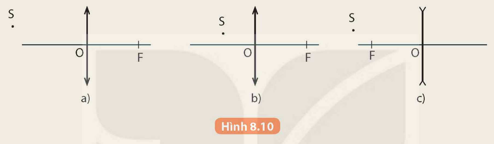
>
> Hình 8.10
>
> 2. Hãy chứng tỏ rằng điểm sáng đặt trên trục chính cũng cho ảnh nằm trên trục chính.
> 3. Ảnh $S'$ trong từng trường hợp ở Hình 8.10 là thật hay ảo?

### 2. Dựng ảnh của một vật qua thấu kính

Để dựng ảnh của một vật nhỏ, phẳng $AB$ đặt vuông góc với trục chính, $A$ nằm trên trục chính (Hình 8.11) của thấu kính ta làm như sau:
- Sử dụng tia sáng đi qua quang tâm và tia sáng song song tới trục chính xuất phát từ $B$. Điểm $B$ là điểm sáng trên vật nằm ngoài trục chính. Giao điểm của hai tia ló là ảnh $B'$ của điểm $B$.
- Từ $B'$ hạ vuông góc với trục chính, cắt trục chính tại $A'$, ta thu được ảnh $A'B'$ của vật.

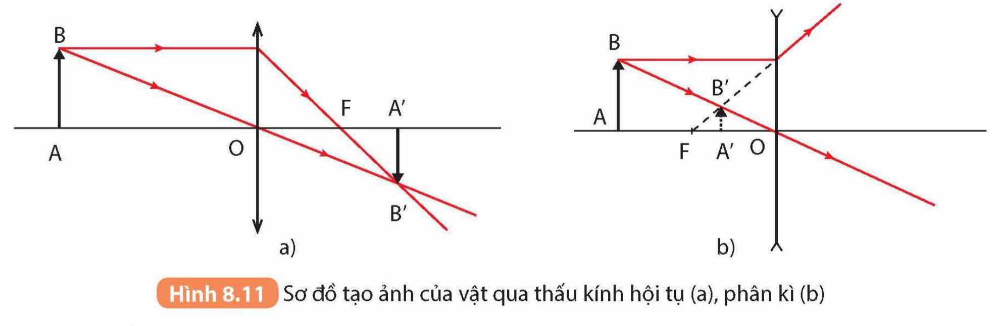

Hình 8.11. Sơ đồ tạo ảnh của vật qua thấu kính hội tụ (a), phân kì (b)

*Quy ước:* Ảnh được biểu diễn bằng mũi tên nét liền nếu là ảnh thật, mũi tên nét đứt nếu là ảnh ảo.

<!-- pdf:47 -->

> 1. Vật $AB$ được đặt vuông góc với trục chính của thấu kính hội tụ có tiêu cự $f$, điểm $A$ nằm trên trục chính. Gọi $d$ là khoảng cách từ vật đến quang tâm thấu kính. Hãy dựng ảnh $A'B'$ của $AB$ ứng với các trường hợp: $d > f$ và $d < f$.
>    Nhận xét đặc điểm ảnh của vật trong các trường hợp trên theo mẫu Bảng 8.1.
>
>    Bảng 8.1
>
>    | Khoảng cách từ vật đến thấu kính | Đặc điểm ảnh của vật: Ảnh thật hay ảnh ảo | Đặc điểm ảnh của vật: Cùng chiều hay ngược chiều với vật | Đặc điểm ảnh của vật: Lớn hơn hay nhỏ hơn vật |
>    | :---: | :---: | :---: | :---: |
>    | $d > f$ | ? | ? | ? |
>    | $d < f$ | ? | ? | ? |
>
> 2. Vẽ ảnh của một vật $AB$ đặt vuông góc với trục chính của thấu kính phân kì có tiêu cự $f$ trong các trường hợp: $d > f$ và $d < f$. Nhận xét đặc điểm ảnh của vật theo mẫu Bảng 8.2.
>
>    Bảng 8.2
>
>    | Khoảng cách từ vật đến thấu kính | Đặc điểm ảnh của vật: Ảnh thật hay ảnh ảo | Đặc điểm ảnh của vật: Cùng chiều hay ngược chiều với vật | Đặc điểm ảnh của vật: Lớn hơn hay nhỏ hơn vật |
>    | :---: | :---: | :---: | :---: |
>    | $d > f$ | ? | ? | ? |
>    | $d < f$ | ? | ? | ? |

### 3. Thí nghiệm kiểm tra đặc điểm ảnh của vật qua thấu kính

> *Chuẩn bị:* Bộ thí nghiệm như Hình 8.12:
> - Đèn chiếu sáng (1);
> - Vật sáng bằng kính mờ hình chữ F (2);
> - Thấu kính hội tụ hoặc thấu kính phân kì (3);
> - Màn chắn (4);
> - Giá quang học (5);
> - Nguồn điện và dây nối (6).
>
> 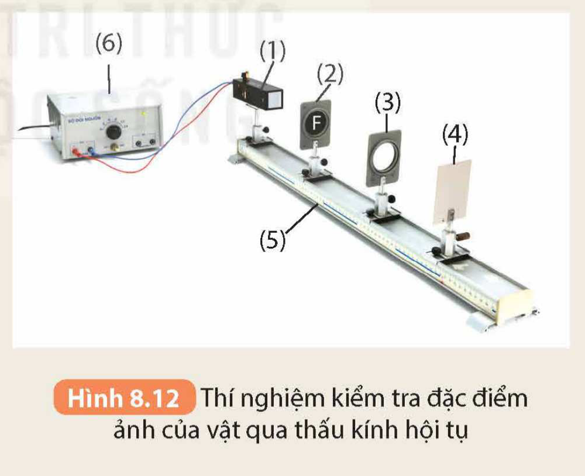
>
> Hình 8.12. Thí nghiệm kiểm tra đặc điểm ảnh của vật qua thấu kính hội tụ
>
> *Tiến hành:*
>
> *Thí nghiệm 1.*
> - Bố trí thí nghiệm như Hình 8.12.
> - Đặt vật ở vị trí $d > f$.
> - Từ từ dịch chuyển màn chắn cho đến khi thu được ảnh của vật rõ nét trên màn chắn.
> - Nhận xét đặc điểm ảnh của vật.
> - Lặp lại thí nghiệm trong trường hợp $d < f$ và rút ra nhận xét đặc điểm ảnh của vật trong trường hợp đó.

<!-- pdf:48 -->

> *Trả lời các câu hỏi sau:*
> 1. Đặt vật trong khoảng nào thì hứng được ảnh rõ nét trên màn chắn. Ảnh đó là ảnh thật hay ảnh ảo?
> 2. Khi đặt vật trong khoảng tiêu cự, quan sát ảnh ảo bằng cách nào? Ảnh ảo có hứng được trên màn chắn không?
>
> *Thí nghiệm 2.*
> - Thay thấu kính hội tụ bằng thấu kính phân kì.
> - Đặt vật ở các vị trí $d > f$ và $d < f$. Đặt mắt quan sát ảnh của vật qua thấu kính.
>
> *Thực hiện các yêu cầu sau:*
> 1. Hãy cho biết ảnh ảo tạo bởi thấu kính hội tụ và thấu kính phân kì có gì giống và khác nhau.
> 2. Nêu các cách phân biệt thấu kính hội tụ và thấu kính phân kì.

## 📌 Em đã học

- Thấu kính là một khối đồng chất trong suốt, giới hạn bởi hai mặt cong hoặc bởi một mặt cong và một mặt phẳng.
- *Quang tâm:* Có một điểm $O$ của thấu kính mà mọi tia sáng tới $O$ đều truyền thẳng qua thấu kính. Điểm $O$ gọi là quang tâm của thấu kính.
- *Trục chính:* Đường thẳng đi qua quang tâm $O$ và vuông góc với tiết diện thẳng của thấu kính gọi là trục chính của thấu kính.
- *Tiêu điểm chính:* Một chùm tia tới song song với trục chính của thấu kính cho chùm tia ló hội tụ tại một điểm $F$ nằm trên trục chính (đối với thấu kính hội tụ); hoặc đường kéo dài của chùm tia ló hội tụ tại một điểm $F$ nằm trên trục chính (đối với thấu kính phân kì). Điểm $F$ gọi là tiêu điểm chính của thấu kính.
- *Tiêu cự:* Khoảng cách từ quang tâm $O$ đến tiêu điểm chính $F$ của thấu kính, $OF = f$ gọi là tiêu cự của thấu kính.
- Vật đặt ngoài khoảng tiêu cự của thấu kính hội tụ cho ảnh thật, ngược chiều với vật. Vật đặt trong khoảng tiêu cự của thấu kính hội tụ cho ảnh ảo, lớn hơn vật và cùng chiều với vật.
- Vật đặt ở mọi vị trí trước thấu kính phân kì luôn cho ảnh ảo, cùng chiều, nhỏ hơn vật.
- Ảnh thật là ảnh hứng được trên màn chắn, ảnh ảo là ảnh không hứng được trên màn chắn.

## ✏️ Em có thể

- Nhận biết được thấu kính hội tụ và thấu kính phân kì.
- Giải thích được sự truyền ánh sáng qua thấu kính.
- Vẽ được ảnh của vật qua thấu kính.
- Chế tạo được thấu kính hội tụ từ chai nhựa và nước.

## 📷 Danh sách hình trong bài

| Mã hình | Trang PDF | Vị trí trong bài | Chú thích gốc |
| --- | :---: | --- | --- |
| H9-khoa_hoc_tu_nhien-b08-01 | 42 | Mở đầu | (Hình mở đầu Bài 8: Thấu kính trong ống nhòm) |
| H9-khoa_hoc_tu_nhien-b08-02 | 42 | Mục I | Hình 8.1. Một số loại thấu kính |
| H9-khoa_hoc_tu_nhien-b08-03 | 42 | Mục I | Hình 8.2. Hình tiết diện thẳng của thấu kính rìa mỏng (a), thấu kính rìa dày (c); kí hiệu thấu kính rìa mỏng (b), thấu kính rìa dày (d) |
| H9-khoa_hoc_tu_nhien-b08-04 | 42 | Mục I | Hình 8.3. Đường truyền của ba chùm sáng hẹp, song song qua thấu kính hội tụ (a) và qua thấu kính phân kì (b) |
| H9-khoa_hoc_tu_nhien-b08-05 | 43 | Mục I | Hình 8.4. Sơ đồ mô tả hệ thống thấu kính trong ống kính của máy ảnh |
| H9-khoa_hoc_tu_nhien-b08-06 | 43 | Mục II | Hình 8.5. Hình vẽ đường truyền tia sáng qua thấu kính hội tụ (a) và thấu kính phân kì (b) |
| H9-khoa_hoc_tu_nhien-b08-07 | 44 | Mục III.1 | Hình 8.6. Mô tả thí nghiệm sự truyền ánh sáng qua thấu kính hội tụ |
| H9-khoa_hoc_tu_nhien-b08-08 | 44 | Mục III.2.a | Hình 8.7. Mô hình thấu kính hội tụ được tạo thành bởi các lăng kính nhỏ |
| H9-khoa_hoc_tu_nhien-b08-09 | 45 | Mục III.2.b | Hình 8.8. Mô hình thấu kính phân kì được tạo thành bởi các lăng kính nhỏ |
| H9-khoa_hoc_tu_nhien-b08-10 | 45 | Mục IV | Hình 8.9. Một trường hợp tạo ảnh của vật qua thấu kính hội tụ (a), qua thấu kính phân kì (b) |
| H9-khoa_hoc_tu_nhien-b08-11 | 46 | Mục IV.1 | Hình 8.10 |
| H9-khoa_hoc_tu_nhien-b08-12 | 46 | Mục IV.2 | Hình 8.11. Sơ đồ tạo ảnh của vật qua thấu kính hội tụ (a), phân kì (b) |
| H9-khoa_hoc_tu_nhien-b08-13 | 47 | Mục IV.3 | Hình 8.12. Thí nghiệm kiểm tra đặc điểm ảnh của vật qua thấu kính hội tụ |
