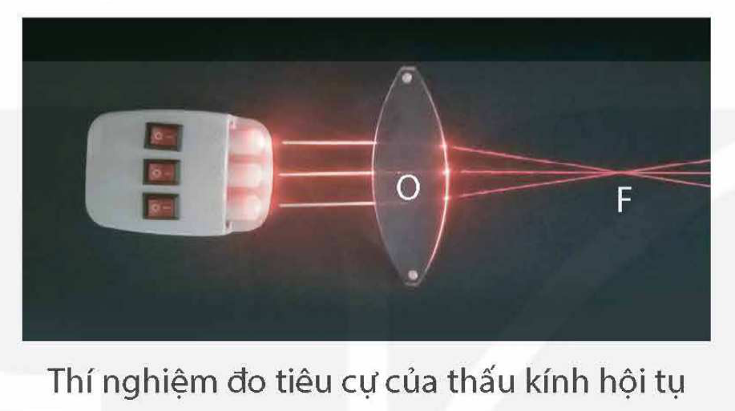
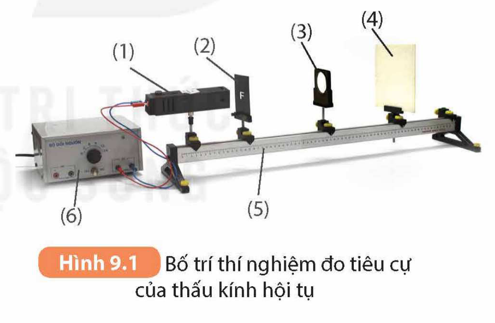
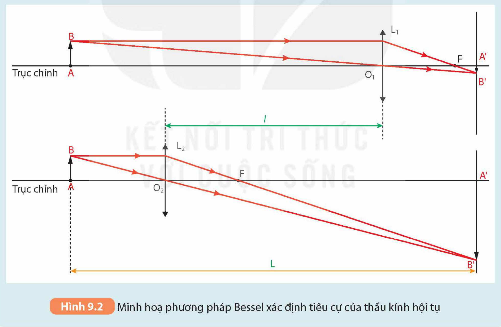

<!-- pdf:49 -->

# BÀI 9: THỰC HÀNH ĐO TIÊU CỰ CỦA THẤU KÍNH HỘI TỤ

## 🎯 Mục tiêu

- Đo được tiêu cự của thấu kính hội tụ bằng dụng cụ thực hành.

## 🔴 Mở đầu

Ta đã biết, khi chiếu chùm sáng song song với trục chính của một thấu kính hội tụ thì chùm tia ló sẽ đi qua tiêu điểm chính của thấu kính. Vậy để đo tiêu cự của thấu kính hội tụ có thể dùng phương án đo trực tiếp khoảng cách từ quang tâm $O$ tới tiêu điểm chính $F$ hay không? Cách đo này có nhược điểm gì?

Thí nghiệm đo tiêu cự của thấu kính hội tụ

## I. Chuẩn bị

### 1. Dụng cụ

- Nguồn sáng (1);
- Vật sáng bằng kính mờ, hình chữ F (2);
- Thấu kính hội tụ (3);
- Màn chắn (4);
- Giá quang học đồng trục (5);
- Nguồn điện, dây nối (6).

Hình 9.1. Bố trí thí nghiệm đo tiêu cự của thấu kính hội tụ

### 2. Đo tiêu cự của thấu kính hội tụ bằng phương pháp đối xứng (phương pháp Silbermann)

<!-- term: Phương pháp đối xứng -->
> Dựng ảnh của một vật $AB$ có độ cao $h$, đặt vuông góc với trục chính của thấu kính hội tụ và cách thấu kính một khoảng $d = 2f$ ($f$ là tiêu cự của thấu kính).
> 1. Dựa vào hình vẽ để chứng minh rằng trong trường hợp này, khoảng cách từ ảnh đến thấu kính và khoảng cách từ vật đến thấu kính bằng nhau.
> 2. Ảnh này có kích thước như thế nào so với vật?
> 3. Chứng minh công thức tính tiêu cự trong trường hợp này: $f = \dfrac{d + d'}{4}$.
>    Trong đó, $d'$ là khoảng cách từ ảnh của vật đến thấu kính.

<!-- pdf:50 -->

## II. Cách tiến hành
<!-- ocr-ok: đã đối chiếu ảnh trang 50, OCR bỏ sót tiêu đề mục II màu cam -->

<!-- term: Phương pháp đối xứng -->
- Bước 1: Đo chiều cao $h$ của vật hình chữ F.
- Bước 2: Bố trí thí nghiệm như Hình 9.1. Đặt vật và màn chắn sát thấu kính, dịch đồng thời vật và màn chắn ra xa dần thấu kính những khoảng bằng nhau cho đến khi quan sát được ảnh rõ nét trên màn chắn thì ghi lại giá trị $d$ và $d'$ vào vở theo mẫu Bảng 9.1.
- Bước 3: Đo chiều cao $h'$ của ảnh.
- Lặp lại thí nghiệm hai lần nữa, ghi kết quả vào vở theo mẫu Bảng 9.1. Tính giá trị trung bình của $d$ và $d'$, rồi tính giá trị trung bình của tiêu cự $\overline{f} = \dfrac{\overline{d} + \overline{d'}}{4}$.

## III. Kết quả
<!-- ocr-ok: đã đối chiếu ảnh trang 50, OCR bỏ sót tiêu đề mục III màu cam -->

> **BÁO CÁO THỰC HÀNH**
>
> Họ và tên: ... Lớp: ...
>
> **1. Mục đích thí nghiệm**
>
> Đo tiêu cự của thấu kính hội tụ bằng dụng cụ thực hành.
>
> **2. Chuẩn bị**
>
> Dụng cụ thí nghiệm: ...
>
> **3. Các bước tiến hành**
>
> Mô tả các bước tiến hành: ...
>
> **4. Kết quả thí nghiệm**
>
> Hoàn thành bảng ghi kết quả thí nghiệm đo tiêu cự của thấu kính hội tụ theo mẫu Bảng 9.1.
>
> Bảng 9.1
>
> | Lần đo | Khoảng cách từ vật đến màn ($\text{mm}$) | Khoảng cách từ ảnh đến màn ($\text{mm}$) | Chiều cao của vật ($\text{mm}$) | Chiều cao của ảnh ($\text{mm}$) |
> | :---: | :---: | :---: | :---: | :---: |
> | 1 | $d_1 = ?$ | $d'_1 = ?$ | $h_1 = ?$ | $h'_1 = ?$ |
> | 2 | $d_2 = ?$ | $d'_2 = ?$ | $h_2 = ?$ | $h'_2 = ?$ |
> | 3 | $d_3 = ?$ | $d'_3 = ?$ | $h_3 = ?$ | $h'_3 = ?$ |
> | Trung bình | $\overline{d} = \dfrac{d_1 + d_2 + d_3}{3} = ?$ | $\overline{d'} = \dfrac{d'_1 + d'_2 + d'_3}{3} = ?$ | $\overline{h} = \dfrac{h_1 + h_2 + h_3}{3} = ?$ | $\overline{h'} = \dfrac{h'_1 + h'_2 + h'_3}{3} = ?$ |
>
> Giá trị trung bình của tiêu cự: $\overline{f} = \dfrac{\overline{d} + \overline{d'}}{4} = ?$
>
> Thực hiện các yêu cầu và trả lời các câu hỏi sau:
> 1. Nhận xét về chiều cao $\overline{h}$ của vật và chiều cao $\overline{h'}$ của ảnh.
> 2. So sánh giá trị $\overline{f}$ với số liệu tiêu cự ghi trên thấu kính.
> 3. So sánh ưu điểm và nhược điểm khi đo tiêu cự thấu kính hội tụ bằng phương pháp Silbermann với phương án đo trực tiếp khoảng cách từ quang tâm $O$ tới tiêu điểm chính $F$ như phần mở đầu.

<!-- pdf:51 -->

## 📌 Em đã học

- Cách đo tiêu cự của thấu kính hội tụ theo phương pháp Silbermann.

## ✏️ Em có thể

- Đo được tiêu cự của thấu kính hội tụ theo những phương pháp khác nhau.

> 🔍 **Em có biết?**
>
> <!-- term: Phương pháp hoán vị -->
> Người ta có thể sử dụng phương pháp hoán vị (phương pháp Bessel) để xác định tiêu cự của thấu kính hội tụ như sau: Đặt vật, thấu kính hội tụ, màn chắn thẳng hàng trên một trục. Dịch chuyển thấu kính tới các vị trí khác nhau để tìm hai vị trí thu được ảnh rõ nét trên màn chắn (Hình 9.2). Xác định khoảng cách giữa vật và màn chắn ($L$), khoảng cách giữa hai vị trí của thấu kính cho ảnh rõ nét trên màn chắn ($l$), ta tính được tiêu cự của thấu kính:
>
> $f = \dfrac{L^2 - l^2}{4L}$
>
> 
>
> Hình 9.2. Minh hoạ phương pháp Bessel xác định tiêu cự của thấu kính hội tụ

## 📷 Danh sách hình trong bài

| Mã hình | Trang PDF | Vị trí trong bài | Chú thích gốc |
| --- | :---: | --- | --- |
| H9-khoa_hoc_tu_nhien-b09-01 | 49 | Mở đầu | Thí nghiệm đo tiêu cự của thấu kính hội tụ |
| H9-khoa_hoc_tu_nhien-b09-02 | 49 | Mục I.1 | Hình 9.1. Bố trí thí nghiệm đo tiêu cự của thấu kính hội tụ |
| H9-khoa_hoc_tu_nhien-b09-03 | 51 | Em có biết? | Hình 9.2. Minh hoạ phương pháp Bessel xác định tiêu cự của thấu kính hội tụ |
