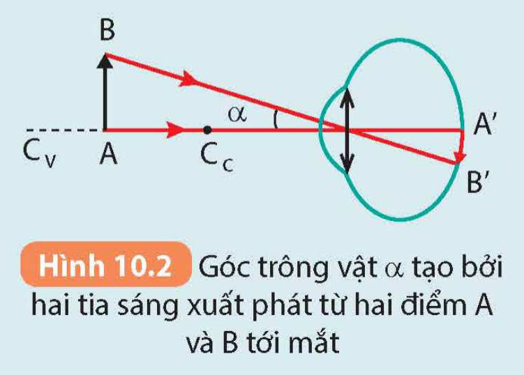
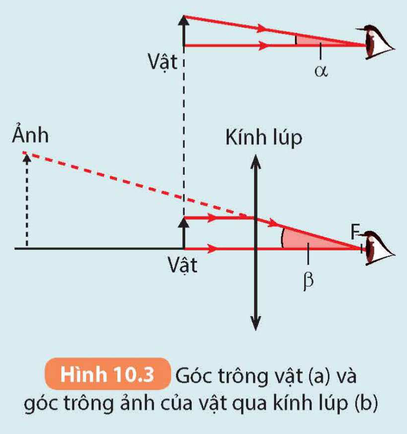
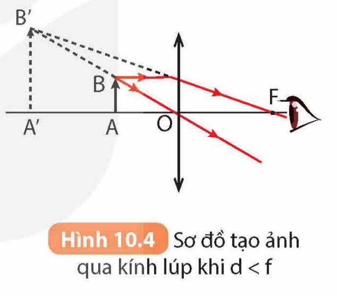
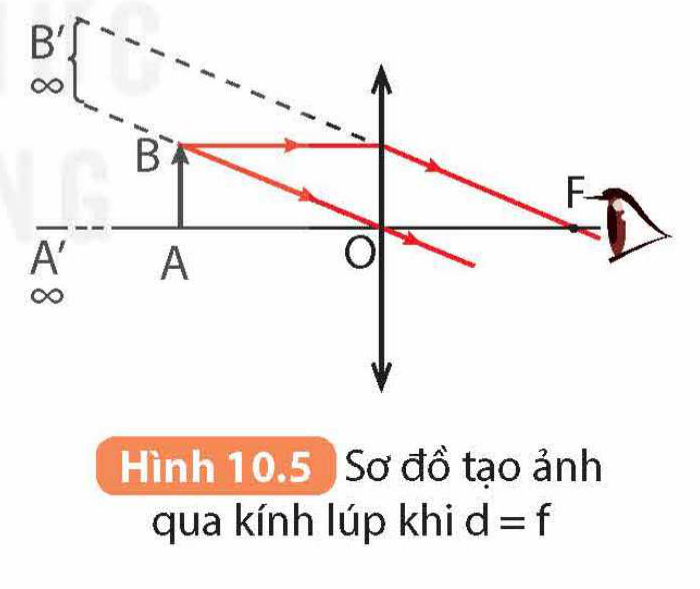
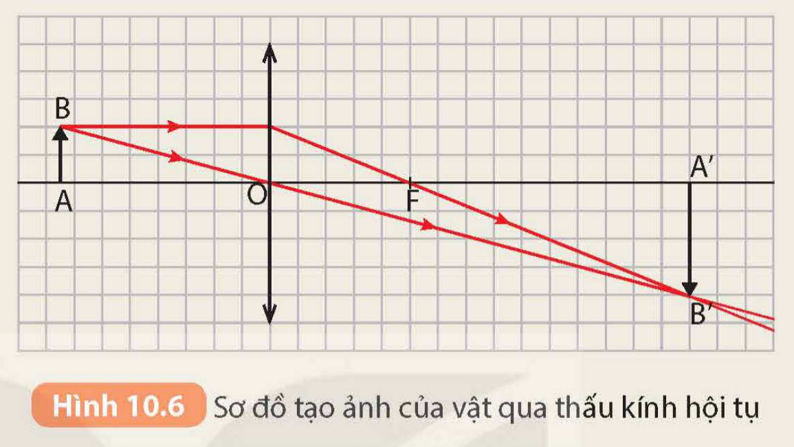

<!-- pdf:52 -->

# BÀI 10: KÍNH LÚP. BÀI TẬP THẤU KÍNH

## 🎯 Mục tiêu

- Mô tả được cấu tạo và sử dụng được kính lúp.
- Vẽ được sơ đồ tỉ lệ để giải các bài tập đơn giản về thấu kính hội tụ.

## 🔴 Mở đầu

Tại sao người thợ sửa đồng hồ lại phải sử dụng kính lúp khi làm việc?

## I. Cấu tạo kính lúp

**Kính lúp** là một dụng cụ quang bổ trợ cho mắt để quan sát các vật nhỏ. Về mặt cấu tạo, kính lúp là một thấu kính hội tụ có tiêu cự nhỏ (cỡ vài $\text{cm}$), thường được bảo vệ bởi một khung có tay cầm (Hình 10.3) hoặc đeo trực tiếp vào mắt.

Mỗi kính lúp có một số bội giác xác định. Trong thực tế, số bội giác thường được ghi ngay trên khung đỡ kính và được kí hiệu: $2\times$, $5\times$, $10\times$, $20\times$,... Giá trị này được tính theo quy ước:

$G = \dfrac{25}{f}$

Trong đó $G$ là số bội giác, $f$ là tiêu cự thấu kính được đo bằng đơn vị $\text{cm}$. Sử dụng kính lúp có số bội giác càng lớn thì có thể quan sát được vật càng nhỏ.

Hình 10.1. Dùng kính lúp đọc sách
<!-- ocr-ok: đã đối chiếu ảnh trang 52, OCR đọc sai nhãn màu cam Hình 10.1 -->

> ❓ 1. Trả lời câu hỏi phần mở bài.
> 2. Nêu một số ứng dụng của kính lúp trong cuộc sống.

> 🔍 **Em có biết?**
>
> <!-- term: Góc trông vật -->
> Ở lớp 8, chúng ta đã học về cấu tạo của mắt, muốn cho mắt nhìn rõ một vật thì ảnh thật của vật tạo bởi mắt phải hiện trên màng lưới (võng mạc). Tuy nhiên, việc nhìn thấy được một vật nhỏ còn tuỳ thuộc vào kích thước ảnh của vật trên màng lưới. Kích thước này phụ thuộc vào góc trông vật $\alpha$ (Hình 10.2).
>
> 
>
> Hình 10.2. Góc trông vật $\alpha$ tạo bởi hai tia sáng xuất phát từ hai điểm $A$ và $B$ tới mắt

<!-- pdf:53 -->

> Để mắt còn có thể phân biệt được hai điểm $AB$ thì góc trông vật cần lớn hơn một giá trị tối thiểu, gọi là **năng suất phân li** $\varepsilon$ (ép-xi-lon) của mắt. Khi đó, ảnh của điểm đầu $B'$ và điểm cuối $A'$ của vật được tạo ra tương ứng với hai tế bào thần kinh thị giác kề nhau trên võng mạc. Năng suất phân li thay đổi tuỳ theo từng người, nhưng giá trị trung bình là: $\varepsilon = \alpha_{\min} \approx 1'$.
>
> Để quan sát được vật nhỏ với góc trông vật $\alpha$, ta có thể dùng kính lúp để tạo ảnh ảo cùng chiều với góc trông ảnh $\beta$ lớn hơn góc trông vật (Hình 10.3). Đại lượng đặc trưng cho tác dụng làm tăng góc trông ảnh so với góc trông vật của kính lúp là **số bội giác** $G$, được xác định bằng tỉ số giữa góc trông ảnh và góc trông vật:
>
> $G = \dfrac{\beta}{\alpha}$
>
> 
>
> Hình 10.3. Góc trông vật (a) và góc trông ảnh của vật qua kính lúp (b)

## II. Cách quan sát một vật nhỏ qua kính lúp
<!-- ocr-ok: đã đối chiếu ảnh trang 53, OCR bỏ sót tiêu đề mục II màu cam -->

Khi quan sát một vật nhỏ qua kính lúp, mắt nhìn ảnh ảo của vật đó qua kính (Hình 10.4). Muốn thế, phải đặt vật nhỏ trong khoảng từ quang tâm $O$ của kính đến tiêu điểm chính $F$.

Hình 10.4. Sơ đồ tạo ảnh qua kính lúp khi $d < f$

Ngoài ra để mắt có thể nhìn thấy ảnh thì ảnh phải có vị trí ở trong khoảng nhìn rõ của mắt. Với mắt không có tật khúc xạ, khoảng nhìn rõ của mắt từ khoảng $25\text{ cm}$ (còn gọi là **điểm cực cận**) đến vô cực (còn gọi là **điểm cực viễn**).
- Khi đặt kính lúp sao cho ảnh của vật xuất hiện ở điểm cực cận, ta gọi đó là **ngắm chừng ở cực cận**.
- Khi đặt vật ở vị trí $d = f$, ảnh của vật sẽ ở xa vô cực (Hình 10.5).

Hình 10.5. Sơ đồ tạo ảnh qua kính lúp khi $d = f$

Để quan sát một vật nhỏ bằng kính lúp, ta đặt kính sát vật, rồi từ từ dịch chuyển kính ra xa tới khi quan sát được rõ vật.

Số bội giác $G$ ghi trên kính chính là số bội giác khi **ngắm chừng ở vô cực** (ảnh của vật cho bởi kính lúp ở vô cực).

> 1. Để quan sát được ảnh qua kính lúp, ta phải đặt vật trong khoảng nào trước kính?
> 2. Vẽ ảnh của vật qua kính lúp khi ngắm chừng ở cực cận.

## III. Vẽ sơ đồ tạo ảnh qua thấu kính hội tụ
<!-- ocr-ok: đã đối chiếu ảnh trang 53, OCR bỏ sót tiêu đề mục III màu cam -->

Trong một số trường hợp phải vẽ ảnh của vật rất lớn hoặc rất nhỏ, ta có thể vẽ được sơ đồ tạo ảnh theo một tỉ lệ xích xác định như sau:

Bước 1: Chọn tỉ lệ xích thích hợp.

<!-- pdf:54 -->

Bước 2: Xác định giá trị tiêu cự $f$ của thấu kính; các khoảng cách từ vật và ảnh tới thấu kính $d$, $d'$; các độ cao của vật và ảnh $h$, $h'$ theo cùng một tỉ lệ xích đã chọn.

Bước 3: Vẽ sơ đồ tạo ảnh của vật theo các giá trị đã xác định được.

> Một vật $AB$ cao $2\text{ cm}$ được đặt vuông góc với trục chính của một thấu kính hội tụ và cách thấu kính một khoảng $7,5\text{ cm}$, $A$ nằm trên trục chính. Thấu kính có tiêu cự là $5\text{ cm}$.
> a) Sử dụng giấy kẻ ô và vẽ ảnh của vật $AB$ qua thấu kính theo tỉ lệ $1$ cạnh của ô vuông tương ứng với $1\text{ cm}$ như Hình 10.6.
> b) Xác định vị trí và đặc điểm của ảnh (ảnh thật hay ảnh ảo, cùng chiều hay ngược chiều với vật).
>
> 
>
> Hình 10.6. Sơ đồ tạo ảnh của vật qua thấu kính hội tụ

> ❓ Vật $AB$ có độ cao $h = 3\text{ cm}$ được đặt vuông góc trước một thấu kính hội tụ có tiêu cự $f = 5\text{ cm}$, điểm $A$ nằm trên trục chính và cách thấu kính một khoảng $d = 2f$.
> a) Dựng ảnh $A'B'$ của $AB$ tạo bởi thấu kính hội tụ theo đúng tỉ lệ.
> b) Vận dụng kiến thức hình học tính chiều cao của ảnh ($h'$) và khoảng cách từ ảnh tới quang tâm ($d'$).

## 📌 Em đã học

- Kính lúp là thấu kính hội tụ có tiêu cự ngắn ($f < 25\text{ cm}$), dùng để quan sát các vật nhỏ.
- Vật cần quan sát phải đặt trong khoảng tiêu cự của kính lúp để cho một ảnh ảo lớn hơn vật và ảnh của vật nằm trong khoảng nhìn rõ của mắt.
- Cách vẽ sơ đồ tạo ảnh qua thấu kính hội tụ:
  Bước 1: Chọn tỉ lệ xích thích hợp.
  Bước 2: Xác định giá trị tiêu cự $f$ của thấu kính; các khoảng cách từ vật và ảnh tới thấu kính $d$, $d'$; các độ cao của vật và ảnh $h$, $h'$ theo cùng một tỉ lệ xích đã chọn.
  Bước 3: Vẽ sơ đồ tạo ảnh của vật theo các giá trị đã xác định được.

## ✏️ Em có thể

- Sử dụng được kính lúp để quan sát các vật nhỏ.
- Vẽ được ảnh của một vật qua thấu kính hội tụ theo đúng tỉ lệ để giải các bài tập đơn giản về thấu kính hội tụ.

> 🔍 **Em có biết?**
>
> Khi nhìn một vật thì ảnh của vật đó hiện rõ nét trên màng lưới. Thực ra, lúc đó cơ vòng đỡ thể thuỷ tinh đã phải co dãn một chút, làm thay đổi tiêu cự của thể thuỷ tinh sao cho ảnh hiện rõ nét trên màng lưới. Quá trình này gọi là **sự điều tiết** của mắt. Sự điều tiết xảy ra hoàn toàn tự nhiên.

## 📷 Danh sách hình trong bài

| Mã hình | Trang PDF | Vị trí trong bài | Chú thích gốc |
| --- | :---: | --- | --- |
| H9-khoa_hoc_tu_nhien-b10-01 | 52 | Mở đầu | (Hình mở đầu Bài 10: Người thợ sửa đồng hồ sử dụng kính lúp khi làm việc) |
| H9-khoa_hoc_tu_nhien-b10-02 | 52 | Mục I | Hình 10.1. Dùng kính lúp đọc sách |
| H9-khoa_hoc_tu_nhien-b10-03 | 52 | Mục I, Em có biết? | Hình 10.2. Góc trông vật α tạo bởi hai tia sáng xuất phát từ hai điểm A và B tới mắt |
| H9-khoa_hoc_tu_nhien-b10-04 | 53 | Mục I, Em có biết? | Hình 10.3. Góc trông vật (a) và góc trông ảnh của vật qua kính lúp (b) |
| H9-khoa_hoc_tu_nhien-b10-05 | 53 | Mục II | Hình 10.4. Sơ đồ tạo ảnh qua kính lúp khi d < f |
| H9-khoa_hoc_tu_nhien-b10-06 | 53 | Mục II | Hình 10.5. Sơ đồ tạo ảnh qua kính lúp khi d = f |
| H9-khoa_hoc_tu_nhien-b10-07 | 54 | Mục III | Hình 10.6. Sơ đồ tạo ảnh của vật qua thấu kính hội tụ |
