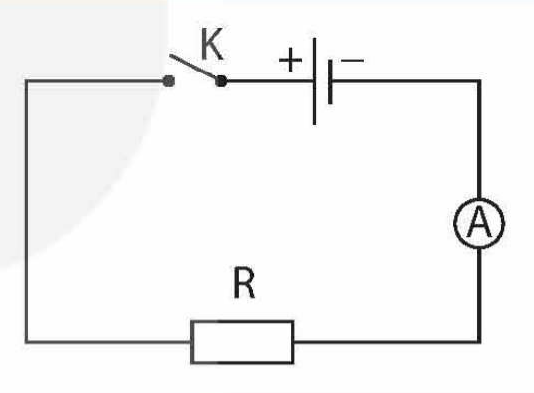
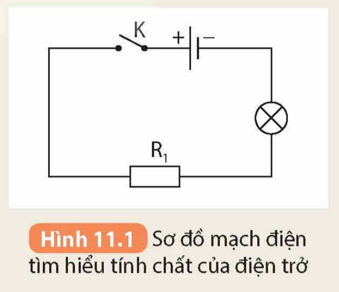
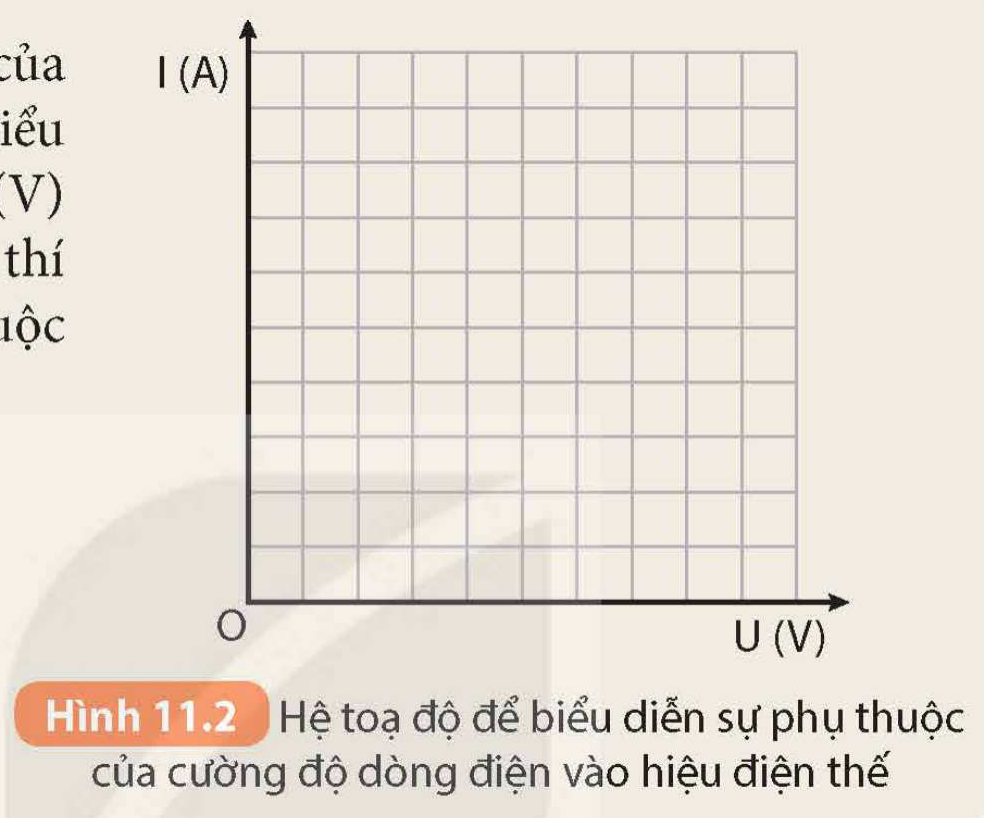
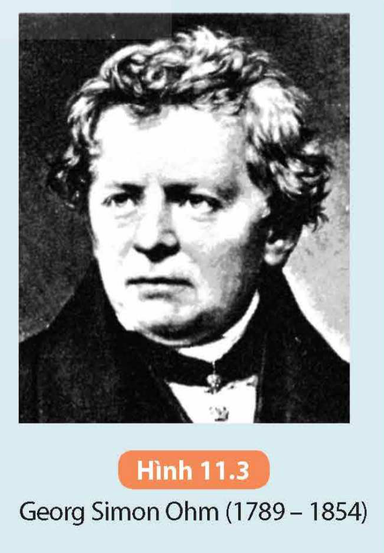
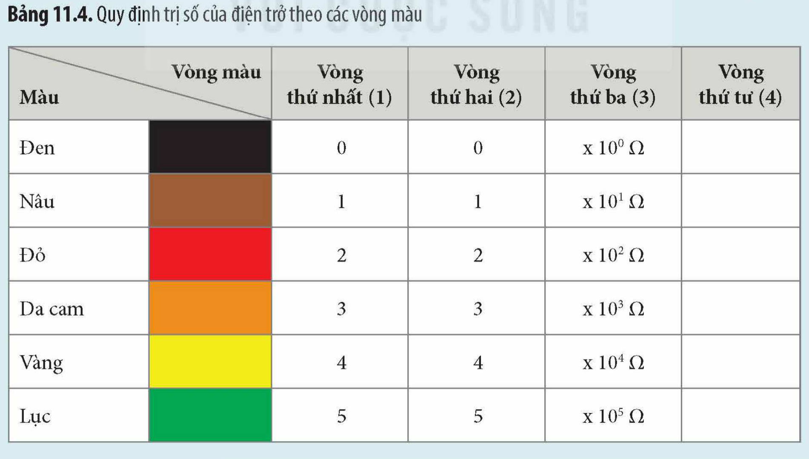
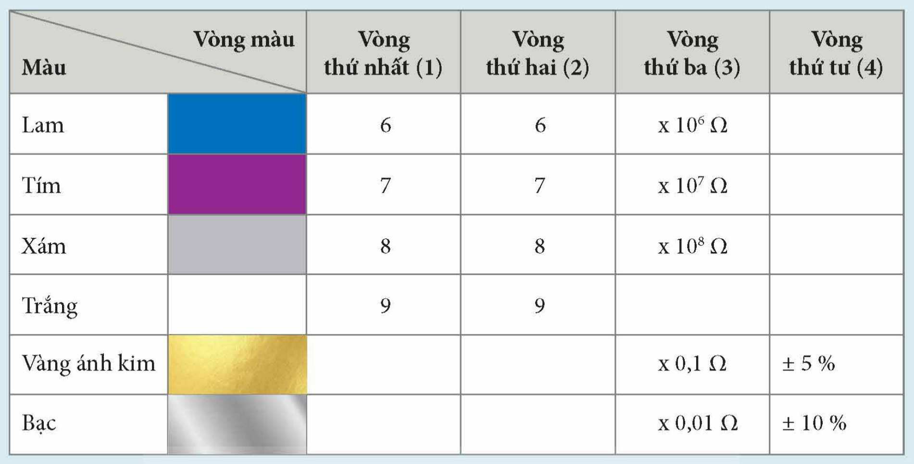
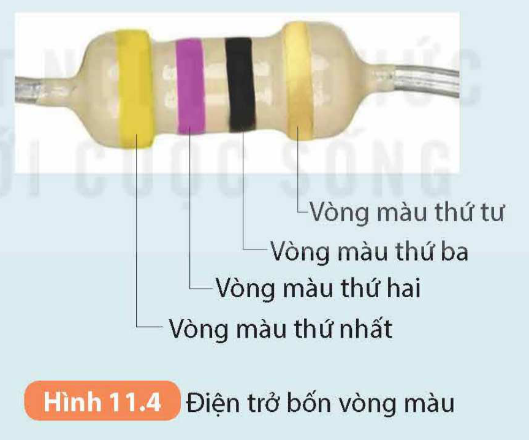

<!-- pdf:55 -->

# BÀI 11: ĐIỆN TRỞ. ĐỊNH LUẬT OHM

## 🎯 Mục tiêu

- Thực hiện thí nghiệm đơn giản để nêu được điện trở có tác dụng cản trở dòng điện trong mạch.
- Thực hiện thí nghiệm để xây dựng được định luật Ohm: Cường độ dòng điện chạy qua một đoạn dây dẫn tỉ lệ thuận với hiệu điện thế giữa hai đầu đoạn dây và tỉ lệ nghịch với điện trở của nó.
- Nêu được (không yêu cầu thành lập): Công thức tính điện trở của một đoạn dây dẫn (theo độ dài, tiết diện, điện trở suất).
- Sử dụng công thức đã cho để tính được điện trở của một đoạn dây dẫn.

## 🔴 Mở đầu

> Nếu lần lượt thay điện trở trong sơ đồ mạch điện ở hình bên bằng các điện trở khác nhau thì số chỉ của ampe kế có thay đổi không?
>
> Nếu thay đổi nguồn điện khác nhau thì cường độ dòng điện chạy qua điện trở có thay đổi không?
>
> 

## I. Điện trở

> ✋ Thí nghiệm tìm hiểu tính chất của điện trở
>
> *Chuẩn bị:*
> - Nguồn điện một chiều $12\text{ V}$;
> - Một bóng đèn $2,5\text{ V}$;
> - Ba vật dẫn là ba điện trở $R_1$, $R_2$, $R_3$;
> - Công tắc, các dây nối.
>
> *Tiến hành:*
> - Mắc điện trở $R_1$ vào mạch điện theo sơ đồ Hình 11.1.
> - Đóng công tắc, quan sát độ sáng của bóng đèn và ghi vào vở theo mẫu Bảng 11.1.
> - Lần lượt thay điện trở $R_1$ bằng điện trở $R_2$ và $R_3$, trong mỗi trường hợp hãy quan sát độ sáng của bóng đèn và ghi vào vở theo mẫu Bảng 11.1.
>
> 
>
> Hình 11.1. Sơ đồ mạch điện tìm hiểu tính chất của điện trở

<!-- pdf:56 -->

> Bảng 11.1.
>
> | Vật dẫn | Mô tả độ sáng của bóng đèn |
> |---|---|
> | Điện trở $R_1$ | ? |
> | Điện trở $R_2$ | ? |
> | Điện trở $R_3$ | ? |
>
> *Thực hiện yêu cầu sau:*
>
> So sánh độ sáng của bóng đèn trong 3 trường hợp, rút ra kết luận về tính chất của điện trở.

*Kết luận:*
- Điện trở có tác dụng cản trở dòng điện.
- Điện trở khác nhau có tác dụng cản trở dòng điện khác nhau.

> ❓ Trả lời câu hỏi thứ nhất nêu ở phần mở bài.

## II. Sự phụ thuộc của cường độ dòng điện vào hiệu điện thế

### 1. Thí nghiệm

> ✋ Thí nghiệm tìm hiểu sự phụ thuộc của cường độ dòng điện vào hiệu điện thế
>
> *Chuẩn bị:*
> - Nguồn điện một chiều $12\text{ V}$;
> - Một biến trở $R_0$;
> - Một ampe kế và một vôn kế;
> - Vật dẫn là một điện trở;
> - Công tắc, các dây nối.
>
> *Tiến hành:*
> - Mắc mạch điện theo sơ đồ Hình 11.1.
> - Đóng khoá K, điều chỉnh biến trở để hiệu điện thế giữa hai đầu đoạn mạch AB lần lượt là $0\text{ V}$, $3\text{ V}$, $6\text{ V}$, $9\text{ V}$, $12\text{ V}$. Ghi lại số chỉ của ampe kế mỗi lần đo vào vở theo mẫu tương tự Bảng 11.2.
>
> Bảng 11.2.
>
> | Lần đo | $U\text{ (V)}$ | $I\text{ (A)}$ |
> |---|---|---|
> | 1 | 0 | 0,0 |
> | 2 | 3 | 0,5 |
> | 3 | 6 | ? |
> | 4 | 9 | 1,5 |
> | 5 | 12 | ? |
>
> *Thực hiện các yêu cầu sau:*
>
> 1. Nhận xét sự thay đổi cường độ dòng điện chạy qua vật dẫn khi thay đổi hiệu điện thế giữa hai đầu vật dẫn.

<!-- pdf:57 -->

> 2. Rút ra mối quan hệ giữa cường độ dòng điện chạy qua vật dẫn và hiệu điện thế giữa hai đầu vật dẫn.
> 3. Hãy dự đoán giá trị của cường độ dòng điện trong các ô còn trống minh hoạ ở Bảng 11.2.

### 2. Đồ thị biểu diễn sự phụ thuộc của cường độ dòng điện vào hiệu điện thế

> ✋ 1. Chọn trục tung biểu diễn các giá trị của cường độ dòng điện $I\text{ (A)}$; trục hoành biểu diễn các giá trị của hiệu điện thế $U\text{ (V)}$ (Hình 11.2). Sử dụng số liệu thu được từ thí nghiệm, vẽ đồ thị biểu diễn sự phụ thuộc của $I$ vào $U$.
>
> 2. Nhận xét đồ thị:
> - Đồ thị là đường cong hay đường thẳng?
> - Đồ thị có đi qua gốc toạ độ không?
>
> 
>
> Hình 11.2. Hệ toạ độ để biểu diễn sự phụ thuộc của cường độ dòng điện vào hiệu điện thế

*Kết luận:* Đồ thị biểu diễn sự phụ thuộc của cường độ dòng điện vào hiệu điện thế là một đường thẳng đi qua gốc toạ độ.

## III. Định luật Ohm

### 1. Điện trở của đoạn dây dẫn

> ❓ Từ số liệu thu được ở Bảng 11.2, xác định thương số $\frac{U}{I}$ đối với mỗi lần đo. Có nhận xét gì về giá trị thương số $\frac{U}{I}$?

Thí nghiệm tương tự với vật dẫn là các đoạn dây dẫn khác nhau cũng cho kết quả giá trị thương số $\frac{U}{I}$ không đổi.

*Kết luận:*
- Giá trị thương số $\frac{U}{I}$ không đổi đối với mỗi đoạn dây dẫn gọi là **điện trở** của đoạn dây dẫn đó (kí hiệu là $R$).
- Với các đoạn dây dẫn khác nhau, giá trị thương số $R = \frac{U}{I}$ khác nhau. Hiệu điện thế giữa hai đầu các đoạn dây dẫn như nhau, cường độ dòng điện chạy qua đoạn dây dẫn nào nhỏ hơn thì giá trị $\frac{U}{I}$ lớn hơn.
- Giá trị $\frac{U}{I}$ đặc trưng cho sự cản trở dòng điện đi qua đoạn dây dẫn.

<!-- pdf:58 -->

### 2. Đơn vị điện trở

Trong biểu thức $R = \frac{U}{I}$, nếu $U$ được tính bằng vôn ($\text{V}$), $I$ được tính bằng ampe ($\text{A}$) thì $R$ được tính bằng **ôm** ($\Omega$).

$$1\ \Omega = \frac{1\text{ V}}{1\text{ A}}$$
<!-- ocr-ok: đã đối chiếu ảnh trang gốc 58 (trang in 56), biểu thức đơn vị ôm -->

Ước số của ôm là **miliôm** ($\text{m}\Omega$); bội số của ôm là **kilôôm** ($\text{k}\Omega$), **mêgaôm** ($\text{M}\Omega$):

$1\text{ m}\Omega = 0,001\ \Omega$

$1\text{ k}\Omega = 1\ 000\ \Omega$

$1\text{ M}\Omega = 1\ 000\ 000\ \Omega$

### 3. Định luật Ohm

Từ kết quả các thí nghiệm nghiên cứu sự phụ thuộc của cường độ dòng điện chạy qua đoạn dây dẫn vào hiệu điện thế giữa hai đầu đoạn dây dẫn và điện trở đoạn dây dẫn cho phép phát biểu thành định luật mang tên nhà bác học Georg Simon Ohm, gọi là **định luật Ohm**:
*Cường độ dòng điện chạy qua một đoạn dây dẫn tỉ lệ thuận với hiệu điện thế giữa hai đầu đoạn dây và tỉ lệ nghịch với điện trở của nó.*

Biểu thức định luật Ohm: $I = \frac{U}{R}$.

> ❓ 1. Một bóng đèn xe máy lúc thắp sáng có điện trở $12\ \Omega$ và cường độ dòng điện đi qua dây tóc bóng đèn là $0,5\text{ A}$. Tính hiệu điện thế giữa hai đầu dây tóc bóng đèn khi đó.
>
> 2. Khi hiệu điện thế giữa hai đầu một đoạn mạch là $2\text{ V}$ thì cường độ dòng điện đi qua là $0,4\text{ A}$. Hỏi hiệu điện thế sẽ phải bằng bao nhiêu để cường độ dòng điện đi qua đoạn mạch là $0,8\text{ A}$?

> 🔍 Georg Simon Ohm sinh năm 1789 tại Erlangen, một thành phố công nghiệp nhỏ ở tây nam nước Đức. Sau khi tốt nghiệp đại học, ông trở thành giáo viên dạy vật lí ở nhiều địa phương khác nhau. Mơ ước lớn nhất của ông là trở thành giáo sư trường đại học.
>
> Định luật Ohm mà chúng ta đang học ngày nay là một trong những công trình nghiên cứu được ông công bố vào năm 1827. Tuy nhiên, lúc đầu chưa được công nhận. Mười năm sau khi công bố, định luật Ohm và các công trình khác của ông mới được công nhận ở Đức, Nga, Anh, Mỹ, Italia. Năm 1842, công trình của ông được một tổ chức khoa học Anh thưởng huy chương, nhưng sau đó nhiều người vẫn còn hoài nghi về tính tổng quát của định luật. Mãi đến cuối thế kỉ XIX, định luật của ông mới được công nhận hoàn toàn. Để ghi nhớ công lao của ông, các nhà vật lí học đã lấy tên ông đặt cho đơn vị điện trở.
>
> 
>
> Hình 11.3. Georg Simon Ohm (1789 – 1854)

<!-- pdf:59 -->

## IV. Điện trở của dây dẫn phụ thuộc vào kích thước và bản chất của dây dẫn

<!-- term: Công thức tính điện trở của một đoạn dây dẫn -->
Kết quả thực hiện các thí nghiệm cho thấy: *Điện trở của một đoạn dây dẫn tỉ lệ thuận với chiều dài của đoạn dây, tỉ lệ nghịch với tiết diện của dây và phụ thuộc vào bản chất của chất làm dây dẫn.*

<!-- term: Công thức tính điện trở của một đoạn dây dẫn -->
Điện trở của một đoạn dây dẫn được tính bằng công thức:

$$R = \rho \frac{l}{S}$$
<!-- ocr-ok: đã đối chiếu ảnh trang gốc 59 (trang in 57), công thức tính điện trở dây dẫn -->

<!-- term: Điện trở suất -->
Trong đó: $R$ là điện trở của đoạn dây dẫn, đơn vị đo là ôm ($\Omega$).
$\rho$ (đọc là rô) là điện trở suất của chất làm dây dẫn, đơn vị đo là ôm mét ($\Omega\text{m}$);
$l$ là chiều dài của đoạn dây dẫn, đơn vị đo là mét ($\text{m}$);
$S$ là tiết diện của dây dẫn, đơn vị đo là mét vuông ($\text{m}^2$).

Bảng 11.3. Điện trở suất của một số chất ở nhiệt độ phòng ($20\text{ }^\circ\text{C}$)\*

| Kim loại | Điện trở suất ($\Omega\text{m}$) | Hợp kim | Điện trở suất ($\Omega\text{m}$) |
|---|---|---|---|
| Bạc | $1,47 \cdot 10^{-8}$ | Nikelin | $40,00 \cdot 10^{-8}$ |
| Đồng | $1,70 \cdot 10^{-8}$ | Manganin | $43,00 \cdot 10^{-8}$ |
| Vàng | $2,35 \cdot 10^{-8}$ | Constantan | $50,00 \cdot 10^{-8}$ |
| Nhôm | $2,80 \cdot 10^{-8}$ | Nicrom | $110,00 \cdot 10^{-8}$ |
| Tungsten | $5,50 \cdot 10^{-8}$ | | |
| Sắt | $12,00 \cdot 10^{-8}$ | | |
<!-- ocr-ok: đã đối chiếu ảnh trang gốc 59 (trang in 57), Bảng 11.3 có nhiều số mũ LaTeX -->

> ❓ 1. Có hai đoạn dây dẫn bằng đồng, dây thứ nhất có chiều dài bằng một nửa dây thứ hai, nhưng lại có tiết diện gấp đôi tiết diện của dây thứ hai. So sánh điện trở của hai dây dẫn đó.
>
> 2. Tính điện trở của một đoạn dây dẫn bằng đồng có chiều dài $150\text{ m}$, tiết diện là $2\text{ mm}^2$, biết điện trở suất của đồng là $1,7 \cdot 10^{-8}\ \Omega\text{m}$.

## 📌 Em đã học

- Đối với một đoạn dây dẫn, thương số $\frac{U}{I}$ (trong đó $U$ là hiệu điện thế giữa hai đầu đoạn dây dẫn, $I$ là cường độ dòng điện chạy qua đoạn dây) có giá trị không đổi gọi là điện trở của đoạn dây dẫn, kí hiệu là $R$. Điện trở là đại lượng đặc trưng cho tính chất cản trở dòng điện của một đoạn dây dẫn khi có dòng điện chạy qua.
- Định luật Ohm: Cường độ dòng điện chạy qua một đoạn dây dẫn tỉ lệ thuận với hiệu điện thế giữa hai đầu dây dẫn và tỉ lệ nghịch với điện trở của nó.

$$I = \frac{U}{R}$$

> (\*) Nguồn: Materials science and engineering, Tr. 27-30

<!-- pdf:60 -->

Trong đó: $I$ là cường độ dòng điện, đơn vị đo là ampe ($\text{A}$);
$U$ là hiệu điện thế, đơn vị đo là vôn ($\text{V}$);
$R$ là điện trở, đơn vị đo là ôm ($\Omega$).

- Điện trở của một đoạn dây dẫn tỉ lệ thuận với chiều dài của đoạn dây, tỉ lệ nghịch với tiết diện của dây và phụ thuộc vào bản chất của chất làm dây dẫn. Công thức tính điện trở của một đoạn dây dẫn:

$$R = \rho \frac{l}{S}$$
<!-- ocr-ok: đã đối chiếu ảnh trang gốc 60 (trang in 58), công thức tính điện trở dây dẫn -->

Trong đó: $R$ là điện trở của đoạn dây dẫn, đơn vị đo là ôm ($\Omega$)
$\rho$ là điện trở suất của chất làm dây dẫn, đơn vị đo là ôm mét ($\Omega\text{m}$);
$l$ là chiều dài của đoạn dây dẫn, đơn vị đo là mét ($\text{m}$);
$S$ là tiết diện của dây dẫn, đơn vị đo là mét vuông ($\text{m}^2$).

## ✏️ Em có thể

- Giải thích được vì sao dây dẫn điện trong gia đình thường làm bằng đồng, còn dây dẫn đường điện cao áp (điện cao thế) làm bằng nhôm.
- Giải thích được nguyên nhân xảy ra các vụ hoả hoạn do “chập điện” và cách đề phòng hoả hoạn do “chập điện”.

> 🔍 Trong kĩ thuật người ta sử dụng nhiều loại điện trở có kích thước nhỏ với các trị số khác nhau từ rất nhỏ (vài ôm) đến rất lớn (triệu ôm). Các điện trở này được chế tạo bằng một lớp than hay lớp kim loại mỏng, phủ ngoài một lớp cách điện (thường bằng sứ). Trị số của điện trở được ghi ngay trên điện trở hoặc được biểu thị bằng các vòng màu.
>
> Bảng 11.4. Quy định trị số của điện trở theo các vòng màu
>
> 
>
> | Màu / Vòng màu | Vòng thứ nhất (1) | Vòng thứ hai (2) | Vòng thứ ba (3) | Vòng thứ tư (4) |
> |---|---|---|---|---|
> | Đen | 0 | 0 | $\times 10^0\ \Omega$ | |
> | Nâu | 1 | 1 | $\times 10^1\ \Omega$ | |
> | Đỏ | 2 | 2 | $\times 10^2\ \Omega$ | |
> | Da cam | 3 | 3 | $\times 10^3\ \Omega$ | |
> | Vàng | 4 | 4 | $\times 10^4\ \Omega$ | |
> | Lục | 5 | 5 | $\times 10^5\ \Omega$ | |

<!-- pdf:61 -->

> 
>
> | Màu / Vòng màu | Vòng thứ nhất (1) | Vòng thứ hai (2) | Vòng thứ ba (3) | Vòng thứ tư (4) |
> |---|---|---|---|---|
> | Lam | 6 | 6 | $\times 10^6\ \Omega$ | |
> | Tím | 7 | 7 | $\times 10^7\ \Omega$ | |
> | Xám | 8 | 8 | $\times 10^8\ \Omega$ | |
> | Trắng | 9 | 9 | | |
> | Vàng ánh kim | | | $\times 0,1\ \Omega$ | $\pm 5\%$ |
> | Bạc | | | $\times 0,01\ \Omega$ | $\pm 10\%$ |
>
> Đối với điện trở 4 vòng màu:
>
> Màu của vòng thứ nhất và của vòng thứ hai cho 2 số đầu của trị số điện trở, màu của vòng thứ ba cho luỹ thừa của 10 nhân với hai số đầu đã xác định ở trên.
>
> Vòng màu thứ tư: chỉ giá trị sai số của điện trở. Vòng thứ tư là vòng ở cuối luôn có màu vàng ánh kim hay màu bạc.
>
> Giá trị điện trở $= [\text{Vòng màu 1}][\text{Vòng màu 2}] \times 10^{[\text{Vòng màu 3}]} \pm [\text{Vòng màu 4}]$
>
> Ví dụ, trên điện trở Hình 11.4 có các vòng màu lần lượt là vàng, tím, đen tương ứng với các số $4$, $7$, $10^0$. Vòng thứ tư màu vàng ánh kim, giá trị sai số là $\pm 5\%$.
>
> Vậy giá trị điện trở là $47 \times 10^0 \pm 5\% = 47 \pm 5\%\ (\Omega)$.
>
> 
>
> Hình 11.4. Điện trở bốn vòng màu

## 📷 Danh sách hình trong bài

| Mã hình | Trang PDF | Vị trí trong bài | Chú thích gốc |
|---|---|---|---|
| H9-khoa_hoc_tu_nhien-b11-01 | 55 | Mở đầu | Sơ đồ mạch điện mở đầu |
| H9-khoa_hoc_tu_nhien-b11-02 | 55 | Mục I | Hình 11.1. Sơ đồ mạch điện tìm hiểu tính chất của điện trở |
| H9-khoa_hoc_tu_nhien-b11-03 | 57 | Mục II.2 (cạnh trái chạm chữ đoạn văn mục II.2 do nhãn Hình 11.2 nhô sang trái) | Hình 11.2. Hệ toạ độ để biểu diễn sự phụ thuộc của cường độ dòng điện vào hiệu điện thế |
| H9-khoa_hoc_tu_nhien-b11-04 | 58 | Mục III.3 | Hình 11.3. Georg Simon Ohm (1789 – 1854) |
| H9-khoa_hoc_tu_nhien-b11-05 | 60 | Hộp mở rộng cuối bài | Bảng 11.4. Quy định trị số của điện trở theo các vòng màu (phần 1) |
| H9-khoa_hoc_tu_nhien-b11-06 | 61 | Hộp mở rộng cuối bài | Bảng 11.4. Quy định trị số của điện trở theo các vòng màu (phần 2) |
| H9-khoa_hoc_tu_nhien-b11-07 | 61 | Hộp mở rộng cuối bài | Hình 11.4. Điện trở bốn vòng màu |
