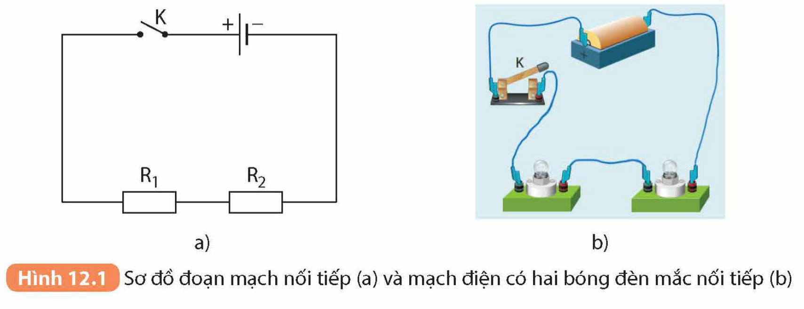
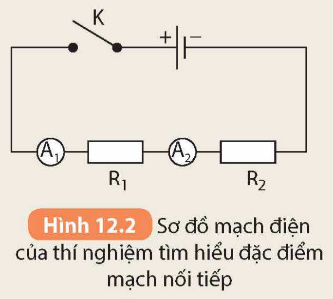
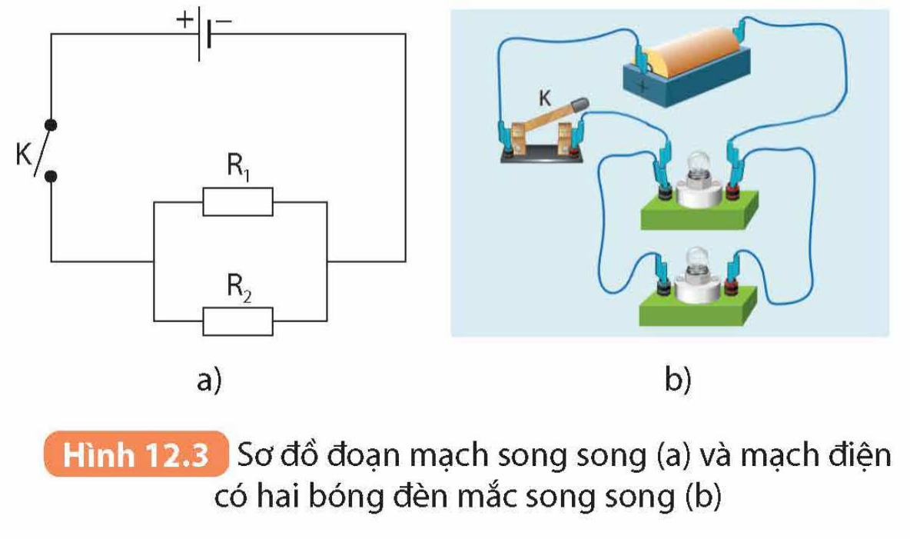
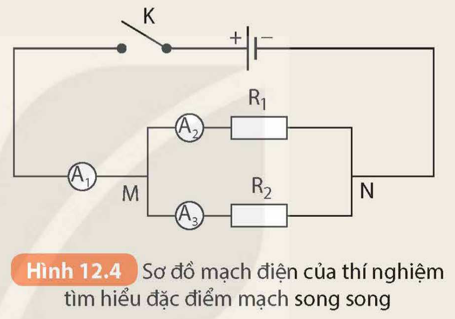

<!-- pdf:62 -->

# BÀI 12: ĐOẠN MẠCH NỐI TIẾP, SONG SONG

## 🎯 Mục tiêu

- Thực hiện thí nghiệm để rút ra được: Trong đoạn mạch điện mắc nối tiếp, cường độ dòng điện là như nhau cho mọi điểm; trong đoạn mạch điện mắc song song, tổng cường độ dòng điện trong các nhánh bằng cường độ dòng điện chạy trong mạch chính.
- Tính được cường độ dòng điện trong đoạn mạch một chiều mắc nối tiếp, mắc song song trong một số trường hợp đơn giản.
- Nêu được công thức tính điện trở tương đương của đoạn mạch một chiều nối tiếp, song song. Sử dụng công thức đã cho để tính được điện trở tương đương của đoạn mạch mắc nối tiếp, song song trong một số trường hợp đơn giản.
- Lắp được mạch điện và đo được giá trị cường độ dòng điện trong một đoạn mạch điện mắc nối tiếp.
- Lắp được mạch điện và đo được giá trị cường độ dòng điện trong một đoạn mạch điện mắc song song.

## 🔴 Mở đầu

> Có hai bóng đèn, một số dây nối, nguồn điện. Mắc các đèn như thế nào vào hai cực của nguồn điện mà khi một bóng đèn bị cháy thì bóng đèn kia vẫn sáng? Vẽ sơ đồ mạch điện.

## I. Đoạn mạch nối tiếp

### 1. Điện trở đoạn mạch nối tiếp

Đoạn mạch điện gồm các điện trở được mắc theo sơ đồ Hình 12.1 được gọi là **đoạn mạch nối tiếp**.

**Điện trở tương đương** của đoạn mạch là điện trở có thể thay thế các điện trở của đoạn mạch sao cho với cùng hiệu điện thế đặt vào hai đầu đoạn mạch thì cường độ dòng điện chạy qua đoạn mạch vẫn có giá trị như trước.

Điện trở tương đương của đoạn mạch gồm hai điện trở $R_1$, $R_2$ mắc nối tiếp được tính bằng công thức:

$$R_{\text{tđ}} = R_1 + R_2$$
<!-- ocr-ok: đã đối chiếu ảnh trang gốc 62 (trang in 60), công thức điện trở tương đương mắc nối tiếp -->

Điện trở tương đương của đoạn mạch gồm $n$ điện trở mắc nối tiếp được tính bằng công thức:

$$R_{\text{tđ}} = R_1 + R_2 + \dots + R_n$$
<!-- ocr-ok: đã đối chiếu ảnh trang gốc 62 (trang in 60), công thức điện trở tương đương n điện trở nối tiếp -->

Hình 12.1. Sơ đồ đoạn mạch nối tiếp (a) và mạch điện có hai bóng đèn mắc nối tiếp (b)

<!-- pdf:63 -->

### 2. Đặc điểm của đoạn mạch nối tiếp

> ✋ Thí nghiệm tìm hiểu đặc điểm của đoạn mạch nối tiếp
>
> *Chuẩn bị:*
> - Nguồn điện một chiều $12\text{ V}$;
> - Ba điện trở $R_1 = 6\ \Omega$, $R_2 = 10\ \Omega$, $R_3 = 16\ \Omega$;
> - Hai ampe kế có giới hạn đo $3\text{ A}$ và có độ chia nhỏ nhất là $0,01\text{ A}$;
> - Công tắc; các dây nối.
>
> *Tiến hành:*
> - Mắc hai điện trở $R_1$ và $R_2$ và hai ampe kế vào mạch điện theo sơ đồ Hình 12.2.
> - Đóng công tắc, đọc số chỉ của các ampe kế và ghi vào vở theo mẫu tương tự Bảng 12.1.
> - Lặp lại thí nghiệm với các cặp điện trở $R_1$, $R_3$ và $R_2$, $R_3$, ghi số chỉ của ampe kế vào vở theo mẫu tương tự Bảng 12.1.
>
> 
>
> Hình 12.2. Sơ đồ mạch điện của thí nghiệm tìm hiểu đặc điểm mạch nối tiếp
>
> Bảng 12.1
>
> | Điện trở mắc vào mạch điện | Số chỉ của ampe kế $A_1$ ($\text{A}$) | Số chỉ của ampe kế $A_2$ ($\text{A}$) |
> |---|---|---|
> | $R_1$ và $R_2$ | 0,75 | 0,75 |
> | $R_1$ và $R_3$ | 0,54 | 0,54 |
> | $R_2$ và $R_3$ | 0,46 | 0,46 |
>
> *Thực hiện yêu cầu sau:*
>
> Rút ra kết luận về cường độ dòng điện tại mọi điểm trong đoạn mạch nối tiếp.

*Kết luận:*
- Cường độ dòng điện chạy trong đoạn mạch gồm hai điện trở mắc nối tiếp:

$$I = I_1 = I_2$$
<!-- ocr-ok: đã đối chiếu ảnh trang gốc 63 (trang in 61), biểu thức cường độ dòng điện mạch nối tiếp -->

- Cường độ dòng điện chạy trong đoạn mạch gồm $n$ điện trở mắc nối tiếp:

$$I = I_1 = I_2 = \dots = I_n$$
<!-- ocr-ok: đã đối chiếu ảnh trang gốc 63 (trang in 61), biểu thức cường độ dòng điện n điện trở nối tiếp -->

> ❓ Có hai điện trở $R_1 = 2\ \Omega$, $R_2 = 3\ \Omega$ được mắc nối tiếp. Biết cường độ dòng điện chạy qua điện trở $R_1$ là $1\text{ A}$. Xác định:
>
> a) Điện trở tương đương của đoạn mạch.
>
> b) Hiệu điện thế giữa hai đầu mỗi điện trở.
>
> c) Hiệu điện thế giữa hai đầu đoạn mạch.

## II. Đoạn mạch song song

### 1. Điện trở đoạn mạch song song

Đoạn mạch điện gồm các điện trở mắc theo sơ đồ Hình 12.3a gọi là **đoạn mạch song song**.

Hình 12.3. Sơ đồ đoạn mạch song song (a) và mạch điện có hai bóng đèn mắc song song (b)

<!-- pdf:64 -->

Điện trở tương đương của đoạn mạch gồm hai điện trở mắc song song được tính bằng công thức:

$$\frac{1}{R_{\text{tđ}}} = \frac{1}{R_1} + \frac{1}{R_2}$$
<!-- ocr-ok: đã đối chiếu ảnh trang gốc 64 (trang in 62), công thức điện trở tương đương mắc song song -->

Điện trở tương đương của đoạn mạch gồm $n$ điện trở mắc song song được tính bằng công thức:

$$\frac{1}{R_{\text{tđ}}} = \frac{1}{R_1} + \frac{1}{R_2} + \dots + \frac{1}{R_n}$$
<!-- ocr-ok: đã đối chiếu ảnh trang gốc 64 (trang in 62), công thức điện trở tương đương n điện trở song song -->

### 2. Đặc điểm của đoạn mạch song song

> ✋ Thí nghiệm tìm hiểu đặc điểm của đoạn mạch song song
>
> *Chuẩn bị:*
> - Nguồn điện một chiều $6\text{ V}$;
> - Hai điện trở $R_1 = 10\ \Omega$, $R_2 = 6\ \Omega$;
> - Ba ampe kế có giới hạn đo $3\text{ A}$ và có độ chia nhỏ nhất là $0,01\text{ A}$;
> - Công tắc; các dây nối.
>
> *Tiến hành:*
> - Mắc hai điện trở và ba ampe kế vào mạch điện theo sơ đồ Hình 12.4.
> - Đóng công tắc, đọc giá trị cường độ dòng điện chạy trong mạch chính (số chỉ của ampe kế $\text{A}_1$) và cường độ dòng điện chạy trong các mạch nhánh (số chỉ của các ampe kế $\text{A}_2$ và $\text{A}_3$), ghi vào vở theo mẫu tương tự Bảng 12.2.
>
> 
>
> Hình 12.4. Sơ đồ mạch điện của thí nghiệm tìm hiểu đặc điểm mạch song song
>
> Bảng 12.2.
>
> | Ampe kế | Số chỉ |
> |---|---|
> | $\text{A}_1$ | $I = 1,60\text{ A}$ |
> | $\text{A}_2$ | $I_1 = 0,60\text{ A}$ |
> | $\text{A}_3$ | $I_2 = 1,00\text{ A}$ |
>
> *Thực hiện yêu cầu sau:*
>
> So sánh cường độ dòng điện trong mạch chính và tổng cường độ dòng điện trong các mạch nhánh.

*Kết luận:*
- Cường độ dòng điện chạy trong mạch chính của đoạn mạch gồm hai điện trở mắc song song:

$$I = I_1 + I_2$$
<!-- ocr-ok: đã đối chiếu ảnh trang gốc 64 (trang in 62), biểu thức cường độ dòng điện mạch song song -->

- Cường độ dòng điện chạy trong mạch chính của đoạn mạch gồm $n$ điện trở mắc song song:

$$I = I_1 + I_2 + \dots + I_n$$
<!-- ocr-ok: đã đối chiếu ảnh trang gốc 64 (trang in 62), biểu thức cường độ dòng điện n nhánh song song -->

> ❓ Hai điện trở $20\ \Omega$ và $40\ \Omega$ được mắc song song vào mạch điện có hiệu điện thế là $24\text{ V}$.
>
> a) Tính điện trở tương đương của đoạn mạch.
>
> b) Tính cường độ dòng điện chạy trong mạch chính.

<!-- pdf:65 -->

## 📌 Em đã học

- Đoạn mạch nối tiếp:
  - Cường độ dòng điện chạy trong đoạn mạch gồm hai điện trở mắc nối tiếp: $I = I_1 = I_2$
  - Cường độ dòng điện chạy trong đoạn mạch gồm $n$ điện trở mắc nối tiếp:
    $$I = I_1 = I_2 = \dots = I_n$$
  - Điện trở tương đương của đoạn mạch gồm hai điện trở mắc nối tiếp:
    $$R_{\text{tđ}} = R_1 + R_2$$
  - Điện trở tương đương của đoạn mạch gồm $n$ điện trở mắc nối tiếp:
    $$R_{\text{tđ}} = R_1 + R_2 + \dots + R_n$$
- Đoạn mạch song song:
  - Cường độ dòng điện chạy trong mạch chính của đoạn mạch gồm hai điện trở mắc song song: $I = I_1 + I_2$
  - Cường độ dòng điện chạy trong mạch chính của đoạn mạch gồm $n$ điện trở mắc song song: $I = I_1 + I_2 + \dots + I_n$
  - Điện trở tương đương của đoạn mạch gồm hai điện trở mắc song song:
    $$\frac{1}{R_{\text{tđ}}} = \frac{1}{R_1} + \frac{1}{R_2}$$
  - Điện trở tương đương của đoạn mạch gồm $n$ điện trở mắc song song:
    $$\frac{1}{R_{\text{tđ}}} = \frac{1}{R_1} + \frac{1}{R_2} + \dots + \frac{1}{R_n}$$

## ✏️ Em có thể

- Giải thích được vì sao các thiết bị tiêu thụ điện như bóng đèn, tivi, tủ lạnh,... sử dụng trong gia đình lại được mắc song song.
- Thiết kế được sơ đồ mạch điện dùng các bóng đèn để trang trí “cành đào, cành mai ngày Tết”.

> 🔍 - Điện trở tương đương của đoạn mạch nối tiếp lớn hơn điện trở thành phần.
>   Hiệu điện thế giữa hai đầu đoạn mạch gồm $n$ điện trở mắc nối tiếp:
>   $U = IR_{\text{tđ}} = I(R_1 + R_2 + \dots + R_n) = IR_1 + IR_2 + \dots + IR_n$
>   Mà $I = I_1 = I_2 = \dots = I_n$, nên $U = I_1 R_1 + I_2 R_2 + \dots + I_n R_n = U_1 + U_2 + \dots + U_n$
>   (với $U_1 = I_1 R_1$, $U_2 = I_2 R_2$, ... $U_n = I_n R_n$ lần lượt là hiệu điện thế giữa hai đầu mỗi điện trở $R_1$, $R_2$, ..., $R_n$).
> - Điện trở tương đương của đoạn mạch song song nhỏ hơn điện trở thành phần.
>   Hiệu điện thế giữa hai đầu các điện trở mắc song song bằng nhau và bằng hiệu điện thế giữa hai đầu đoạn mạch:
>   $U_1 = U_2 = \dots = U_n = U = I_1 R_1 = I_2 R_2 = \dots = I_n R_n = IR_{\text{tđ}}$.

## 📷 Danh sách hình trong bài

| Mã hình | Trang PDF | Vị trí trong bài | Chú thích gốc |
|---|---|---|---|
| H9-khoa_hoc_tu_nhien-b12-01 | 62 | Mục I.1 | Hình 12.1. Sơ đồ đoạn mạch nối tiếp (a) và mạch điện có hai bóng đèn mắc nối tiếp (b) |
| H9-khoa_hoc_tu_nhien-b12-02 | 63 | Mục I.2 | Hình 12.2. Sơ đồ mạch điện của thí nghiệm tìm hiểu đặc điểm mạch nối tiếp |
| H9-khoa_hoc_tu_nhien-b12-03 | 63 | Mục II.1 | Hình 12.3. Sơ đồ đoạn mạch song song (a) và mạch điện có hai bóng đèn mắc song song (b) |
| H9-khoa_hoc_tu_nhien-b12-04 | 64 | Mục II.2 | Hình 12.4. Sơ đồ mạch điện của thí nghiệm tìm hiểu đặc điểm mạch song song |
