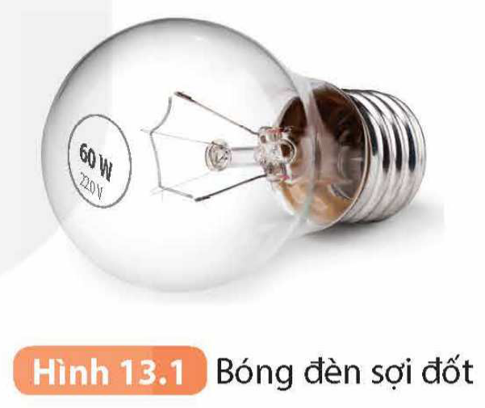
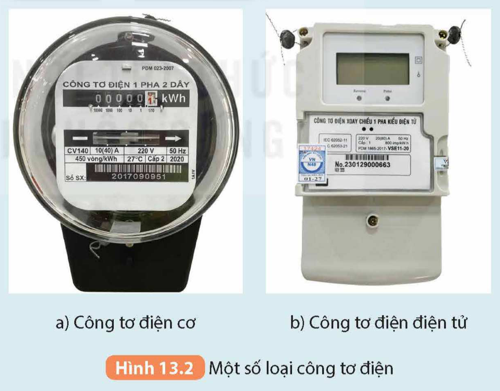

<!-- pdf:66 -->

# BÀI 13: NĂNG LƯỢNG CỦA DÒNG ĐIỆN VÀ CÔNG SUẤT ĐIỆN

## 🎯 Mục tiêu

- Lấy ví dụ để chứng tỏ được dòng điện có năng lượng.
- Nêu được công suất điện định mức của dụng cụ điện (công suất mà dụng cụ tiêu thụ khi hoạt động bình thường).
- Tính được năng lượng của dòng điện và công suất điện trong trường hợp đơn giản.

## 🔴 Mở đầu

> Gia đình em thường sử dụng những loại bóng đèn điện nào để thắp sáng? Em có biết ý nghĩa của các số liệu ghi trên nhãn bóng đèn điện hay không?

## I. Năng lượng điện

Ta đã biết, dòng điện có năng lượng, gọi là **điện năng**. Tác dụng nhiệt của dòng điện chứng tỏ điện năng chuyển hoá thành nhiệt năng, tác dụng phát sáng của dòng điện chứng tỏ điện năng chuyển hoá thành quang năng,...

> ❓ 1. Tìm ví dụ trong thực tế chứng tỏ dòng điện có năng lượng.
>
> 2. Những thiết bị tiêu thụ điện sau đây hoạt động nhờ có năng lượng điện (điện năng): đèn dây tóc, quạt điện, đèn huỳnh quang (đèn ống), bàn là điện, nồi cơm điện. Năng lượng điện sử dụng trong các thiết bị này đã chuyển hoá thành các dạng năng lượng nào?

**Năng lượng điện** trên một đoạn mạch được chuyển hoá thành các dạng năng lượng khác, xác định bởi biểu thức:

$$W = UIt$$

Trong đó: $W$ là năng lượng điện, đơn vị đo là jun ($\text{J}$).
$U$ là hiệu điện thế giữa hai đầu đoạn mạch, đơn vị đo là vôn ($\text{V}$);
$I$ là cường độ dòng điện, đơn vị đo là ampe ($\text{A}$);
$t$ là thời gian dòng điện chạy qua đoạn mạch, đơn vị đo là giây ($\text{s}$).

> ❓ 1. Tính năng lượng điện mà động cơ điện một chiều tiêu thụ trong thời gian 30 phút, biết hiệu điện thế giữa hai đầu động cơ là $12\text{ V}$ và cường độ dòng điện chạy qua động cơ là $0,5\text{ A}$.
>
> 2. Hiệu điện thế giữa hai đầu dây tóc một bóng đèn sợi đốt là $3,5\text{ V}$, điện trở của dây tóc bóng đèn khi phát sáng là $12\ \Omega$. Năng lượng điện mà bóng đèn tiêu thụ trong 4 phút là bao nhiêu?

<!-- pdf:67 -->

## II. Công suất điện

Năng lượng của dòng điện chạy qua một đoạn mạch trong một đơn vị thời gian gọi là **công suất điện**.

Biểu thức tính công suất điện:

$$\mathcal{P} = UI$$

Trong đó: $U$ là hiệu điện thế, đơn vị đo là vôn ($\text{V}$);
$I$ là cường độ dòng điện, đơn vị đo là ampe ($\text{A}$);
$\mathcal{P}$ là công suất điện, đơn vị đo là **oát** ($\text{W}$).

> ❓ Tính công suất điện của một bóng đèn và năng lượng điện mà bóng đèn tiêu thụ trong $3\text{ h}$. Biết hiệu điện thế giữa hai đầu bóng đèn là $220\text{ V}$ và cường độ dòng điện chạy qua bóng đèn là $0,3\text{ A}$.

## III. Công suất điện định mức

Trên một số thiết bị tiêu thụ điện như bóng đèn điện, bếp điện, bàn là điện,... thường ghi hai giá trị hiệu điện thế định mức và công suất điện định mức. **Công suất điện định mức** của một thiết bị điện cho biết công suất mà thiết bị đó tiêu thụ khi hoạt động bình thường.

<!-- term: Hiệu điện thế định mức -->
Chẳng hạn trên bóng đèn ở Hình 13.1 có ghi $220\text{ V} - 60\text{ W}$, nghĩa là để bóng đèn sáng bình thường cần mắc bóng đèn vào hiệu điện thế $220\text{ V}$, khi đó công suất điện của bóng đèn là $60\text{ W}$.

Hình 13.1. Bóng đèn sợi đốt

> ❓ 1. Giải thích các chữ số ghi trên các thiết bị tiêu thụ điện dưới đây:
> - Bóng đèn pin: $2,5\text{ V} - 2,5\text{ W}$;
> - Bàn là điện: $220\text{ V} - 1\ 000\text{ W}$;
> - Bóng đèn sợi đốt: $110\text{ V} - 100\text{ W}$;
>
> 2. Một bóng đèn điện $220\text{ V} - 60\text{ W}$, nếu được dùng đúng công suất điện định mức thì năng lượng điện mà bóng đèn tiêu thụ trong 4 giờ là bao nhiêu? Cường độ dòng điện chạy qua dây tóc bóng đèn là bao nhiêu?

## 📌 Em đã học

- Dòng điện có năng lượng. Năng lượng điện có thể chuyển hoá thành các dạng năng lượng khác như nhiệt năng, hoá năng, quang năng, cơ năng,...
- Năng lượng điện trên một đoạn mạch chuyển hoá thành các dạng năng lượng khác được tính bằng công thức:

$$W = UIt$$

<!-- pdf:68 -->

Trong đó: $W$ là năng lượng điện, đơn vị đo là jun ($\text{J}$);
$U$ là hiệu điện thế giữa hai đầu đoạn mạch, đơn vị đo là vôn ($\text{V}$);
$I$ là cường độ dòng điện, đơn vị đo là ampe ($\text{A}$);
$t$ là thời gian dòng điện chạy qua đoạn mạch, đơn vị đo là giây ($\text{s}$).

- Công suất điện có giá trị bằng năng lượng của dòng điện chạy qua một đoạn mạch trong một đơn vị thời gian. Công thức tính công suất điện:

$$\mathcal{P} = UI$$

Trong đó: $U$ là hiệu điện thế, đơn vị đo là vôn ($\text{V}$).
$I$ là cường độ dòng điện, đơn vị đo là ampe ($\text{A}$).
$\mathcal{P}$ là công suất điện, đơn vị đo là oát ($\text{W}$).

- Công suất điện định mức của một thiết bị tiêu thụ điện là công suất mà thiết bị tiêu thụ điện khi hoạt động bình thường.

## ✏️ Em có thể

- Tính được năng lượng điện mà thiết bị điện dùng trong gia đình tiêu thụ hàng tháng và số tiền gia đình phải trả Công ty Điện lực.

> 🔍 **Công tơ điện** (**đồng hồ đo điện năng**) là thiết bị đo năng lượng điện. Có hai loại công tơ điện: công tơ điện cơ và công tơ điện điện tử. Công tơ điện cơ (Hình 13.2a) hoạt động dựa trên nguyên tắc điện từ, lực từ tác dụng lên làm quay một đĩa kim loại. Năng lượng điện càng nhiều thì số vòng quay của đĩa kim loại càng lớn làm thay đổi chỉ số trên công tơ điện. Bằng cách ghi lại các chỉ số trên công tơ điện giữa các “thời điểm”, có thể tính được năng lượng điện tương ứng. Công tơ điện điện tử (Hình 13.2b) về bản chất chính là một joulemeter đã được làm quen ở sách Khoa học tự nhiên lớp 8. Hiệu chỉ số hiện tại và chỉ số cũ của công tơ điện là số đếm của công tơ điện. Mỗi số đếm ứng với 1 **kilôoát giờ** ($1\text{ kWh} = 3,6 \cdot 10^6\text{ J}$).
>
> 
>
> Hình 13.2. Một số loại công tơ điện

## 📷 Danh sách hình trong bài

| Mã hình | Trang PDF | Vị trí trong bài | Chú thích gốc |
|---|---|---|---|
| H9-khoa_hoc_tu_nhien-b13-01 | 67 | Mục III | Hình 13.1. Bóng đèn sợi đốt |
| H9-khoa_hoc_tu_nhien-b13-02 | 68 | Hộp mở rộng cuối bài | Hình 13.2. Một số loại công tơ điện |
