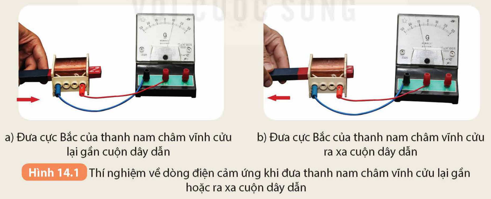
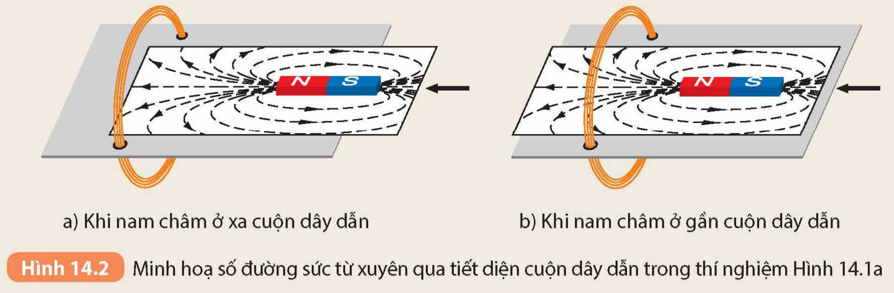
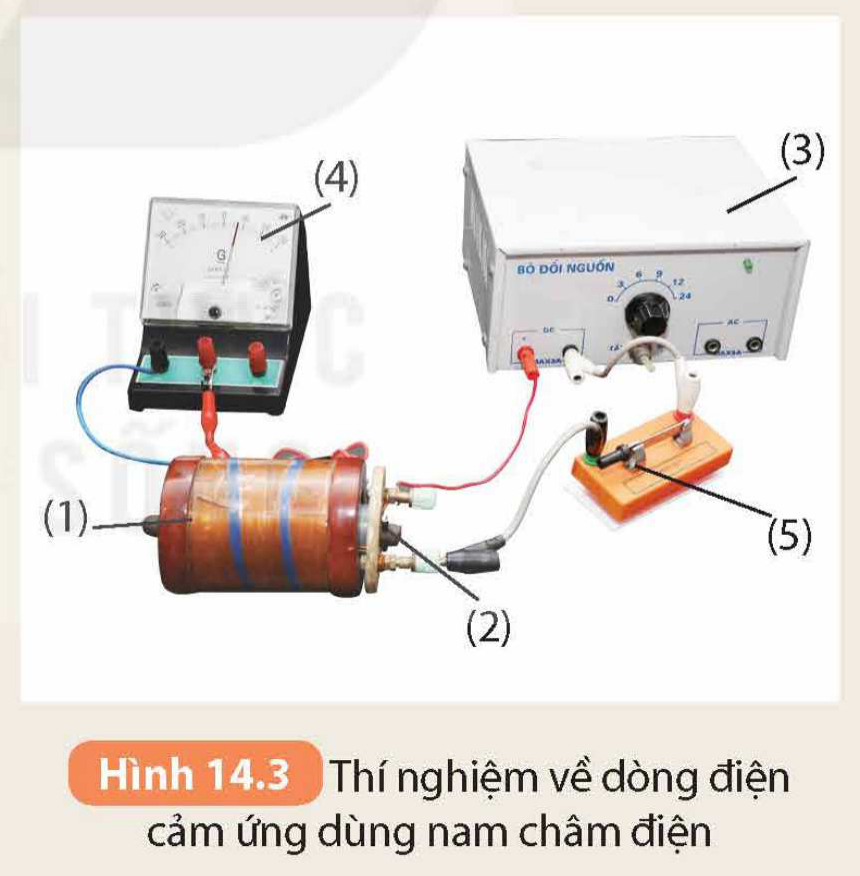
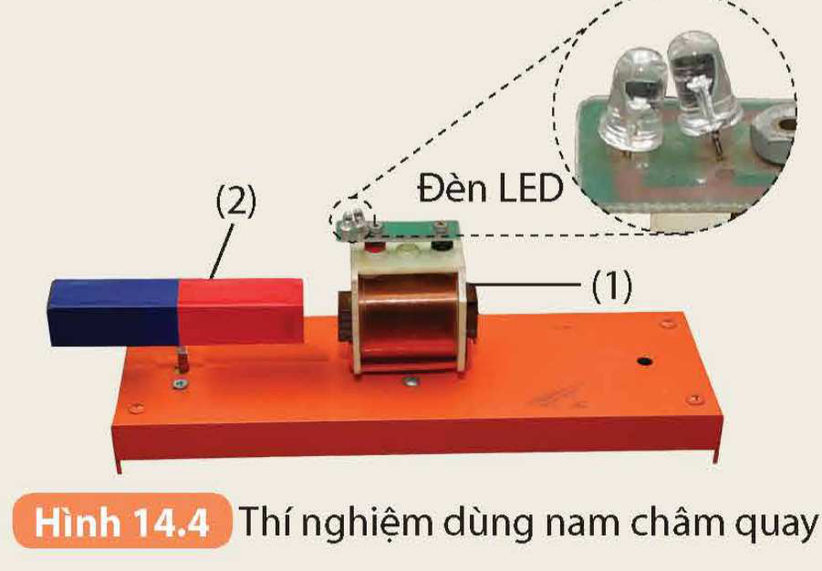
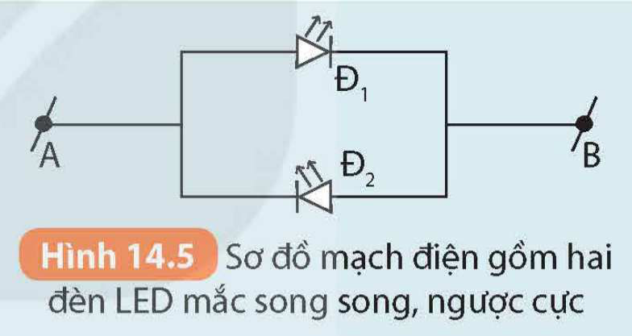
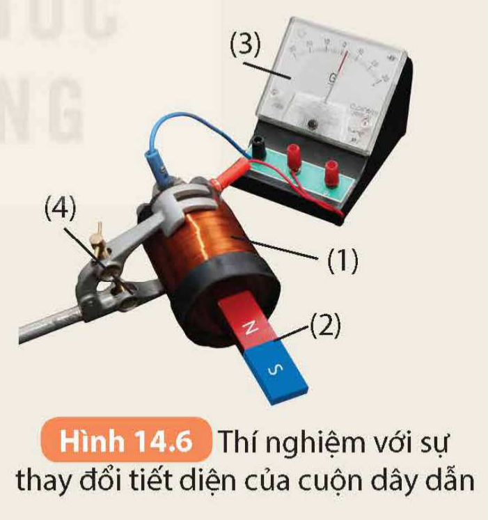
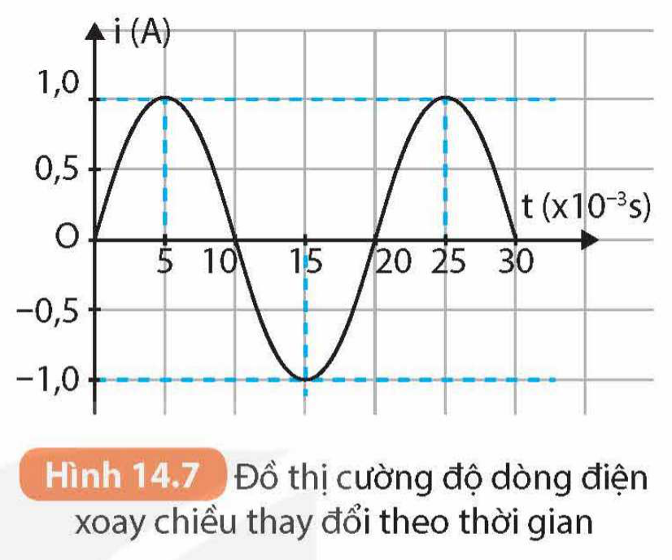
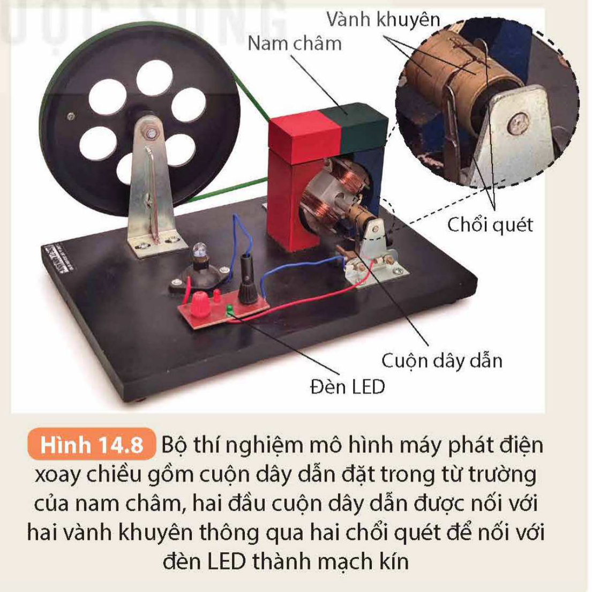
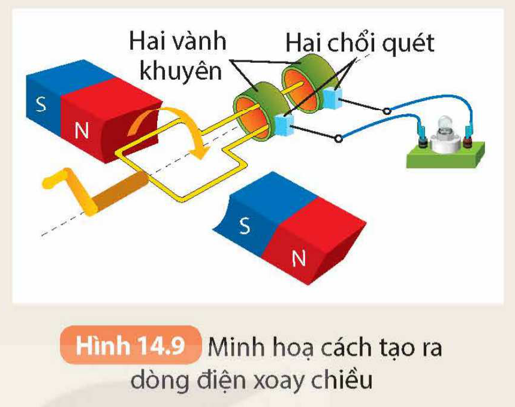

<!-- pdf:69 -->

# BÀI 14: CẢM ỨNG ĐIỆN TỪ. NGUYÊN TẮC TẠO RA DÒNG ĐIỆN XOAY CHIỀU

## 🎯 Mục tiêu

- Thực hiện thí nghiệm để rút ra được: Khi số đường sức từ xuyên qua tiết diện của cuộn dây dẫn kín biến thiên thì trong cuộn dây đó xuất hiện dòng điện cảm ứng.
- Thực hiện thí nghiệm để nêu được nguyên tắc tạo ra dòng điện xoay chiều (dòng điện luân phiên đổi chiều).

## 🔴 Mở đầu

> Chúng ta đã biết ở lớp 7, dòng điện chạy qua cuộn dây quấn quanh lõi thép thì sinh ra từ trường. Vậy, từ trường có thể sinh ra dòng điện không?

## I. Dòng điện cảm ứng

> ✋ Thí nghiệm 1: Thí nghiệm về dòng điện cảm ứng dùng thanh nam châm vĩnh cửu
>
> *Chuẩn bị:* Thanh nam châm vĩnh cửu; cuộn dây dẫn; điện kế và các dây nối.
>
> *Tiến hành:*
> - Nối hai đầu cuộn dây dẫn với điện kế.
> - Quan sát sự thay đổi của kim điện kế khi đưa cực Bắc của thanh nam châm vĩnh cửu lại gần hoặc ra xa cuộn dây dẫn (Hình 14.1a và Hình 14.1b).
>
> 
>
> Hình 14.1. Thí nghiệm về dòng điện cảm ứng khi đưa thanh nam châm vĩnh cửu lại gần hoặc ra xa cuộn dây dẫn
>
> *Trả lời câu hỏi sau:* Sự thay đổi của kim điện kế chứng tỏ điều gì?

Trong quá trình dịch chuyển thanh nam châm vĩnh cửu lại gần hoặc ra xa cuộn dây dẫn thì kim điện kế bị lệch sang phải hoặc sang trái, chứng tỏ có dòng điện chạy trong cuộn dây dẫn. Dòng điện xuất hiện trong cuộn dây dẫn khi đó gọi là **dòng điện cảm ứng**.

<!-- pdf:70 -->

> ❓ 1. Quan sát Hình 14.2 và cho biết số đường sức từ xuyên qua tiết diện của cuộn dây dẫn biến thiên như thế nào (tăng hay giảm) khi đưa cực Bắc của nam châm lại gần cuộn dây dẫn theo phương vuông góc với tiết diện của cuộn dây.
>
> 
>
> Hình 14.2. Minh hoạ số đường sức từ xuyên qua tiết diện cuộn dây dẫn trong thí nghiệm Hình 14.1a
>
> 2. Trong trường hợp thí nghiệm như Hình 14.1b thì số đường sức từ xuyên qua tiết diện của cuộn dây dẫn biến thiên như thế nào?

> ✋ Thí nghiệm 2: Thí nghiệm về dòng điện cảm ứng dùng nam châm điện
>
> *Chuẩn bị:* Cuộn dây dẫn (1); nam châm điện (2); nguồn điện (3); điện kế (4); công tắc (5) và các dây nối.
>
> *Tiến hành:*
> - Lắp mạch điện như Hình 14.3.
> - Quan sát kim điện kế khi đóng, mở công tắc.
>
> *Trả lời câu hỏi và thực hiện yêu cầu sau:*
>
> 1. Khi đóng hoặc mở công tắc thì số đường sức từ xuyên qua tiết diện cuộn dây dẫn biến thiên như thế nào?
> 2. Từ hai thí nghiệm dùng thanh nam châm vĩnh cửu dịch chuyển và nam châm điện ở trên, hãy nêu giả thuyết về nguyên nhân xuất hiện dòng điện cảm ứng trong cuộn dây.
>
> 
>
> Hình 14.3. Thí nghiệm về dòng điện cảm ứng dùng nam châm điện

## II. Hiện tượng cảm ứng điện từ
<!-- ocr-ok: đã đối chiếu ảnh trang gốc 70 (trang in 68), OCR bỏ sót tiêu đề mục II màu cam -->

> ✋ 1. Đề xuất một số cách làm biến thiên số đường sức từ xuyên qua tiết diện cuộn dây dẫn.
> 2. Đề xuất một số phương án thí nghiệm làm xuất hiện dòng điện cảm ứng.

<!-- pdf:71 -->

> ✋ Thí nghiệm 3: Thí nghiệm về dòng điện cảm ứng dùng nam châm quay
>
> *Chuẩn bị:* Cuộn dây dẫn kín có hai đèn LED đỏ và vàng mắc song song, ngược cực (1); thanh nam châm vĩnh cửu có trục quay ở giữa (2).
>
> *Tiến hành:*
> - Bố trí thí nghiệm như Hình 14.4.
> - Quan sát sự sáng của hai đèn LED khi quay nam châm.
>
> *Thực hiện yêu cầu và trả lời câu hỏi sau:*
>
> 1. Mô tả sự sáng của hai đèn LED khi nam châm quay.
> 2. Khi cực nam châm quay lại gần hoặc ra xa cuộn dây dẫn thì số đường sức từ xuyên qua tiết diện cuộn dây dẫn biến thiên như thế nào?
> 3. Chứng tỏ khi nam châm quay, dòng điện xuất hiện trong cuộn dây dẫn gắn hai đèn LED có mối liên hệ với sự biến thiên của số đường sức từ xuyên qua tiết diện của cuộn dây dẫn.
>
> 
>
> Hình 14.4. Thí nghiệm dùng nam châm quay

> 🔍 Đèn LED chỉ sáng khi dòng điện chạy theo chiều từ cực dương đến cực âm của nó. Trong Hình 14.5, khi dòng điện có chiều từ A đến B thì đèn $\text{Đ}_1$ sáng còn đèn $\text{Đ}_2$ không sáng. Ngược lại, đèn $\text{Đ}_2$ sẽ sáng còn đèn $\text{Đ}_1$ không sáng khi dòng điện có chiều từ B về A.
>
> 
>
> Hình 14.5. Sơ đồ mạch điện gồm hai đèn LED mắc song song, ngược cực

> ✋ Thí nghiệm 4: Thí nghiệm về dòng điện cảm ứng bằng cách thay đổi tiết diện của cuộn dây
>
> *Chuẩn bị:* Một cuộn dây dẫn mềm có tiết diện dễ dàng thay đổi khi bị bóp mạnh (1); thanh nam châm vĩnh cửu (2); điện kế (3); kẹp giữ (4) và các dây nối.
>
> *Tiến hành:*
> - Bố trí thí nghiệm như Hình 14.6.
> - Bóp mạnh cuộn dây dẫn, quan sát kim điện kế khi cuộn dây dẫn bị giảm tiết diện.
>
> *Trả lời câu hỏi và thực hiện yêu cầu sau:*
>
> 1. Khi tiết diện của cuộn dây giảm thì số đường sức từ xuyên qua tiết diện cuộn dây dẫn biến thiên như thế nào?
> 2. Từ kết quả thí nghiệm, chứng tỏ số đường sức từ xuyên qua tiết diện cuộn dây dẫn biến thiên thì trong cuộn dây dẫn xuất hiện dòng điện cảm ứng.
>
> 
>
> Hình 14.6. Thí nghiệm với sự thay đổi tiết diện của cuộn dây dẫn

> ❓ 1. Khi làm biến thiên số đường sức từ xuyên qua tiết diện của cuộn dây dẫn, thí nghiệm 3 và 4 đã chứng tỏ điều gì?
> 2. Nêu điều kiện xuất hiện dòng điện cảm ứng trong cuộn dây dẫn kín.

<!-- pdf:72 -->

Từ các thí nghiệm trên và nhiều thí nghiệm khác, rút ra kết luận: *Khi số đường sức từ xuyên qua tiết diện của cuộn dây dẫn kín biến thiên thì trong cuộn dây dẫn đó xuất hiện dòng điện cảm ứng.*

Hiện tượng xuất hiện dòng điện cảm ứng được gọi là hiện tượng **cảm ứng điện từ**.

## III. Nguyên tắc tạo ra dòng điện xoay chiều

**Dòng điện xoay chiều** có tần số $50\text{ Hz}$ sử dụng trong các hệ thống điện lưới và trong gia đình chúng ta có cường độ tăng, giảm tuần tự và chiều luân phiên thay đổi theo thời gian (Hình 14.7).

<!-- term: Tần số của dòng điện xoay chiều -->
Theo đó, chiều của dòng điện sẽ thay đổi từ chiều dương sang âm và ngược lại theo tần số nhất định. Tần số này là số lần thay đổi chiều của dòng điện trong một giây. Ví dụ, dòng điện xoay chiều $50\text{ Hz}$ sẽ thay đổi chiều 100 lần trong 1 giây. Dòng điện này được sử dụng rộng rãi trong các thiết bị điện, điện gia dụng, công nghiệp và hệ thống điện lưới,...

Hình 14.7. Đồ thị cường độ dòng điện xoay chiều thay đổi theo thời gian

> ❓ Dòng điện xoay chiều có đặc điểm gì?

> ✋ Thí nghiệm tạo dòng điện xoay chiều
>
> *Chuẩn bị:* Bộ thí nghiệm mô hình máy phát điện xoay chiều có hai đèn LED như Hình 14.8.
>
> *Tiến hành:* Quan sát sự thay đổi sáng, tối luân phiên của hai đèn LED khi quay chậm và quay nhanh cuộn dây dẫn trong từ trường.
>
> *Trả lời các câu hỏi và thực hiện các yêu cầu sau:*
>
> 1. Khi quay chậm cuộn dây dẫn thì hai đèn LED thay đổi sáng, tối luân phiên như thế nào? Khi quay nhanh cuộn dây dẫn, có phân biệt được sự thay đổi này không?
> 2. Số đường sức từ xuyên qua tiết diện cuộn dây dẫn biến thiên (tăng giảm luân phiên) theo thời gian như thế nào?
> 3. Dòng điện xuất hiện trong cuộn dây dẫn đi qua đèn LED có đặc điểm gì?
> 4. Nêu nguyên tắc tạo ra dòng điện xoay chiều.
>
> 
>
> Hình 14.8. Bộ thí nghiệm mô hình máy phát điện xoay chiều gồm cuộn dây dẫn đặt trong từ trường của nam châm, hai đầu cuộn dây dẫn được nối với hai vành khuyên thông qua hai chổi quét để nối với đèn LED thành mạch kín

<!-- pdf:73 -->

Thí nghiệm trên cho thấy, khi quay cuộn dây thì số đường sức từ xuyên qua tiết diện của cuộn dây dẫn biến thiên (tăng, giảm luân phiên) theo thời gian tạo ra dòng điện xoay chiều. Dòng điện này đi qua hai chổi quét tì vào hai vành khuyên ở hai đầu cuộn dây đến hai đèn LED (Hình 14.8) tạo thành mạch kín.

> ❓ Hình 14.9 minh hoạ trường hợp khung dây quay trong từ trường đều để tạo ra dòng điện xoay chiều. **Vành khuyên** là vòng tròn bằng đồng, **chổi quét** là lá đồng. Quan sát Hình 14.9 và cho biết cách dẫn dòng điện xoay chiều xuất hiện trong khung dây quay trong từ trường đều ra mạch ngoài như thế nào?
>
> 
>
> Hình 14.9. Minh hoạ cách tạo ra dòng điện xoay chiều

Người ta cũng có thể tạo ra dòng điện xoay chiều bằng cách cho nam châm quay và cuộn dây đứng yên để làm cho số đường sức từ qua tiết diện cuộn dây tăng, giảm luân phiên theo thời gian.

<!-- term: Nguyên tắc tạo ra dòng điện xoay chiều -->
Nguyên tắc tạo dòng điện xoay chiều dựa trên hiện tượng cảm ứng điện từ: *Khi số đường sức từ qua tiết diện của cuộn dây dẫn kín biến thiên (tăng, giảm luân phiên) theo thời gian, trong cuộn dây xuất hiện dòng điện xoay chiều.*

## 📌 Em đã học

- Dòng điện cảm ứng xuất hiện trong cuộn dây dẫn kín khi có sự biến thiên số đường sức từ xuyên qua tiết diện của cuộn dây dẫn đó.
- Hiện tượng xuất hiện dòng điện cảm ứng được gọi là hiện tượng cảm ứng điện từ.
- Dòng điện xoay chiều có cường độ và chiều luân phiên thay đổi theo thời gian.
- Nguyên tắc tạo ra dòng điện xoay chiều dựa trên hiện tượng cảm ứng điện từ.

## ✏️ Em có thể

- Nêu được tên các thiết bị sử dụng dòng điện xoay chiều trong đời sống như máy giặt, tủ lạnh, bếp điện, bếp từ, ...
- Giải thích được cách tạo ra dòng điện xoay chiều trong cuộn dây dẫn kín.

## 📷 Danh sách hình trong bài

| Mã hình | Trang PDF | Vị trí trong bài | Chú thích gốc |
|---|---|---|---|
| H9-khoa_hoc_tu_nhien-b14-01 | 69 | Mục I | Hình 14.1. Thí nghiệm về dòng điện cảm ứng khi đưa thanh nam châm vĩnh cửu lại gần hoặc ra xa cuộn dây dẫn |
| H9-khoa_hoc_tu_nhien-b14-02 | 70 | Mục I | Hình 14.2. Minh hoạ số đường sức từ xuyên qua tiết diện cuộn dây dẫn trong thí nghiệm Hình 14.1a |
| H9-khoa_hoc_tu_nhien-b14-03 | 70 | Mục I | Hình 14.3. Thí nghiệm về dòng điện cảm ứng dùng nam châm điện |
| H9-khoa_hoc_tu_nhien-b14-04 | 71 | Mục II (cạnh trên chạm chân chữ tiêu đề Thí nghiệm 3 sát vòng tròn phóng đại) | Hình 14.4. Thí nghiệm dùng nam châm quay |
| H9-khoa_hoc_tu_nhien-b14-05 | 71 | Mục II | Hình 14.5. Sơ đồ mạch điện gồm hai đèn LED mắc song song, ngược cực |
| H9-khoa_hoc_tu_nhien-b14-06 | 71 | Mục II | Hình 14.6. Thí nghiệm với sự thay đổi tiết diện của cuộn dây dẫn |
| H9-khoa_hoc_tu_nhien-b14-07 | 72 | Mục III | Hình 14.7. Đồ thị cường độ dòng điện xoay chiều thay đổi theo thời gian |
| H9-khoa_hoc_tu_nhien-b14-08 | 72 | Mục III | Hình 14.8. Bộ thí nghiệm mô hình máy phát điện xoay chiều gồm cuộn dây dẫn đặt trong từ trường của nam châm, hai đầu cuộn dây dẫn được nối với hai vành khuyên thông qua hai chổi quét để nối với đèn LED thành mạch kín |
| H9-khoa_hoc_tu_nhien-b14-09 | 73 | Mục III | Hình 14.9. Minh hoạ cách tạo ra dòng điện xoay chiều |
