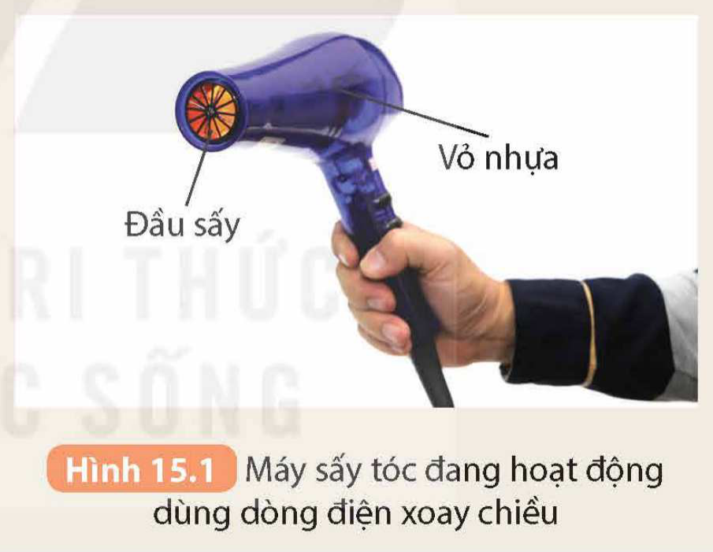
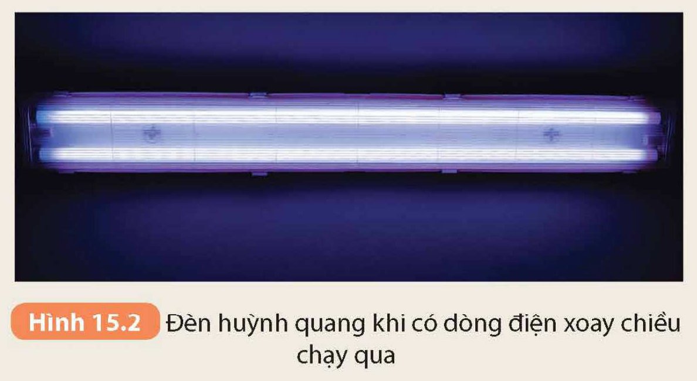
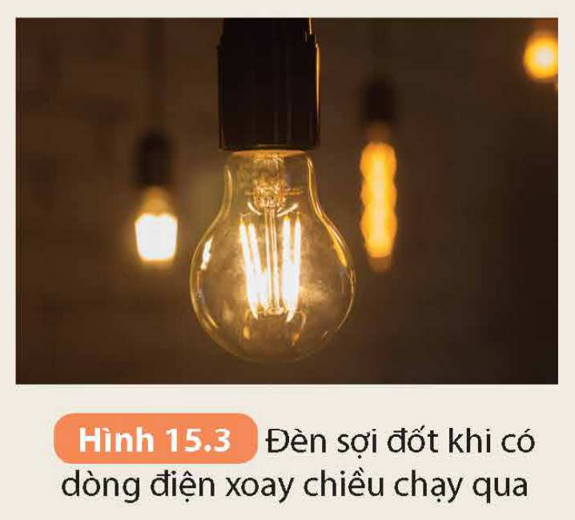
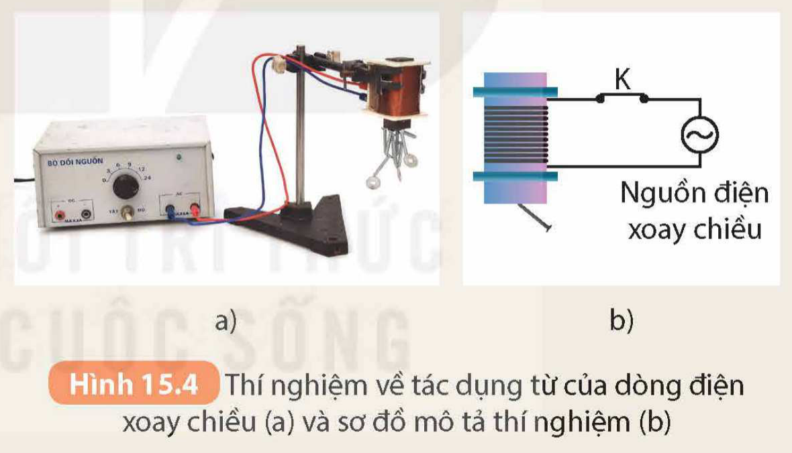
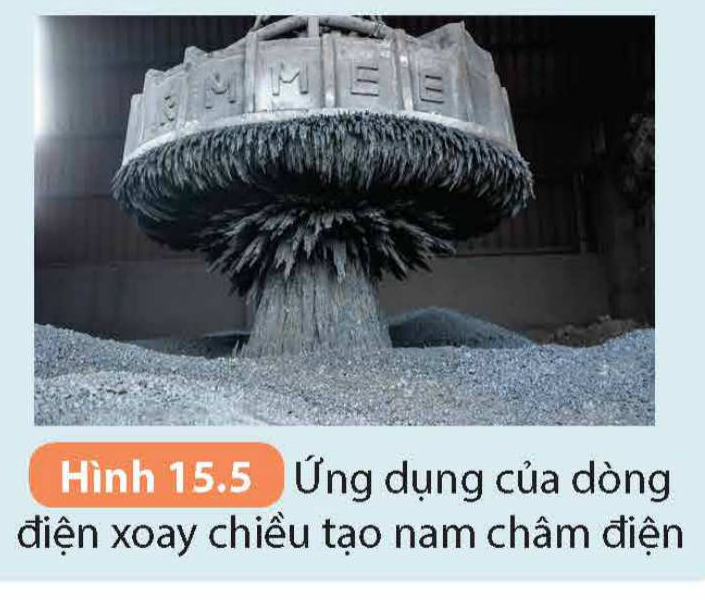
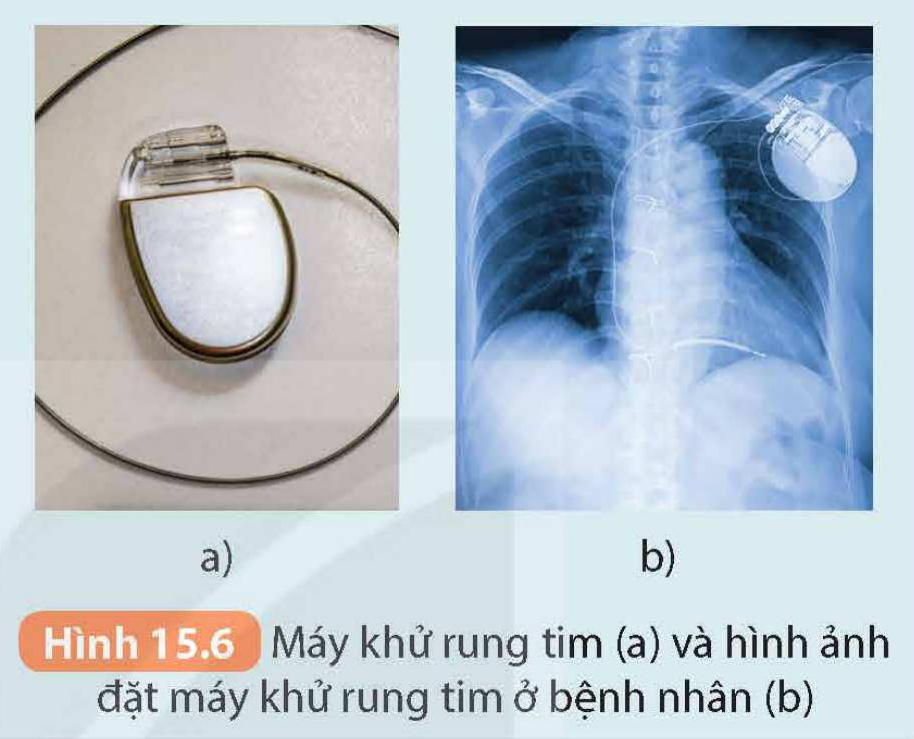

<!-- pdf:74 -->

# BÀI 15: TÁC DỤNG CỦA DÒNG ĐIỆN XOAY CHIỀU

## 🎯 Mục tiêu

- Lấy được ví dụ chứng tỏ dòng điện xoay chiều có tác dụng nhiệt, phát sáng, tác dụng từ, tác dụng sinh lí.

## 🔴 Mở đầu

> Khi sử dụng các thiết bị quạt điện, bếp từ, bình nước nóng, máy sấy tóc, ấm đun nước, đèn điện,... ta không nhìn thấy dòng điện xoay chiều chạy qua các thiết bị đó, nhưng ta có thể nhận biết sự tồn tại của dòng điện qua các tác dụng của nó. Vậy, dòng điện xoay chiều có những tác dụng gì?

## I. Tác dụng nhiệt

<!-- term: Tác dụng nhiệt của dòng điện xoay chiều -->
Dòng điện xoay chiều chạy qua vật dẫn làm nó nóng lên, chứng tỏ dòng điện xoay chiều có tác dụng nhiệt.

> ✋ Quan sát Hình 15.1 và cho biết:
>
> 1. Cảm giác của tay thế nào khi chạm vào vỏ nhựa máy sấy tóc đang hoạt động?
> 2. Hơi nóng thổi ra từ đầu sấy của máy sấy tóc chứng tỏ năng lượng điện được chuyển hoá thành những dạng năng lượng nào?
> 3. Từ kết quả trên chứng tỏ dòng điện xoay chiều có tác dụng gì?
>
> 
>
> Hình 15.1. Máy sấy tóc đang hoạt động dùng dòng điện xoay chiều

> ❓ Nêu các ví dụ trong cuộc sống để chứng tỏ dòng điện xoay chiều có tác dụng nhiệt.

## II. Tác dụng phát sáng

<!-- term: Tác dụng phát sáng của dòng điện xoay chiều -->
Dòng điện xoay chiều chạy qua đèn sợi đốt làm đèn phát sáng chứng tỏ dòng điện xoay chiều có tác dụng phát sáng.

> ✋ 1. Gia đình em thường sử dụng loại đèn điện nào để chiếu sáng? Dòng điện được sử dụng để chiếu sáng là dòng điện một chiều hay dòng điện xoay chiều?
> 2. Quan sát các Hình 15.2 và 15.3, cho biết dòng điện xoay chiều có tác dụng gì?

<!-- pdf:75 -->

> 
>
> Hình 15.2. Đèn huỳnh quang khi có dòng điện xoay chiều chạy qua
>
> 
>
> Hình 15.3. Đèn sợi đốt khi có dòng điện xoay chiều chạy qua

> ❓ Nêu ví dụ trong cuộc sống chứng tỏ dòng điện xoay chiều có tác dụng phát sáng.

## III. Tác dụng từ

<!-- term: Tác dụng từ của dòng điện xoay chiều -->
Dòng điện xoay chiều chạy trong dây dẫn thẳng hay trong cuộn dây dẫn sinh ra từ trường chứng tỏ dòng điện xoay chiều có tác dụng từ. Có thể kiểm chứng tác dụng từ của dòng điện xoay chiều bằng thí nghiệm mô tả ở Hình 15.4.

> ✋ Quan sát Hình 15.4 và cho biết:
>
> 1. Khi đóng công tắc K để dòng điện xoay chiều chạy qua cuộn dây thì đinh sắt bị hút lên, chứng tỏ dòng điện có tác dụng gì?
> 2. Hiện tượng xảy ra có gì khác hay không nếu thay dòng điện xoay chiều bởi dòng điện một chiều?
>
> 
>
> Hình 15.4. Thí nghiệm về tác dụng từ của dòng điện xoay chiều (a) và sơ đồ mô tả thí nghiệm (b)

> 🔍 Trong công nghiệp, người ta có thể sử dụng nam châm điện xoay chiều có từ trường mạnh để di chuyển bột sắt như Hình 15.5.
>
> Tác dụng từ của dòng điện xoay chiều được ứng dụng trong thực tế để tạo nam châm điện, rơ le điện từ, động cơ điện, máy chụp cộng hưởng từ trong y học, tàu đệm từ,...
>
> 
>
> Hình 15.5. Ứng dụng của dòng điện xoay chiều tạo nam châm điện

> ❓ Nêu ví dụ trong cuộc sống chứng tỏ dòng điện xoay chiều có tác dụng từ.

<!-- pdf:76 -->

## IV. Tác dụng sinh lí

<!-- term: Tác dụng sinh lí của dòng điện xoay chiều -->
Nếu sơ ý để cho dòng điện xoay chiều đi qua cơ thể thì dòng điện sẽ làm các cơ co giật, có thể làm tim ngừng đập, ngạt thở, thần kinh bị tê liệt, chứng tỏ dòng điện xoay chiều có tác dụng sinh lí.

Trong y học, người ta có thể ứng dụng tác dụng sinh lí của dòng điện xoay chiều thích hợp để điều trị một số bệnh. Máy khử rung tim là một trong số các thiết bị ứng dụng tác dụng sinh lí của dòng dòng điện xoay chiều đang được sử dụng hiện nay.

<!-- term: Máy khử rung tim -->
> 🔍 Máy khử rung tim được đặt ở gần vị trí của tim bệnh nhân (Hình 15.6). Khi phát hiện nhịp tim rối loạn, máy sẽ kịp thời phát xung điện để khôi phục lại nhịp đập bình thường của tim. Chẳng hạn như nếu tim đập nhanh, máy sẽ phát ra xung điện để khử bớt nhịp đập của tim. Nếu tim đập chậm, máy sẽ phát ra xung điện để kích thích tăng nhịp tim.
>
> **Xung điện** là dòng điện không liên tục chỉ xuất hiện trong thời gian ngắn, xen kẽ giữa các xung là khoảng nghỉ không có dòng điện. Trong y học, xung điện có tác dụng giảm đau, mỏi cơ và khớp, hỗ trợ phục hồi sau chấn thương và tăng cường tuần hoàn máu.
>
> 
>
> Hình 15.6. Máy khử rung tim (a) và hình ảnh đặt máy khử rung tim ở bệnh nhân (b)

*Lưu ý:* Dòng điện xoay chiều có thể gây nguy hiểm tới tính mạng của con người. Cần thận trọng khi sử dụng dòng điện xoay chiều ở gia đình và không được lại gần các trạm biến thế điện.

> ❓ 1. Nêu ví dụ trong cuộc sống chứng tỏ dòng điện xoay chiều có tác dụng sinh lí.
> 2. Nêu một số ứng dụng của dòng điện xoay chiều trong y tế để điều trị cho bệnh nhân.

## 📌 Em đã học

- Tác dụng nhiệt: Dòng điện xoay chiều chạy qua bình nước nóng, ấm đun nước, máy sấy tóc,... làm các thiết bị điện đó nóng lên.
- Tác dụng phát sáng: Dòng điện xoay chiều chạy qua đèn sợi đốt, đèn huỳnh quang,... làm các đèn phát sáng.
- Tác dụng từ: Dòng điện xoay chiều chạy trong dây dẫn thẳng hay trong cuộn dây dẫn sinh ra từ trường.
- Tác dụng sinh lí: Dòng điện xoay chiều đi qua cơ thể sẽ làm các cơ co giật, có thể làm tim ngừng đập, ngạt thở, thần kinh bị tê liệt,...

## ✏️ Em có thể

- Nhận biết được các tác dụng của dòng điện xoay chiều chạy qua các thiết bị điện như quạt điện, bếp từ, bình nước nóng, máy sấy tóc, ấm đun nước, đèn điện,...
- Nêu được một số ví dụ về tác dụng phát sáng, tác dụng nhiệt, tác dụng từ của dòng điện xoay chiều được ứng dụng trong thực tế đời sống.

## 📷 Danh sách hình trong bài

| Mã hình | Trang PDF | Vị trí trong bài | Chú thích gốc |
|---|---|---|---|
| H9-khoa_hoc_tu_nhien-b15-01 | 74 | Mục I | Hình 15.1. Máy sấy tóc đang hoạt động dùng dòng điện xoay chiều |
| H9-khoa_hoc_tu_nhien-b15-02 | 75 | Mục II | Hình 15.2. Đèn huỳnh quang khi có dòng điện xoay chiều chạy qua |
| H9-khoa_hoc_tu_nhien-b15-03 | 75 | Mục II | Hình 15.3. Đèn sợi đốt khi có dòng điện xoay chiều chạy qua |
| H9-khoa_hoc_tu_nhien-b15-04 | 75 | Mục III | Hình 15.4. Thí nghiệm về tác dụng từ của dòng điện xoay chiều (a) và sơ đồ mô tả thí nghiệm (b) |
| H9-khoa_hoc_tu_nhien-b15-05 | 75 | Mục III | Hình 15.5. Ứng dụng của dòng điện xoay chiều tạo nam châm điện |
| H9-khoa_hoc_tu_nhien-b15-06 | 76 | Mục IV | Hình 15.6. Máy khử rung tim (a) và hình ảnh đặt máy khử rung tim ở bệnh nhân (b) |
