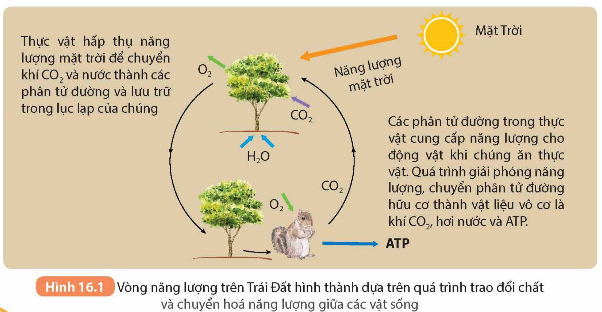
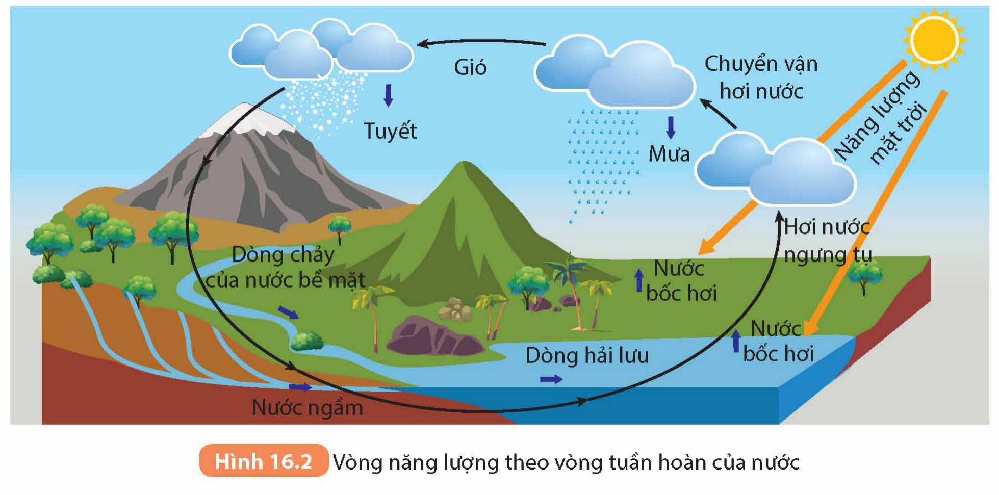
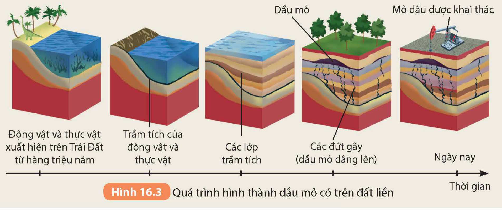
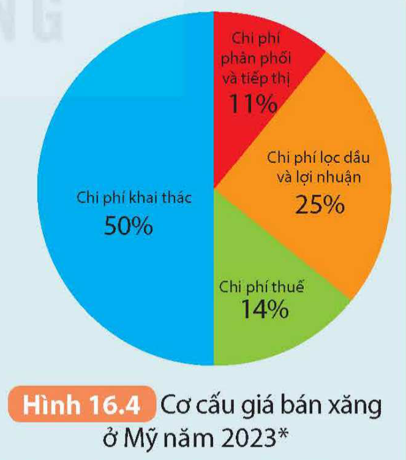
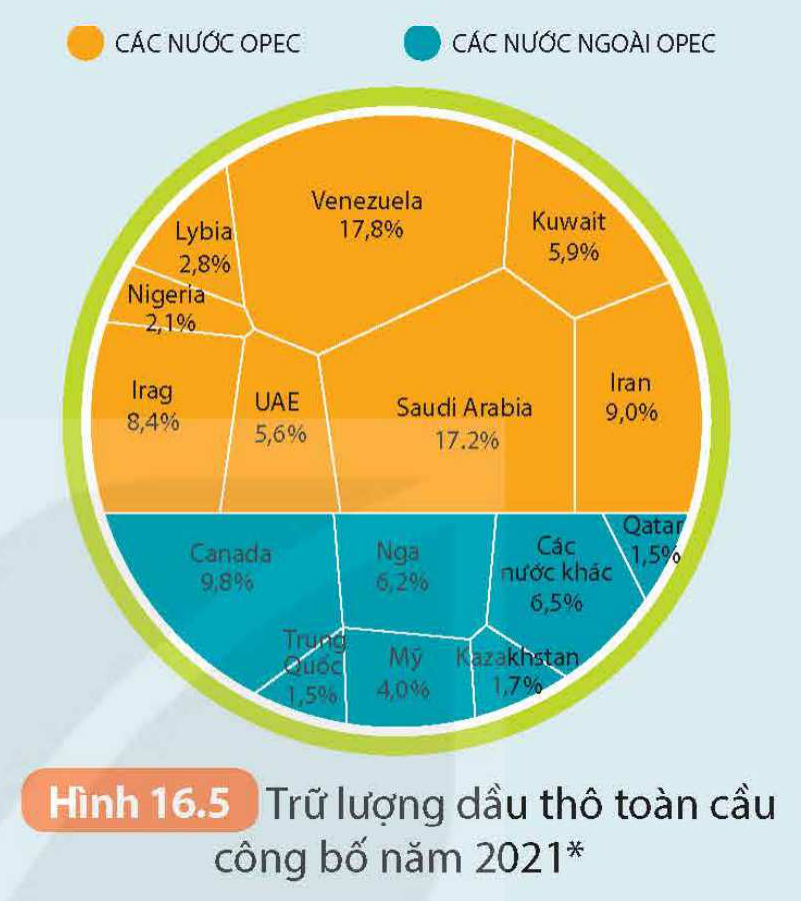

<!-- pdf:77 -->

# BÀI 16: VÒNG NĂNG LƯỢNG TRÊN TRÁI ĐẤT. NĂNG LƯỢNG HOÁ THẠCH

## 🎯 Mục tiêu

- Dựa vào ảnh (hoặc hình vẽ) mô tả vòng năng lượng trên Trái Đất để rút ra được: năng lượng của Trái Đất đến từ Mặt Trời.
- Nêu được sơ lược ưu điểm và nhược điểm của năng lượng hoá thạch.
- Lấy được ví dụ chứng tỏ việc đốt cháy các nhiên liệu hoá thạch có thể gây ô nhiễm môi trường.
- Thảo luận để chỉ ra được giá nhiên liệu phụ thuộc vào chi phí khai thác nó.

## 🔴 Mở đầu

> Ở lớp 7, chúng ta đã biết quang hợp ở thực vật đóng vai trò quan trọng trong chuyển hoá năng lượng của Mặt Trời trên Trái Đất. Vậy, năng lượng mặt trời chuyển hoá như thế nào trên Trái Đất?

## I. Vòng năng lượng trên Trái Đất

<!-- term: Vòng năng lượng trên Trái Đất -->
Năng lượng mặt trời không thể thiếu trong cuộc sống của con người và các vật sống khác trên Trái Đất. Năng lượng mặt trời được chuyển hoá thành các dạng năng lượng từ gió, năng lượng sinh khối, năng lượng từ dòng chảy,... Sự chuyển hoá năng lượng mặt trời theo vòng tuần hoàn của nước hay thông qua sự chuyển hoá năng lượng giữa các vật sống,... tạo thành các vòng năng lượng trên Trái Đất.

### 1. Vòng năng lượng giữa các vật sống

Quá trình trao đổi chất và chuyển hoá năng lượng giữa các vật sống tạo thành một vòng năng lượng trên Trái Đất như Hình 16.1.

**Vòng năng lượng giữa các vật sống** là quá trình chuyển đổi năng lượng từ nguồn thực vật (thông qua quá trình quang hợp) cho đến các động vật. Ở quá trình quang hợp, thực vật hấp thụ năng lượng mặt trời, chuyển hoá năng lượng mặt trời thành hoá năng lưu trữ trong lục lạp của chúng. Thức ăn của động vật thường là thực vật hoặc các động vật khác. Các động vật ăn thực vật để lấy năng lượng và các chất dinh dưỡng cho sự sinh trưởng, phát triển và vận động. Động vật lấy glucose từ quá trình phân giải thức ăn. Nhờ quá trình hô hấp với sự tham gia của khí oxygen mà các phân tử chất hữu cơ (chủ yếu là glucose) được phân giải thành khí $\ce{CO2}$ và nước, đồng thời tạo ra năng lượng ATP. Thực vật lại bắt đầu hấp thụ năng lượng mặt trời để chuyển khí $\ce{CO2}$ và nước thành phân tử đường hữu cơ.

Việc phân huỷ xác các vật sống bị vùi lấp do thiên tai qua hàng triệu năm đã hình thành nguồn năng lượng hoá thạch trên Trái Đất.

<!-- pdf:78 -->

Hình 16.1. Vòng năng lượng trên Trái Đất hình thành dựa trên quá trình trao đổi chất và chuyển hoá năng lượng giữa các vật sống

> ✋ Quan sát Hình 16.1 và thực hiện các yêu cầu sau:
>
> 1. Mô tả vòng năng lượng giữa các vật sống trên Trái Đất. Nêu dạng năng lượng trong mỗi giai đoạn của vòng năng lượng.
> 2. Chứng tỏ năng lượng được chuyển hoá trong vòng năng lượng giữa các vật sống trên Trái Đất đến từ Mặt trời.

### 2. Vòng năng lượng theo vòng tuần hoàn của nước

<!-- term: Vòng năng lượng theo vòng tuần hoàn của nước -->
Trong vòng tuần hoàn của nước (Hình 16.2) cũng có sự chuyển hoá năng lượng mặt trời thành các dạng năng lượng.

<!-- term: Vòng năng lượng theo vòng tuần hoàn của nước -->
Các giai đoạn chủ yếu của vòng tuần hoàn nước là nước từ dạng lỏng bốc hơi dưới tác động của ánh sáng mặt trời, hơi nước ngưng tụ thành các đám mây và mưa. Thoát hơi nước ở thực vật trên cạn cũng chuyển vận một lượng hơi nước đáng kể vào bầu khí quyển. Nước ở bề mặt đất và nước ngầm có thể chảy xuống đại dương, khép kín vòng chuyển vận nước.

Hình 16.2. Vòng năng lượng theo vòng tuần hoàn của nước

<!-- pdf:79 -->

<!-- term: Vòng năng lượng theo vòng tuần hoàn của nước -->
Vòng năng lượng theo vòng tuần hoàn của nước xảy ra một cách tự nhiên và không được nhìn thấy bằng mắt. Quá trình bắt đầu khi ánh sáng mặt trời chiếu xuống mặt đất và biển, làm nóng nước và khí quyển. Sự nóng lên này tạo ra sự chênh lệch nhiệt độ giữa các vùng trên Trái Đất, gây ra sự chuyển động của không khí và các dòng hải lưu (dòng biển) trong đại dương, tạo ra gió và các hiện tượng thời tiết. Như vậy, ở giai đoạn đầu của vòng năng lượng theo vòng tuần hoàn của nước, cần lấy năng lượng từ Mặt Trời để chuyển hoá thành năng lượng từ gió, năng lượng từ dòng chảy, năng lượng từ sóng biển, từ dòng biển trên Trái Đất.

> ✋ Quan sát Hình 16.2 và thực hiện các yêu cầu sau:
>
> 1. Mô tả sự chuyển hoá giữa các dạng năng lượng trong vòng tuần hoàn của nước.
> 2. Chứng tỏ năng lượng từ gió, năng lượng từ dòng chảy trên Trái Đất cũng đến từ Mặt Trời.
> 3. Từ vòng năng lượng trên Trái Đất như mô tả trong Hình 16.1 và 16.2, hãy lấy các ví dụ chứng tỏ năng lượng của Trái Đất đến từ Mặt Trời.

## II. Năng lượng hoá thạch

**Năng lượng hoá thạch** được tạo ra từ các nhiên liệu hoá thạch, bao gồm than mỏ, dầu mỏ, khí mỏ dầu và khí thiên nhiên. Nguồn năng lượng này được hình thành từ việc phân huỷ xác các vật sống qua hàng triệu năm. Do đó, năng lượng hoá thạch cũng có nguồn gốc từ Mặt Trời.

<!-- term: Dầu mỏ -->
Hình 16.3 minh hoạ quá trình hình thành dầu mỏ có trên đất liền. Từ vài trăm triệu năm trước, một lượng lớn thực vật và xác sinh vật biển tích tụ dưới đáy đại dương tạo thành trầm tích của động vật và thực vật. Trong hàng triệu năm tiếp theo, lớp trầm tích này bị biến đổi bởi vi khuẩn và chìm sâu hơn. Trải qua sự gia tăng nhiệt độ và áp suất, ở độ sâu khoảng một vài kilômét dưới áp suất lớn, dần dần các lớp trầm tích biến thành bùn đen, dầu mỏ. Sau đó, dựa vào các vết đứt gãy của các lớp đá, dầu mỏ dần nổi lên, tích tụ trong các túi đá, trở thành mỏ dầu.

> ✋ Quan sát Hình 16.3 và thực hiện các yêu cầu sau:
>
> 1. Mô tả quá trình hình thành dầu mỏ.
> 2. Vì sao dầu mỏ không thể bổ sung nhanh và sẽ dần cạn kiệt trong tương lai gần?
>
> 
>
> Hình 16.3. Quá trình hình thành dầu mỏ có trên đất liền

<!-- pdf:80 -->

Dầu mỏ, khí thiên nhiên, than mỏ cung cấp phần lớn nhu cầu năng lượng cho các quốc gia trên thế giới. Năng lượng hoá thạch có nhiều ưu điểm như nguồn sẵn có, dễ khai thác, chế biến, dễ vận chuyển, dễ tích trữ với khối lượng lớn. Công nghệ khai thác và chuyển hoá năng lượng hoá thạch phổ biến, chi phí rẻ.

Tuy nhiên, Trái Đất mất hàng triệu năm để tạo ra các nguồn nhiên liệu đó, trong khi tốc độ tiêu thụ của con người lại rất nhanh khiến nguồn nhiên liệu này ngày càng trở nên cạn kiệt. Hơn nữa, việc khai thác, xử lí, phân phối nhiên liệu hoá thạch cũng gây ra nhiều mối đe doạ cho môi trường như có thể làm thay đổi cấu trúc địa tầng, gây động đất, thay đổi hệ sinh thái.

Việc đốt cháy nhiên liệu hoá thạch sẽ tạo ra chất thải rắn, phát thải các khí $\ce{CO2}$, $\ce{CO}$, $\ce{NO2}$, $\ce{NO}$, $\ce{SO2}$,... gây ảnh hưởng đến sức khoẻ con người và ô nhiễm môi trường, gây hiệu ứng nhà kính trên Trái Đất. Hậu quả làm tan băng ở các địa cực, gây biến đổi khí hậu toàn cầu, khiến nước biển dâng, hạn hán, thiên tai, lũ lụt xảy ra với cường độ ngày càng tăng, góp phần phá huỷ hệ sinh thái và sự sống trên Trái Đất.

> ✋ 1. Nêu ưu điểm và nhược điểm của năng lượng hoá thạch.
> 2. Lấy ví dụ chứng tỏ việc đốt cháy các nhiên liệu hoá thạch có thể gây ô nhiễm môi trường.

## III. Các yếu tố ảnh hưởng đến giá nhiên liệu hoá thạch

Giá nhiên liệu phụ thuộc vào chi phí khai thác và nhiều yếu tố khác như nhu cầu sử dụng và cung cầu trên thị trường, tình hình kinh tế toàn cầu, chính sách của các quốc gia có trữ lượng nhiên liệu lớn,...

<!-- term: Chi phí khai thác nhiên liệu hoá thạch -->
Chi phí khai thác gồm chi phí thăm dò, chi phí khoan khai thác, chi phí vận chuyển, chi phí tích trữ lưu kho và chi phí xử lí các vấn đề môi trường liên quan. Chi phí này ngày càng tăng đã tác động đến giá nhiên liệu do các mỏ dầu, khí thiên nhiên, than,... dễ khai thác trên đất liền hoặc lộ thiên dần cạn kiệt, nên phải thăm dò và khai thác các mỏ mới ở vùng biển sâu, ở đại dương hoặc vùng hẻo lánh, các cực của Trái Đất.

> 🔍 Chi phí khai thác chiếm tỉ lệ quan trọng trong giá thành bán xăng ra thị trường, có thể đến $50\%$ giá bán như mô tả trong Hình 16.4.
>
> Ở nước ta, Chính phủ quy định cách xác định giá bán xăng dầu trên thị trường theo nguồn xăng dầu nhập khẩu hoặc nguồn xăng dầu trong nước.
> - Đối với giá bán xăng dầu nguồn nhập khẩu được xác định gồm: Giá xăng dầu thế giới $+$ Chi phí đưa xăng dầu từ nước ngoài về cảng Việt Nam $+$ Chi phí kinh doanh định mức $+$ Mức trích lập Quỹ bình ổn giá $+$ Lợi nhuận định mức $+$ Chi phí thuế (thuế nhập khẩu, thuế tiêu thụ đặc biệt, thuế bảo vệ môi trường, thuế giá trị gia tăng) $+$ Phí, trích nộp khác.
> - Đối với giá bán xăng dầu nguồn trong nước được xác định gồm: Giá xăng dầu thế giới $+$ Chi phí đưa xăng dầu từ các nhà máy lọc dầu trong nước về đến cảng $+$ Chi phí kinh doanh định mức $+$ Mức trích lập Quỹ bình ổn giá $+$ Lợi nhuận định mức $+$ Thuế, phí, trích nộp khác.
>
> 
>
> Hình 16.4. Cơ cấu giá bán xăng ở Mỹ năm 2023\*

> (\*) Nguồn: eia.gov/petroleum/gasdiesel/

<!-- pdf:81 -->

> ✋ Tìm hiểu thông tin trên sách báo, internet, thảo luận để trả lời các câu hỏi sau:
>
> 1. Giá nhiên liệu hoá thạch phụ thuộc vào những chi phí nào?
> 2. Chi phí khai thác ảnh hưởng như thế nào đến giá nhiên liệu?
> 3. Khi tính thêm chi phí khắc phục các yếu tố ảnh hưởng đến môi trường do sử dụng nhiên liệu hoá thạch (như thuế bảo vệ môi trường,...) làm giá nhiên liệu tăng thì lợi ích là gì?

> 🔍 Dầu mỏ được coi là huyết mạch của nền kinh tế toàn cầu. Hơn $33\%$ nguồn cung năng lượng của thế giới được sản xuất từ dầu mỏ, nhiều hơn bất kì tài nguyên thiên nhiên nào khác.
>
> Một số nước có trữ lượng dầu mỏ lớn đã phối hợp với nhau, gọi là **các nước OPEC**, để điều tiết lượng cung dầu ra toàn cầu (Hình 16.5).
>
> Sự giảm trữ lượng dầu mỏ luôn bị lo ngại vì khả năng cạn kiệt trong một tương lai không xa và nguy cơ biến đổi khí hậu. Hiện nay, có xu hướng khuyến khích giảm nhu cầu sử dụng nhiên liệu hoá thạch và thay thế bằng các nguồn năng lượng tái tạo khác.
>
> 
>
> Hình 16.5. Trữ lượng dầu thô toàn cầu công bố năm 2021\*

## 📌 Em đã học

- Vòng năng lượng giữa các vật sống và vòng năng lượng theo vòng tuần hoàn của nước chuyển hoá năng lượng mặt trời thành các dạng năng lượng trên Trái Đất như năng lượng từ gió, năng lượng từ sóng biển,... chứng tỏ năng lượng của Trái Đất đến từ Mặt Trời
- Ưu điểm của năng lượng hoá thạch là có thể khai thác với khối lượng lớn, dễ vận chuyển, công nghệ chuyển hoá thành các dạng năng lượng khác phổ biến với chi phí rẻ.
- Nhược điểm của năng lượng hoá thạch là khi sử dụng gây ô nhiễm môi trường, phát thải khí gây hiệu ứng nhà kính,...
- Giá nhiên liệu phụ thuộc vào chi phí khai thác nó và các yếu tố khác như vận chuyển, lưu kho, chi phí khắc phục môi trường,...

## ✏️ Em có thể

- Giải thích được năng lượng từ gió, năng lượng từ dòng chảy trong vòng tuần hoàn của nước đến từ Mặt Trời.
- Giải thích được sự chuyển hoá năng lượng mặt trời thành các dạng năng lượng khác trên Trái Đất trong vòng năng lượng giữa các vật sống.
- Lấy được ví dụ về đốt cháy than, xăng, dầu gây ô nhiễm môi trường trong cuộc sống hằng ngày.

> (\*) Nguồn: visualcapitalist.com/ranking-the-countries-with-the-largest-proven-global-oil-reserves-in-the-world/

## 📷 Danh sách hình trong bài

| Mã hình | Trang PDF | Vị trí trong bài | Chú thích gốc |
|---|---|---|---|
| H9-khoa_hoc_tu_nhien-b16-01 | 78 | Mục I.1 (cạnh dưới chạm biểu tượng bàn tay của hộp hoạt động phía dưới) | Hình 16.1. Vòng năng lượng trên Trái Đất hình thành dựa trên quá trình trao đổi chất và chuyển hoá năng lượng giữa các vật sống |
| H9-khoa_hoc_tu_nhien-b16-02 | 78 | Mục I.2 | Hình 16.2. Vòng năng lượng theo vòng tuần hoàn của nước |
| H9-khoa_hoc_tu_nhien-b16-03 | 79 | Mục II | Hình 16.3. Quá trình hình thành dầu mỏ có trên đất liền |
| H9-khoa_hoc_tu_nhien-b16-04 | 80 | Mục III | Hình 16.4. Cơ cấu giá bán xăng ở Mỹ năm 2023\* |
| H9-khoa_hoc_tu_nhien-b16-05 | 81 | Mục III | Hình 16.5. Trữ lượng dầu thô toàn cầu công bố năm 2021\* |
