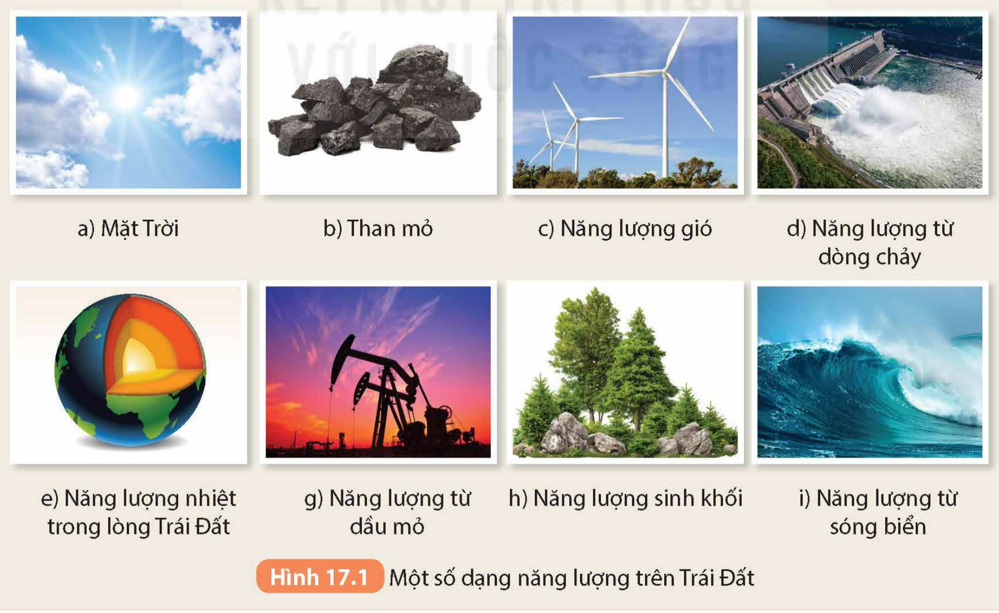
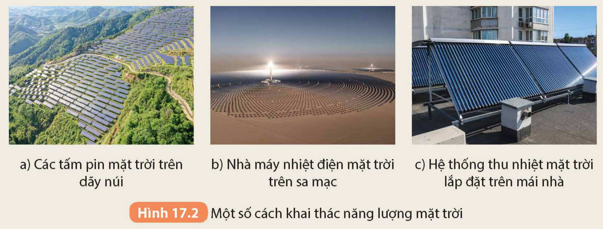
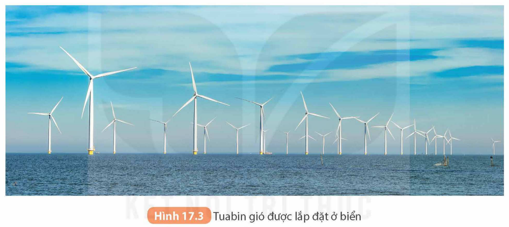
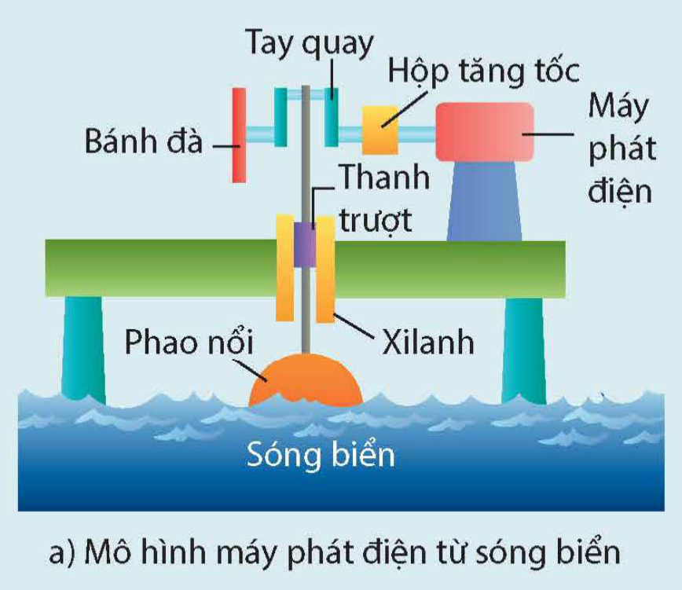
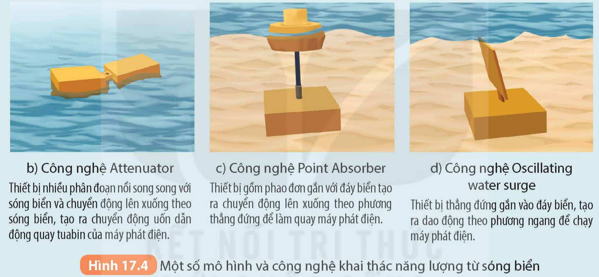
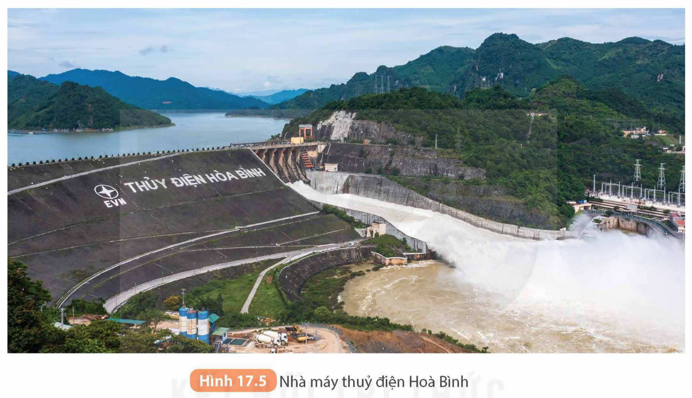

<!-- pdf:82 -->

# BÀI 17: MỘT SỐ DẠNG NĂNG LƯỢNG TÁI TẠO

## 🎯 Mục tiêu

- Nêu được sơ lược ưu điểm và nhược điểm của một số dạng năng lượng tái tạo (năng lượng mặt trời, năng lượng từ gió, năng lượng từ sóng biển, năng lượng từ dòng sông).
- Thảo luận để nêu được một số biện pháp sử dụng hiệu quả năng lượng và bảo vệ môi trường.

## 🔴 Mở đầu

> Ở lớp 6, chúng ta đã biết: năng lượng mặt trời, năng lượng từ gió, năng lượng từ sóng biển, năng lượng từ dòng sông... là các dạng năng lượng tái tạo. Các dạng năng lượng này có ưu điểm và nhược điểm gì?

## I. Năng lượng tái tạo

**Năng lượng tái tạo** là năng lượng đến từ các nguồn năng lượng có sẵn trong thiên nhiên, liên tục được bổ sung thông qua các quá trình tự nhiên.

> ✋ Quan sát Hình 17.1 và cho biết:
>
> 1. Những dạng năng lượng nào là năng lượng tái tạo?
> 2. Năng lượng nào khi sử dụng có thể gây ô nhiễm môi trường như tạo ra chất thải rắn, phát thải khí gây hiệu ứng nhà kính, gây biến đổi khí hậu,...?
>
> 
>
> Hình 17.1. Một số dạng năng lượng trên Trái Đất

<!-- pdf:83 -->

> ❓ Vì sao cần tăng cường sử dụng năng lượng tái tạo?

## II. Ưu điểm và nhược điểm của một số dạng năng lượng tái tạo

Năng lượng tái tạo bao gồm năng lượng mặt trời, năng lượng từ gió, năng lượng từ sóng biển, năng lượng từ dòng sông, năng lượng sinh khối, năng lượng địa nhiệt,...

### 1. Năng lượng mặt trời

<!-- term: Năng lượng mặt trời -->
Năng lượng mặt trời luôn có sẵn trong thiên nhiên, khó có khả năng bị cạn kiệt trong tương lai gần. Khi sử dụng năng lượng mặt trời không gây ra tiếng ồn, không phát thải các chất gây ô nhiễm không khí hay các khí gây hiệu ứng nhà kính. Năng lượng mặt trời được khai thác trực tiếp như để chiếu sáng, làm khô quần áo, sấy nông sản, sấy thực phẩm, làm muối, chuyển hoá thành năng lượng điện của pin mặt trời hoặc khai thác gián tiếp qua các thiết bị thu nhiệt để làm nóng nước, chạy nhà máy nhiệt điện,...

Tuy nhiên, giá thành sản xuất tấm pin mặt trời còn cao, hệ thống hấp thụ nhiệt mặt trời có hiệu suất chuyển hoá năng lượng thấp. Trong quá trình thay các tấm pin mặt trời sau khi hết hạn sử dụng (trung bình 25 năm) sẽ tạo ra rác thải điện tử, chất thải rắn khó phân huỷ,...

Lắp đặt quá nhiều các tấm pin mặt trời, hệ thống thu nhiệt mặt trời trong thành phố sẽ phản xạ mạnh ánh sáng vào ban ngày gây ô nhiễm ánh sáng. Nhà máy điện mặt trời chiếm một diện tích lớn dẫn đến vấn đề mặt đất, mặt nước bị che phủ quá lớn làm ảnh hưởng đến hệ sinh thái, quá trình quang hợp của thực vật hoặc làm thay đổi môi trường sống và sự phát triển các loài động vật ở khu vực đó.

> ✋ Quan sát Hình 17.2, tìm hiểu trên sách báo, internet và thực hiện các yêu cầu sau:
>
> 1. Năng lượng mặt trời được khai thác, sử dụng trong cuộc sống như thế nào?
> 2. Nêu đặc điểm của năng lượng mặt trời.
> 3. Nêu ưu điểm và nhược điểm của việc khai thác và sử dụng năng lượng mặt trời.
>
> 
>
> Hình 17.2. Một số cách khai thác năng lượng mặt trời

<!-- pdf:84 -->

> 🔍 Nước ta được đánh giá là quốc gia có tiềm năng năng lượng mặt trời rất lớn.
>
> Cường độ bức xạ cao nhất tập trung ở các tỉnh Tây Nguyên và Nam bộ như Đắk Lắk, Gia Lai, Nha Trang, Ninh Thuận, Bình Thuận, Tây Ninh và Bình Phước.

### 2. Năng lượng từ gió

<!-- term: Năng lượng từ gió -->
Năng lượng từ gió luôn có sẵn trong thiên nhiên. Do không phát thải các chất gây ô nhiễm không khí hay các khí gây hiệu ứng nhà kính và công nghệ khai thác năng lượng từ gió phát triển mạnh, nên khai thác năng lượng từ gió được xem là một trong những giải pháp quan trọng nhất nhằm giảm biến đổi khí hậu toàn cầu. Vì tốc độ gió trên đại dương thường ổn định hơn và mạnh hơn so với tốc độ gió trên đất liền nên năng lượng từ gió ngoài khơi là một nguồn năng lượng tái tạo có triển vọng phát triển lớn, có thể lắp đặt các trang trại gió ngoài khơi trên vùng biển rộng (Hình 17.3). Hiện nay, nhiều khu vực biển ở nước ta có tiềm năng năng lượng từ gió nhưng chưa được khai thác.

Hình 17.3. Tuabin gió được lắp đặt ở biển

Mặc dù việc khai thác và sử dụng năng lượng từ gió không phát thải khí gây hiệu ứng nhà kính nhưng hiệu suất chuyển đổi năng lượng thấp, giá thành đầu tư ban đầu cao, các nhà máy điện gió phát ra tiếng ồn gây ảnh hưởng đến môi trường sống của sinh vật,... Tuabin điện gió có thể làm nhiễu tín hiệu phát thanh, ảnh hưởng đến vùng hoạt động của các loài chim (đặc biệt là chim di cư) và dơi.

> ❓ 1. Nêu đặc điểm của năng lượng từ gió.
> 2. Nêu ưu điểm và nhược điểm của việc khai thác và sử dụng năng lượng từ gió.

### 3. Năng lượng từ sóng biển

Sóng biển được hình thành chủ yếu do tác động của gió. Tốc độ gió càng lớn và thời gian gió thổi càng lâu thì sóng biển càng lớn. **Năng lượng từ sóng biển** là năng lượng có nguồn gốc từ hoạt động của các con sóng. Dạng năng lượng này luôn có sẵn trong tự nhiên, không tạo chất thải, được khai thác bằng công nghệ hiện đại (Hình 17.4) và chuyển hoá thành điện năng phục vụ cho các nhu cầu sử dụng của con người.

<!-- pdf:85 -->

> 🔍 Phao nổi trên mặt nước (Hình 17.4a) khi chuyển động lên xuống trong xilanh làm quay tuabin của máy phát điện. Khi đó, năng lượng từ sóng biển được chuyển hoá thành năng lượng điện.
>
> 
>
> Ngày nay xuất hiện nhiều công nghệ hiện đại được sử dụng khai thác năng lượng từ sóng biển (Hình 17.4b, c, d). Ở công nghệ Attenuator và Point Absorber, thiết bị gắn phao chuyển động lên xuống theo sóng biển theo phương thẳng đứng tạo ra chuyển động quay tuabin của máy phát điện. Còn ở công nghệ Oscillating water surge, thiết bị tạo ra dao động theo phương ngang để chạy máy phát điện. Công nghệ Point Absorber và Oscillating water surge thiết bị cần gắn với đáy biển, khó khăn khi lắp đặt, thi công, còn công nghệ Attenuator chỉ cần đặt các thiết bị nổi trên mặt biển.
>
> 
>
> Hình 17.4. Một số mô hình và công nghệ khai thác năng lượng từ sóng biển

Năng lượng từ sóng biển ở nước ta rất dồi dào nhưng để có được công suất điện lớn và ổn định cần nhiều máy phát điện đặt trong không gian rộng, gây ảnh hưởng đến giao thông đường biển, hệ sinh thái, đòi hỏi giá thành đầu tư ban đầu cao và phụ thuộc rất lớn vào các mùa trong năm, chịu ảnh hưởng bởi thiên tai.

> 🔍 Ở nước ta, theo báo cáo của Tổng cục Khí tượng Thuỷ văn – Bộ Tài nguyên và Môi trường năm 2022 thì khoảng thời gian khai thác năng lượng từ sóng biển thuận lợi nhất trong năm là mùa đông do gió mùa đông bắc tạo ra vùng năng lượng sóng khá mạnh trên vùng bắc và giữa Biển Đông. Vùng bờ biển miền Trung Việt Nam từ Đà Nẵng đến Ninh Thuận có tiềm năng năng lượng sóng biển lớn nhất.

> ❓ 1. Nêu đặc điểm của năng lượng từ sóng biển.
> 2. Nêu ưu điểm và nhược điểm của việc khai thác và sử dụng năng lượng từ sóng biển.

<!-- pdf:86 -->

### 4. Năng lượng từ dòng sông

**Sông** là dòng nước chảy thường xuyên trên Trái Đất, được các nguồn nước mưa, nước ngầm, nước băng tuyết tan bổ sung thường xuyên.

**Năng lượng từ dòng sông** là năng lượng lấy từ sức chảy của dòng nước. Dạng năng lượng này có sẵn trong thiên nhiên, ít tác động tiêu cực đến môi trường so với năng lượng hoá thạch. Để khai thác năng lượng từ dòng sông, người ta xây dựng các nhà máy thuỷ điện nhằm chuyển hoá năng lượng này thành năng lượng điện. Ở các nhà máy thuỷ điện, các đập hoặc hồ được xây dựng nhằm ngăn dòng chảy, tích trữ nước của những con sông lớn, sau đó sử dụng chúng để làm quay các tuabin của máy phát điện (Hình 17.5).

Hình 17.5. Nhà máy thuỷ điện Hoà Bình

Sử dụng đập để tích trữ nước cho thuỷ điện có nguy cơ ảnh hưởng đến môi trường, làm cho các loài động vật không có khả năng di chuyển từ hạ nguồn lên thượng nguồn. Nước ngập ở thượng nguồn và cạn ở hạ nguồn làm thay đổi môi trường sống của sinh vật hoặc gây áp lực lớn lên địa chất ở trong đập và thân đập dẫn đến có thể gây nứt, gãy địa tầng, gây động đất,...

Khai thác năng lượng từ dòng sông để làm thuỷ điện cũng dẫn đến các vấn đề về sinh thái và đa dạng sinh học, làm diện tích rừng bị suy giảm, tác động đến chất lượng nước và việc khai thác, sử dụng nước. Đặc biệt với các nhà máy thuỷ điện có công suất lớn, cần phải di chuyển số lượng lớn dân cư ra khỏi vùng sinh sống ở gần sông, làm thay đổi văn hoá, tập quán sinh sống của họ.

> ❓ 1. Việc sử dụng năng lượng từ dòng sông ảnh hưởng đến môi trường như thế nào nếu:
> - Vỡ đập thuỷ điện.
> - Động vật không di chuyển được từ hạ nguồn lên thượng nguồn của dòng sông.
> - Diện tích rừng thay đổi khi xây dựng nhà máy thuỷ điện.
>
> 2. Nêu ưu điểm của việc khai thác và sử dụng năng lượng từ dòng sông.

<!-- pdf:87 -->

> 🔍 Nước ta nằm trong vùng nhiệt đới, có lượng mưa trung bình hằng năm cao. Địa hình miền Bắc và biên giới miền Tây đồi núi cao, phía đông là bờ biển dài nên nước ta có hệ thống sông ngòi khá dày đặc. Với điều kiện tự nhiên thuận lợi như vậy nên tiềm năng thuỷ điện của nước ta tương đối lớn.

## III. Một số biện pháp sử dụng hiệu quả năng lượng và bảo vệ môi trường

**Sử dụng hiệu quả năng lượng** là việc dùng ít năng lượng hơn để thực hiện cùng một công việc hoặc cùng một chức năng của thiết bị, máy móc. Ví dụ, chúng ta cần sử dụng đèn LED thay thế cho đèn huỳnh quang hoặc đèn sợi đốt.

**Bảo vệ môi trường** là hoạt động phòng ngừa, hạn chế tác động xấu đến môi trường; ứng phó sự cố môi trường; khắc phục ô nhiễm, suy thoái môi trường, cải thiện chất lượng môi trường; sử dụng hợp lí tài nguyên thiên nhiên, đa dạng sinh học và ứng phó với biến đổi khí hậu.

Sử dụng hiệu quả năng lượng và bảo vệ môi trường có liên quan chặt chẽ với nhau. Việc sử dụng hiệu quả năng lượng giúp giảm thiểu sự tiêu thụ năng lượng và khí thải, giảm thiểu tác động đến môi trường.

Mục tiêu chính của việc sử dụng hiệu quả năng lượng là để thực hiện tiết kiệm năng lượng như:
- Giảm năng lượng hao phí, nhờ đó giảm chi phí sử dụng năng lượng trong sản xuất và đời sống.
- Giảm khai thác và sử dụng năng lượng hoá thạch giúp giảm lượng phát thải khí gây ô nhiễm môi trường.

> ❓ Tại sao sử dụng hiệu quả năng lượng góp phần bảo vệ môi trường?

Ví dụ về một số biện pháp sử dụng hiệu quả năng lượng và bảo vệ môi trường:
- Sử dụng năng lượng tái tạo để chuyển hoá thành điện năng (như điện mặt trời, điện gió, thuỷ điện) sẽ giảm thiểu sự phát thải khí nhà kính và giảm tiêu thụ nhiên liệu hoá thạch.
- Sử dụng các thiết bị tiết kiệm điện như bóng đèn LED, tủ lạnh, điều hoà, bình nóng lạnh,... (có tính năng tiết kiệm năng lượng) nhằm giảm số tiền điện phải trả hàng tháng và ít tác động đến môi trường.
- Tăng cường sử dụng, cải tiến máy móc, thiết bị tiết kiệm năng lượng tại các công ty, nhà máy, xí nghiệp, đồng thời thực hiện tái chế các sản phẩm và sử dụng nguyên liệu thân thiện với môi trường.
- Sử dụng phương tiện giao thông công cộng thay cho các phương tiện cá nhân góp phần tiết kiệm năng lượng và giảm thiểu phát thải khí thải.
- Tạo ý thức tiết kiệm năng lượng và bảo vệ môi trường: tắt các thiết bị không sử dụng, sử dụng thiết bị tiết kiệm năng lượng, chọn sử dụng các sản phẩm tái chế và thân thiện với môi trường,...

<!-- pdf:88 -->

> ✋ 1. Thảo luận và nêu thêm một số biện pháp sử dụng hiệu quả năng lượng và bảo vệ môi trường.
>
> 2. Giải thích vì sao những cách dưới đây được coi là sử dụng hiệu quả năng lượng điện.
>   a) Tắt các thiết bị điện (ti vi, đèn điện,...) khi không sử dụng.
>   b) Giảm độ sáng màn hình máy tính.
>   c) Để điều hoà trên $26\text{ }^\circ\text{C}$ vào mùa hè. Sử dụng quạt thay cho máy điều hoà mọi lúc có thể.
>   d) Không để nhiệt độ tủ lạnh quá thấp, không mở tủ lạnh quá lâu.
>   e) Thường xuyên bảo trì, bảo dưỡng và vệ sinh các thiết bị điện.
>
> 3. Để tận dụng gió và ánh sáng tự nhiên cho ngôi nhà của em, hãy thực hiện các việc sau và giải thích vì sao hành động như vậy.
>   a) Mở cửa để gió tự nhiên làm thông thoáng ngôi nhà.
>   b) Kê bàn học, bàn làm việc gần nơi có ánh sáng tự nhiên và tận dụng nguồn ánh sáng này cho các hoạt động sinh hoạt.
>   c) Sơn phòng sáng màu.
>
> 4. Vì sao trồng nhiều cây xanh quanh nhà và trường học giúp sử dụng hiệu quả năng lượng và bảo vệ môi trường?
>
> 5. Vì sao sử dụng năng lượng tái tạo giúp giảm ô nhiễm môi trường, giảm phát thải khí nhà kính?

## 📌 Em đã học

- Ưu điểm của năng lượng tái tạo là nguồn năng lượng có sẵn trong thiên nhiên, liên tục được bổ sung thông qua các quá trình tự nhiên. Khai thác và sử dụng một số dạng năng lượng tái tạo không gây phát thải khí nhà kính, giúp bảo vệ môi trường.
- Nhược điểm của năng lượng tái tạo là các công nghệ khai thác hiện nay có hiệu suất thấp, chi phí đầu tư ban đầu cao.
- Sử dụng một số biện pháp tiết kiệm năng lượng, tận dụng ánh sáng và gió tự nhiên, sử dụng thiết bị điện đúng cách giúp sử dụng hiệu quả năng lượng làm giảm năng lượng hao phí, giảm khai thác tài nguyên giúp bảo vệ môi trường.

## ✏️ Em có thể

- Khai thác và sử dụng được một số dạng năng lượng tái tạo trong cuộc sống.
- Thảo luận để nêu được một số biện pháp sử dụng hiệu quả năng lượng và bảo vệ môi trường.

## 📷 Danh sách hình trong bài

| Mã hình | Trang PDF | Vị trí trong bài | Chú thích gốc |
|---|---|---|---|
| H9-khoa_hoc_tu_nhien-b17-01 | 82 | Mục I | Hình 17.1. Một số dạng năng lượng trên Trái Đất |
| H9-khoa_hoc_tu_nhien-b17-02 | 83 | Mục II.1 | Hình 17.2. Một số cách khai thác năng lượng mặt trời |
| H9-khoa_hoc_tu_nhien-b17-03 | 84 | Mục II.2 | Hình 17.3. Tuabin gió được lắp đặt ở biển |
| H9-khoa_hoc_tu_nhien-b17-04 | 85 | Mục II.3 | Hình 17.4a. Mô hình máy phát điện từ sóng biển |
| H9-khoa_hoc_tu_nhien-b17-05 | 85 | Mục II.3 | Hình 17.4. Một số mô hình và công nghệ khai thác năng lượng từ sóng biển |
| H9-khoa_hoc_tu_nhien-b17-06 | 86 | Mục II.4 | Hình 17.5. Nhà máy thuỷ điện Hoà Bình |
