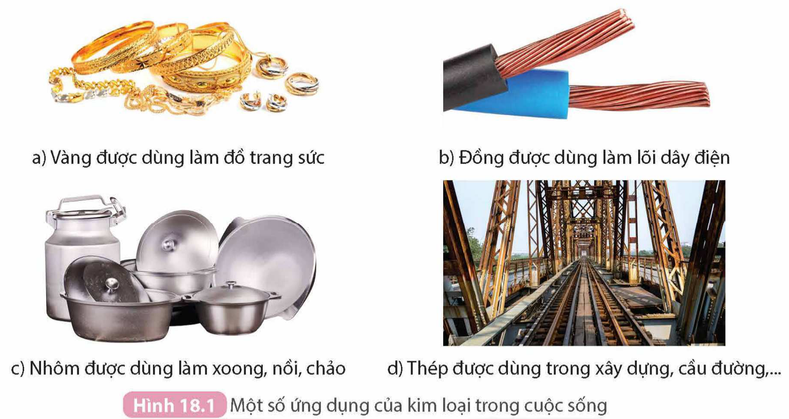
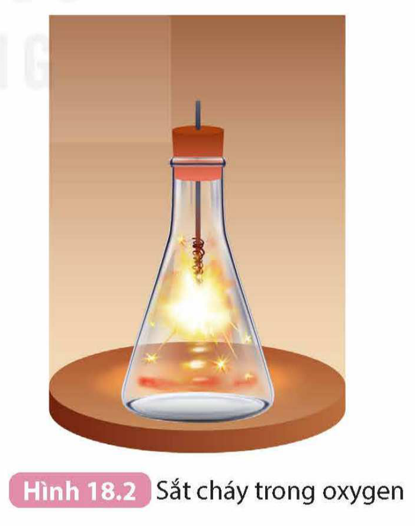
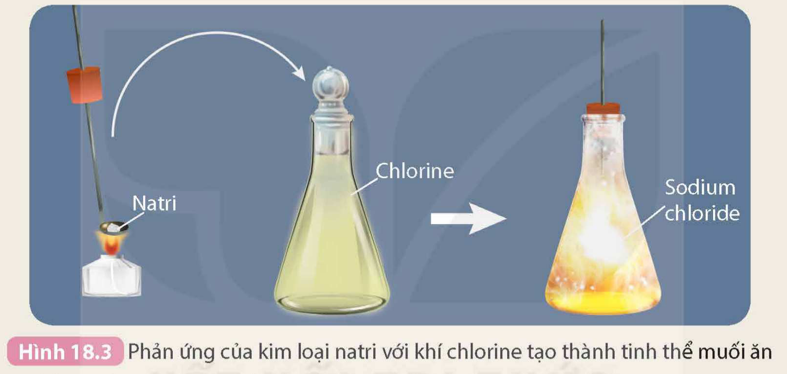
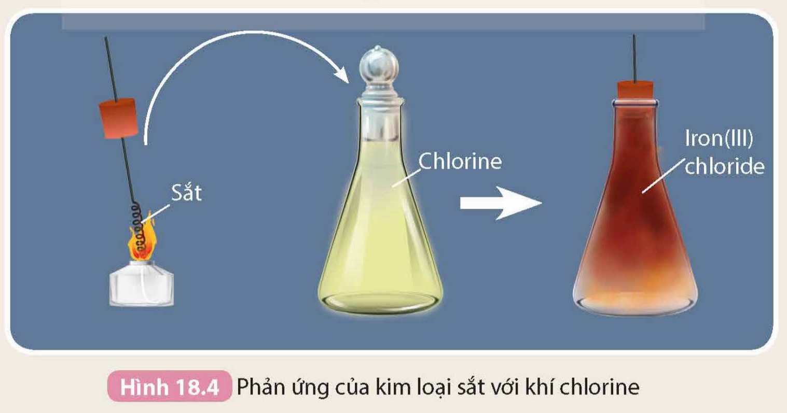
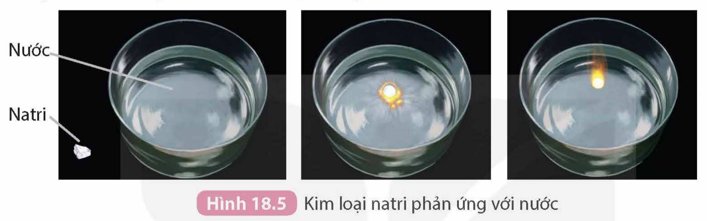

<!-- pdf:89 -->

# BÀI 18: TÍNH CHẤT CHUNG CỦA KIM LOẠI

## 🎯 Mục tiêu

- Nêu được tính chất vật lí của kim loại.
- Trình bày được tính chất hoá học cơ bản của kim loại: tác dụng với phi kim (oxygen, lưu huỳnh, chlorine), nước hoặc hơi nước, dung dịch hydrochloric acid, dung dịch muối.
- Mô tả được một số khác biệt về tính chất giữa các kim loại thông dụng (nhôm, sắt, vàng,...).

## 🔴 Mở đầu

> Thép, thành phần chính là sắt (iron), được dùng làm khung chịu lực của các công trình xây dựng; đồng (copper) dùng làm dây dẫn điện; vàng (gold) dùng làm đồ trang sức;... Các ứng dụng đó dựa trên những tính chất nào của kim loại?

## I. Tính chất vật lí của kim loại

> ✋ **Tìm hiểu về tính chất vật lí của kim loại**
>
> Trả lời các câu hỏi sau:
>
> 1. Khi uốn các thanh thuỷ tinh, gỗ, nhôm (aluminium), thép (thành phần chính là sắt), thanh nào có thể bị uốn cong mà không gãy?
> 2. Khi dùng búa đập vào các vật thể bằng đồng, gỗ, vàng, nhôm, cao su, sứ, vật thể nào bị biến dạng (vỡ vụn, dát mỏng,...)?
> 3. Khi nhúng thìa nhôm vào cốc nước sôi, tay cầm cán thìa sẽ thấy nóng. Hiện tượng này chứng tỏ tính chất gì của nhôm?
> 4. Dựa vào các số liệu trong Bảng 11.3 (trang 57), hãy giải thích vì sao dây dẫn điện thường làm bằng đồng và nhôm mà không làm bằng sắt.
> 5. Quan sát bề mặt viên gạch, mảnh nhôm, mảnh đồng, bề mặt nào có vẻ sáng lấp lánh (ánh kim)?

<!-- term: Tính chất vật lí chung của kim loại -->
Kim loại có các tính chất vật lí chung như sau:
- Tính dẻo.
- Tính dẫn điện, dẫn nhiệt.
- Ánh kim.

<!-- pdf:90 -->

Hình 18.1. Một số ứng dụng của kim loại trong cuộc sống

> ❓ Quan sát Hình 18.1 và cho biết những ứng dụng của các kim loại vàng, đồng, nhôm, sắt dựa trên tính chất vật lí nào.

> 🔍
> - Kim loại dẻo nhất (dễ dát mỏng, dễ kéo sợi): Vàng
> - Kim loại dẫn điện tốt nhất: Bạc (silver)
> - Kim loại dẫn nhiệt tốt nhất: Bạc
> - Kim loại có nhiệt độ nóng chảy cao nhất: Tungsten
> - Kim loại có nhiệt độ nóng chảy thấp nhất: Thuỷ ngân (mercury)
<!-- ocr-ok: đã đối chiếu ảnh trang gốc 90 (trang in 88), OCR đọc dính chữ trong hộp mở rộng -->

## II. Tính chất hoá học của kim loại

### 1. Tác dụng với phi kim

**a) Tác dụng với oxygen**

Hầu hết các kim loại như $\ce{Ca}$, $\ce{Mg}$, $\ce{Al}$, $\ce{Zn}$, $\ce{Fe}$, $\ce{Cu}$,... phản ứng với khí oxygen tạo thành oxide kim loại.

Một số kim loại như $\ce{Au}$,... không phản ứng với khí oxygen.

Ví dụ:
- Khi đốt nóng dây sắt (đã được uốn thành hình lò xo) rồi đưa vào bình đựng khí oxygen, dây sắt cháy sáng tạo thành khói màu nâu đỏ (Hình 18.2) theo phản ứng sau:

$$\ce{3Fe + 2O2 ->[t^\circ] Fe3O4}^{(1)}$$
<!-- ocr-ok: đã đối chiếu ảnh trang gốc 90 (trang in 88), phương trình hoá học sắt tác dụng oxygen -->

- Rắc bột nhôm trên ngọn lửa đèn cồn, nhôm cháy sáng tạo thành chất rắn màu trắng:

$$\ce{4Al + 3O2 ->[t^\circ] 2Al2O3}$$
<!-- ocr-ok: đã đối chiếu ảnh trang gốc 90 (trang in 88), phương trình hoá học nhôm tác dụng oxygen -->

Hình 18.2. Sắt cháy trong oxygen

> (1) $\ce{Fe3O4}$ (sắt có hoá trị II và III) có thể viết dưới dạng $\ce{FeO.Fe2O3}$.
<!-- ocr-ok: đã đối chiếu ảnh trang gốc 90 (trang in 88), OCR đọc sai chữ số La Mã II và III trong chú thích -->

<!-- pdf:91 -->

> 🔍 Một số kim loại như nhôm, kẽm, chromium,... phản ứng được với khí oxygen ngay ở điều kiện thường, tạo thành lớp oxide mỏng, bền vững. Lớp oxide này có tác dụng bảo vệ, ngăn không cho kim loại bên trong phản ứng tiếp với oxygen.

> ❓ 1. Viết phương trình hoá học của phản ứng giữa kẽm (zinc), đồng với khí oxygen.
> 2. Tại sao đồ vật làm bằng kim loại như sắt, nhôm, kẽm, đồng,... để lâu trong không khí bị mất ánh kim, còn đồ trang sức bằng vàng để lâu trong không khí vẫn sáng, đẹp?

**b) Tác dụng với phi kim khác**

> ✋ **Nghiên cứu phản ứng của một số kim loại với chlorine**
>
> - Thí nghiệm natri (sodium) tác dụng với chlorine được thực hiện như sau:
>   Đun nóng chảy một mẩu natri rồi đưa nhanh vào bình khí chlorine (màu vàng lục), natri cháy trong khí chlorine tạo thành tinh thể muối ăn có màu trắng (Hình 18.3).
>
> 
>
> Hình 18.3. Phản ứng của kim loại natri với khí chlorine tạo thành tinh thể muối ăn
>
> - Thí nghiệm sắt tác dụng với khí chlorine được thực hiện như sau:
>   Đốt đầu của dây sắt (đã được uốn hình lò xo) bằng đèn cồn đến nóng đỏ rồi đưa nhanh vào bình khí chlorine, sắt cháy trong khí chlorine tạo thành muối iron(III) chloride màu nâu đỏ (Hình 18.4).
>
> 
>
> Hình 18.4. Phản ứng của kim loại sắt với khí chlorine
>
> *Thực hiện yêu cầu sau:*
>
> Viết phương trình hoá học của các phản ứng xảy ra ở trên.

<!-- pdf:92 -->

Kim loại có thể tác dụng với nhiều phi kim tạo thành muối. Ví dụ: kim loại tác dụng chlorine tạo thành muối chloride, tác dụng với lưu huỳnh (sulfur) tạo thành muối sulfide.

Ví dụ: $\ce{Cu + Cl2 ->[t^\circ] CuCl2}$ $\qquad$ $\ce{2Al + 3S ->[t^\circ] Al2S3}$

> ❓ Viết phương trình hoá học của các phản ứng giữa kim loại $\ce{Mg}$, $\ce{Zn}$ với phi kim $\ce{S}$.

### 2. Tác dụng với nước

<!-- term: Kim loại hoạt động hoá học mạnh -->
Một số kim loại như $\ce{K}$, $\ce{Na}$, $\ce{Ca}$,... tác dụng với nước ở nhiệt độ thường tạo thành hydroxide và khí hydrogen, phản ứng toả ra nhiều nhiệt.

Ví dụ : $\ce{2Na + 2H2O -> 2NaOH + H2}$

<!-- term: Kim loại hoạt động hoá học mạnh -->
Những kim loại này là kim loại hoạt động hoá học mạnh.

Hình 18.5. Kim loại natri phản ứng với nước

Trong khi đó, những kim loại như $\ce{Zn}$, $\ce{Fe}$,... tác dụng với hơi nước ở nhiệt độ cao tạo thành oxide và khí hydrogen.

Ví dụ: $\ce{Zn + H2O ->[t^\circ] ZnO + H2}$

<!-- term: Kim loại hoạt động hoá học yếu -->
Một số kim loại như $\ce{Cu}$, $\ce{Ag}$, $\ce{Au}$,... không tác dụng với nước, đó là các kim loại hoạt động hoá học yếu.

> ❓ Biết rằng ở nhiệt độ cao, hơi nước tác dụng với sắt tạo thành $\ce{Fe3O4}$. Viết phương trình hoá học của phản ứng.

### 3. Tác dụng với dung dịch acid

Một số kim loại phản ứng với dung dịch hydrochloric acid tạo thành muối và giải phóng khí hydrogen.

Ví dụ:
$$\ce{Fe + 2HCl -> FeCl2 + H2}$$
Iron(II) chloride
<!-- ocr-ok: đã đối chiếu ảnh trang gốc 92 (trang in 90), phương trình sắt tác dụng HCl và Iron(II) chloride -->

$$\ce{2Al + 6HCl -> 2AlCl3 + 3H2}$$
Aluminium chloride
<!-- ocr-ok: đã đối chiếu ảnh trang gốc 92 (trang in 90), phương trình nhôm tác dụng HCl và Aluminium chloride -->

Các kim loại $\ce{Cu}$, $\ce{Ag}$, $\ce{Au}$,... không tác dụng với dung dịch $\ce{HCl}$.

> ❓ 1. Phản ứng của kim loại kẽm với dung dịch hydrochloric acid được dùng để điều chế khí hydrogen trong phòng thí nghiệm. Tính lượng kẽm và thể tích dung dịch hydrochloric acid $1\text{ M}$ cần dùng để điều chế $250\text{ mL}$ khí hydrogen (điều kiện chuẩn).
> 2. Viết phương trình hoá học của phản ứng xảy ra khi cho kim loại magnesium vào dung dịch hydrochloric acid.

<!-- pdf:93 -->

### 4. Tác dụng với dung dịch muối

Khi cho đinh sắt vào cốc đựng dung dịch copper(II) sulfate, xảy ra phản ứng:

$$\ce{Fe + CuSO4 -> FeSO4 + Cu}$$
<!-- ocr-ok: đã đối chiếu ảnh trang gốc 93 (trang in 91), phương trình sắt tác dụng dung dịch copper(II) sulfate -->

Sắt đã đẩy đồng ra khỏi muối, sắt là kim loại hoạt động hoá học mạnh hơn đồng.

Nhiều kim loại khác như $\ce{Mg}$, $\ce{Al}$, $\ce{Zn}$,... cũng tác dụng được với dung dịch $\ce{CuSO4}$, $\ce{AgNO3}$,... tạo thành muối mới và kim loại mới.

> ✋ 1. Mô tả một số điểm khác biệt trong tính chất của các kim loại $\ce{Al}$, $\ce{Fe}$, $\ce{Au}$ theo gợi ý sau:
> - Khác biệt trong tính chất vật lí.
> - Khác biệt trong tính chất hoá học khi tác dụng với:
>   a) Oxygen; b) Dung dịch hydrochloric acid.
>
> 2. Nêu các ứng dụng của ba kim loại: sắt, nhôm, vàng mà em biết; chỉ rõ mối liên hệ giữa tính chất và ứng dụng của chúng.
>
> 3. Trình bày tính chất hoá học của kim loại theo gợi ý sau:
> - Nêu tính chất hoá học cơ bản của kim loại.
> - Viết phương trình hoá học minh hoạ cho mỗi tính chất.

## 📌 Em đã học

- Kim loại có tính dẫn điện, dẫn nhiệt, tính dẻo và ánh kim.
- Hầu hết kim loại tác dụng với oxygen tạo thành oxide và với các phi kim khác tạo thành muối.
- Một số kim loại hoạt động hoá học mạnh như $\ce{Na}$, $\ce{K}$, $\ce{Ca}$,... tác dụng với nước ở nhiệt độ thường tạo thành hydroxide và khí hydrogen. Các kim loại như $\ce{Zn}$, $\ce{Fe}$,... tác dụng với hơi nước ở nhiệt độ cao tạo thành oxide và khí hydrogen.
- Một số kim loại tác dụng với dung dịch $\ce{HCl}$ tạo thành muối và giải phóng khí hydrogen.
- Khi xảy ra phản ứng hoá học giữa dung dịch muối và kim loại (trừ kim loại phản ứng được với nước như $\ce{K}$, $\ce{Na}$, $\ce{Ca}$,...), thường sản phẩm tạo thành là muối mới và kim loại mới.

## ✏️ Em có thể

Dựa vào tính chất của kim loại để giải thích việc lựa chọn kim loại phù hợp với mục đích sử dụng như: làm dây dẫn điện, đồ dùng nấu ăn, đồ trang sức,...

## 📷 Danh sách hình trong bài

| Mã hình | Trang PDF | Vị trí trong bài | Chú thích gốc |
|---|---|---|---|
| H9-khoa_hoc_tu_nhien-b18-01 | 90 | Mục I | Hình 18.1. Một số ứng dụng của kim loại trong cuộc sống |
| H9-khoa_hoc_tu_nhien-b18-02 | 90 | Mục II.1.a | Hình 18.2. Sắt cháy trong oxygen |
| H9-khoa_hoc_tu_nhien-b18-03 | 91 | Mục II.1.b | Hình 18.3. Phản ứng của kim loại natri với khí chlorine tạo thành tinh thể muối ăn |
| H9-khoa_hoc_tu_nhien-b18-04 | 91 | Mục II.1.b | Hình 18.4. Phản ứng của kim loại sắt với khí chlorine |
| H9-khoa_hoc_tu_nhien-b18-05 | 92 | Mục II.2 | Hình 18.5. Kim loại natri phản ứng với nước |
