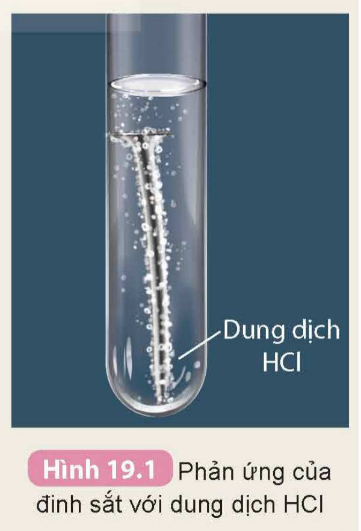
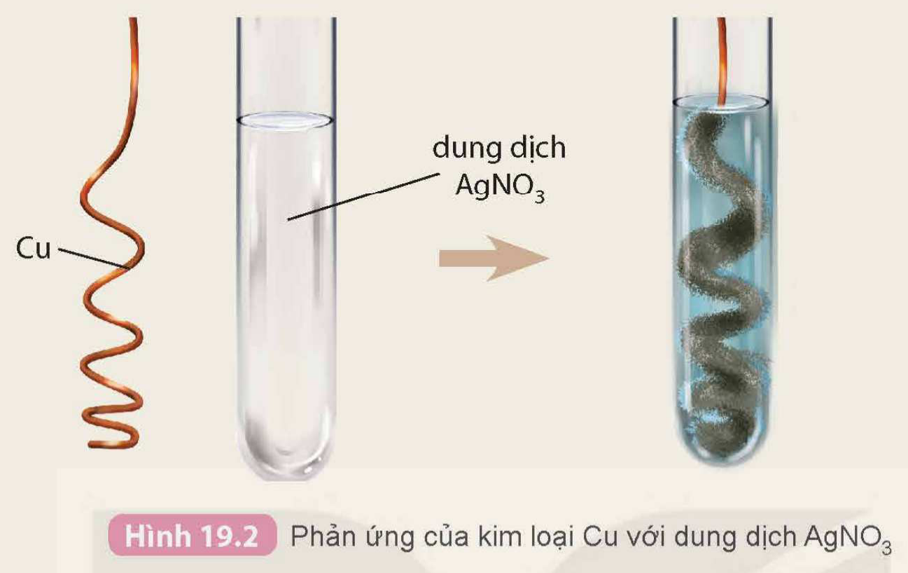

<!-- pdf:94 -->

# BÀI 19: DÃY HOẠT ĐỘNG HOÁ HỌC

## 🎯 Mục tiêu

- Tiến hành được một số thí nghiệm hoặc mô tả được thí nghiệm (qua hình vẽ hoặc học liệu điện tử thí nghiệm) khi cho kim loại tiếp xúc với nước, hydrochloric acid,...
- Nêu được dãy hoạt động hoá học ($\ce{K}$, $\ce{Na}$, $\ce{Ca}$, $\ce{Mg}$, $\ce{Al}$, $\ce{Zn}$, $\ce{Fe}$, $\ce{Pb}$, $\ce{H}$, $\ce{Cu}$, $\ce{Ag}$, $\ce{Au}$).
- Trình bày được ý nghĩa của dãy hoạt động hoá học.

## 🔴 Mở đầu

> Quan sát các đồ vật làm từ kim loại sắt, đồng, vàng, bạc,... xung quanh em. Đồ vật nào dễ bị gỉ? Từ đó, em có nhận xét gì về khả năng tham gia phản ứng hoá học của các kim loại này.

## I. Xây dựng dãy hoạt động hoá học

Khi quan sát phản ứng của kim loại với các chất khác nhau, có thể sắp xếp các kim loại thành dãy theo thứ tự khả năng phản ứng giảm dần. Dãy này được gọi là **dãy hoạt động hoá học**.

> ✋ **Sắp xếp mức độ hoạt động hoá học của: $\ce{Na}$, $\ce{Fe}$, $\ce{H}$, $\ce{Cu}$, $\ce{Ag}$**
>
> *1. Khảo sát phản ứng của các kim loại $\ce{Na}$, $\ce{Fe}$, $\ce{Cu}$ với nước*
>
> *Chuẩn bị:* 1 mẩu kim loại natri bằng hạt đậu xanh, đinh sắt và dây đồng; 2 ống nghiệm đựng nước được đánh số (1), (2), chậu thuỷ tinh đựng nước.
>
> *Tiến hành:* Cho mẩu natri vào chậu thuỷ tinh đựng nước, đinh sắt vào ống nghiệm (1), dây đồng vào ống nghiệm (2).
> (Phản ứng của kim loại natri với nước xem Hình 18.5, Bài 18).
>
> *Quan sát hiện tượng xảy ra và thực hiện các yêu cầu sau:*
>
> Dựa vào khả năng phản ứng với nước, có thể chia các kim loại natri, đồng và sắt thành mấy nhóm? So sánh mức độ hoạt động hoá học của các nhóm kim loại này.
>
> *2. Khảo sát phản ứng của kim loại $\ce{Fe}$, $\ce{Cu}$ với dung dịch acid*
>
> *Chuẩn bị:* đinh sắt, dây đồng, hai ống nghiệm đựng cùng một lượng dung dịch $\ce{HCl}$ cùng nồng độ.
>
> *Tiến hành:* Cho đinh sắt, dây đồng vào từng ống nghiệm riêng biệt đựng dung dịch $\ce{HCl}$.
>
> *Quan sát hiện tượng xảy ra và thực hiện các yêu cầu sau:*
>
> a) Hãy cho biết kim loại nào phản ứng được với dung dịch $\ce{HCl}$ (đẩy được hydrogen ra khỏi acid)?
>
> b) So sánh mức độ hoạt động hoá học của sắt, đồng với hydrogen.
>
> c) So sánh mức độ hoạt động hoá học của sắt với đồng.
>
> 
>
> Hình 19.1. Phản ứng của đinh sắt với dung dịch $\ce{HCl}$

<!-- pdf:95 -->

> *3. So sánh mức độ hoạt động hoá học của kim loại $\ce{Ag}$ và $\ce{Cu}$*
>
> *Chuẩn bị:* dây đồng, dung dịch $\ce{AgNO3}$ $2\%$; ống nghiệm, panh.
>
> *Tiến hành:* Dùng panh kẹp dây đồng đã được uốn thành hình lò xo đưa vào ống nghiệm chứa dung dịch $\ce{AgNO3}$ $2\%$.
>
> 
>
> Hình 19.2. Phản ứng của kim loại $\ce{Cu}$ với dung dịch $\ce{AgNO3}$
>
> *Quan sát hiện tượng xảy ra và thực hiện các yêu cầu sau:*
>
> a) Mô tả hiện tượng và viết phương trình hoá học của phản ứng xảy ra.
>
> b) So sánh mức độ hoạt động hoá học của kim loại đồng và bạc. Giải thích.
>
> c) Qua ba thí nghiệm ở trên, hãy sắp xếp mức độ hoạt động hoá học của các kim loại $\ce{Na}$, $\ce{Fe}$, $\ce{Cu}$, $\ce{Ag}$ và $\ce{H}$ thành dãy theo chiều giảm dần.

Bằng nhiều thí nghiệm khác nhau, người ta sắp xếp các kim loại và hydrogen thành dãy theo chiều giảm dần mức độ hoạt động hoá học:

$$\ce{K, Na, Ca, Mg, Al, Zn, Fe, Pb, H, Cu, Ag, Au}.$$

Dãy trên gọi là dãy hoạt động hoá học.

## II. Ý nghĩa dãy hoạt động hoá học

> ✋ **Tìm hiểu về ý nghĩa dãy hoạt động hoá học**
>
> Trình bày về ý nghĩa dãy hoạt động hoá học theo gợi ý sau:
>
> 1. Kim loại hoạt động hoá học mạnh như $\ce{K}$, $\ce{Na}$, $\ce{Ca}$ phản ứng với nước ở điều kiện thường tạo sản phẩm gì?
> 2. Kim loại đứng trước $\ce{H}$ phản ứng với dung dịch acid ($\ce{H2SO4}$ loãng, $\ce{HCl}$,...) tạo sản phẩm gì?
> 3. Nêu khái quát về vị trí trong dãy hoạt động của:
> - Kim loại hoạt động hoá học mạnh;
> - Kim loại hoạt động hoá học trung bình;
> - Kim loại hoạt động hoá học yếu.

<!-- pdf:96 -->

> ❓ Dự đoán hiện tượng xảy ra và viết phương trình hoá học của phản ứng (nếu có) trong các thí nghiệm sau:
>
> 1. Rót dung dịch $\ce{H2SO4}$ loãng vào 3 ống nghiệm, mỗi ống khoảng $3\text{ mL}$. Lần lượt cho vào mỗi ống nghiệm một mẩu kim loại trong số ba kim loại sau: $\ce{Mg}$, $\ce{Ag}$, $\ce{Zn}$.
> 2. Cho viên kẽm vào ống nghiệm chứa dung dịch $\ce{AgNO3}$.
> 3. Rót vào ba cốc thuỷ tinh loại $100\text{ mL}$, mỗi cốc $25\text{ mL}$ nước cất. Cho vào mỗi cốc một mẩu kim loại trong số ba kim loại sau: $\ce{Cu}$, $\ce{Fe}$, $\ce{Ca}$.

## 📌 Em đã học

- Dãy hoạt động hoá học được xây dựng từ thực nghiệm:
  $$\ce{K, Na, Ca, Mg, Al, Zn, Fe, Pb, H, Cu, Ag, Au}.$$

<!-- term: Ý nghĩa của dãy hoạt động hoá học -->
- Ý nghĩa của dãy hoạt động hoá học:
  - Từ trái sang phải, mức độ hoạt động hoá học giảm dần.
  - Các kim loại hoạt động hoá học mạnh như $\ce{K}$, $\ce{Na}$, $\ce{Ca}$,... tác dụng được với nước ở điều kiện thường, giải phóng khí hydrogen.
  - Kim loại đứng trước $\ce{H}$ có thể tác dụng với dung dịch acid, giải phóng khí hydrogen.
  - Kim loại đứng trước (trừ $\ce{K}$, $\ce{Na}$, $\ce{Ca}$,...) có thể đẩy kim loại đứng sau ra khỏi dung dịch muối.

## ✏️ Em có thể

Dự đoán được phản ứng hoá học của các kim loại với nước, dung dịch acid, dung dịch muối,...

## 📷 Danh sách hình trong bài

| Mã hình | Trang PDF | Vị trí trong bài | Chú thích gốc |
|---|---|---|---|
| H9-khoa_hoc_tu_nhien-b19-01 | 94 | Mục I | Hình 19.1. Phản ứng của đinh sắt với dung dịch HCl |
| H9-khoa_hoc_tu_nhien-b19-02 | 95 | Mục I | Hình 19.2. Phản ứng của kim loại Cu với dung dịch AgNO₃ |
