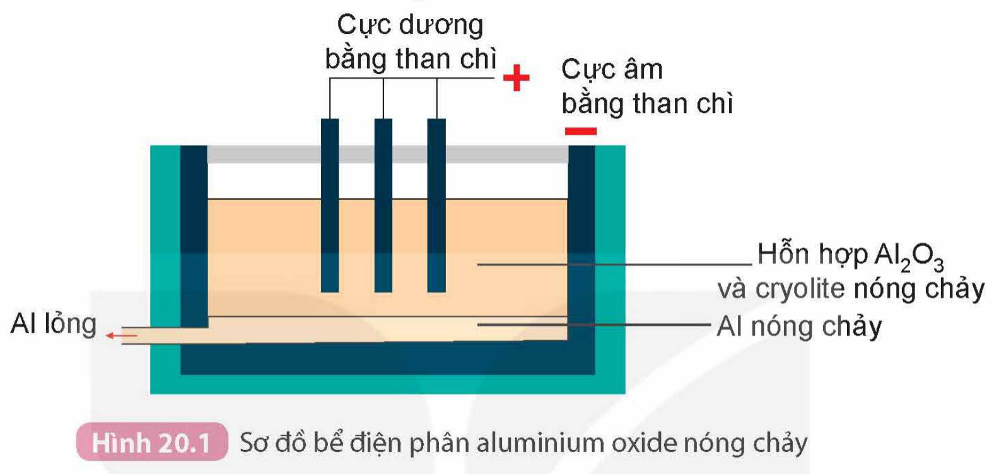
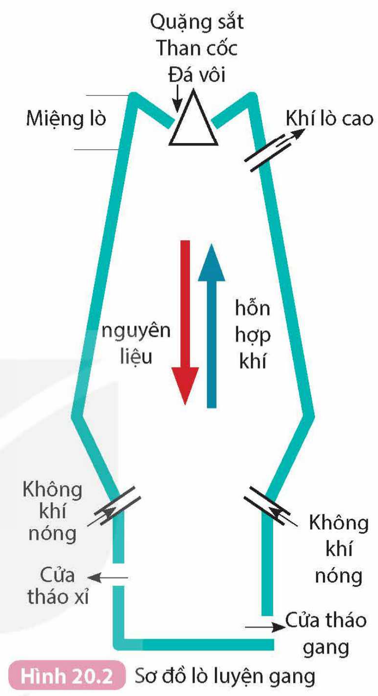
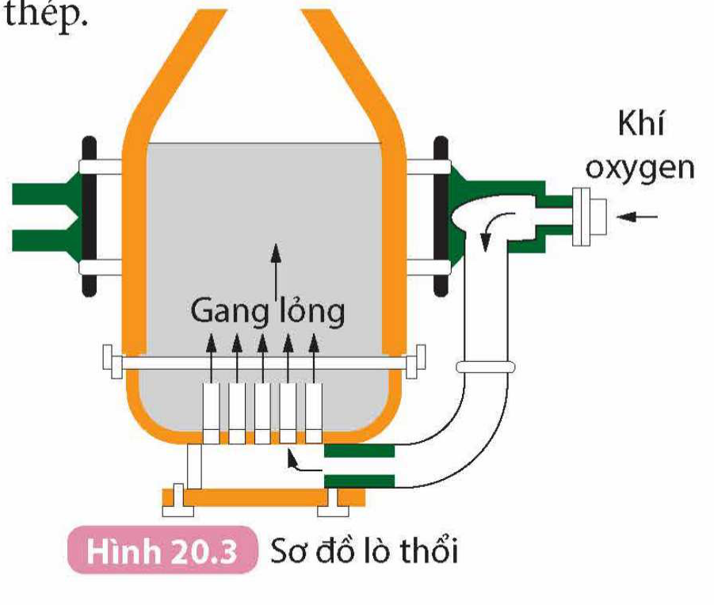

<!-- pdf:97 -->

# BÀI 20: TÁCH KIM LOẠI VÀ VIỆC SỬ DỤNG HỢP KIM

## 🎯 Mục tiêu

- Nêu được phương pháp tách kim loại theo mức độ hoạt động hoá học của chúng.
- Trình bày được quá trình tách một số kim loại có nhiều ứng dụng, như:
  + Tách sắt ra khỏi iron(III) oxide bởi carbon oxide;
  + Tách nhôm ra khỏi aluminium oxide bởi phản ứng điện phân;
  + Tách kẽm khỏi zinc sulfide bởi oxygen và carbon (than).
- Nêu được khái niệm hợp kim.
- Giải thích vì sao trong một số trường hợp thực tiễn, kim loại được sử dụng dưới dạng hợp kim.
- Nêu được thành phần, tính chất đặc trưng của một số hợp kim phổ biến, quan trọng, hiện đại.
- Trình bày được các giai đoạn cơ bản của quá trình sản xuất gang; quá trình sản xuất thép.

## 🔴 Mở đầu

> Kim loại được sử dụng rộng rãi trong đời sống. Chúng được tách từ nguồn nguyên liệu nào và sản xuất bằng cách nào?

## I. Phương pháp tách kim loại

Trong tự nhiên, kim loại chủ yếu tồn tại ở trong quặng dưới dạng hợp chất như oxide, muối. Ví dụ: aluminium oxide là thành phần chủ yếu trong quặng bauxite; iron(III) oxide là thành phần chủ yếu trong quặng hematite; zinc sulfide là thành phần chủ yếu trong quặng sphalerite. Một số kim loại quý như vàng có thể tồn tại dưới dạng đơn chất trong các hạt nhỏ li ti, nằm lẫn trong đất, cát.

<!-- term: Làm giàu quặng -->
Từ các quặng kim loại, người ta làm giàu quặng bằng cách loại bỏ các tạp chất như đất, cát, đá,... Sau đó, tuỳ thuộc vào mức độ hoạt động hoá học của kim loại, có thể lựa chọn phương pháp hoá học phù hợp để tách kim loại ra khỏi hợp chất của nó:

<!-- term: Phương pháp điện phân nóng chảy -->
- Phương pháp điện phân nóng chảy được áp dụng để tách các kim loại hoạt động hoá học mạnh như $\ce{Na}$, $\ce{Ca}$, $\ce{Mg}$, $\ce{Al}$,...

<!-- term: Phương pháp nhiệt luyện -->
- Phương pháp nhiệt luyện thường được dùng để tách các kim loại hoạt động hoá học trung bình như $\ce{Fe}$, $\ce{Zn}$,...: có thể dùng các chất như $\ce{C}$, $\ce{CO}$, $\ce{H2}$, $\ce{Al}$,... tác dụng với oxide kim loại ở nhiệt độ cao, thu được kim loại.

- Ngoài hai phương pháp trên, người ta còn dùng phương pháp thuỷ luyện để tách các kim loại hoạt động hoá học yếu như $\ce{Ag}$, $\ce{Au}$,...

> ❓ Nêu các bước cơ bản trong quy trình tách kim loại từ quặng.

<!-- pdf:98 -->

## II. Quá trình tách một số kim loại có nhiều ứng dụng

### 1. Tách nhôm ra khỏi aluminium oxide bằng phản ứng điện phân

*Nguyên liệu:* quặng bauxite (thành phần chính là $\ce{Al2O3}$).

*Quá trình điện phân nóng chảy:* Trong công nghiệp, nhôm được sản xuất bằng phương pháp điện phân aluminium oxide nóng chảy, theo phản ứng sau:

$$\ce{2Al2O3 ->[\text{Điện phân nóng chảy}][\text{Cryolite}^{(1)}] 4Al + 3O2}$$
<!-- ocr-ok: đã đối chiếu ảnh trang gốc 98 (trang in 96), phương trình điện phân aluminium oxide nóng chảy -->

Hình 20.1. Sơ đồ bể điện phân aluminium oxide nóng chảy

### 2. Tách sắt ra khỏi iron(III) oxide

Ở nhiệt độ cao, sắt được tách ra khỏi iron(III) oxide bởi carbon monoxide:

$$\ce{Fe2O3 + 3CO ->[t^\circ] 2Fe + 3CO2}$$
<!-- ocr-ok: đã đối chiếu ảnh trang gốc 98 (trang in 96), phương trình tách sắt bởi carbon monoxide -->

### 3. Tách kẽm ra khỏi zinc sulfide

Quặng chứa zinc sulfide ($\ce{ZnS}$) được đốt trong không khí để chuyển zinc sulfide thành zinc oxide ($\ce{ZnO}$):

$$\ce{2ZnS + 3O2 ->[t^\circ] 2ZnO + 2SO2}$$
<!-- ocr-ok: đã đối chiếu ảnh trang gốc 98 (trang in 96), phương trình đốt zinc sulfide -->

Tiếp theo, kẽm được tách ra khỏi zinc oxide bởi carbon:

$$\ce{ZnO + C ->[t^\circ] Zn + CO}$$
<!-- ocr-ok: đã đối chiếu ảnh trang gốc 98 (trang in 96), phương trình tách kẽm bởi carbon -->

> 🔍 **Phương pháp thuỷ luyện**
>
> Các hợp chất hoặc hỗn hợp các kim loại hoạt động hoá học yếu như bạc,... được chuyển thành muối tan. Sau đó dùng kim loại hoạt động hoá học mạnh hơn đẩy kim loại bạc ra khỏi muối, tách chúng ra khỏi dung dịch.

> ✋ 1. Hãy chỉ ra điểm giống nhau và khác nhau trong hai quá trình tách kẽm và tách sắt đã nêu ở trên.
> 2. Theo em, kim loại natri có thể tách bằng phương pháp nhiệt luyện như tách kẽm được không? Vì sao?

> (1) Cryolite dùng để hạ nhiệt độ nóng chảy của $\ce{Al2O3}$ nhằm tiết kiệm năng lượng.

<!-- pdf:99 -->

> ❓ 1. Phương pháp nào thường được dùng để tách các kim loại hoạt động hoá học mạnh như $\ce{K}$, $\ce{Na}$, $\ce{Al}$,...?
> 2. Phương pháp nào thường được dùng để tách các kim loại hoạt động hoá học trung bình như $\ce{Zn}$, $\ce{Fe}$?

## II. Hợp kim

### 1. Khái niệm hợp kim

**Hợp kim** là vật liệu kim loại có chứa ít nhất một kim loại cơ bản và một số kim loại hoặc phi kim khác.

**Kim loại cơ bản** là kim loại chiếm thành phần chính trong hợp kim.

Ví dụ: thép có kim loại cơ bản là sắt, đuy-ra (duralumin) có kim loại cơ bản là nhôm,...

### 2. Ưu điểm của hợp kim

Hợp kim thường có nhiều ưu điểm vượt trội so với kim loại nguyên chất về độ cứng, độ bền, khả năng chống ăn mòn và gỉ sét, phù hợp với nhiều ứng dụng. Do đó, chúng được sử dụng phổ biến trong đời sống và trong công nghiệp.

### 3. Một số hợp kim phổ biến

**Gang** và **thép** là hai hợp kim quan trọng của sắt với carbon và một số nguyên tố khác (carbon chiếm hàm lượng từ $2\%$ đến $5\%$ trong gang và dưới $2\%$ trong thép). Hiện nay, chúng là những vật liệu kim loại phổ biến nhất trên thế giới. Thép có nhiều ưu điểm hơn sắt về độ cứng, độ đàn hồi, khả năng chịu lực nên được sử dụng rộng rãi trong các công trình xây dựng, giao thông. Gang cứng và giòn hơn thép, thường được dùng để đúc các chi tiết máy, ống dẫn nước, nắp cống,...

**Inox** là một loại thép đặc biệt, ngoài sắt và carbon còn có các nguyên tố khác như chromium, nickel. Inox cứng và khó bị gỉ, được sử dụng làm đồ gia dụng, thiết bị y tế,...

**Đuy-ra** (**duralumin**) là hợp kim của nhôm với đồng, manganese, magnesium,... Đuy-ra nhẹ tương đương nhôm nhưng bền và cứng hơn nhiều, được dùng làm vật liệu chế tạo máy bay, ô tô,...

> ❓ 1. Thành phần, tính chất của kim loại và hợp kim của nó khác nhau như thế nào? Tại sao trong thực tiễn kim loại thường được sử dụng dưới dạng hợp kim. Lấy ví dụ minh hoạ.
> 2. Gang, thép, đuy-ra có thành phần và tính chất đặc trưng gì? Tại sao các hợp kim này được sử dụng phổ biến trong công nghiệp và cuộc sống?

> 🔍 Van nước cứu hoả của hệ thống dập lửa tự động có thể được làm từ hợp kim có nhiệt độ nóng chảy thấp. Ví dụ: hợp kim của bismuth ($50\%$), chì ($25\%$), thiếc ($12,5\%$) và cadmium ($12,5\%$) có nhiệt độ nóng chảy $55,5\text{ }^\circ\text{C}$ (trong khi nhiệt độ nóng chảy của các đơn chất $\ce{Bi}$, $\ce{Pb}$, $\ce{Sn}$ và $\ce{Cd}$ khá cao, tương ứng là $271\text{ }^\circ\text{C}$, $327\text{ }^\circ\text{C}$, $232\text{ }^\circ\text{C}$ và $321\text{ }^\circ\text{C}$). Điểm nóng chảy có thể được thay đổi bằng cách thay đổi thành phần. Hợp kim này được đặt tên là **hợp kim Wood** (theo tên của nhà phát minh William Wood)$^{(1)}$.

> (1) Nguồn: Cardarelli, F. 2018. Materials Handbook: A Concise Desktop Reference, Springer London.

<!-- pdf:100 -->

## III. Sản xuất gang, thép

Sắt tinh khiết hầu như không được sử dụng trong cuộc sống, nhưng các hợp kim của sắt là gang và thép lại được sử dụng phổ biến trong công nghiệp và đời sống.

### 1. Sản xuất gang từ nguồn quặng chứa iron(III) oxide

*Nguyên liệu:* quặng sắt (thường là quặng hematite với thành phần chính là $\ce{Fe2O3}$), than cốc và chất tạo xỉ như $\ce{CaCO3}$, $\ce{SiO2}$,...

Quặng sắt, than cốc, đá vôi được đưa vào lò cao qua miệng lò, chuyển dần từ trên xuống. Không khí nóng được thổi từ dưới lên.

*Các giai đoạn chính của quá trình sản xuất gang:*
- Phản ứng tạo thành khí $\ce{CO}$:

$$\ce{C + O2 ->[t^\circ] CO2}$$
<!-- ocr-ok: đã đối chiếu ảnh trang gốc 100 (trang in 98), phương trình tạo CO2 trong lò cao -->

$$\ce{C + CO2 ->[t^\circ] 2CO}$$
<!-- ocr-ok: đã đối chiếu ảnh trang gốc 100 (trang in 98), phương trình tạo CO trong lò cao -->

- Khí $\ce{CO}$ phản ứng với các oxide của sắt trong quặng:

$$\ce{3CO + Fe2O3 ->[t^\circ] 2Fe + 3CO2}$$
<!-- ocr-ok: đã đối chiếu ảnh trang gốc 100 (trang in 98), phương trình khử Fe2O3 bằng CO -->

Sắt nóng chảy hoà tan một lượng nhỏ carbon cùng một số nguyên tố khác tạo thành gang lỏng.
<!-- ocr-ok: đã đối chiếu ảnh trang gốc 100 (trang in 98), OCR đọc dính từ và sai dấu trong đoạn -->

- Đá vôi bị phân huỷ thành $\ce{CaO}$. $\ce{CaO}$ kết hợp với các oxide như $\ce{SiO2}$ trong quặng tạo thành xỉ:

$$\ce{CaO + SiO2 ->[t^\circ] CaSiO3}$$
<!-- ocr-ok: đã đối chiếu ảnh trang gốc 100 (trang in 98), phương trình tạo xỉ CaSiO3 -->

Xỉ nhẹ nổi lên trên gang lỏng, được đưa ra ngoài qua cửa tháo xỉ.

Khí thải tạo thành trong lò cao được đưa ra ngoài qua cửa ở gần miệng lò.

Hình 20.2. Sơ đồ lò luyện gang
<!-- ocr-ok: đã đối chiếu ảnh trang gốc 100 (trang in 98), OCR bỏ sót nhãn Hình 20.2 nền hồng -->

### 2. Sản xuất thép

<!-- term: Sản xuất thép -->
Nguyên liệu chính để sản xuất thép là gang (hoặc thép phế liệu) và khí oxygen. Trong quá trình sản xuất thép, khí oxygen được thổi vào lò đựng gang nóng chảy ở nhiệt độ cao, đốt cháy các tạp chất trong gang. Các oxide tạo thành ở dạng khí ($\ce{CO2}$, $\ce{SO2}$,...) sẽ thoát ra theo khí thải, còn các oxide dạng rắn ($\ce{SiO2}$, $\ce{MnO2}$,...) sẽ tạo xỉ nhẹ, nổi lên trên thép lỏng và được tách ra để thu lấy thép.

Hình 20.3. Sơ đồ lò thổi
<!-- ocr-ok: đã đối chiếu ảnh trang gốc 100 (trang in 98), OCR bỏ sót chú thích Hình 20.3 ở cuối trang -->

<!-- pdf:101 -->

> ✋ 1. Mô tả các giai đoạn chính của quá trình sản xuất gang. Viết phương trình hoá học của các phản ứng.
> 2. Tại sao khi loại bỏ một phần carbon và các tạp chất trong gang lại thu được thép?
> 3. Khí thải trong sản xuất gang, thép thường chứa các khí gì? Em hãy tìm hiểu và cho biết nếu các khí này được đưa thẳng ra ngoài môi trường mà không qua xử lí thì sẽ gây ảnh hưởng như thế nào tới môi trường sống.

> ❓ 1. Gang và thép có thành phần khác nhau như thế nào? Thành phần đó ảnh hưởng đến tính chất vật lí của gang, thép như thế nào? Nêu ví dụ về các ứng dụng nổi bật của gang và thép trong cuộc sống.
> 2. Phương pháp tách kim loại nào đã được vận dụng trong quá trình sản xuất gang? Giải thích.

## 📌 Em đã học

- Các bước cơ bản trong quy trình tách kim loại từ quặng:
  $$\text{Quặng} \xrightarrow{\text{Làm giàu quặng}} \text{Hợp chất chứa kim loại} \xrightarrow{\text{Phương pháp hoá học}} \text{Kim loại}.$$
- Một số phương pháp hoá học thường được sử dụng để tách kim loại:
  - Phương pháp điện phân nóng chảy.
  - Phương pháp nhiệt luyện.
  - Phương pháp thuỷ luyện.
- Hợp kim là vật liệu kim loại có chứa ít nhất một kim loại cơ bản và một số kim loại hoặc phi kim khác. Hợp kim thường có nhiều ưu điểm vượt trội so với kim loại nguyên chất như độ bền, độ cứng cao,...
- Giai đoạn chính sản xuất gang:
  - Tạo $\ce{CO}$: $\ce{C + O2 ->[t^\circ] CO2}$; $\ce{C + CO2 ->[t^\circ] 2CO}$.
  - Tạo gang từ quặng: $\ce{3CO + Fe2O3 ->[t^\circ] 2Fe + 3CO2}$.
  - Tạo xỉ, tách xỉ thu được gang: $\ce{CaO + SiO2 ->[t^\circ] CaSiO3}$.
- Quá trình sản xuất thép: Làm giảm các tạp chất $\ce{C}$, $\ce{Si}$, $\ce{Mn}$,... trong gang bằng cách chuyển chúng thành các oxide và loại bỏ chúng để thu được thép.

## ✏️ Em có thể

- Giải thích mối liên hệ giữa tính chất và ứng dụng của hợp kim.
- Trình bày (thuyết trình/viết/vẽ) về các giai đoạn cơ bản của quá trình sản xuất gang và quá trình sản xuất thép.

## 📷 Danh sách hình trong bài

| Mã hình | Trang PDF | Vị trí trong bài | Chú thích gốc |
|---|---|---|---|
| H9-khoa_hoc_tu_nhien-b20-01 | 98 | Mục II.1 | Hình 20.1. Sơ đồ bể điện phân aluminium oxide nóng chảy |
| H9-khoa_hoc_tu_nhien-b20-02 | 100 | Mục III.1 | Hình 20.2. Sơ đồ lò luyện gang |
| H9-khoa_hoc_tu_nhien-b20-03 | 100 | Mục III.2 (cạnh trên chạm chân chữ dòng văn bản mục III.2 sát đỉnh lò thổi) | Hình 20.3. Sơ đồ lò thổi |
