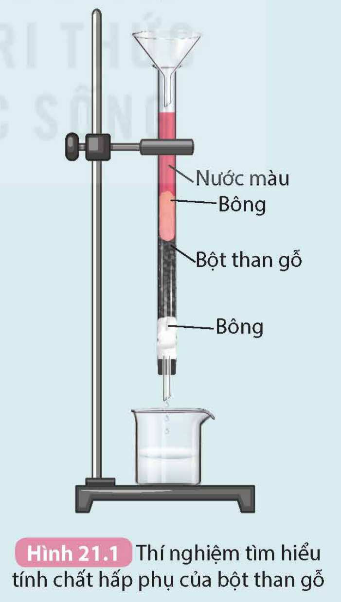
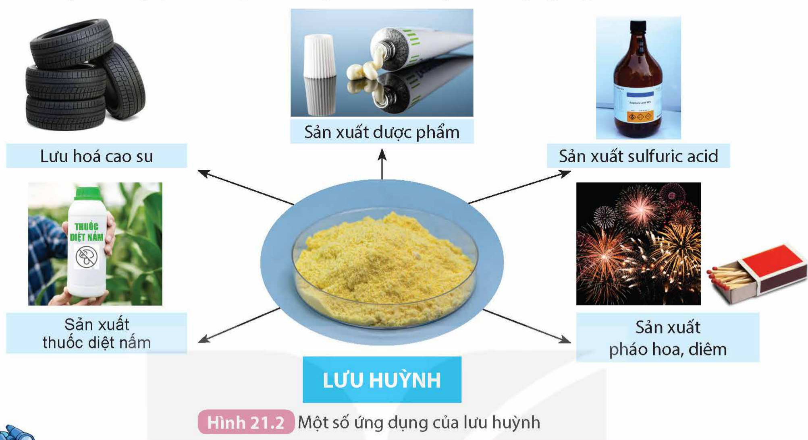

<!-- pdf:102 -->

# BÀI 21: SỰ KHÁC NHAU CƠ BẢN GIỮA PHI KIM VÀ KIM LOẠI

## 🎯 Mục tiêu

- Nêu được ứng dụng của một số đơn chất phi kim thiết thực trong cuộc sống (than, lưu huỳnh, khí chlorine,...).
- Chỉ ra được sự khác nhau cơ bản về một số tính chất giữa phi kim và kim loại: khả năng dẫn điện, nhiệt độ nóng chảy, nhiệt độ sôi, khối lượng riêng; khả năng tạo ion dương, ion âm; phản ứng với oxygen tạo oxide acid, oxide base.

## 🔴 Mở đầu

> Các phi kim như carbon, lưu huỳnh hay chlorine là những chất không thể thiếu trong công nghiệp cũng như cuộc sống hàng ngày. Tính chất của chúng có gì khác so với kim loại?

## I. Ứng dụng của một số phi kim quan trọng

### 1. Carbon

Trong tự nhiên, đơn chất carbon tồn tại ở các dạng chính như: kim cương, than chì (graphite), carbon vô định hình (than gỗ, than xương, mồ hóng,...).

<!-- term: Than hoạt tính -->
Các loại than như than gỗ, than xương,... có khả năng giữ trên bề mặt của nó các phân tử chất khí, chất tan trong dung dịch. Tính chất này được gọi là **tính hấp phụ**. Dựa vào tính hấp phụ, carbon ở dạng than hoạt tính được dùng trong mặt nạ phòng độc, chất khử màu, khử mùi.

Carbon còn có rất nhiều các ứng dụng khác như: than cốc dùng làm nhiên liệu, nguyên liệu trong công nghiệp luyện kim,...; than chì làm điện cực, chất bôi trơn, ruột bút chì,...; kim cương làm đồ trang sức, mũi khoan, dao cắt kính;...

> 🔍 Để tìm hiểu tính chất hấp phụ của bột than gỗ, có thể quan sát thí nghiệm sau: Rót từ từ nước màu pha loãng vào phễu, cho nước màu chảy qua lớp bột than gỗ. Dung dịch thu được trong cốc thủy tinh bị mất màu là do than gỗ đã giữ lại các phân tử chất màu trên bề mặt.
>
> 
>
> Hình 21.1. Thí nghiệm tìm hiểu tính chất hấp phụ của bột than gỗ

<!-- pdf:103 -->

### 2. Lưu huỳnh

Lưu huỳnh là nguyên liệu quan trọng cho nhiều ngành công nghiệp.

Hình 21.2. Một số ứng dụng của lưu huỳnh

> 🔍 **Lưu hoá cao su**
>
> Quá trình lưu hoá cao su được phát minh bởi Charles Goodyear vào năm 1839. Bản chất của quá trình lưu hoá cao su là quá trình tạo các cầu nối lưu huỳnh giữa các mạch cao su để hình thành một mạng lưới có kết cấu chắc chắn, đàn hồi hơn. Vì vậy, lưu hoá cao su là quá trình quan trọng để sản xuất các sản phẩm từ cao su như lốp xe, ống dẫn, dây cáp, đệm, quần áo bảo hộ,...

### 3. Chlorine

Chlorine có nhiều ứng dụng trong cuộc sống và trong các ngành công nghiệp như khử trùng nước sinh hoạt; sản xuất nước Javel, chất tẩy rửa,...; tẩy trắng vải, sợi, bột giấy,...; sản xuất chất dẻo,...

> ✋ Sử dụng Hình 21.2, kết hợp với những hiểu biết của em trong thực tế, em hãy trình bày một số ứng dụng của các phi kim như carbon, lưu huỳnh, chlorine, trong cuộc sống.

## II. Sự khác nhau giữa phi kim và kim loại

### 1. Sự khác nhau về tính chất vật lí

**a) Tính dẫn điện**

Trong khi các kim loại dẫn điện tốt thì phi kim thường không dẫn điện. Silicon tinh khiết là chất bán dẫn. Than chì có tính dẫn điện nhưng yếu hơn kim loại.

**b) Nhiệt độ nóng chảy, nhiệt độ sôi**

Phần lớn các phi kim có nhiệt độ nóng chảy, nhiệt độ sôi thấp hơn kim loại. Ở nhiệt độ thường, trong khi hầu hết các kim loại ở thể rắn (riêng thuỷ ngân ở thể lỏng) thì

<!-- pdf:104 -->

phi kim có thể tồn tại ở thể khí (hydrogen, nitrogen, oxygen, fluorine, chlorine,...), thể lỏng (bromine) hay thể rắn (carbon, silicon, phosphorus, lưu huỳnh,...).

**c) Khối lượng riêng**

Phần lớn phi kim có khối lượng riêng nhỏ hơn kim loại.

### 2. Sự khác nhau về tính chất hoá học

**a) Phản ứng của kim loại với phi kim**

Trong phản ứng hoá học, các kim loại dễ nhường electron để tạo ra ion dương, còn các phi kim dễ nhận electron tạo ion âm.

Ví dụ :

$$\ce{Na -> Na+ + 1e};$$

$$\ce{Cl + 1e -> Cl-};$$

$$\ce{2Na + Cl2 -> 2NaCl}.$$

**b) Phản ứng của phi kim và kim loại với oxygen**

Kim loại tác dụng với oxygen thường tạo thành oxide base, trong khi phi kim tác dụng với oxygen thường tạo thành oxide acid.

Ví dụ: $\ce{2Mg + O2 ->[t^\circ] 2MgO}$; $\qquad$ $\ce{S + O2 ->[t^\circ] SO2}$.

> ❓ 1. Giải thích tại sao trong phản ứng giữa kim loại và phi kim, phi kim thường nhận electron.
> 2. Lấy ví dụ minh hoạ sự khác nhau giữa kim loại và phi kim về tính chất vật lí và tính chất hoá học.

## 📌 Em đã học

- Phi kim có nhiều ứng dụng quan trọng: than hoạt tính có tính hấp phụ được dùng làm mặt nạ phòng độc, khử màu, khử mùi; than cốc là nhiên liệu, chất phản ứng trong nhiều ngành công nghiệp; lưu huỳnh là nguyên liệu sản xuất sulfuric acid; chlorine dùng để khử trùng, tẩy màu, sản xuất nhựa, hydrochloric acid,...
- Khác với kim loại, hầu hết các nguyên tố phi kim không dẫn điện; phần lớn phi kim có nhiệt độ nóng chảy, nhiệt độ sôi và khối lượng riêng nhỏ hơn so với kim loại.
- Trong các phản ứng giữa kim loại và phi kim, kim loại là chất nhường electron, phi kim là chất nhận electron. Nhiều kim loại tác dụng với oxygen tạo thành oxide base. Phi kim tác dụng với oxygen thường tạo thành oxide acid.

## ✏️ Em có thể

- Biết được ưu điểm của khẩu trang than hoạt tính so với khẩu trang thường.
- Biết được vai trò của than hoạt tính trong các máy lọc nước.

## 📷 Danh sách hình trong bài

| Mã hình | Trang PDF | Vị trí trong bài | Chú thích gốc |
|---|---|---|---|
| H9-khoa_hoc_tu_nhien-b21-01 | 102 | Mục I.1 | Hình 21.1. Thí nghiệm tìm hiểu tính chất hấp phụ của bột than gỗ |
| H9-khoa_hoc_tu_nhien-b21-02 | 103 | Mục I.2 (cạnh dưới chạm biểu tượng ống nhòm của hộp Lưu hoá cao su) | Hình 21.2. Một số ứng dụng của lưu huỳnh |
