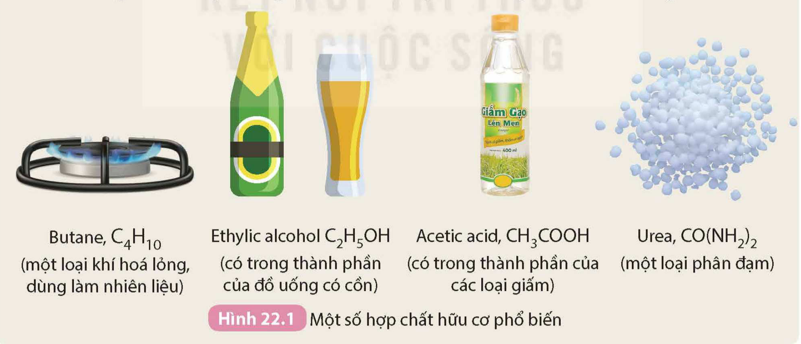
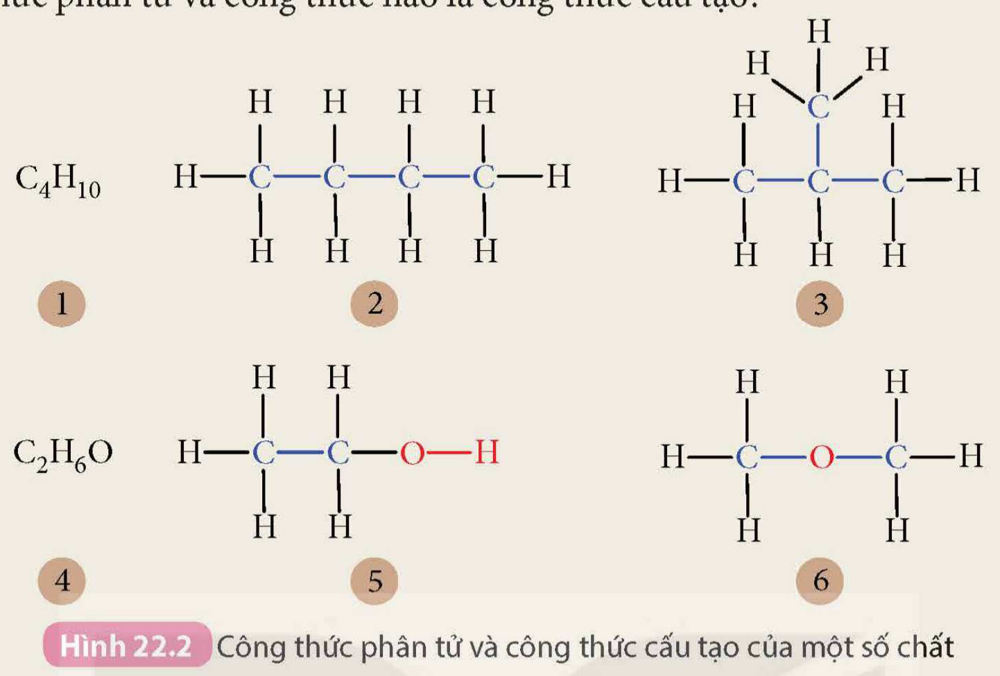
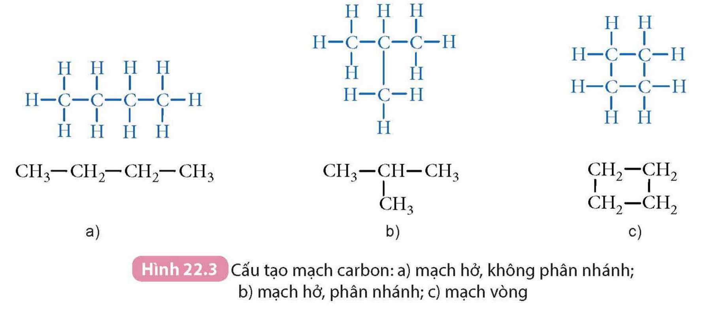

<!-- pdf:105 -->

# BÀI 22: GIỚI THIỆU VỀ HỢP CHẤT HỮU CƠ

## 🎯 Mục tiêu

- Nêu được khái niệm hợp chất hữu cơ, hoá học hữu cơ.
- Nêu được khái niệm công thức phân tử, công thức cấu tạo và ý nghĩa của nó; đặc điểm cấu tạo hợp chất hữu cơ.
- Phân biệt được chất vô cơ hay hữu cơ theo công thức phân tử.
- Trình bày được sự phân loại sơ bộ hợp chất hữu cơ gồm hydrocarbon và dẫn xuất của hydrocarbon.

## 🔴 Mở đầu

Hợp chất hữu cơ đóng vai trò thiết yếu cho sự sống phát triển. Số lượng hợp chất hữu cơ lớn hơn rất nhiều số lượng chất vô cơ và được ứng dụng trong hầu hết các lĩnh vực phục vụ đời sống con người. Hợp chất hữu cơ là gì và có gì khác biệt về cấu tạo so với hợp chất vô cơ?

## I. Khái niệm hợp chất hữu cơ và hoá học hữu cơ

> ✋ Quan sát công thức của các hợp chất hữu cơ phổ biến trong Hình 22.1 và cho biết đặc điểm chung về thành phần nguyên tố của các phân tử hợp chất hữu cơ là gì.
>
> 
>
> Hình 22.1. Một số hợp chất hữu cơ phổ biến

Hợp chất của carbon là **hợp chất hữu cơ**, trừ carbon monoxide, carbon dioxide, các muối carbonate,...

Ngành khoa học chuyên nghiên cứu về các hợp chất hữu cơ là một chuyên ngành của ngành Hoá học, được đặt tên là chuyên ngành **Hoá học hữu cơ**.

<!-- pdf:106 -->

> ❓ Hãy sắp xếp các hợp chất dưới đây thành hai nhóm: nhóm 1 gồm các hợp chất hữu cơ và nhóm 2 gồm các hợp chất vô cơ.
>
> $\ce{C6H6}$ &emsp; $\ce{H2SO4}$ &emsp; $\ce{C6H12O6}$ &emsp; $\ce{H2CO3}$ &emsp; $\ce{CaCO3}$ &emsp; $\ce{KNO3}$
>
> $\ce{C2H4}$ &emsp; $\ce{NaOH}$ &emsp; $\ce{Al2O3}$ &emsp; $\ce{CH3Cl}$ &emsp; $\ce{CH3OH}$

> 🔍 Thuật ngữ “hoá học hữu cơ” được nhà hoá học người Thuỵ Điển Jacob Berzelius đưa ra lần đầu tiên vào năm 1806, khi ông nghiên cứu các hợp chất có nguồn gốc sinh vật. Tại thời điểm đó, các nhà khoa học vẫn cho rằng các hợp chất hữu cơ chỉ được hình thành trong cơ thể sinh vật nhờ “lực sống”.
>
> Đến năm 1828, khi nhà hoá học người Đức Friedrich Wöhler tổng hợp thành công chất hữu cơ urea từ chất vô cơ thì thuật ngữ “hoá học hữu cơ” bắt đầu được hiểu như cách hiểu hiện nay.

## II. Công thức phân tử và công thức cấu tạo

Để hiểu rõ mối liên hệ giữa cấu tạo và tính chất của một chất hữu cơ, không chỉ cần quan tâm đến công thức phân tử của chất mà còn cần quan tâm đến cả công thức cấu tạo của chất đó.

**Công thức phân tử** là công thức cho biết thành phần nguyên tố và số lượng nguyên tử của mỗi nguyên tố trong phân tử.

**Công thức cấu tạo** là công thức cho biết trật tự liên kết và cách thức liên kết giữa các nguyên tử trong phân tử.

Trong công thức cấu tạo, liên kết cộng hoá trị giữa hai nguyên tử bằng một cặp electron dùng chung được gọi là **liên kết đơn**, biểu diễn bằng một gạch nối ($\ce{-}$); còn liên kết cộng hoá trị giữa hai nguyên tử bằng hai cặp electron dùng chung được gọi là **liên kết đôi**, biểu diễn bằng hai gạch nối ($\ce{=}$).

<!-- term: Công thức cấu tạo thu gọn -->
Công thức cấu tạo còn được viết dưới dạng thu gọn bằng cách viết gộp nguyên tử hydrogen vào nguyên tử liên kết với nó thành từng nhóm.

Ví dụ:

| Công thức phân tử | Công thức cấu tạo dạng đầy đủ | Công thức cấu tạo dạng thu gọn |
| :---: | :---: | :---: |
| $\ce{C2H6}$ | $\ce{H-\overset{\overset{\ce{H}}{|}}{\underset{\underset{\ce{H}}{|}}{C}}-\overset{\overset{\ce{H}}{|}}{\underset{\underset{\ce{H}}{|}}{C}}-H}$ | $\ce{CH3-CH3}$ |
| $\ce{C2H4}$ | $\ce{\overset{\displaystyle H}{\underset{\displaystyle H}{C}}=\overset{\displaystyle H}{\underset{\displaystyle H}{C}}}$ | $\ce{CH2=CH2}$ |
<!-- ocr-ok: đối chiếu trực tiếp ảnh trang PDF 106 (bảng ví dụ công thức phân tử và công thức cấu tạo của C2H6, C2H4) -->

<!-- pdf:107 -->

> ✋ 1. Em hãy cho biết trong các công thức từ (1) đến (6) trong Hình 22.2, công thức nào là công thức phân tử và công thức nào là công thức cấu tạo?
>
> 
>
> Hình 22.2. Công thức phân tử và công thức cấu tạo của một số chất
>
> 2. Hãy viết các công thức cấu tạo đầy đủ ở Hình 22.2 dưới dạng thu gọn.
>
> 3. So sánh công thức phân tử của:
>
> a) hợp chất (2) và (3);
>
> b) hợp chất (5) và (6).

## III. Đặc điểm cấu tạo hợp chất hữu cơ

Thành phần phân tử hợp chất hữu cơ nhất thiết phải chứa nguyên tố carbon, thường có các nguyên tố như hydrogen, oxygen, nitrogen, chlorine, sulfur,...

Có thể nhận thấy rằng các hợp chất hữu cơ được tạo thành chủ yếu từ các nguyên tố phi kim, vì vậy liên kết hoá học chủ yếu trong các hợp chất này là liên kết cộng hoá trị.

Trong phân tử hợp chất hữu cơ, carbon luôn có hoá trị IV, các nguyên tử carbon không chỉ có khả năng liên kết với nguyên tử của nguyên tố khác mà còn có thể liên kết với nhau tạo thành **mạch carbon** (Hình 22.3). Điều này dẫn đến hệ quả là có nhiều chất hữu cơ khác nhau nhưng lại có cùng công thức phân tử.

Hình 22.3. Cấu tạo mạch carbon: a) mạch hở, không phân nhánh; b) mạch hở, phân nhánh; c) mạch vòng

<!-- pdf:108 -->

Tính chất của hợp chất hữu cơ phụ thuộc đồng thời vào thành phần phân tử và cấu tạo hoá học của chúng (xem ví dụ trong Bảng 22.1).

Bảng 22.1. Sự phụ thuộc tính chất vào thành phần phân tử và cấu tạo hoá học của một số hợp chất hữu cơ

| Chất | Methyl chloride | Ethylic alcohol | Dimethyl ether |
| :--- | :---: | :---: | :---: |
| Công thức phân tử | $\ce{CH3Cl}$ | $\ce{C2H6O}$ | $\ce{C2H6O}$ |
| Công thức cấu tạo | $\ce{CH3-Cl}$ | $\ce{CH3-CH2-OH}$ | $\ce{CH3-O-CH3}$ |
| Tính chất vật lí | Chất khí, tan rất ít trong nước | Chất lỏng, tan vô hạn trong nước | Chất khí, tan ít trong nước |
| Tính chất hoá học | Không tác dụng với natri | Tác dụng với natri | Không tác dụng với natri |

> ✋ 1. Quan sát các Hình 22.2, 22.3 và cho biết: Phân tử hợp chất hữu cơ có những dạng mạch carbon nào? Chỉ ra các công thức cấu tạo có cùng công thức phân tử. Giải thích tại sao nhiều hợp chất hữu cơ khác nhau, tính chất khác nhau lại có cùng công thức phân tử.
>
> 2. Sử dụng bộ mô hình lắp ghép phân tử, lắp ghép các công thức cấu tạo có thể có từ các công thức phân tử $\ce{C4H10}$ và $\ce{C3H6}$.

## IV. Phân loại hợp chất hữu cơ

Có nhiều cơ sở khác nhau để phân loại hợp chất hữu cơ, trong đó phổ biến nhất là phân loại dựa trên thành phần nguyên tố. Trên cơ sở này hợp chất hữu cơ được chia làm hai loại:

- **Hydrocarbon** là loại hợp chất hữu cơ mà thành phần phân tử chỉ chứa các nguyên tố carbon và hydrogen.
- **Dẫn xuất của hydrocarbon** là loại hợp chất hữu cơ mà trong thành phần phân tử, ngoài nguyên tố carbon còn có nguyên tố khác như oxygen, nitrogen, chlorine,... và thường có hydrogen.

> ❓ Sắp xếp các chất sau đây vào một trong hai nhóm: hydrocarbon và dẫn xuất của hydrocarbon: $\ce{CH4}$, $\ce{CH3Cl}$, $\ce{CH2=CH2}$, $\ce{CH3CH2OH}$, $\ce{CH3COOH}$, $\ce{CH3NH2}$, $\ce{CH3CH2CH3}$, $\ce{CH3CH=CH2}$, $\ce{CH3COOCH2CH3}$.

## 📌 Em đã học

- Hợp chất của carbon là hợp chất hữu cơ (trừ $\ce{CO}$, $\ce{CO2}$, muối carbonate,...). Hợp chất hữu cơ được chia thành hai loại: hydrocarbon và dẫn xuất của hydrocarbon.
- Trong phân tử hợp chất hữu cơ, carbon luôn có hoá trị IV, các nguyên tử carbon có thể liên kết trực tiếp với nhau tạo thành mạch carbon.
- Công thức phân tử cho biết thành phần nguyên tố và số lượng nguyên tử của mỗi nguyên tố trong phân tử.
- Công thức cấu tạo cho biết trật tự liên kết và cách thức liên kết giữa các nguyên tử trong phân tử.

## ✏️ Em có thể

Phân biệt được hợp chất hữu cơ và vô cơ.

## 📷 Danh sách hình trong bài

| Mã hình | Trang PDF | Vị trí trong bài | Chú thích gốc |
|---|---|---|---|
| H9-khoa_hoc_tu_nhien-b22-01 | 105 | Mục I, hộp Hoạt động | Hình 22.1. Một số hợp chất hữu cơ phổ biến |
| H9-khoa_hoc_tu_nhien-b22-02 | 107 | Mục II, hộp Hoạt động (cạnh trên sát dòng câu hỏi 1) | Hình 22.2. Công thức phân tử và công thức cấu tạo của một số chất |
| H9-khoa_hoc_tu_nhien-b22-03 | 107 | Mục III | Hình 22.3. Cấu tạo mạch carbon: a) mạch hở, không phân nhánh; b) mạch hở, phân nhánh; c) mạch vòng |
