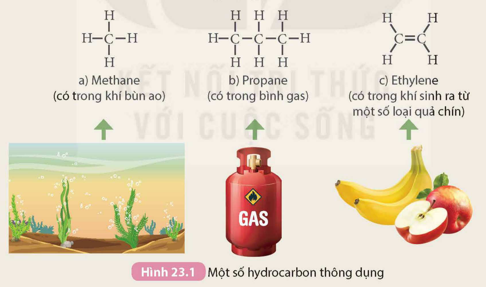
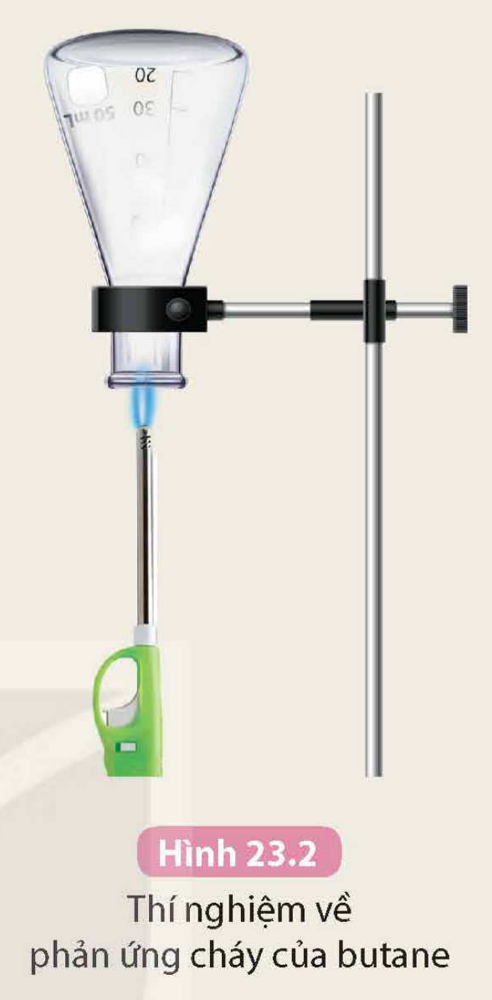
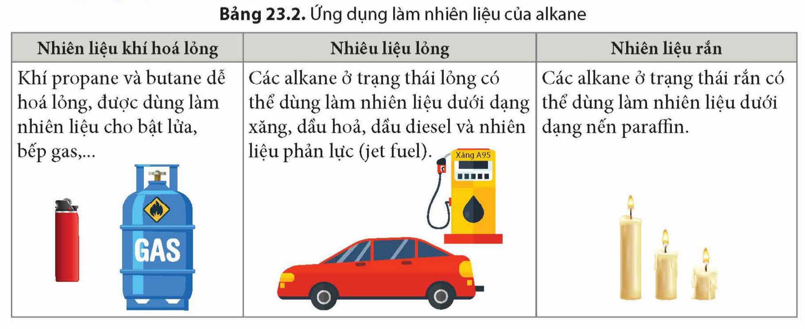

<!-- pdf:109 -->

# BÀI 23: ALKANE

## 🎯 Mục tiêu

- Nêu được khái niệm hydrocarbon, alkane.
- Viết được công thức cấu tạo và gọi tên được một số alkane đơn giản và thông dụng (C1 – C4).
- Viết được phương trình hoá học phản ứng đốt cháy của butane.
- Tiến hành được (hoặc quan sát qua học liệu điện tử) thí nghiệm đốt cháy butane từ đó rút ra được tính chất hoá học cơ bản của alkane.
- Trình bày được ứng dụng làm nhiên liệu của alkane trong thực tiễn.

## 🔴 Mở đầu

Khí mỏ dầu hoá lỏng (dùng cho bật lửa và bếp gas), xăng hay dầu (dùng cho xe máy, ô tô, máy bay,...) đều có thành phần chính là alkane. Dựa trên những tính chất gì mà các alkane được sử dụng làm nhiên liệu? Alkane còn có những ứng dụng gì khác?

## I. Khái niệm hydrocarbon, alkane

> ✋ Tìm hiểu về các hydrocarbon thông dụng
>
> 
>
> Hình 23.1. Một số hydrocarbon thông dụng
>
> *Quan sát Hình 23.1 và thực hiện các yêu cầu sau:*
>
> 1. Nhận xét đặc điểm chung về thành phần nguyên tố của ba chất trên.
>
> 2. So sánh đặc điểm cấu tạo (loại liên kết cộng hoá trị) giữa các nguyên tử trong phân tử của ba chất trên.

Hydrocarbon là loại hợp chất hữu cơ mà thành phần phân tử chỉ chứa các nguyên tố carbon và hydrogen. Hydrocarbon gồm nhiều loại khác nhau, như alkane, alkene,...

**Alkane** là những hydrocarbon mạch hở, phân tử chỉ chứa các liên kết đơn.

<!-- pdf:110 -->

> ❓ 1. Quan sát Hình 23.1 và cho biết hợp chất nào không thuộc loại alkane. Giải thích.
>
> 2. Xét các chất:
>
> (A) $\ce{CH3-CH3}$, &emsp; (B) $\ce{CH2=CH-CH3}$, &emsp; (C) $\ce{CH2=\underset{\underset{\ce{CH3}}{|}}{C}-CH3}$,
>
> (D) $\ce{CH3-CH2-OH}$, &emsp; (E) $\ce{CH3-COOH}$, &emsp; (G) $\ce{CH3-\underset{\underset{\ce{CH3}}{|}}{CH}-CH3}$,
>
> (H) $\ce{CH2=CH-CH=CH2}$, &emsp; (I) $\ce{CH4}$.
>
> Trong các chất trên, chất nào là hydrocarbon, chất nào là alkane? Giải thích.

## II. Cấu tạo phân tử và danh pháp của alkane

Bảng 23.1. Một số alkane (từ C1 đến C4)

| Công thức phân tử | Công thức cấu tạo dạng đầy đủ | Công thức cấu tạo dạng thu gọn | Tên gọi |
| :---: | :---: | :---: | :---: |
| $\ce{CH4}$ | $\ce{H-\overset{\overset{\ce{H}}{|}}{\underset{\underset{\ce{H}}{|}}{C}}-H}$ | $\ce{CH4}$ | Methane |
| $\ce{C2H6}$ | $\ce{H-\overset{\overset{\ce{H}}{|}}{\underset{\underset{\ce{H}}{|}}{C}}-\overset{\overset{\ce{H}}{|}}{\underset{\underset{\ce{H}}{|}}{C}}-H}$ | $\ce{CH3-CH3}$ | Ethane |
| $\ce{C3H8}$ | $\ce{H-\overset{\overset{\ce{H}}{|}}{\underset{\underset{\ce{H}}{|}}{C}}-\overset{\overset{\ce{H}}{|}}{\underset{\underset{\ce{H}}{|}}{C}}-\overset{\overset{\ce{H}}{|}}{\underset{\underset{\ce{H}}{|}}{C}}-H}$ | $\ce{CH3-CH2-CH3}$ | Propane |
| $\ce{C4H10}$ | $\ce{H-\overset{\overset{\ce{H}}{|}}{\underset{\underset{\ce{H}}{|}}{C}}-\overset{\overset{\ce{H}}{|}}{\underset{\underset{\ce{H}}{|}}{C}}-\overset{\overset{\ce{H}}{|}}{\underset{\underset{\ce{H}}{|}}{C}}-\overset{\overset{\ce{H}}{|}}{\underset{\underset{\ce{H}}{|}}{C}}-H}$ | $\ce{CH3-CH2-CH2-CH3}$ | Butane |
<!-- ocr-ok: đối chiếu trực tiếp ảnh trang PDF 110 (Bảng 23.1 công thức cấu tạo và tên gọi alkane C1 đến C4) -->

> ✋ *Đọc thông tin trong Bảng 23.1 và thực hiện các yêu cầu sau:*
>
> 1. Trong công thức phân tử của alkane, khi tăng thêm một nguyên tử carbon thì số nguyên tử hydrogen tăng thêm là bao nhiêu?
>
> 2. Hãy cho biết tên gọi của các alkane trong Bảng 23.1 có đặc điểm gì giống nhau và khác nhau.

Thành phần phân tử của các alkane hơn kém nhau một hay nhiều nhóm $\ce{CH2}$. Alkane có công thức chung là $\ce{C_nH_{2n+2}}$ ($n \ge 1$, $n$ là số nguyên, dương).

<!-- pdf:111 -->

## III. Phản ứng cháy của alkane

> ✋ Thí nghiệm: Tìm hiểu về phản ứng cháy của butane
>
> *Chuẩn bị:* Bật lửa gas (chứa butane) loại dài (loại dùng để mồi lửa bếp gas, bếp cồn); bình tam giác bằng thuỷ tinh chịu nhiệt, sạch và khô, có nút; ống nghiệm đựng dung dịch nước vôi trong.
>
> *Tiến hành:*
>
> - Đưa đầu bật lửa vào miệng bình tam giác úp ngược, đánh lửa và giữ lửa cháy cho tới khi thấy thành bình tam giác mờ đi thì dừng lại (Hình 23.2).
> - Quay xuôi bình tam giác lại và đổ nước vôi trong vào. Sau đó, đậy bình tam giác bằng nút và lắc đều.
>
> *Thực hiện yêu cầu sau:*
>
> 1. Nhận xét hiện tượng bên trong thành bình tam giác sau khi đánh lửa bật lửa gas để đốt cháy butane. Dự đoán sản phẩm tạo thành.
>
> 2. Quan sát hiện tượng xảy ra trong bình tam giác sau khi cho nước vôi trong vào bình và dự đoán sản phẩm tạo thành.
>
> 
>
> Hình 23.2. Thí nghiệm về phản ứng cháy của butane

Khi đốt cháy alkane trong không khí thu được sản phẩm chủ yếu là khí carbon dioxide và hơi nước:

$$\ce{C3H8 + 5O2 ->[t^\circ] 3CO2 + 4H2O}$$
<!-- ocr-ok: đối chiếu trực tiếp ảnh trang PDF 111 (phương trình đốt cháy propane) -->

$$\ce{C4H10 + \frac{13}{2}O2 ->[t^\circ] 4CO2 + 5H2O}$$
<!-- ocr-ok: đối chiếu trực tiếp ảnh trang PDF 111 (phương trình đốt cháy butane) -->

Phản ứng cháy của alkane toả nhiệt mạnh, vì vậy alkane được sử dụng làm nhiên liệu trong cuộc sống và trong sản xuất.

Bên cạnh các sản phẩm trên, một phần alkane cháy không hoàn toàn tạo một lượng nhỏ sản phẩm là muội than (một dạng đơn chất của carbon) và carbon monoxide.

Các alkane khá bền nên ở điều kiện thường, chúng không phản ứng với các acid, base và nhiều chất khác.

> ❓ 1.
>
> a) Viết phương trình hoá học biểu diễn phản ứng cháy của methane và ethane.
>
> b) Dùng công thức chung của alkane, viết phương trình hoá học tổng quát của phản ứng đốt cháy hoàn toàn alkane tạo sản phẩm là carbon dioxide và nước.
>
> 2. Giả thiết rằng gas trong bình gas là một hỗn hợp propane và butane có tỉ lệ thể tích $1 : 1$. Tính nhiệt lượng sinh ra khi đốt cháy $1\text{ kg}$ loại gas này. Biết rằng nhiệt lượng tương ứng sinh ra khi đốt cháy $1\text{ mol}$ mỗi chất propane và butane lần lượt là $2\,220\text{ kJ}$ và $2\,878\text{ kJ}$.

<!-- pdf:112 -->

## IV. Ứng dụng làm nhiên liệu của alkane

Bảng 23.2. Ứng dụng làm nhiên liệu của alkane

| Nhiên liệu khí hoá lỏng | Nhiêu liệu lỏng | Nhiên liệu rắn |
| :--- | :--- | :--- |
| Khí propane và butane dễ hoá lỏng, được dùng làm nhiên liệu cho bật lửa, bếp gas,... | Các alkane ở trạng thái lỏng có thể dùng làm nhiên liệu dưới dạng xăng, dầu hoả, dầu diesel và nhiên liệu phản lực (jet fuel). | Các alkane ở trạng thái rắn có thể dùng làm nhiên liệu dưới dạng nến paraffin. |

> ❓ 1. Đọc thông tin trong Bảng 23.2 và trình bày các ứng dụng chủ yếu của alkane.
>
> 2. Bảng dưới đây cho biết nhiệt lượng toả ra khi đốt cháy hoàn toàn $1\text{ mol}$ alkane$^{(1)}$.
>
> | Alkane | Công thức phân tử | Khối lượng mol phân tử ($\text{gam/mol}$) | Nhiệt lượng ($\text{kJ/mol}$) |
> | :---: | :---: | :---: | :---: |
> | Methane | $\ce{CH4}$ | $16$ | $891$ |
> | Ethane | $\ce{C2H6}$ | $30$ | $1\,561$ |
> | Propane | $\ce{C3H8}$ | $44$ | $2\,220$ |
> | Butane | $\ce{C4H10}$ | $58$ | $2\,878$ |
>
> a) Tính nhiệt lượng toả ra khi đốt cháy hoàn toàn $1\text{ gam}$ mỗi alkane trong bảng trên.
>
> b) Đốt cháy $1\text{ gam}$ alkane nào trong số các alkane ở trên sẽ toả ra nhiều nhiệt lượng nhất?

## 📌 Em đã học

- Hydrocarbon là hợp chất hữu cơ mà thành phần phân tử chỉ chứa các nguyên tố carbon và hydrogen.
- Alkane là những hydrocarbon mạch hở, phân tử chỉ chứa các liên kết đơn, có công thức chung $\ce{C_nH_{2n+2}}$ ($n \ge 1$, $n$ là số nguyên, dương).
- Phản ứng cháy của alkane trong không khí tạo sản phẩm chủ yếu là carbon dioxide và nước. Phản ứng này toả nhiệt mạnh nên alkane được dùng làm nhiên liệu dưới nhiều hình thức khác nhau như khí hoá lỏng, nhiên liệu lỏng và nhiên liệu rắn.

## ✏️ Em có thể

- Nêu được ứng dụng làm nhiên liệu của các alkane.
- Sử dụng nhiên liệu như gas, xăng, dầu hoả tiết kiệm, hiệu quả.

> $^{(1)}$ Nguồn: Haynes, W. M., Lide, D. R. & Bruno, T. J. 2017. *CRC Handbook of Chemistry and Physics*, 97th Edition, CRC Press LLC.
<!-- ocr-ok: đối chiếu trực tiếp ảnh trang PDF 112 (chú thích chân trang chữ nhỏ) -->

## 📷 Danh sách hình trong bài

| Mã hình | Trang PDF | Vị trí trong bài | Chú thích gốc |
|---|---|---|---|
| H9-khoa_hoc_tu_nhien-b23-01 | 109 | Mục I, hộp Hoạt động | Hình 23.1. Một số hydrocarbon thông dụng |
| H9-khoa_hoc_tu_nhien-b23-02 | 111 | Mục III, hộp Hoạt động | Hình 23.2. Thí nghiệm về phản ứng cháy của butane |
| H9-khoa_hoc_tu_nhien-b23-03 | 112 | Mục IV | Bảng 23.2. Ứng dụng làm nhiên liệu của alkane |
