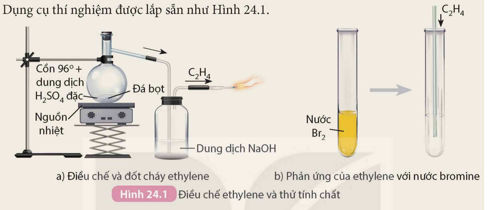
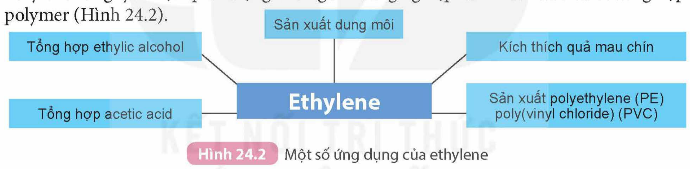

<!-- pdf:113 -->

# BÀI 24: ALKENE

## 🎯 Mục tiêu

- Nêu được khái niệm về alkene.
- Viết được công thức cấu tạo và nêu được tính chất vật lí của ethylene.
- Trình bày được tính chất hoá học của ethylene (phản ứng cháy, phản ứng làm mất màu nước bromine, phản ứng trùng hợp). Viết được các phương trình hoá học xảy ra.
- Tiến hành được thí nghiệm (hoặc quan sát thí nghiệm) của ethylene: phản ứng đốt cháy, phản ứng làm mất màu nước bromine, quan sát và giải thích được tính chất hoá học cơ bản của alkene.
- Trình bày được một số ứng dụng của ethylene: tổng hợp ethylic alcohol, tổng hợp nhựa polyethylene (PE).

## 🔴 Mở đầu

Khí ethylene có tác dụng thúc đẩy quá trình chín của trái cây. Ethylene thuộc loại hợp chất hữu cơ nào? Ethylene có cấu tạo, tính chất như thế nào và có vai trò gì trong công nghiệp hoá chất?

## I. Khái niệm alkene

> ✋ Cho công thức cấu tạo của một số alkene như sau:
>
> $\ce{CH2=CH2}$ &emsp;&emsp; $\ce{CH3-CH=CH2}$ &emsp;&emsp; $\ce{CH3-CH=CH-CH3}$
>
> *Thực hiện các yêu cầu sau:*
>
> 1. Nhận xét về đặc điểm chung của các công thức cấu tạo đã cho.
>
> 2. Viết công thức phân tử của các alkene trên, từ đó rút ra công thức chung của các alkene đó.

**Alkene** là những hydrocarbon mạch hở, trong phân tử có một liên kết đôi $\text{>}\ce{C=C}\text{<}$.

Công thức chung của các alkene có dạng $\ce{C_nH_{2n}}$ (với $n \ge 2$, $n$ là các số nguyên, dương).

## II. Ethylene

### 1. Tính chất vật lí

<!-- term: Ethylene -->
Ethylene là chất khí ở điều kiện thường (hoá lỏng ở $-104\ ^\circ\text{C}$ và hoá rắn ở $-169\ ^\circ\text{C}$$^{(1)}$), không màu, hầu như không tan trong nước, tan ít trong các dung môi hữu cơ như ethylic alcohol.

### 2. Cấu tạo phân tử

<!-- term: Ethylene -->
Công thức phân tử của ethylene là $\ce{C2H4}$. Công thức cấu tạo của ethylene là $\ce{\overset{\displaystyle H}{\underset{\displaystyle H}{C}}=\overset{\displaystyle H}{\underset{\displaystyle H}{C}}}$.

<!-- term: Ethylene -->
Phân tử ethylene có liên kết đôi $\text{>}\ce{C=C}\text{<}$, trong đó có một liên kết kém bền, dễ bị phá vỡ trong các phản ứng hoá học.

> $^{(1)}$ Nguồn: Haynes, W. M., Lide, D. R. & Bruno, T. J. 2017. *CRC Handbook of Chemistry and Physics*, 97th Edition, CRC Press LLC.
<!-- ocr-ok: đối chiếu trực tiếp ảnh trang PDF 113 (chú thích chân trang chữ nhỏ) -->

<!-- pdf:114 -->

### 3. Tính chất hoá học

> ✋ Thí nghiệm: Điều chế và thử tính chất của ethylene
>
> *Chuẩn bị:* bình cầu có nhánh $250\text{ mL}$ đựng dung dịch cồn $96^\circ$ và dung dịch $\ce{H2SO4}$ đặc đã được trộn đều, đá bọt, ống nghiệm chứa khoảng $2\text{ mL}$ nước bromine, bình thuỷ tinh chứa dung dịch $\ce{NaOH}$, ống dẫn thuỷ tinh đầu vuốt nhọn, ống dẫn thuỷ tinh hình chữ L.
>
> Dụng cụ thí nghiệm được lắp sẵn như Hình 24.1.
>
> 
>
> Hình 24.1. Điều chế ethylene và thử tính chất
>
> *Tiến hành:*
>
> - Đun nóng bình cầu đến khi khí ethylene sinh ra và đi vào ống dẫn thuỷ tinh có đầu vuốt nhọn. Dùng que đóm đang cháy để đốt ethylene ở đầu vuốt nhọn của ống dẫn.
> - Thay ống dẫn thuỷ tinh đầu vuốt nhọn bằng ống dẫn thuỷ tinh hình chữ L và dẫn khí ethylene vào ống nghiệm đựng nước bromine.
>
> *Thực hiện các yêu cầu sau:*
>
> Quan sát hiện tượng xảy ra ở đầu ống dẫn thuỷ tinh vuốt nhọn và tại ống nghiệm đựng nước bromine. Rút ra nhận xét về tính chất hoá học của ethylene.

**a) Phản ứng cháy**

Tương tự alkane, phản ứng đốt cháy các alkene tạo ra sản phẩm chủ yếu là khí carbon dioxide và hơi nước. Phản ứng toả ra nhiều nhiệt.

$$\ce{C2H4 + 3O2 ->[t^\circ] 2CO2 + 2H2O}$$
<!-- ocr-ok: đối chiếu trực tiếp ảnh trang PDF 114 (phương trình đốt cháy ethylene) -->

**b) Phản ứng cộng**

Trong phản ứng của ethylene với nước bromine, phân tử bromine đã cộng hợp vào nối đôi $\text{>}\ce{C=C}\text{<}$ trong phân tử ethylene, liên kết kém bền trong liên kết đôi bị phá vỡ, tạo thành sản phẩm 1,2-dibromoethane theo phản ứng sau:

$$\ce{\underset{\text{Ethylene}}{CH2=CH2} + Br-Br -> \underset{\text{1,2-Dibromoethane}}{\overset{1}{\underset{\underset{\ce{Br}}{|}}{CH2}}-\overset{2}{\underset{\underset{\ce{Br}}{|}}{CH2}}}}$$
<!-- ocr-ok: đối chiếu trực tiếp ảnh trang PDF 114 (phương trình cộng bromine vào ethylene) -->

Viết gọn lại là: $\ce{C2H4 + Br2 -> C2H4Br2}$

Phản ứng trên gọi là **phản ứng cộng**.

<!-- pdf:115 -->

**c) Phản ứng trùng hợp**

Ở điều kiện thích hợp, các phân tử ethylene cộng hợp liên tiếp với nhau, liên kết kém bền trong liên kết đôi của phân tử ethylene bị phá vỡ, tạo thành chất có khối lượng phân tử lớn, theo phương trình hoá học sau:

$$\ce{...CH2=CH2 + CH2=CH2 + CH2=CH2... ->[t^\circ, p,\text{ xúc tác}] ...-CH2-CH2-CH2-CH2-CH2-CH2-...}$$
<!-- ocr-ok: đối chiếu trực tiếp ảnh trang PDF 115 (sơ đồ cộng hợp liên tiếp các phân tử ethylene) -->

Phản ứng trên gọi là **phản ứng trùng hợp**.

Phản ứng trùng hợp ethylene có thể viết như sau:

$$\ce{\underset{\text{Ethylene}}{nCH2=CH2} ->[t^\circ, p,\text{ xúc tác}] \underset{\text{Polyethylene}}{(-CH2-CH2-)_n}}$$
<!-- ocr-ok: đối chiếu trực tiếp ảnh trang PDF 115 (phương trình trùng hợp ethylene tạo polyethylene) -->

<!-- term: Polyethylene -->
Polyethylene (nhựa PE) là chất rắn, không tan trong nước, không độc, được dùng để sản xuất túi đựng, màng bọc, chai, bình chứa,... Tuy nhiên, nhựa PE rất khó phân huỷ sinh học, có thể tồn tại bền trong môi trường hàng trăm năm, vì vậy cần giảm thiểu việc thải các sản phẩm làm từ nhựa PE ra ngoài môi trường.

> ❓ Propylene là một alkene, có công thức cấu tạo $\ce{CH3-CH=CH2}$. Propylene có tính chất hoá học tương tự ethylene không? Tại sao? Viết các phương trình hoá học minh hoạ.

### 4. Ứng dụng

Ethylene là nguyên liệu quan trọng cho ngành công nghiệp sản xuất hoá chất và tổng hợp polymer (Hình 24.2).

Hình 24.2. Một số ứng dụng của ethylene

> ✋ Em hãy tìm các hình ảnh minh hoạ và viết bài trình bày về các ứng dụng của ethylene.

## 📌 Em đã học

- Alkene là những hydrocarbon mạch hở, phân tử có một liên kết đôi, công thức chung có dạng $\ce{C_nH_{2n}}$ ($n \ge 2$, $n$ là số nguyên, dương).
- Ethylene là chất khí, không màu, không mùi, ít tan trong nước.
- Ethylene và các alkene khác có các tính chất hoá học sau: tham gia phản ứng cộng, phản ứng trùng hợp, phản ứng cháy,...
- Ethylene là một nguyên liệu quan trọng trong công nghiệp hoá chất và tổng hợp polymer.

## ✏️ Em có thể

Nhận biết và lựa chọn được các sản phẩm làm từ nguyên liệu polyethylene và sử dụng chúng đúng cách để bảo vệ môi trường.

## 📷 Danh sách hình trong bài

| Mã hình | Trang PDF | Vị trí trong bài | Chú thích gốc |
|---|---|---|---|
| H9-khoa_hoc_tu_nhien-b24-01 | 114 | Mục II.3, hộp Hoạt động | Hình 24.1. Điều chế ethylene và thử tính chất |
| H9-khoa_hoc_tu_nhien-b24-02 | 115 | Mục II.4 (cạnh trên sát dòng chữ 'polymer (Hình 24.2).') | Hình 24.2. Một số ứng dụng của ethylene |
