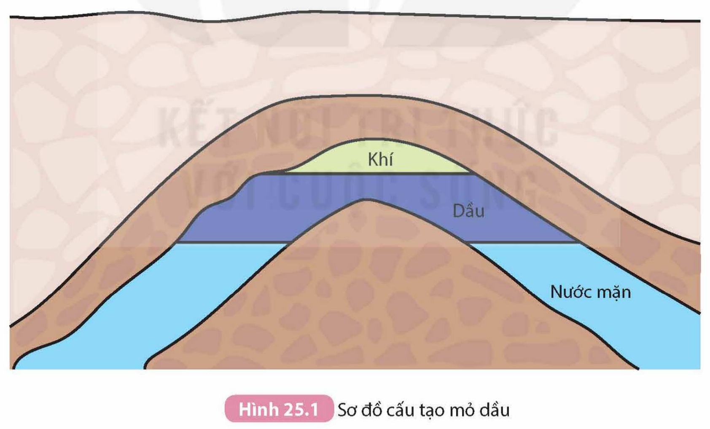
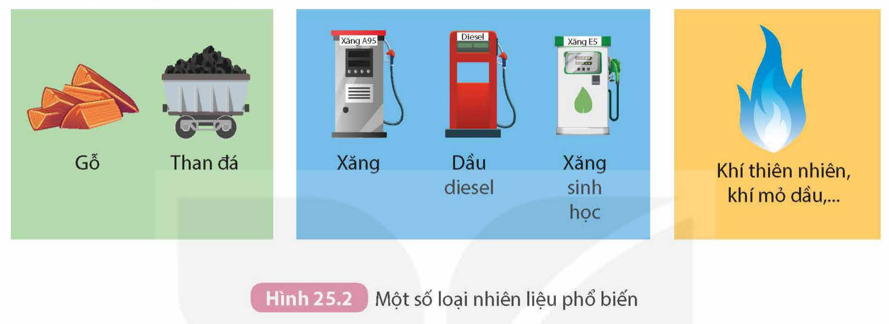

<!-- pdf:116 -->

# BÀI 25: NGUỒN NHIÊN LIỆU

## 🎯 Mục tiêu

- Nêu được khái niệm, thành phần, trạng thái tự nhiên của dầu mỏ, khí thiên nhiên và khí mỏ dầu.
- Trình bày được phương pháp khai thác dầu mỏ, khí thiên nhiên và khí mỏ dầu; một số sản phẩm chế biến từ dầu mỏ; ứng dụng của dầu mỏ và khí thiên nhiên (là nguồn nhiên liệu và nguyên liệu quý trong công nghiệp).
- Nêu được khái niệm về nhiên liệu, các dạng nhiên liệu phổ biến (rắn, lỏng, khí).
- Trình bày được cách sử dụng nhiên liệu (gas, dầu hoả, than,...), từ đó có cách ứng xử thích hợp đối với việc sử dụng nhiên liệu (gas, xăng, dầu hoả, than,...) trong cuộc sống.

## 🔴 Mở đầu

Hydrocarbon là thành phần chính của dầu mỏ, khí thiên nhiên và khí mỏ dầu. Hydrocarbon vừa là nguồn nhiên liệu, vừa là nguồn nguyên liệu quý. Chúng được khai thác và sử dụng như thế nào?

## I. Dầu mỏ, khí mỏ dầu và khí thiên nhiên

### 1. Khái niệm, thành phần và trạng thái tự nhiên

Hình 25.1. Sơ đồ cấu tạo mỏ dầu

> ✋ 1. Quan sát sơ đồ trên Hình 25.1 và trình bày cấu tạo của mỏ dầu.
>
> 2. Tìm hiểu qua các tài liệu sách, báo, internet, thảo luận nhóm và trình bày về các nội dung sau:
>
> a) Dầu mỏ và khí mỏ dầu tồn tại ở đâu trong tự nhiên? Nguyên nhân dẫn đến sự hình thành dầu mỏ và khí mỏ dầu là gì?
>
> b) Các ứng dụng của dầu mỏ và khí mỏ dầu là gì?

<!-- pdf:117 -->

**Dầu mỏ** là nhiên liệu hoá thạch, có trong vỏ Trái Đất. Thành phần chính của dầu mỏ là các hydrocarbon. Thành phần dầu mỏ có thể khác nhau tùy thuộc vào vị trí mỏ dầu.

Trong tự nhiên, dầu mỏ thường tập trung thành những khu vực ở trong lòng đất, gọi là các **mỏ dầu**. Mỏ dầu thường có ba lớp:

- Lớp khí ở phía trên gọi là **khí mỏ dầu** (hay còn gọi là **khí đồng hành**). Khí mỏ dầu chứa chủ yếu là khí methane (khoảng $75\%$) và một số hydrocarbon khí khác.
- Lớp dầu lỏng có hoà tan khí ở giữa là hỗn hợp phức tạp của nhiều loại hydrocarbon và một lượng nhỏ các hợp chất khác.
- Dưới đáy mỏ dầu là một lớp nước mặn.

**Khí thiên nhiên** cũng là nhiên liệu hoá thạch ở dưới lòng đất. Trong tự nhiên, khí thiên nhiên tập trung trong các mỏ khí dưới lòng đất hay rải rác thoát ra từ lớp bùn ở đáy ao. Thành phần chủ yếu của khí thiên nhiên là methane (khoảng $95\%$) và một số hydrocarbon khác như ethane, propane và butane. Trong khí thiên nhiên cũng có một lượng nhỏ carbon dioxide và nitrogen,...

### 2. Phương pháp khai thác và chế biến

**a) Dầu mỏ và khí mỏ dầu**

Khai thác dầu mỏ và khí mỏ dầu gồm nhiều giai đoạn:

- Khoan, thu dầu và khí.
- Loại bỏ tạp chất để thu được dầu thô, vận chuyển đến nhà máy lọc dầu (bằng ống dẫn hoặc tàu chở dầu).
- Tại nhà máy lọc dầu, dầu thô được xử lí chủ yếu bằng phương pháp chưng cất để thu được nhiều loại sản phẩm khác nhau ở các khoảng nhiệt độ khác nhau. Sau đó, dầu và khí sẽ được vận chuyển đến cơ sở sử dụng với các mục đích khác nhau (Bảng 25.1).

Bảng 25.1. Ứng dụng của các sản phẩm chưng cất dầu mỏ

| Phân đoạn | Ứng dụng |
| :---: | :--- |
| Khí hoá lỏng | Nhiên liệu (sưởi ấm, bếp gas) |
| Dầu nhẹ | Dung môi |
| Naphtha nhẹ$^{(1)}$ | Dung môi |
| Xăng | Nhiên liệu cho động cơ đốt trong (xe máy, ô tô,...) |
| Dầu hoả | Nhiên liệu cho động cơ phản lực |
| Dầu diesel | Nhiên liệu cho động cơ diesel và các lò nung |
| Dầu bôi trơn | Chất bôi trơn |
| Sáp paraffin | Sáp bóng, sáp dầu khoáng |
| Nhựa đường | Bề mặt đường nhựa, giấy dầu lợp mái |

> $^{(1)}$ **Naphtha**: hỗn hợp các hydrocarbon lỏng, có thể dùng sản xuất xăng, dùng làm dung môi, hoặc dùng làm nguyên liệu điều chế ethylene và một số hydrocarbon khác.

<!-- pdf:118 -->

**b) Khí thiên nhiên**

Khí thiên nhiên được khai thác bằng cách khoan xuống mỏ khí và khí sẽ tự phun lên do áp suất ở các mỏ khí lớn hơn áp suất khí quyển. Sau đó, khí sẽ được vận chuyển đến nhà máy để xử lí nhằm đạt được chất lượng mong muốn trước khi phân phối đến các điểm tiêu thụ khác nhau.

## II. Nhiên liệu

### 1. Khái niệm và phân loại

Hình 25.2. Một số loại nhiên liệu phổ biến

> ✋ *Quan sát Hình 25.2 và trả lời các câu hỏi sau đây:*
>
> 1. Theo em, các chất được sử dụng làm nhiên liệu đều phải có tính chất gì?
>
> 2. Hãy cho biết trạng thái tồn tại của mỗi nhiên liệu trên ở điều kiện thường.

**Nhiên liệu** là những chất cháy được, khi cháy toả nhiệt và phát sáng$^{(1)}$.

Nhiên liệu được phân loại dựa trên một số cơ sở khác nhau.

Dựa trên trạng thái tồn tại, nhiên liệu được phân loại thành **nhiên liệu rắn** (như gỗ, than mỏ), **nhiên liệu lỏng** (như xăng, dầu diesel, ethanol) và **nhiên liệu khí** (như hydrogen, methane, propane hay butane).

### 2. Sử dụng nhiên liệu

> ✋ Quan sát các loại nhiên liệu khác nhau trong Bảng 25.1 và cho biết ứng dụng của các loại nhiên liệu này trong cuộc sống hằng ngày.

Trong cuộc sống hằng ngày, các nhiên liệu như xăng, dầu hoả, gas hay than đáp ứng được nhiều nhu cầu sử dụng của con người. Xe máy, ô tô và máy bay dùng nhiên liệu xăng và dầu hoả. Ở nhiều nơi trên thế giới, gas là nguồn nhiên liệu chính để sưởi ấm, nấu ăn, vận hành các thiết bị máy. Than là nhiên liệu quan trọng cho các nhà máy nhiệt điện, công nghiệp luyện kim.

> $^{(1)}$ Đây là khái niệm nhiên liệu theo nghĩa hẹp, khái niệm nhiên liệu theo nghĩa rộng còn có cả nhiên liệu hạt nhân,...

<!-- pdf:119 -->

Lựa chọn nhiên liệu phù hợp và sử dụng nhiên liệu một cách tiết kiệm, hiệu quả không chỉ mang lại nhiều lợi ích kinh tế mà còn góp phần bảo vệ môi trường. Vì vậy, cần tắt thiết bị khi không sử dụng, ưu tiên tham gia giao thông bằng phương tiện công cộng, bảo dưỡng xe thường xuyên để đảm bảo động cơ xe hoạt động hiệu quả và tiết kiệm nhiên liệu,...

Nhiên liệu là các chất dễ cháy, vì vậy việc sử dụng và lưu trữ nhiên liệu cần tuân thủ nghiêm ngặt các nguyên tắc về an toàn cháy nổ và hướng dẫn của nhà sản xuất. Xăng phải được bảo quản trong bình chứa đúng tiêu chuẩn. Bình gas cần được đặt nơi thông thoáng và cách xa nguồn nhiệt, đồng thời chúng ta nên thường xuyên kiểm tra để tránh rò rỉ. Không đốt cháy than, gas,... trong không gian kín, tránh nguy cơ ngộ độc khí.

> ✋ Bếp nấu ăn, xe máy, ô tô ở Việt Nam hiện đang sử dụng những loại nhiên liệu gì? Hãy đề xuất một số biện pháp sử dụng các loại nhiên liệu này an toàn và hiệu quả.

## 📌 Em đã học

- Dầu mỏ, khí mỏ dầu và khí thiên nhiên là nhiên liệu hoá thạch dưới bề mặt Trái Đất. Dầu mỏ gồm hỗn hợp của các hydrocarbon và các hợp chất khác. Khí thiên nhiên có thành phần chính là methane (khoảng $95\%$) và ethane, propane, butane,...
- Phương pháp khai thác và chế biến: khoan, thu khí và dầu từ mỏ dầu, chưng cất dầu mỏ để thu được các sản phẩm khác nhau; khoan xuống mỏ khí thiên nhiên và thu khí.
- Dầu mỏ, khí mỏ dầu và khí thiên nhiên được sử dụng làm nhiên liệu, làm vật liệu, làm nguyên liệu cho ngành hoá dầu.
- Nhiên liệu là những chất cháy được, khi cháy tỏa nhiệt và phát sáng.
- Nhiên liệu hoá thạch (như khí mỏ dầu, khí thiên nhiên, xăng, dầu hoả, dầu diesel, than đá,...) được khai thác từ dưới lòng đất, là nguồn nhiên liệu chính hiện nay.
- Nhiên liệu là các chất dễ cháy nên khi sử dụng cần tuân thủ nghiêm ngặt các biện pháp phòng cháy và chữa cháy.
- Trữ lượng nhiên liệu hoá thạch có hạn và việc sử dụng loại nhiên liệu này gây ô nhiễm môi trường, nên cần sử dụng tiết kiệm và hiệu quả.

## ✏️ Em có thể

Sử dụng các loại nhiên liệu một cách tiết kiệm, hiệu quả, an toàn.

## 📷 Danh sách hình trong bài

| Mã hình | Trang PDF | Vị trí trong bài | Chú thích gốc |
|---|---|---|---|
| H9-khoa_hoc_tu_nhien-b25-01 | 116 | Mục I.1 | Hình 25.1. Sơ đồ cấu tạo mỏ dầu |
| H9-khoa_hoc_tu_nhien-b25-02 | 118 | Mục II.1 | Hình 25.2. Một số loại nhiên liệu phổ biến |
