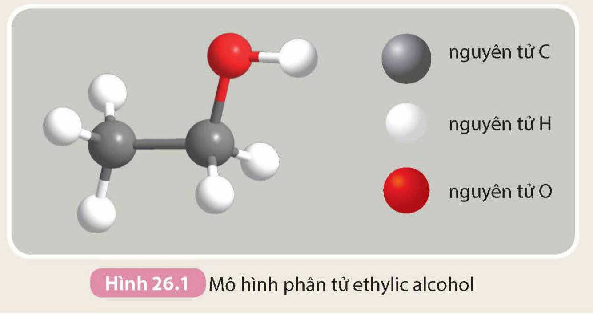
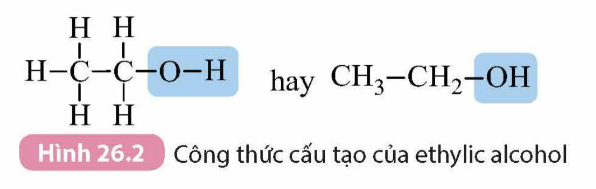
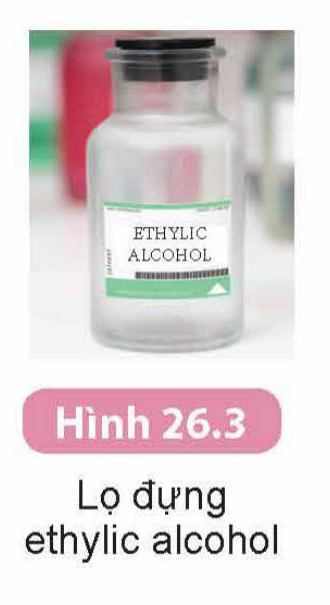
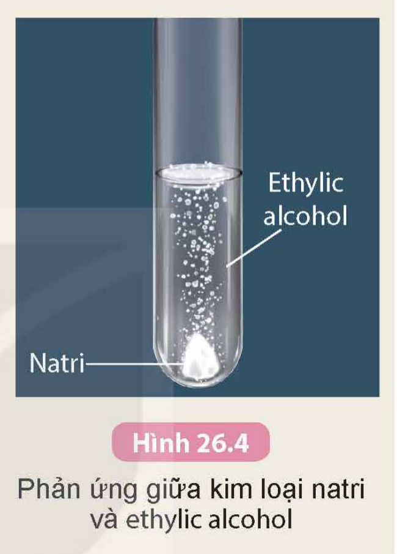
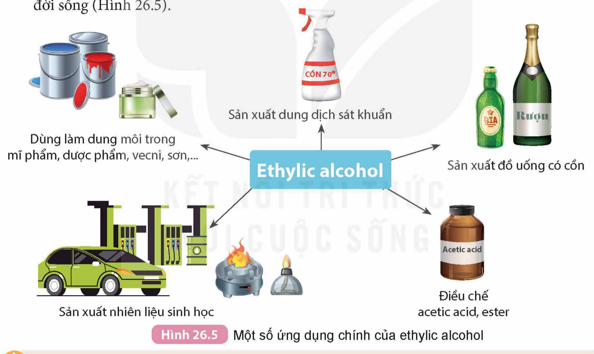

<!-- pdf:120 -->

# BÀI 26: ETHYLIC ALCOHOL

## 🎯 Mục tiêu

- Viết được công thức phân tử, công thức cấu tạo và nêu được đặc điểm cấu tạo của ethylic alcohol.
- Quan sát mẫu vật hoặc hình ảnh, trình bày được một số tính chất vật lí của ethylic alcohol: trạng thái, màu sắc, mùi vị, tính tan, khối lượng riêng, nhiệt độ sôi.
- Nêu được khái niệm và ý nghĩa của độ cồn.
- Trình bày được tính chất hoá học của ethylic alcohol: phản ứng cháy, phản ứng với natri. Viết được các phương trình hoá học xảy ra.
- Tiến hành được (hoặc quan sát qua video) thí nghiệm phản ứng cháy, phản ứng với natri của ethylic alcohol, nêu và giải thích hiện tượng thí nghiệm, nhận xét và rút ra kết luận về tính chất hoá học cơ bản của ethylic alcohol.
- Trình bày được phương pháp điều chế ethylic alcohol từ tinh bột và từ ethylene.
- Nêu được ứng dụng của ethylic alcohol (dung môi, nhiên liệu,...).
- Trình bày được tác hại của việc lạm dụng rượu bia.

## 🔴 Mở đầu

Từ xa xưa con người đã biết lên men các sản phẩm nông nghiệp như ngũ cốc, trái cây chín để tạo các đồ uống có cồn (chứa ethylic alcohol). Ngày nay, ethylic alcohol được sử dụng phổ biến trong nhiều lĩnh vực đời sống và công nghiệp. Vậy ethylic alcohol có cấu tạo như thế nào và có các tính chất đặc trưng gì ?

## I. Công thức và đặc điểm cấu tạo

> ✋ Dựa vào mô hình phân tử ethylic alcohol (Hình 26.1), hãy viết công thức phân tử, công thức cấu tạo thu gọn của ethylic alcohol (ethanol) và so sánh với alkane cùng số nguyên tử carbon về thành phần nguyên tố, nhóm nguyên tử liên kết trực tiếp với nguyên tử carbon.
>
> 
>
> Hình 26.1. Mô hình phân tử ethylic alcohol

<!-- pdf:121 -->

**Ethylic alcohol** (ethanol) là hợp chất hữu cơ có công thức phân tử $\ce{C2H6O}$. Trong phân tử ethylic alcohol có nhóm $\ce{-OH}$, đây là nhóm nguyên tử gây nên tính chất đặc trưng của ethylic alcohol.

Hình 26.2. Công thức cấu tạo của ethylic alcohol

## II. Tính chất vật lí

> ✋ Quan sát các sản phẩm trong đời sống có chứa ethylic alcohol (rượu gạo, cồn y tế, nước rửa tay sát khuẩn,...), em hãy nhận xét trạng thái, màu sắc, mùi, tính tan của ethylic alcohol.

Ethylic alcohol là chất lỏng, không màu, có mùi đặc trưng, vị cay, sôi ở $78,3\ ^\circ\text{C}$, có khối lượng riêng là $0,789\text{ g/mL}$ (ở $20\ ^\circ\text{C}$), tan vô hạn trong nước, hoà tan được nhiều chất như iodine, benzene,....

Hình 26.3. Lọ đựng ethylic alcohol
<!-- ocr-ok: đối chiếu trực tiếp ảnh trang PDF 121 (chú thích Hình 26.3 bên lề phải bị OCR đọc lỗi) -->

**Độ cồn** là số mililít ethylic alcohol nguyên chất có trong $100\text{ mL}$ dung dịch ở $20\ ^\circ\text{C}$$^{(1)}$. Độ cồn thường được kí hiệu là $\text{X}^\circ$ hoặc $\text{X\% vol}$.

Ví dụ: cồn y tế $70^\circ$ có nghĩa là trong $100\text{ mL}$ cồn $70^\circ$ có chứa $70\text{ mL}$ ethylic alcohol nguyên chất.

> 🔍 Cồn y tế, nước rửa tay sát khuẩn,... chứa ethylic alcohol với hàm lượng từ $60\%$ đến $85\%$ về thể tích có tính diệt khuẩn. Khi tiếp xúc với vi khuẩn, ethylic alcohol gây đông tụ protein, phá vỡ cấu trúc của vi khuẩn, làm cho vi khuẩn chết.

> ✋ Trên nhãn các chai bia, rượu vang, rượu whisky,... có ghi các giá trị như $4\text{\% vol}$, $14\text{\% vol}$, $40\text{\% vol}$,..., các giá trị này có ý nghĩa như thế nào?

## III. Tính chất hoá học

### 1. Phản ứng cháy của ethylic alcohol

> ✋ Thí nghiệm: Tìm hiểu về phản ứng cháy của ethylic alcohol
>
> *Chuẩn bị:* ethylic alcohol (có thể dùng cồn $96^\circ$), bát sứ, que đóm.
>
> *Tiến hành:* Lấy khoảng $1\text{ mL}$ ethylic alcohol (chú ý không lấy nhiều hơn) cho vào bát sứ và dùng que đóm dài để đốt cháy ethylic alcohol.
>
> *Thực hiện yêu cầu và trả lời các câu hỏi sau:*
>
> 1. Nhận xét về màu sắc ngọn lửa. Dựa vào dấu hiệu nào để nhận biết phản ứng đốt cháy ethylic alcohol là phản ứng toả nhiệt?
>
> 2. Khi đốt cháy, ethylic alcohol đã phản ứng với chất nào trong không khí? Dự đoán sản phẩm tạo thành và viết phương trình hoá học của phản ứng.
>
> *Lưu ý:* Chỉ lấy một lượng nhỏ ethylic alcohol. Không được sử dụng diêm, bật lửa để đốt trực tiếp ethylic alcohol. Ethylic alcohol dễ bay hơi và dễ cháy nên cần hết sức chú ý khi sử dụng để tránh bị bỏng, hoả hoạn.

> $^{(1)}$ Trong các đồ uống có cồn (bia, rượu,...), ngoài ethylic alcohol và nước thường có các chất khác.

<!-- pdf:122 -->

Ethylic alcohol dễ cháy trong không khí tạo thành carbon dioxide, hơi nước và toả nhiều nhiệt.

> ❓ 1. Ethylic alcohol dễ cháy nên cần lưu ý gì khi sử dụng ethylic alcohol?
>
> 2. Ethylic alcohol được dùng làm nhiên liệu trong đèn cồn,... hoặc phối trộn với xăng làm nhiên liệu cho động cơ đốt trong (xe máy, ô tô,...). Ứng dụng này dựa vào tính chất nào của ethylic alcohol.

### 2. Phản ứng với natri

> ✋ Thí nghiệm: Phản ứng giữa natri và ethylic alcohol
>
> *Chuẩn bị:* ethylic alcohol tuyệt đối, kim loại natri, ống nghiệm, panh.
>
> *Tiến hành:*
>
> Cho khoảng $5\text{ mL}$ ethylic alcohol tuyệt đối vào ống nghiệm. Sau đó, dùng panh kẹp một mẩu natri bằng hạt ngô đưa vào ống nghiệm.
>
> *Thực hiện yêu cầu sau:*
>
> Quan sát và mô tả hiện tượng xảy ra. Viết phương trình hoá học để giải thích, biết rằng nguyên tử hydrogen trong nhóm $\ce{-OH}$ của phân tử ethylic alcohol được thay thế bằng nguyên tử natri.
>
> *Lưu ý:* Cần làm sạch mẩu natri trước khi phản ứng. Dùng panh kẹp mẩu natri, không dùng tay cầm trực tiếp.
>
> 
>
> Hình 26.4. Phản ứng giữa kim loại natri và ethylic alcohol

Các kim loại mạnh như $\ce{Na}$, $\ce{K}$ thay thế được nguyên tử hydrogen trong nhóm $\ce{-OH}$ của ethylic alcohol, sản phẩm phản ứng có khí hydrogen được tạo thành.

> ❓ Trong số các chất sau: $\ce{CH3-CH3}$; $\ce{CH2=CH2}$; $\ce{CH3-OH}$; $\ce{CH3-CH2-OH}$, chất nào tác dụng được với $\ce{Na}$? Viết phương trình hoá học của phản ứng.

## IV. Điều chế

### 1. Điều chế ethylic alcohol từ tinh bột

Ethylic alcohol được điều chế bằng phương pháp lên men các nguyên liệu chứa tinh bột (gạo, ngô, sắn,...):

$$\ce{\underset{\text{Tinh bột}}{(C6H10O5)_n} ->[+ \ce{H2O}/\text{enzyme}] \underset{\text{Glucose}}{C6H12O6} ->[\text{enzyme}][- \ce{CO2}] \underset{\text{Ethylic alcohol}}{C2H5OH}}$$
<!-- ocr-ok: đối chiếu trực tiếp ảnh trang PDF 122 (sơ đồ lên men tinh bột tạo ethylic alcohol) -->

Ngoài nguyên liệu giàu tinh bột, người ta còn sử dụng phụ phẩm của công nghiệp sản xuất đường (rỉ đường), nguyên liệu chứa cellulose (rơm, rạ, gỗ phế liệu,...) để sản xuất ethylic alcohol.

<!-- pdf:123 -->

### 2. Điều chế ethylic alcohol từ ethylene

Ethylic alcohol còn được điều chế bằng phản ứng cộng nước vào ethylene.

$$\ce{CH2=CH2 + H2O ->[t^\circ, \ce{H+}] C2H5OH}$$
<!-- ocr-ok: đối chiếu trực tiếp ảnh trang PDF 123 (phương trình cộng nước vào ethylene tạo ethylic alcohol) -->

Phương pháp điều chế ethylic alcohol từ ethylene dùng để sản xuất ethylic alcohol trong công nghiệp.

> ❓ 1. Tại sao khi ủ các loại quả chín có chứa đường glucose như nho, táo, mơ, mận,... ở điều kiện thích hợp, sau một thời gian thì thu được nước quả có mùi đặc trưng của ethylic alcohol?
>
> 2. Em hãy tìm hiểu các nguồn nguyên liệu ở địa phương có thể sử dụng để sản xuất ethylic alcohol.

## V. Ứng dụng

Ethylic alcohol là một trong những hoá chất được sử dụng phổ biến trong công nghiệp và đời sống (Hình 26.5).

Hình 26.5. Một số ứng dụng chính của ethylic alcohol

> ✋ Dựa vào sơ đồ Hình 26.5 và tìm hiểu thông tin trên sách, báo, internet, em hãy trình bày các ứng dụng của ethylic alcohol và cho biết các ứng dụng đó dựa vào tính chất gì của ethylic alcohol.

<!-- term: Xăng sinh học -->
> 🔍 Thành phần xăng sinh học: xăng thông thường và ethylic alcohol được phối trộn theo một tỉ lệ nhất định (thường từ $5\%$ đến $20\%$ ethylic alcohol về thể tích). Ví dụ: Xăng E5 chứa $5\%$ ethylic alcohol (về thể tích). Ethylic alcohol dùng để sản xuất xăng sinh học được điều chế từ quá trình lên men các sản phẩm hữu cơ.
>
> Việc sử dụng xăng sinh học góp phần giảm bớt tỉ lệ tiêu thụ nhiên liệu hoá thạch, giảm lượng phát thải khí gây hiệu ứng nhà kính, giúp bảo vệ môi trường.

<!-- pdf:124 -->

## VI. Tác hại của việc lạm dụng rượu, bia, đồ uống có cồn

Hiện nay, có nhiều loại đồ uống chứa cồn như rượu, bia, nước quả lên men,... Sử dụng quá nhiều đồ uống này sẽ tăng nguy cơ bị viêm gan, viêm loét dạ dày, tăng huyết áp, xơ vữa động mạch, gây tổn thương hệ thần kinh, rối loạn tâm thần. Việc lạm dụng rượu, bia là một trong các nguyên nhân gây tai nạn giao thông, tai nạn lao động, bạo lực trong các mối quan hệ gia đình và xã hội.

> ❓ Em hãy tìm hiểu thông tin trên sách, báo, internet và trình bày về tác hại của việc lạm dụng rượu, bia theo dàn ý sau:
>
> 1. Kể tên một số loại bệnh có nguyên nhân từ việc lạm dụng rượu bia, đồ uống có cồn.
>
> 2. Học sinh có được sử dụng rượu, bia, đồ uống có cồn không? Tại sao?
>
> 3. Viết một câu thông điệp vận động mọi người trong cộng đồng không sử dụng rượu, bia khi tham gia giao thông.

## 📌 Em đã học

- Ethylic alcohol là chất lỏng, không màu, có mùi đặc trưng, vị cay, tan vô hạn trong nước.
- Độ cồn là số mililít ethylic alcohol nguyên chất có trong $100\text{ mL}$ dung dịch ở $20\ ^\circ\text{C}$.
- Ethylic alcohol có công thức cấu tạo là $\ce{CH3-CH2-OH}$. Nhóm $\ce{-OH}$ gây nên những tính chất đặc trưng của ethylic alcohol như phản ứng với kim loại mạnh $\ce{Na}$, $\ce{K}$,... giải phóng khí hydrogen.
  $\ce{2C2H5OH + 2Na -> 2C2H5ONa + H2}$
- Phản ứng đốt cháy ethylic alcohol toả nhiều nhiệt:
  $\ce{C2H5OH + 3O2 ->[t^\circ] 2CO2 + 3H2O}$
- Ethylic alcohol được sử dụng làm nguyên liệu, nhiên liệu, dung môi,...
- Ethylic alcohol thường được điều chế bằng phương pháp lên men các nguyên liệu chứa tinh bột và phản ứng cộng nước vào ethylene.

## ✏️ Em có thể

- Nhận biết một số sản phẩm chứa ethylic alcohol trong đời sống.
- Sử dụng nhiên liệu sinh học có chứa ethylic alcohol góp phần bảo vệ môi trường.
- Tránh lạm dụng các loại đồ uống có chứa cồn để bảo vệ sức khoẻ.

## 📷 Danh sách hình trong bài

| Mã hình | Trang PDF | Vị trí trong bài | Chú thích gốc |
|---|---|---|---|
| H9-khoa_hoc_tu_nhien-b26-01 | 120 | Mục I, hộp Hoạt động | Hình 26.1. Mô hình phân tử ethylic alcohol |
| H9-khoa_hoc_tu_nhien-b26-02 | 121 | Mục I | Hình 26.2. Công thức cấu tạo của ethylic alcohol |
| H9-khoa_hoc_tu_nhien-b26-03 | 121 | Mục II | Hình 26.3. Lọ đựng ethylic alcohol |
| H9-khoa_hoc_tu_nhien-b26-04 | 122 | Mục III.2, hộp Hoạt động | Hình 26.4. Phản ứng giữa kim loại natri và ethylic alcohol |
| H9-khoa_hoc_tu_nhien-b26-05 | 123 | Mục V (cạnh trên sát dòng chữ 'đời sống (Hình 26.5).') | Hình 26.5. Một số ứng dụng chính của ethylic alcohol |
