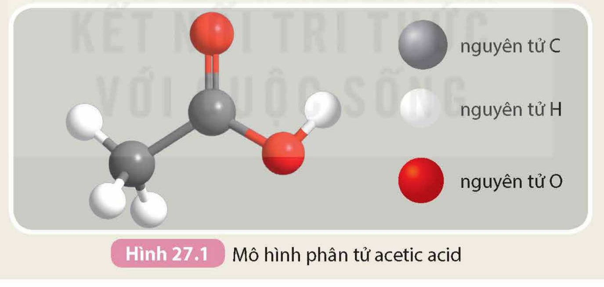
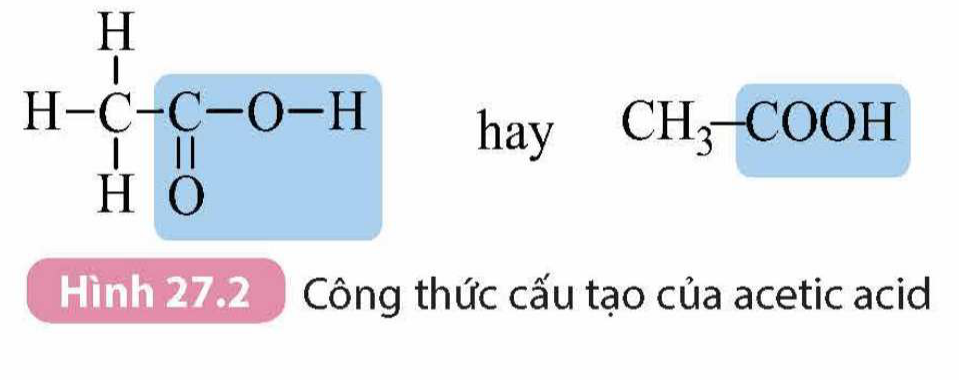
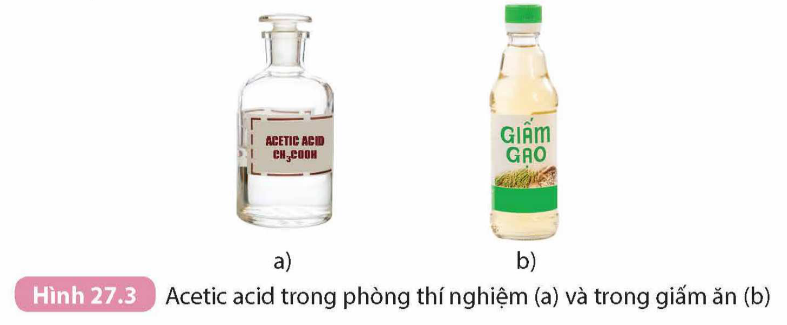
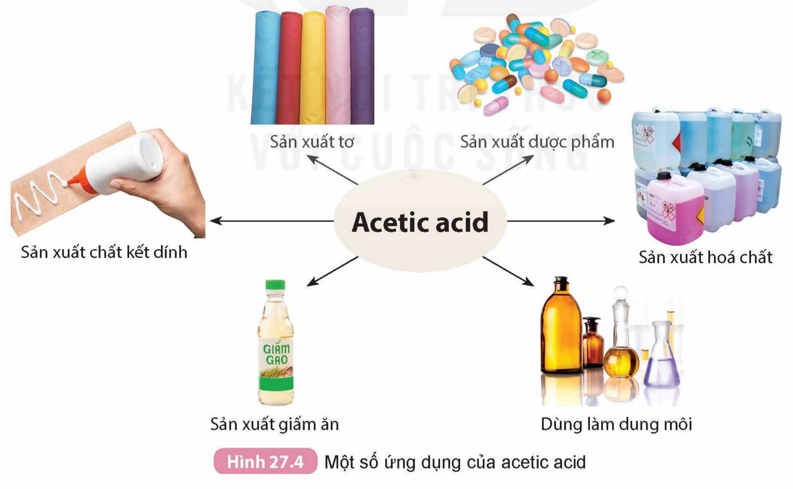

<!-- pdf:125 -->

# BÀI 27: ACETIC ACID

## 🎯 Mục tiêu

- Quan sát mô hình hoặc hình vẽ, viết được công thức phân tử, công thức cấu tạo; nêu được đặc điểm cấu tạo của acid acetic.
- Quan sát mẫu vật hoặc hình ảnh, trình bày được một số tính chất vật lí của acetic acid: trạng thái, màu sắc, mùi vị, tính tan, khối lượng riêng, nhiệt độ sôi.
- Trình bày được phương pháp điều chế acetic acid bằng cách lên men ethylic alcohol.
- Trình bày được tính chất hoá học của acetic acid: phản ứng với quỳ tím, đá vôi, kim loại, oxide kim loại, base, phản ứng cháy, phản ứng ester hoá. Viết được các phương trình hoá học xảy ra.
- Tiến hành được (hoặc quan sát qua video) thí nghiệm của acid acetic (phản ứng với quỳ tím, đá vôi, kim loại, oxide kim loại, base, phản ứng cháy, phản ứng ester hoá), nhận xét, rút ra được tính chất hoá học cơ bản của acetic acid.
- Trình bày được ứng dụng của acetic acid (làm nguyên liệu, làm giấm).

## 🔴 Mở đầu

Giấm là gia vị quen thuộc được sử dụng phổ biến trong chế biến thực phẩm. Chất nào đã tạo nên vị chua của giấm?

## I. Công thức và đặc điểm cấu tạo

> ✋ Dựa vào mô hình phân tử acetic acid (Hình 27.1), hãy viết công thức phân tử, công thức cấu tạo của acetic acid và so sánh với alkane cùng số nguyên tử carbon về thành phần nguyên tố, nhóm nguyên tử liên kết trực tiếp với nguyên tử carbon.
>
> 
>
> Hình 27.1. Mô hình phân tử acetic acid

**Acetic acid** là hợp chất hữu cơ có công thức phân tử $\ce{C2H4O2}$. Trong phân tử acetic acid có nhóm $\ce{-COOH}$, đây là nhóm nguyên tử gây nên tính chất đặc trưng của acetic acid.

Nhóm $\ce{-COOH}$ gồm có nhóm $\ce{-OH}$ liên kết với nhóm $\text{>}\ce{C=O}$.

Hình 27.2. Công thức cấu tạo của acetic acid

> ❓ Trong các chất dưới đây, chất nào có tính chất hoá học đặc trưng giống acetic acid?
>
> A. $\ce{CH3OH}$. &emsp;&emsp; B. $\ce{CH3CHO}$. &emsp;&emsp; C. $\ce{HCOOH}$. &emsp;&emsp; D. $\ce{CH3COOC2H5}$.

<!-- pdf:126 -->

## II. Tính chất vật lí

<!-- term: Giấm ăn -->
Acetic acid là chất lỏng, không màu, vị chua, có mùi đặc trưng, sôi ở $118\ ^\circ\text{C}$, tan vô hạn trong nước, khối lượng riêng là $1,045\text{ g/mL}$ (ở $25\ ^\circ\text{C}$). Giấm ăn có chứa acetic acid với nồng độ thường từ $2\%$ đến $5\%$.

Hình 27.3. Acetic acid trong phòng thí nghiệm (a) và trong giấm ăn (b)

## III. Tính chất hoá học

### 1. Tính acid

Acetic acid là một acid yếu và có đầy đủ tính chất của một acid thông thường.

> ✋ Thí nghiệm: Tìm hiểu tính chất hoá học của acetic acid
>
> *Chuẩn bị:* dung dịch acetic acid $10\%$, dung dịch $\ce{NaOH}$ $10\%$, $\ce{Mg}$, $\ce{CuO}$, đá vôi đập nhỏ, ống nghiệm, giấy quỳ tím (hoặc giấy chỉ thị pH), phenolphthalein, đèn cồn, ống hút nhỏ giọt.
>
> *Tiến hành:*
>
> 1. Phản ứng với chất chỉ thị:
>    Lấy một mẩu giấy quỳ, nhỏ vài giọt dung dịch acetic acid lên mẩu giấy quỳ.
> 2. Phản ứng với kim loại:
>    Cho khoảng $2\text{ mL}$ dung dịch acetic acid $10\%$ vào ống nghiệm, thêm tiếp một mảnh $\ce{Mg}$ vào ống nghiệm.
> 3. Phản ứng với oxide kim loại:
>    - Cho vào ống nghiệm một ít bột $\ce{CuO}$ (khoảng $1/3$ thìa thuỷ tinh), sau đó nhỏ khoảng $2\text{ mL}$ dung dịch acetic acid vào ống nghiệm.
>    - Đun nhẹ ống nghiệm trên ngọn lửa đèn cồn.
> 4. Phản ứng với base:
>    - Cho vào ống nghiệm $1\text{ mL}$ dung dịch $\ce{NaOH}$ $10\%$, thêm tiếp vài giọt phenolphthalein vào ống nghiệm, lắc đều.
>    - Nhỏ từ từ dung dịch acetic acid $10\%$ vào ống nghiệm cho tới khi mất màu.
> 5. Phản ứng với đá vôi:
>    Cho vào ống nghiệm khoảng $1$ thìa thuỷ tinh đá vôi đập nhỏ, thêm tiếp khoảng $1\text{ mL}$ dung dịch acetic acid $10\%$ vào ống nghiệm.
>
> *Thực hiện các yêu cầu sau:*
>
> 1. Quan sát hiện tượng xảy ra trong các thí nghiệm trên và từ các kiến thức đã học về acid, hãy nêu tính chất hoá học của acetic acid.
>
> 2. Giải thích các hiện tượng xảy ra trong các thí nghiệm trên.

<!-- pdf:127 -->

Tính chất hoá học của acetic acid:

- Làm đổi màu chất chỉ thị acid như giấy quỳ (sang màu đỏ) và giấy chỉ thị pH.
- Phản ứng với kim loại giải phóng khí hydrogen.
  $\ce{2CH3COOH + Mg -> (CH3COO)2Mg + H2}$
- Phản ứng với oxide kim loại tạo thành muối và nước.
  $\ce{2CH3COOH + CuO -> (CH3COO)2Cu + H2O}$
- Phản ứng với base tạo muối và nước.
  $\ce{CH3COOH + NaOH -> CH3COONa + H2O}$
- Phản ứng với muối carbonate, giải phóng khí carbon dioxide.
  $\ce{2CH3COOH + CaCO3 -> (CH3COO)2Ca + CO2 + H2O}$

> ❓ 1. Ấm đun nước sử dụng một thời gian có thể có lớp cặn (chứa $\ce{CaCO3}$) bám vào đáy và thành ấm. Có thể loại bỏ lớp cặn này bằng giấm ăn. Hãy giải thích.
>
> 2. Acetic acid có thể tác dụng được với những chất nào trong các chất sau đây: $\ce{Zn}$, $\ce{KOH}$, $\ce{ZnO}$, $\ce{NaCl}$, $\ce{MgCO3}$, $\ce{Cu}$? Viết các phương trình hoá học (nếu có).

### 2. Phản ứng ester hoá

> ✋ Nghiên cứu phản ứng ester hoá của acetic acid với ethylic alcohol
>
> Phản ứng ester hoá của acetic acid và ethylic alcohol được thực hiện như sau:
>
> - Cho $2\text{ mL}$ ethylic alcohol và $2\text{ mL}$ acetic acid đặc vào ống nghiệm, lắc đều hỗn hợp.
> - Thêm $1\text{ mL}$ dung dịch $\ce{H2SO4}$ đặc, lắc nhẹ để các chất trộn đều với nhau.
> - Kẹp ống nghiệm rồi đặt vào cốc nước nóng (khoảng $60\ ^\circ\text{C}$ – $70\ ^\circ\text{C}$), thỉnh thoảng lắc ống nghiệm để trộn đều hỗn hợp. Sau khoảng $5$ phút, để nguội hỗn hợp rồi đổ sang ống nghiệm khác chứa $5\text{ mL}$ dung dịch muối ăn bão hoà thấy xuất hiện lớp chất lỏng ở phía trên, không màu, có mùi thơm nhẹ.
>
> *Chú ý:* Dung dịch $\ce{H2SO4}$ đặc có thể gây bỏng nên cần thận trọng khi sử dụng.
>
> *Thực hiện yêu cầu sau:*
>
> Dựa vào dấu hiệu nào để khẳng định có phản ứng hoá học xảy ra giữa acetic acid và ethylic alcohol?

Acetic acid phản ứng với ethylic alcohol tạo thành ester và nước theo phản ứng:

$$\ce{CH3-\underset{\underset{\ce{O}}{||}}{C}-O-H + C2H5-O-H <=>[\ce{H2SO4}\text{ đặc}, t^\circ] \underset{\text{Ethyl acetate}}{CH3-\underset{\underset{\ce{O}}{||}}{C}-O-C2H5} + H2O}$$
<!-- ocr-ok: đối chiếu trực tiếp ảnh trang PDF 127 (phương trình phản ứng ester hoá giữa acetic acid và ethylic alcohol) -->

Phản ứng giữa acetic acid và ethylic alcohol tạo ra ester (ethyl acetate) thuộc loại **phản ứng ester hoá**.

> ❓ Propyl acetate là một ester có mùi thơm đặc trưng của quả lê. Propyl acetate thu được khi đun nóng acetic acid với propyl alcohol ($\ce{CH3CH2CH2OH}$) có mặt $\ce{H2SO4}$ đặc làm xúc tác. Viết phương trình hoá học của phản ứng xảy ra.

<!-- pdf:128 -->

<!-- term: Ester -->
> 🔍 Nhiều hợp chất ester dễ bay hơi, tạo nên mùi hương đặc trưng của nhiều loài hoa (hoa oải hương, hoa hồng, hoa nhài,...) và các loại trái cây (táo, lê, nho, chuối, dứa, dâu tây, sầu riêng,...). Các ester thường có mùi thơm dễ chịu nên được sử dụng làm hương liệu trong ngành công nghiệp mĩ phẩm và thực phẩm.

### 3. Phản ứng cháy

Acetic acid cháy trong khí oxygen tạo thành khí carbon dioxide và hơi nước:

$$\ce{CH3COOH + 2O2 ->[t^\circ] 2CO2 + 2H2O}$$
<!-- ocr-ok: đối chiếu trực tiếp ảnh trang PDF 128 (phương trình đốt cháy acetic acid) -->

## IV. Điều chế

<!-- term: Lên men giấm -->
Acetic acid dùng để sản xuất giấm được điều chế từ ethylic alcohol loãng bằng phương pháp lên men giấm:

$$\ce{C2H5OH + O2 ->[\text{men giấm}] CH3COOH + H2O}$$
<!-- ocr-ok: đối chiếu trực tiếp ảnh trang PDF 128 (phương trình lên men giấm) -->

> ❓ Khi để các loại rượu có độ cồn thấp (rượu vang, rượu mơ, rượu sâm panh,...) tiếp xúc với không khí, sau một thời gian thì các loại rượu này có vị chua. Hãy giải thích.

## V. Ứng dụng

Acetic acid là một trong những hoá chất được sử dụng phổ biến trong công nghiệp và đời sống. Acetic acid được sử dụng nhiều trong công nghiệp thực phẩm, dùng làm nguyên liệu đầu để sản xuất nhiều sản phẩm khác nhau như dược phẩm, phẩm nhuộm, tơ nhân tạo, chất dẻo,...

Hình 27.4. Một số ứng dụng của acetic acid

> ❓ Em hãy tìm hiểu và trình bày trước lớp cách làm giấm từ quả chín hoặc từ tinh bột.

<!-- pdf:129 -->

## 📌 Em đã học

- Acetic acid là chất lỏng, không màu, vị chua, có mùi đặc trưng, tan vô hạn trong nước.
- Công thức cấu tạo thu gọn của acetic acid: $\ce{CH3COOH}$.
- Acetic acid có đầy đủ các tính chất hoá học chung của acid.
- Acetic acid tác dụng với ethylic alcohol tạo ra ester:
  $\ce{CH3COOH + C2H5OH <=>[\ce{H2SO4}, t^\circ] CH3COOC2H5 + H2O}$
- Acetic acid được sử dụng nhiều trong công nghiệp thực phẩm; là nguyên liệu đầu để sản xuất các hoá chất khác.
- Acetic acid dùng để sản xuất giấm được điều chế bằng cách lên men dung dịch loãng ethylic alcohol.

## ✏️ Em có thể

- Biết cách tạo ra giấm bằng phương pháp lên men để sử dụng trong gia đình.
- Vận dụng các tính chất của acetic acid để ứng dụng trong đời sống như loại bỏ cặn trong ấm nước, thiết bị vệ sinh,...

## 📷 Danh sách hình trong bài

| Mã hình | Trang PDF | Vị trí trong bài | Chú thích gốc |
|---|---|---|---|
| H9-khoa_hoc_tu_nhien-b27-01 | 125 | Mục I, hộp Hoạt động | Hình 27.1. Mô hình phân tử acetic acid |
| H9-khoa_hoc_tu_nhien-b27-02 | 125 | Mục I | Hình 27.2. Công thức cấu tạo của acetic acid |
| H9-khoa_hoc_tu_nhien-b27-03 | 126 | Mục II | Hình 27.3. Acetic acid trong phòng thí nghiệm (a) và trong giấm ăn (b) |
| H9-khoa_hoc_tu_nhien-b27-04 | 128 | Mục V | Hình 27.4. Một số ứng dụng của acetic acid |
