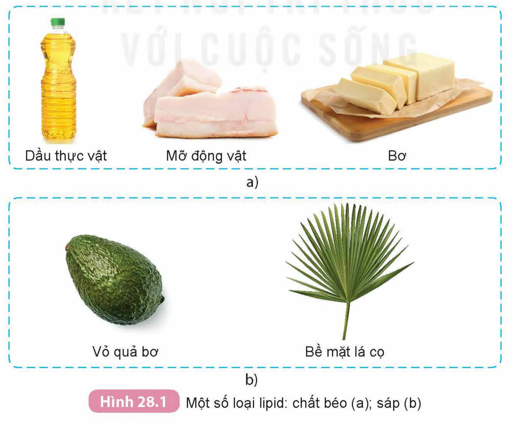

<!-- pdf:130 -->

# BÀI 28: LIPID

## 🎯 Mục tiêu

- Nêu được khái niệm lipid, khái niệm chất béo, trạng thái thiên nhiên, công thức tổng quát của chất béo đơn giản là $\ce{(R-COO)3C3H5}$, đặc điểm cấu tạo.
- Trình bày được tính chất vật lí của chất béo (trạng thái, tính tan) và tính chất hoá học (phản ứng xà phòng hoá). Viết được phương trình hoá học xảy ra.
- Nêu được vai trò của lipid tham gia vào cấu tạo tế bào và tích lũy năng lượng trong cơ thể.
- Trình bày được ứng dụng của chất béo và đề xuất biện pháp sử dụng chất béo cho phù hợp trong việc ăn uống hằng ngày để có cơ thể khoẻ mạnh, tránh được bệnh béo phì.

## 🔴 Mở đầu

Dầu thực vật và mỡ động vật là loại lipid được sử dụng phổ biến hằng ngày để chế biến thực phẩm. Vai trò của chúng trong cơ thể sinh vật là gì? Tại sao tuỳ theo độ tuổi, cơ thể cần được cung cấp một lượng dầu và mỡ phù hợp? Lipid còn có những ứng dụng gì khác?

## I. Lipid

**Lipid** là những hợp chất hữu cơ có trong tế bào sống, không tan trong nước, nhưng tan được trong một số dung môi hữu cơ như: xăng, dầu hoả,...

Hình 28.1. Một số loại lipid: chất béo (a); sáp (b)

<!-- pdf:131 -->

<!-- term: Sáp -->
Một số loại lipid điển hình là *chất béo* (nguồn dự trữ năng lượng chính trong cơ thể và là thành phần chính của dầu thực vật và mỡ động vật), *sáp* (thường được tìm thấy trên bề mặt lá, thân cây, trái cây của nhiều loại thực vật và da, lông của một số loại động vật, giúp chống nước và một số tác động có hại từ môi trường ngoài),...

> ❓ 1. Đặc trưng tính chất vật lí của lipid là gì?
>
> 2. Có những loại lipid điển hình nào và vai trò chính của mỗi loại ở sinh vật là gì?

## II. Chất béo

### 1. Khái niệm

Loại lipid được sử dụng phổ biến nhất trong cuộc sống hằng ngày là chất béo.

Khi đun chất béo với nước, có mặt xúc tác acid hoặc enzyme lipase sẽ thu được glycerol và acid béo.

**Glycerol** là alcohol có công thức cấu tạo:

$$\ce{\underset{\underset{\ce{OH}}{|}}{CH2}-\underset{\underset{\ce{OH}}{|}}{CH}-\underset{\underset{\ce{OH}}{|}}{CH2}}\text{, viết gọn: }\ce{C3H5(OH)3}.$$
<!-- ocr-ok: đối chiếu trực tiếp ảnh trang PDF 131 (công thức cấu tạo và công thức viết gọn của glycerol) -->

**Acid béo** là các acid hữu cơ có công thức chung $\ce{R-COOH}$, với $\ce{R}$ thường là $\ce{-C15H31}$, $\ce{-C17H35}$, $\ce{-C17H33}$, $\ce{-C17H31}$,... và thường có mạch carbon dài, không phân nhánh.

Từ kết quả trên, kết hợp với những phương pháp khác, người ta xác định được: **chất béo** là các triester (loại ester chứa $3$ nhóm $\ce{-COO-}$ trong phân tử) của glycerol và acid béo, có công thức cấu tạo thu gọn là $\ce{(RCOO)3C3H5}$. $\ce{R}$ có thể giống nhau hoặc khác nhau.

### 2. Tính chất vật lí

Ở điều kiện thường, một số chất béo tồn tại ở trạng thái lỏng như dầu lạc, dầu hướng dương, dầu cá,...; một số chất béo tồn tại ở trạng thái rắn như các loại mỡ động vật, bơ,...

Các chất béo nhẹ hơn nước, không tan trong nước và tan trong một số dung môi hữu cơ như benzene, xăng,...

### 3. Tính chất hoá học

Chất béo có thể bị thuỷ phân hoàn toàn trong môi trường kiềm. Khi đun nóng chất béo với dung dịch $\ce{NaOH}$ (hoặc $\ce{KOH}$), sản phẩm thu được là muối $\ce{Na}$ (hoặc $\ce{K}$) của acid béo và glycerol.

Ví dụ: $\ce{(RCOO)3C3H5 + 3NaOH ->[t^\circ] 3RCOONa + C3H5(OH)3}$

Muối $\ce{Na}$ (hoặc $\ce{K}$) của các acid béo được sử dụng làm xà phòng nên loại phản ứng này có tên là **phản ứng xà phòng hoá**.

<!-- term: Xà phòng -->
> 🔍 Làm xà phòng thủ công
>
> Để làm xà phòng, chất béo (dầu thực vật, mỡ động vật) được đun với dung dịch kiềm, khi đó muối natri của acid béo được tạo thành ở dạng keo. Các muối này được tách ra, sau đó trộn với các chất phụ gia, hương liệu, chất tạo màu,... rồi ép thành bánh.

<!-- pdf:132 -->

> ✋ Em hãy tìm hiểu và trình bày về cách làm xà phòng từ dầu ăn, mỡ thừa sau khi sử dụng.

### 4. Ứng dụng

> ✋ Chúng ta biết rằng chất béo được ứng dụng rộng rãi trong cuộc sống hằng ngày, từ thực phẩm đến mĩ phẩm và cả dược phẩm. Em hãy tìm hiểu qua sách báo, internet, sau đó thảo luận nhóm và liệt kê ra $3$ sản phẩm có chứa chất béo. Giải thích tại sao chất béo lại có trong thành phần các sản phẩm đó.

Chất béo là một trong các thực phẩm thiết yếu của con người, được sử dụng dưới dạng dầu thực vật (như dầu hướng dương, đậu nành, lạc,...), mỡ động vật (như mỡ lợn, bò, cá,...), bơ hoặc một số loại hạt (lạc, vừng, hạnh nhân, óc chó,...).

Chất béo còn được dùng trong công nghiệp mĩ phẩm (chất làm mềm, dưỡng ẩm,...), dược phẩm, nhiên liệu (dầu diesel sinh học), nguyên liệu (sản xuất xà phòng),...

### 5. Sử dụng chất béo đúng cách để hạn chế béo phì

**Béo phì** là tình trạng tích tụ mỡ quá mức trong cơ thể. Béo phì có thể gây ra các vấn đề trầm trọng đến sức khoẻ, là một trong các nguyên nhân gây ra nhiều bệnh khác nhau như bệnh tim mạch, đột quỵ, đái tháo đường, thoái hoá khớp, gan nhiễm mỡ, máu nhiễm mỡ, bệnh ung thư,...

Một trong những nguyên nhân gây bệnh béo phì là do chế độ ăn uống quá nhiều chất béo. Để hạn chế bệnh béo phì và các bệnh liên quan, trong chế độ ăn uống cần lưu ý lựa chọn thực phẩm có lượng chất béo phù hợp, ưu tiên sử dụng các chất béo có nguồn gốc thực vật, chất béo giàu omega-3 (có trong các loại cá, hải sản), hạn chế sử dụng các chất béo có nguồn gốc động vật (mỡ lợn, mỡ bò,...), các loại bơ nhân tạo, các thức ăn có chứa chất béo đã qua chế biến ở nhiệt độ cao (thức ăn nhanh, đồ chiên, nướng),...

## 📌 Em đã học

- Lipid là những hợp chất hữu cơ có trong tế bào sống, không tan trong nước, nhưng tan được trong một số dung môi hữu cơ như: xăng, dầu hoả,... Một số loại lipid điển hình là *chất béo* và *sáp*.
- Chất béo là triester của glycerol và các acid béo, có công thức $\ce{(RCOO)3C3H5}$. Phản ứng hoá học đặc trưng của chất béo là phản ứng xà phòng hoá.
- Chất béo có nhiều ứng dụng trong công nghiệp thực phẩm, dược phẩm, làm nhiên liệu, nguyên liệu sản xuất xà phòng,...

## ✏️ Em có thể

Biết cách lựa chọn, sử dụng chất béo phù hợp trong ăn uống để có lợi cho sức khoẻ.

## 📷 Danh sách hình trong bài

| Mã hình | Trang PDF | Vị trí trong bài | Chú thích gốc |
|---|---|---|---|
| H9-khoa_hoc_tu_nhien-b28-01 | 130 | Mục I | Hình 28.1. Một số loại lipid: chất béo (a); sáp (b) |
