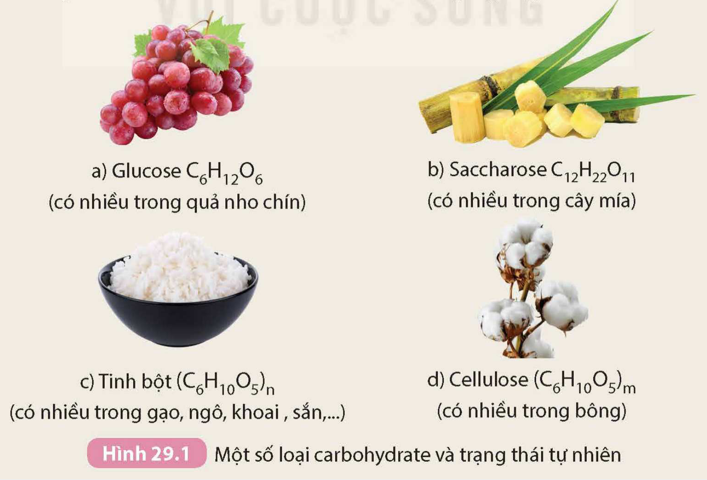
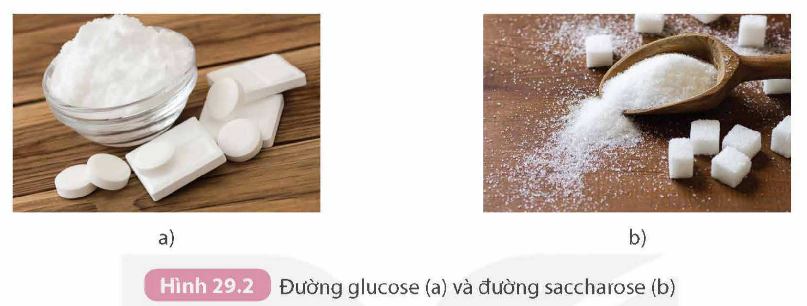
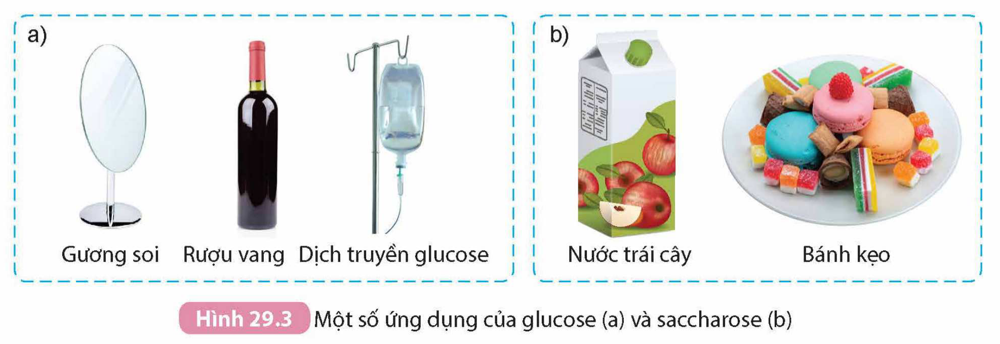

<!-- pdf:133 -->

# BÀI 29: CARBOHYDRATE. GLUCOSE VÀ SACCHAROSE

## 🎯 Mục tiêu

- Nêu được thành phần nguyên tố, công thức chung của carbohydrate.
- Nêu được công thức phân tử, trạng thái tự nhiên, tính chất vật lí (trạng thái, màu sắc, mùi, vị, tính tan, khối lượng riêng) của glucose và saccharose.
- Trình bày được tính chất hoá học của glucose (phản ứng tráng bạc, phản ứng lên men rượu), của saccharose (phản ứng thuỷ phân có xúc tác acid hoặc enzyme). Viết được các phương trình hoá học xảy ra dưới dạng công thức phân tử.
- Tiến hành được thí nghiệm (hoặc quan sát thí nghiệm) phản ứng tráng bạc của glucose.
- Trình bày được vai trò và ứng dụng của glucose (chất dinh dưỡng quan trọng của người và động vật) và của saccharose (nguyên liệu quan trọng trong công nghiệp thực phẩm). Ý thức được tầm quan trọng của việc sử dụng hợp lí saccharose. Nhận biết được các loại thực phẩm giàu saccharose và hoa quả giàu glucose.

## 🔴 Mở đầu

Một số chất tạo vị ngọt trong bánh kẹo, nước uống; lương thực như gạo, ngô, khoai, sắn và các chất tạo bộ khung cứng cho cây trồng đều thuộc loại hợp chất carbohydrate. Vậy giữa các chất này có đặc điểm gì giống nhau và khác nhau? Chúng có mối liên hệ gì giữa cấu tạo và tính chất?

## I. Khái niệm carbohydrate

> ✋ Quan sát công thức phân tử của một số carbohydrate trong Hình 29.1 và thực hiện các yêu cầu sau:
>
> 1. Carbohydrate được tạo thành từ những nguyên tố nào?
>
> 2. Viết lại công thức phân tử của mỗi chất dưới dạng $\ce{C_n(H2O)_m}$.
>
> 
>
> Hình 29.1. Một số loại carbohydrate và trạng thái tự nhiên

<!-- pdf:134 -->

**Carbohydrate** là loại hợp chất hữu cơ chứa các nguyên tố carbon, hydrogen, oxygen, thường có công thức chung là $\ce{C_n(H2O)_m}$.

Glucose, saccharose, tinh bột và cellulose là những carbohydrate phổ biến trong tự nhiên và có nhiều ứng dụng trong cuộc sống hằng ngày.

## II. Glucose và saccharose

### 1. Trạng thái tự nhiên và tính chất vật lí

Hình 29.2. Đường glucose (a) và đường saccharose (b)

**Glucose** có công thức phân tử $\ce{C6H12O6}$, dạng tinh thể không màu (khối lượng riêng $1,56\text{ g/cm}^3$)$^{(1)}$, không mùi, có vị ngọt. Glucose tan tốt trong nước.

Glucose là loại đường có trong nhiều trái cây chín (đặc biệt nho chín). Glucose cũng có trong máu, đóng vai trò là nguồn năng lượng chính cho các hoạt động ở tế bào.

**Saccharose** có công thức phân tử $\ce{C12H22O11}$, dạng tinh thể không màu (khối lượng riêng $1,58\text{ g/cm}^3$)$^{(2)}$, không mùi, có vị ngọt. Saccharose tan tốt trong nước.

Saccharose là loại đường có nhiều trong mía, củ cải đường, thốt nốt.

> ❓ 1. So sánh tính chất vật lí của glucose và saccharose.
>
> 2. Lấy ví dụ các sản phẩm tự nhiên trong đời sống có chứa nhiều đường glucose và saccharose.

### 2. Tính chất hoá học

**a) Phản ứng tráng bạc của glucose**

> ✋ Thí nghiệm về phản ứng tráng bạc của glucose
>
> *Chuẩn bị:* dung dịch glucose $10\%$, dung dịch $\ce{AgNO3}$ $1\%$, dung dịch $\ce{NH3}$ $5\%$, cốc nước nóng, ống nghiệm.
>
> *Tiến hành:*
>
> - Cho khoảng $1\text{ mL}$ dung dịch $\ce{AgNO3}$ $1\%$ vào ống nghiệm.
> - Thêm từ từ dung dịch $\ce{NH3}$ $5\%$ vào ống nghiệm và lắc đều đến khi kết tủa tan hoàn toàn.
> - Cho khoảng $1\text{ mL}$ dung dịch glucose $10\%$ vào ống nghiệm, lắc đều.
> - Đặt ống nghiệm vào cốc đựng nước nóng (khoảng $70$ – $80\ ^\circ\text{C}$), để yên khoảng $5$ phút.

> $^{(1),(2)}$ Nguồn: Haynes, W. M., Lide, D. R. & Bruno, T. J. 2017. *CRC Handbook of Chemistry and Physics*, 97th Edition, CRC Press LLC.
<!-- ocr-ok: đối chiếu trực tiếp ảnh trang PDF 134 (chú thích chân trang chữ nhỏ) -->

<!-- pdf:135 -->

> *Thực hiện các yêu cầu sau:*
>
> 1. Quan sát hiện tượng trên thành ống nghiệm và cho biết có phản ứng hoá học xảy ra hay không?
>
> 2. Dự đoán sản phẩm tạo thành (nếu có) và rút ra nhận xét.

Tính chất đặc trưng của glucose là có phản ứng hoá học với silver nitrate trong dung dịch ammonia tạo ra bạc kim loại. Phản ứng này được dùng để tráng bạc lên kính trong sản xuất gương soi, nên có tên là **phản ứng tráng bạc**.

Phương trình hoá học của phản ứng tráng bạc được biểu diễn ở dạng đơn giản như sau:

$$\ce{C6H12O6 + Ag2O ->[\text{Dung dịch }\ce{NH3}, t^\circ] C6H12O7 + 2Ag}^{(1)}$$
<!-- ocr-ok: đối chiếu trực tiếp ảnh trang PDF 135 (phương trình phản ứng tráng bạc của glucose) -->

Saccharose không có phản ứng này.

**b) Phản ứng lên men rượu của glucose**

Dưới tác dụng của enzyme, glucose bị lên men tạo thành ethylic alcohol. Phản ứng này được sử dụng để sản xuất bia, rượu hay các loại đồ uống có cồn khác.

$$\ce{C6H12O6 ->[\text{Enzyme}] 2C2H5OH + 2CO2}$$
<!-- ocr-ok: đối chiếu trực tiếp ảnh trang PDF 135 (phương trình phản ứng lên men rượu của glucose) -->

**c) Phản ứng thuỷ phân của saccharose**

<!-- term: Fructose -->
Phản ứng đặc trưng của saccharose là thuỷ phân (trong môi trường acid hoặc dưới tác dụng của enzyme) sinh ra glucose và fructose (một loại đường có công thức phân tử giống glucose nhưng khác công thức cấu tạo).

$$\ce{C12H22O11 + H2O ->[\text{Enzyme hoặc acid}/t^\circ] C6H12O6\text{ (glucose)} + C6H12O6\text{ (fructose)}}$$
<!-- ocr-ok: đối chiếu trực tiếp ảnh trang PDF 135 (phương trình thuỷ phân saccharose) -->

### 3. Vai trò và ứng dụng của glucose và saccharose

**a) Vai trò**

Glucose hình thành ở thực vật qua quá trình quang hợp và ở động vật qua quá trình tiêu hoá carbohydrate. Glucose là nguồn năng lượng chính cho cả thực vật và động vật, cung cấp năng lượng cho các tế bào, hỗ trợ tăng trưởng và trao đổi chất.

Saccharose có vai trò cung cấp năng lượng cho cơ thể nên được sử dụng phổ biến làm nguyên liệu trong công nghiệp thực phẩm.

Tiêu thụ quá nhiều glucose, saccharose trong thời gian dài có nguy cơ bị béo phì và mắc các bệnh khác như tiểu đường, tim mạch,...

**b) Ứng dụng**

Glucose được dùng làm nguyên liệu trong công nghiệp dược phẩm, thực phẩm. Ngoài ra, glucose cũng là nguyên liệu để sản xuất đồ uống có cồn và tráng gương.

Saccharose được sử dụng làm chất tạo ngọt cho nhiều loại đồ uống và bánh kẹo.

> $^{(1)}$ $\ce{C5H11O5CHO + 2AgNO3 + 3NH3 + H2O -> C5H11O5COONH4 + 2Ag + 2NH4NO3}$
<!-- ocr-ok: đối chiếu trực tiếp ảnh trang PDF 135 (chú thích chân trang phương trình tráng bạc đầy đủ) -->

<!-- pdf:136 -->

Hình 29.3. Một số ứng dụng của glucose (a) và saccharose (b)
<!-- ocr-ok: đối chiếu trực tiếp ảnh trang PDF 136 (chú thích Hình 29.3 bị OCR bỏ sót) -->

> ✋ Quan sát Hình 29.3 và trình bày về ứng dụng của glucose, saccharose. Hãy chỉ ra mối liên hệ giữa ứng dụng và tính chất của chúng.

## 📌 Em đã học

- Carbohydrate là loại hợp chất hữu cơ chứa các nguyên tố carbon, hydrogen, oxygen, thường có công thức chung là $\ce{C_n(H2O)_m}$.
- Glucose và saccharose đều là những chất rắn, không màu, tan nhiều trong nước. Glucose giữ vai trò chính trong việc cung cấp năng lượng trực tiếp cho các hoạt động của cơ thể. Saccharose đóng vai trò cung cấp năng lượng cho cơ thể và là nguyên liệu quan trọng trong công nghiệp thực phẩm.
- Glucose tham gia phản ứng tráng bạc (phản ứng với $\ce{AgNO3}$/$\ce{NH3}$) và phản ứng lên men tạo ethylic alcohol.
- Saccharose có phản ứng thuỷ phân tạo thành glucose và fructose.
- Glucose được dùng làm nguyên liệu trong công nghiệp dược phẩm, thực phẩm,...; saccharose chủ yếu được dùng làm chất tạo vị ngọt cho thực phẩm.

## ✏️ Em có thể

Nêu được vai trò, ứng dụng của glucose; tầm quan trọng của việc sử dụng hợp lí saccharose và ảnh hưởng của chúng đến sức khoẻ.

## 📷 Danh sách hình trong bài

| Mã hình | Trang PDF | Vị trí trong bài | Chú thích gốc |
|---|---|---|---|
| H9-khoa_hoc_tu_nhien-b29-01 | 133 | Mục I, hộp Hoạt động (cạnh trên sát câu hỏi 2) | Hình 29.1. Một số loại carbohydrate và trạng thái tự nhiên |
| H9-khoa_hoc_tu_nhien-b29-02 | 134 | Mục II.1 | Hình 29.2. Đường glucose (a) và đường saccharose (b) |
| H9-khoa_hoc_tu_nhien-b29-03 | 136 | Mục II.3.b | Hình 29.3. Một số ứng dụng của glucose (a) và saccharose (b) |
