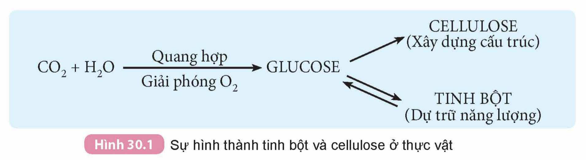
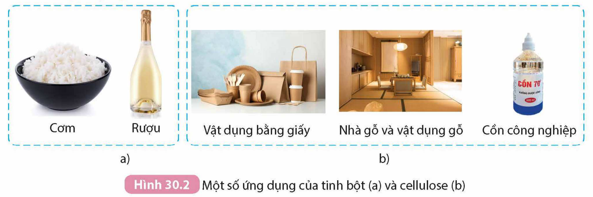

<!-- pdf:137 -->

# BÀI 30: TINH BỘT VÀ CELLULOSE

## 🎯 Mục tiêu

- Nêu được trạng thái tự nhiên, tính chất vật lí của tinh bột và cellulose.
- Trình bày được tính chất hoá học của tinh bột và cellulose: phản ứng thuỷ phân; hồ tinh bột có phản ứng màu với iodine. Viết được các phương trình hoá học của phản ứng thuỷ phân dưới dạng công thức phân tử.
- Tiến hành được (hoặc quan sát qua video) thí nghiệm phản ứng thuỷ phân; phản ứng màu của hồ tinh bột với iodine; nêu được hiện tượng thí nghiệm, nhận xét và rút ra kết luận về tính chất hoá học của tinh bột và cellulose.
- Trình bày được ứng dụng của tinh bột và cellulose trong đời sống và sản xuất, sự tạo thành tinh bột, cellulose và vai trò của chúng trong cây xanh.
- Nêu được tầm quan trọng của sự tạo thành tinh bột, cellulose trong cây xanh.
- Nhận biết được các loại lương thực, thực phẩm giàu tinh bột và biết cách sử dụng hợp lí tinh bột.

## 🔴 Mở đầu

Tinh bột và cellulose là những carbohydrate phức tạp có vai trò khác nhau trong cơ thể sinh vật. Vai trò chính của tinh bột là nguồn dự trữ năng lượng, còn vai trò chính của cellulose là tạo nên bộ khung của thực vật. Trong cuộc sống hằng ngày, ứng dụng của các chất này là giống hay khác nhau?

## I. Tính chất vật lí và trạng thái tự nhiên

**Tinh bột**, có công thức phân tử $\ce{(C6H10O5)_n}$, là chất rắn, dạng bột, màu trắng, không tan trong nước lạnh, nhưng tan một phần trong nước nóng tạo hệ keo, gọi là **hồ tinh bột**. **Cellulose**, có công thức phân tử $\ce{(C6H10O5)_m}$, là chất rắn, dạng sợi, màu trắng, không tan trong nước và các dung môi hữu cơ thông thường.

Tinh bột và cellulose được tìm thấy chủ yếu ở thực vật. Tinh bột tập trung nhiều ở hạt, củ và quả của cây. Các loại hạt và củ chứa nhiều tinh bột là gạo, ngô, khoai, sắn,... Cellulose tập trung nhiều ở thân cây và vỏ cây. Các loại cây thân gỗ, quả bông, các loại tre, nứa và vỏ các cây đay, gai chứa hàm lượng cellulose cao.

Sự hình thành tinh bột và cellulose ở thực vật bắt đầu từ phản ứng quang hợp. Phản ứng này đã chuyển hóa carbon dioxide và nước thành glucose và giải phóng khí oxygen, quá trình này góp phần làm cân bằng lượng khí carbon dioxide và khí oxygen trong bầu khí quyển. Một phần glucose sau đó được biến đổi tiếp thành tinh bột và cellulose.

Tinh bột đóng vai trò quan trọng trong việc dự trữ năng lượng. Cây có thể sử dụng năng lượng dự trữ này trong các điều kiện thiếu glucose. Khác với tinh bột, vai trò chính của cellulose là xây dựng thành tế bào thực vật và giúp duy trì độ cứng, hình dáng của cây.

<!-- pdf:138 -->

Hình 30.1. Sự hình thành tinh bột và cellulose ở thực vật

> ❓ 1. So sánh sự khác nhau giữa tinh bột và cellulose về trạng thái tự nhiên, tính chất vật lí (như tính tan,...) và vai trò của chúng trong cây xanh.
>
> 2. Quan sát Hình 30.1, trình bày sự tạo thành tinh bột và cellulose ở thực vật.

## II. Tính chất hoá học

> ✋ 1. Thí nghiệm phản ứng màu của hồ tinh bột với iodine
>
> *Chuẩn bị:* dung dịch hồ tinh bột, dung dịch iodine; ống nghiệm.
>
> *Tiến hành:* Thêm $5\text{ mL}$ dung dịch hồ tinh bột vào ống nghiệm, sau đó nhỏ vài giọt dung dịch iodine vào ống nghiệm.
>
> *Quan sát hiện tượng xảy ra và thực hiện yêu cầu sau:*
>
> Hồ tinh bột phản ứng với iodine tạo ra hợp chất có màu gì?
>
> 2. Thí nghiệm thuỷ phân tinh bột
>
> *Chuẩn bị:* dung dịch hồ tinh bột, dung dịch $\ce{HCl}$ $2\text{ M}$, dung dịch iodine; ống nghiệm, cốc thuỷ tinh chịu nhiệt $100\text{ mL}$, đèn cồn hoặc bếp điện.
>
> *Tiến hành:*
>
> - Đổ $50\text{ mL}$ nước vào cốc thuỷ tinh và đun sôi nước bằng đèn cồn hoặc bếp điện.
> - Lấy hai ống nghiệm, đánh số (1) và (2). Thêm khoảng $3\text{ mL}$ dung dịch hồ tinh bột vào mỗi ống nghiệm. Tiếp theo, thêm $1\text{ mL}$ dung dịch $\ce{HCl}$ $2\text{ M}$ vào ống nghiệm (1).
> - Đặt cả hai ống nghiệm vào cốc nước sôi và đun trong khoảng $10$ phút.
> - Lấy hai ống nghiệm ra và để nguội.
>
> *Thực hiện các yêu cầu sau:*
>
> 1. Nhỏ vài giọt dung dịch iodine vào ống nghiệm (1) và (2), nêu hiện tượng xảy ra.
>
> 2. Trong thí nghiệm trên, ở ống nghiệm nào đã có phản ứng hoá học xảy ra?

Tinh bột và cellulose đều có thể bị thuỷ phân tạo thành glucose trong môi trường acid hoặc dưới tác dụng của enzyme. Enzyme trong quá trình thuỷ phân tinh bột khác với enzyme dùng để thuỷ phân cellulose. Cơ thể người chỉ có enzyme thuỷ phân tinh bột (ở tuyến nước bọt và ở ruột non) mà không có enzyme thuỷ phân cellulose.

$$\ce{(C6H10O5)_n + nH2O ->[\text{Enzyme hoặc acid}/t^\circ] nC6H12O6\text{ (glucose)}}$$
<!-- ocr-ok: đối chiếu trực tiếp ảnh trang PDF 138 (phương trình thuỷ phân tinh bột và cellulose) -->

Thuỷ phân tinh bột tạo ra glucose, do đó quá trình tiêu hoá thức ăn giàu tinh bột sẽ tạo ra nhiều năng lượng cho cơ thể hoạt động.

Khác với cellulose, tinh bột phản ứng với iodine tạo hợp chất có màu xanh tím.

<!-- pdf:139 -->

## III. Ứng dụng

Hình 30.2. Một số ứng dụng của tinh bột (a) và cellulose (b)

Tinh bột là một trong những nguồn dinh dưỡng chính của con người, đặc biệt có nhiều trong gạo, bột mì và bột ngô (bắp),... Trong công nghiệp, ứng dụng chính của tinh bột là sản xuất hồ dán, làm nguyên liệu sản xuất ethylic alcohol và một số hoá chất khác.

Một lượng lớn cellulose được sử dụng để sản xuất giấy và tơ sợi. Cellulose dưới dạng gỗ tự nhiên hoặc gỗ công nghiệp là vật liệu thông dụng. Cellulose còn là nguyên liệu tổng hợp nhiều hoá chất như ethylic alcohol,...

> ❓ 1. Nêu một số ứng dụng của tinh bột và cellulose trong đời sống và sản xuất.
>
> 2. Kể tên một số lương thực, thực phẩm giàu tinh bột và cho biết cách sử dụng hợp lí tinh bột trong khẩu phần ăn hằng ngày.

## 📌 Em đã học

- Tinh bột và cellulose đều là những carbohydrate, công thức phân tử có dạng $\ce{(C6H10O5)_n}$.
- Tinh bột và cellulose đều là chất rắn, màu trắng, không tan trong nước. Vai trò chính của tinh bột là dự trữ năng lượng của thực vật, trong khi vai trò chính của cellulose là tạo nên bộ khung thực vật.
- Thuỷ phân hoàn toàn tinh bột và cellulose đều tạo sản phẩm là glucose.
- Tinh bột có thể phản ứng với dung dịch iodine tạo hợp chất có màu xanh tím.
- Tinh bột và cellulose có vai trò quan trọng trong đời sống và sản xuất công nghiệp.

## ✏️ Em có thể

Tìm hiểu các sản phẩm chứa tinh bột và cellulose trong gia đình như thực phẩm, quần áo, đồ gia dụng,... để hiểu rõ hơn về sự phổ biến cũng như cách sử dụng hiệu quả chúng trong cuộc sống hằng ngày.

## 📷 Danh sách hình trong bài

| Mã hình | Trang PDF | Vị trí trong bài | Chú thích gốc |
|---|---|---|---|
| H9-khoa_hoc_tu_nhien-b30-01 | 138 | Mục I | Hình 30.1. Sự hình thành tinh bột và cellulose ở thực vật |
| H9-khoa_hoc_tu_nhien-b30-02 | 139 | Mục III | Hình 30.2. Một số ứng dụng của tinh bột (a) và cellulose (b) |
