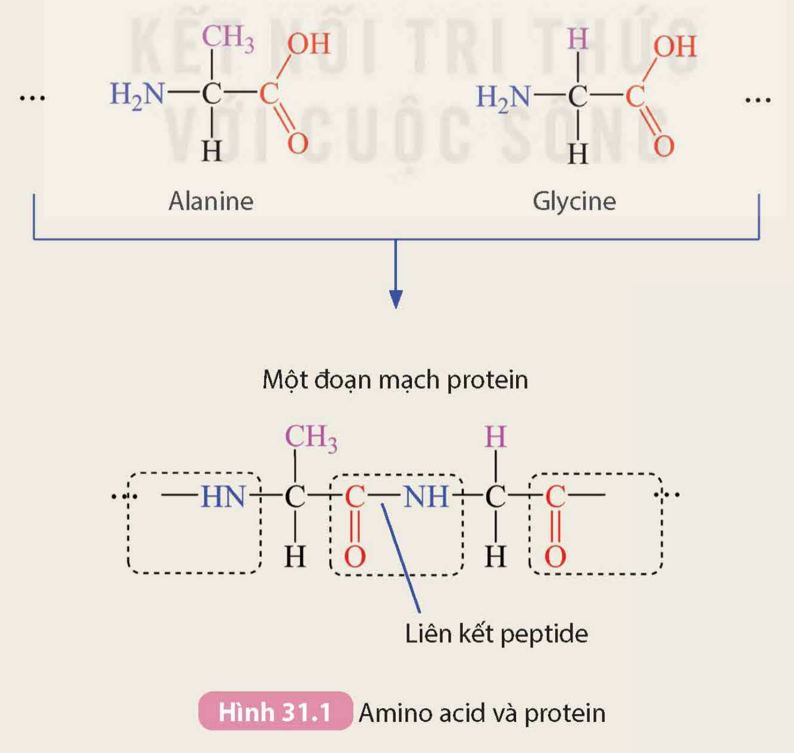
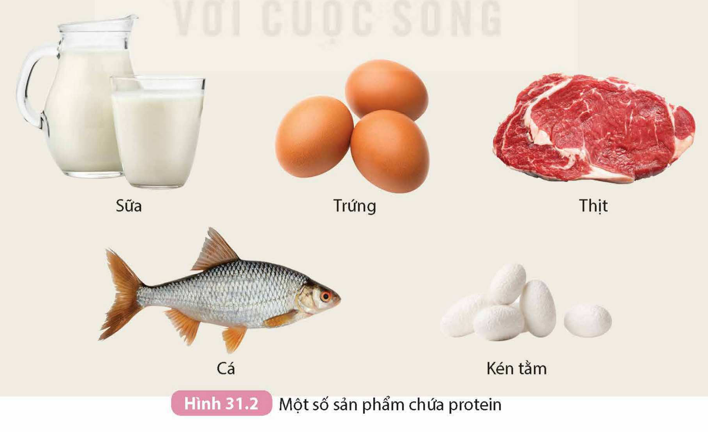

<!-- pdf:140 -->

# BÀI 31: PROTEIN

## 🎯 Mục tiêu

- Nêu được khái niệm, đặc điểm cấu tạo phân tử (do nhiều amino acid tạo nên, liên kết peptide) và khối lượng phân tử của protein.
- Trình bày được tính chất hoá học của protein: Phản ứng thuỷ phân có xúc tác acid, base hoặc enzyme, bị đông tụ khi có tác dụng của acid, base hoặc nhiệt độ; dễ bị phân huỷ khi đun nóng mạnh.
- Tiến hành được (hoặc quan sát qua video) thí nghiệm của protein: bị đông tụ khi có tác dụng của $\ce{HCl}$, nhiệt độ, dễ bị phân huỷ khi đun nóng mạnh.
- Phân biệt được protein (len lông cừu, tơ tằm) với chất khác (tơ nylon).
- Trình bày được vai trò của protein đối với cơ thể con người.

## 🔴 Mở đầu

Protein đóng vai trò đặc biệt quan trọng trong cơ thể sinh vật như cấu tạo thành tế bào, vận chuyển chất, xúc tác (enzyme), nội tiết tố (hormone), kháng thể ... Protein có cấu tạo như thế nào và có tính chất đặc trưng gì?

## I. Khái niệm, cấu tạo

> ✋ Hình 31.1 mô tả một số amino acid (alanine và glycine) và một đoạn mạch protein tạo thành từ các amino acid này. Quan sát Hình 31.1 và thực hiện các yêu cầu sau:
>
> 1. Điểm giống và khác nhau giữa các amino acid này là gì?
>
> 2. Các amino acid này đã kết hợp lại với nhau hình thành protein bằng cách nào?
>
> 
>
> Hình 31.1. Amino acid và protein

<!-- pdf:141 -->

**Protein** là những hợp chất hữu cơ phức tạp có khối lượng phân tử rất lớn, gồm nhiều đơn vị amino acid liên kết với nhau bởi liên kết peptide.

Khối lượng phân tử của protein rất lớn, thường từ khoảng vài chục nghìn đến hàng triệu $\text{amu}$.

## II. Tính chất hoá học

> ✋ Thí nghiệm về tính chất của protein
>
> *Chuẩn bị:* lòng trắng trứng, dung dịch $\ce{HCl}$ $1\text{ M}$; $3$ ống nghiệm, đèn cồn.
>
> *Tiến hành:*
>
> Lấy khoảng $2\text{ mL}$ lòng trắng trứng cho vào mỗi ống nghiệm.
>
> 1. Thêm vài giọt $\ce{HCl}$ $1\text{ M}$ vào ống nghiệm thứ nhất.
> 2. Hơ nóng nhẹ ống nghiệm thứ hai trên ngọn lửa đèn cồn trong khoảng $1$ phút.
> 3. Đun nóng ống nghiệm thứ ba trên ngọn lửa đèn cồn cho đến khi thấy có mùi khét.
>
> *Thực hiện yêu cầu sau:*
>
> Quan sát và nhận xét hiện tượng ở ba ống nghiệm.

<!-- term: Sự đông tụ protein -->
Protein bị thay đổi tính chất dưới tác dụng của acid, base hoặc nhiệt độ. Dưới tác dụng của một trong số các tác nhân này, protein có thể bị đông tụ.

Khi bị đun nóng ở nhiệt độ cao và không có nước, protein bị phân huỷ hoặc cháy, tạo ra các chất bay hơi và có mùi khét.

<!-- term: Liên kết peptide -->
Protein bị thuỷ phân dưới tác dụng của acid, base hoặc enzyme. Quá trình thuỷ phân hoàn toàn protein tạo ra các amino acid cấu thành nên protein đó. Phản ứng thuỷ phân xảy ra tại liên kết peptide.

$$\text{Protein} + \ce{H2O ->[\text{Acid/base/enzyme}] \text{Amino acid}}$$
<!-- ocr-ok: đối chiếu trực tiếp ảnh trang PDF 141 (sơ đồ phản ứng thuỷ phân protein) -->

## III. Vai trò và ứng dụng của protein

Hình 31.2. Một số sản phẩm chứa protein

<!-- pdf:142 -->

> ✋ Từ Hình 31.2 và những hiểu biết của em trong thực tế cuộc sống, hãy cho biết một số ứng dụng của protein.

Trong cơ thể người, các protein có cấu trúc đa dạng tương ứng với các vai trò quan trọng khác nhau, như vai trò cấu trúc (cấu tạo nên cơ bắp, da, tóc,...), vai trò xúc tác (các enzyme), vai trò nội tiết tố (các loại hormone), vai trò vận chuyển (như hemoglobin vận chuyển oxygen đến các tế bào),...

Protein là một trong những nguồn thực phẩm quan trọng. Một số protein được dùng làm nguyên liệu sản xuất một số loại tơ tự nhiên (như tơ tằm). Khi đốt cháy, các loại tơ này sẽ có mùi khét đặc trưng (giống mùi tóc cháy) nên có thể dùng phương pháp này để phân biệt tơ tự nhiên với các loại tơ tổng hợp (như tơ nylon).

> ❓ 1. Các enzyme là các protein đóng vai trò chất xúc tác trong các phản ứng sinh hoá. Em hãy viết sơ đồ của hai phản ứng có enzyme là chất xúc tác diễn ra trong cơ thể người.
>
> 2. Nêu cách phân biệt tơ tự nhiên (tơ tằm) với tơ tổng hợp (tơ nylon).

## 📌 Em đã học

- Protein là những hợp chất hữu cơ phức tạp có khối lượng phân tử rất lớn, gồm nhiều đơn vị amino acid liên kết với nhau bởi liên kết peptide.
- Protein bị thuỷ phân trong môi trường acid, base hoặc dưới tác dụng của enzyme, bị đông tụ dưới tác dụng của acid, base hoặc nhiệt độ và dễ bị phân huỷ khi đun nóng mạnh.
- Protein là một trong các nguồn thực phẩm quan trọng. Một số protein là nguồn nguyên liệu để sản xuất tơ sợi tự nhiên.
- Khi đốt cháy, protein bị phân huỷ tạo ra mùi khét.

## ✏️ Em có thể

- Lựa chọn thực phẩm giàu protein cho chế độ ăn uống hằng ngày nhằm cung cấp đủ lượng protein cần thiết, giúp cơ thể phát triển khoẻ mạnh.
- Vận dụng tính chất của protein trong chế biến thực phẩm.

## 📷 Danh sách hình trong bài

| Mã hình | Trang PDF | Vị trí trong bài | Chú thích gốc |
|---|---|---|---|
| H9-khoa_hoc_tu_nhien-b31-01 | 140 | Mục I, hộp Hoạt động | Hình 31.1. Amino acid và protein |
| H9-khoa_hoc_tu_nhien-b31-02 | 141 | Mục III | Hình 31.2. Một số sản phẩm chứa protein |
