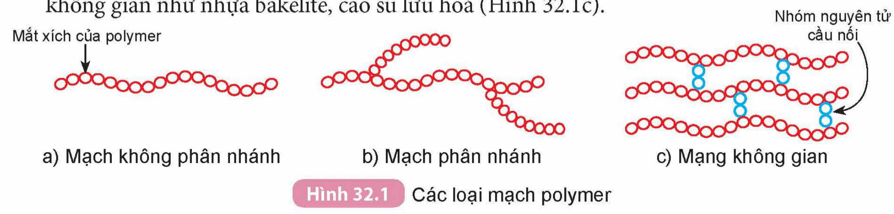
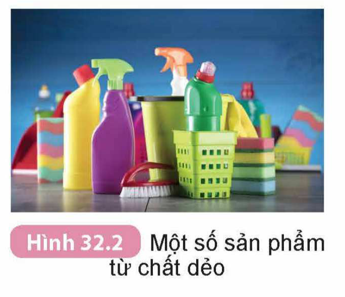
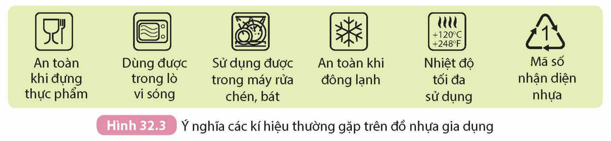
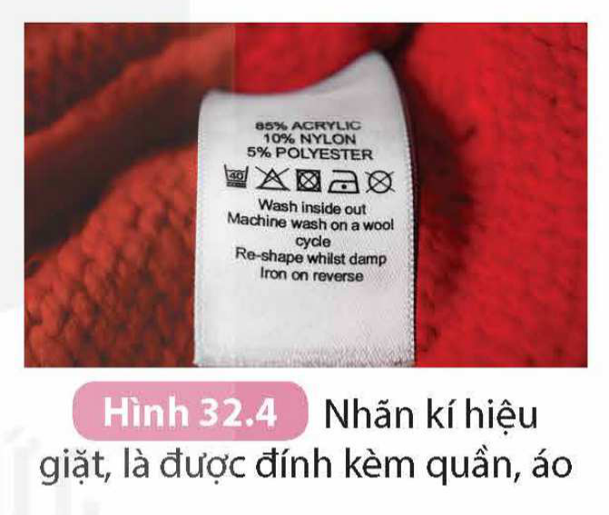
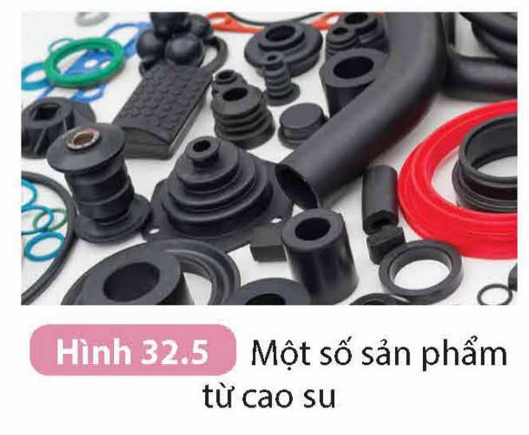
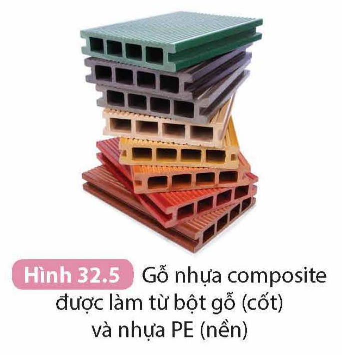
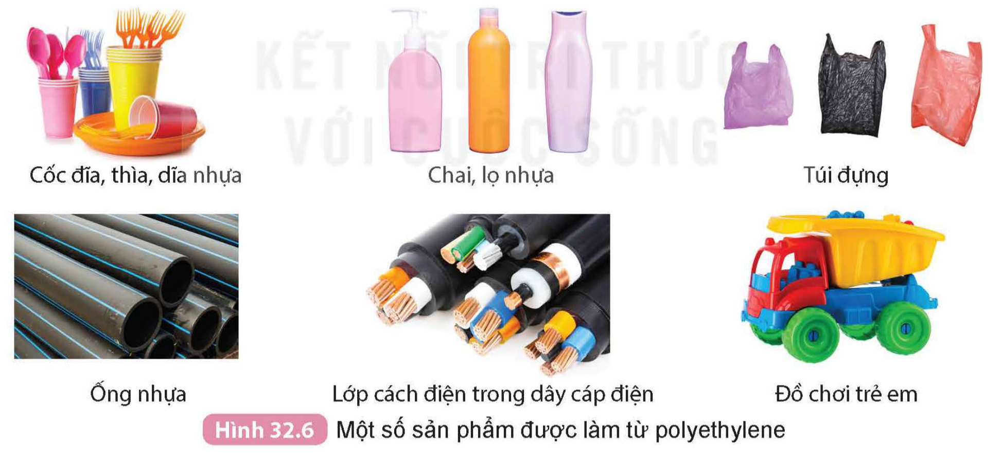
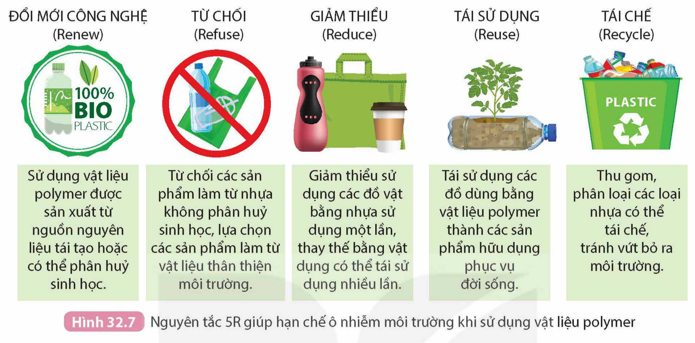

<!-- pdf:143 -->

# BÀI 32: POLYMER

## 🎯 Mục tiêu

- Nêu được khái niệm polymer, monomer, mắt xích,...; cấu tạo, phân loại polymer (polymer thiên nhiên và polymer tổng hợp).
- Trình bày được tính chất vật lí chung của polymer (trạng thái, khả năng tan).
- Viết được các phương trình hoá học của phản ứng điều chế PE, PP từ các monomer.
- Nêu được khái niệm chất dẻo, tơ, cao su, vật liệu composite và cách sử dụng, bảo quản một số vật dụng làm bằng chất dẻo, tơ, cao su trong gia đình an toàn, hiệu quả.
- Trình bày được ứng dụng của polyethylene; vấn đề ô nhiễm môi trường khi sử dụng polymer không phân huỷ sinh học (polyethylene) và các cách hạn chế gây ô nhiễm môi trường khi sử dụng vật liệu polymer trong đời sống.

## 🔴 Mở đầu

Vật liệu polymer được sử dụng rộng rãi trong đời sống hằng ngày cũng như trong công nghiệp. Vậy polymer là gì và có đặc điểm cấu tạo, tính chất như thế nào?

## I. Khái niệm, đặc điểm cấu tạo và phân loại

### 1. Khái niệm

> ✋ Tinh bột có công thức chung $\ce{(C6H10O5)_n}$, tinh bột được tạo thành do hàng nghìn đơn vị glucose kết hợp với nhau tạo nên. Các đơn vị glucose ($\ce{C6H10O5}$) này được gọi là mắt xích.
>
> Em có nhận xét gì về khối lượng phân tử của tinh bột?

**Polymer** là những chất có khối lượng phân tử rất lớn do nhiều đơn vị nhỏ (gọi là **mắt xích**) liên kết với nhau tạo nên.

Các phân tử nhỏ kết hợp với nhau tạo nên polymer được gọi là **monomer**.

Một số ví dụ về polymer, monomer và mắt xích được trình bày trong Bảng 32.1.

Bảng 32.1. Một số polymer thường gặp

| Công thức polymer – Tên gọi (kí hiệu) | Công thức monomer – Tên gọi | Mắt xích |
| :---: | :---: | :---: |
| $\ce{(-CH2-CH2-)_n}$ — polyethylene (PE) | $\ce{CH2=CH2}$ — ethylene | $\ce{-CH2-CH2-}$ |
| $\ce{(-CH2-\underset{\underset{\ce{CH3}}{|}}{CH}-)_n}$ — polypropylene (PP) | $\ce{CH2=\underset{\underset{\ce{CH3}}{|}}{CH}}$ — propylene | $\ce{-CH2-\underset{\underset{\ce{CH3}}{|}}{CH}-}$ |
<!-- ocr-ok: đối chiếu trực tiếp ảnh trang PDF 143 (Bảng 32.1 công thức polymer, monomer và mắt xích của PE, PP) -->

<!-- pdf:144 -->

### 2. Đặc điểm cấu tạo

Các mắt xích của polymer có thể nối với nhau thành mạch không phân nhánh như: amylose (Hình 32.1a); mạch phân nhánh như amylopectin, glycogen (Hình 32.1b); mạng không gian như nhựa bakelite, cao su lưu hoá (Hình 32.1c).

Hình 32.1. Các loại mạch polymer

### 3. Phân loại

Dựa vào nguồn gốc, polymer được chia thành hai loại chính:

- **Polymer thiên nhiên**: có sẵn trong tự nhiên như tinh bột, cellulose, protein (sợi tơ tằm, lông cừu), cao su thiên nhiên,...
- **Polymer tổng hợp**: được tổng hợp bằng phương pháp hoá học. Ví dụ: PE, PP,...

> ❓ Vận dụng kiến thức đã học ở *Bài 24. Alkene*, em hãy viết phương trình hoá học của phản ứng tổng hợp các polymer PE, PP từ các monomer tương ứng.

## II. Tính chất vật lí của polymer

Hầu hết polymer là những chất rắn, không bay hơi, không có nhiệt độ nóng chảy xác định (một số polymer không nóng chảy) và không tan trong nước. Một số polymer tan được trong một số dung môi hữu cơ.

> 🔍 Các polymer bị nóng chảy ở nhiệt độ cao được gọi là các **polymer nhiệt dẻo**. Tính chất này được ứng dụng trong sản xuất bằng cách đun nóng chảy polymer, sau đó đổ vào khuôn tạo hình rồi làm nguội sẽ thu được các vật dụng có hình thù mong muốn. Hiện nay, polymer nhiệt dẻo chiếm phần lớn tổng lượng polymer tiêu thụ trên toàn thế giới.

## III. Một số vật liệu polymer phổ biến

### 1. Chất dẻo

**Chất dẻo** là loại vật liệu được chế tạo từ các polymer có tính dẻo. **Tính dẻo** của vật liệu là tính bị biến dạng khi chịu tác dụng của nhiệt, áp lực bên ngoài và vẫn giữ được sự biến dạng đó khi thôi tác dụng.

Thành phần của chất dẻo gồm polymer, chất độn, chất hoá dẻo, chất tạo màu,...

Hình 32.2. Một số sản phẩm từ chất dẻo

Chất dẻo được dùng làm nguyên liệu để sản xuất nhiều loại vật dụng trong đời sống hằng ngày và nhiều ngành công nghiệp.

<!-- pdf:145 -->

Chất dẻo dễ bị mềm dẻo ở môi trường nhiệt độ cao, một số bị phân huỷ tạo thành các sản phẩm độc hại. Vì vậy, không để các vật dụng làm từ chất dẻo ở gần nguồn nhiệt cao (bếp gas, lò nướng,...), hạn chế sử dụng các đồ dùng bằng nhựa đựng thức ăn nóng. Trên các vỏ chai, hộp, đồ dùng bằng nhựa thường có các kí hiệu an toàn và kí hiệu phân loại nhựa. Vì vậy, cần lưu ý tìm hiểu thông tin để lựa chọn đồ nhựa phù hợp với mục đích sử dụng (Hình 32.3).

Hình 32.3. Ý nghĩa các kí hiệu thường gặp trên đồ nhựa gia dụng

> ❓ Các kí hiệu in trên đồ nhựa gia dụng có ý nghĩa gì? Hãy quan sát các kí hiệu in trên các vật dụng bằng nhựa trong gia đình và tìm hiểu xem chúng được làm từ loại nhựa nào, cần lưu ý gì khi sử dụng.

### 2. Tơ

**Tơ** là những vật liệu polymer có cấu tạo mạch không phân nhánh và có thể kéo dài thành sợi.

Dựa vào nguồn gốc, tơ thường được chia thành: **tơ thiên nhiên** (như tơ tằm, bông vải, len lông cừu,...); **tơ tổng hợp** (như tơ nylon, tơ polyester,...);...

Mỗi loại tơ có các tính chất đặc trưng khác nhau, vì vậy để các vật dụng làm từ tơ (quần áo, chăn, ga,...) được bền, đẹp, cần đọc kĩ hướng dẫn sử dụng trước khi giặt, là để lựa chọn chế độ giặt (nếu giặt bằng máy), nhiệt độ là, sấy và chất giặt rửa phù hợp.

Hình 32.4. Nhãn kí hiệu giặt, là được đính kèm quần, áo

> ❓ Nhãn kí hiệu đính kèm quần áo có ý nghĩa gì? Hãy quan sát các nhãn kí hiệu đính kèm quần, áo và tìm hiểu ý nghĩa của các kí hiệu đó.

### 3. Cao su

**Cao su** là vật liệu polymer có tính đàn hồi. **Tính đàn hồi** là tính bị biến dạng khi bị tác dụng của lực bên ngoài và trở lại trạng thái ban đầu khi lực đó thôi tác dụng.

Cao su được phân thành hai loại: **cao su thiên nhiên** (được lấy từ mủ cây cao su) và **cao su tổng hợp** (được tổng hợp từ một số monomer).

Cao su có tính chất đàn hồi, không thấm nước, không thấm khí, chịu mài mòn, cách điện,... nên được sử dụng rộng rãi trong nhiều lĩnh vực như sản xuất các loại lốp xe, băng tải cao su, ống dẫn, gioăng đệm, áo lặn,... (Hình 32.5).

Hình 32.5. Một số sản phẩm từ cao su

<!-- pdf:146 -->

Nói chung, khi sử dụng các vật dụng làm từ cao su, chú ý không để ở nơi có nhiệt độ quá cao (cao su sẽ bị chảy), nơi có nhiệt độ quá thấp (cao su sẽ bị giòn, cứng,...) hoặc nơi có ánh sáng mạnh (cao su nhanh bị lão hoá); hạn chế để xăng, dầu, mỡ, hoá chất dính vào cao su.

### 4. Vật liệu composite

**Vật liệu composite** là vật liệu được tổ hợp từ hai hay nhiều vật liệu khác nhau, gồm *vật liệu cốt* và *vật liệu nền*.

**Vật liệu cốt** có vai trò tăng cường tính cơ học của vật liệu, thường ở dạng sợi (sợi thuỷ tinh, sợi carbon,...) và dạng hạt.

**Vật liệu nền** thường là các vật liệu có độ dẻo lớn (như một số polymer) đóng vai trò liên kết các vật liệu cốt với nhau).

Hình 32.5. Gỗ nhựa composite được làm từ bột gỗ (cốt) và nhựa PE (nền)
<!-- ocr-ok: đối chiếu trực tiếp ảnh trang PDF 146 (chú thích Hình 32.5 in trùng số hiệu bị OCR đọc lỗi) -->

Vật liệu composite được ứng dụng rộng rãi như làm ống dẫn nước, bồn chứa nước và hoá chất, vật liệu xây dựng, thân vỏ ô tô, máy bay, tàu thuyền,...

> ✋ Em hãy tìm hiểu về các vật dụng trong gia đình được làm từ cao su, vật liệu composite.

## IV. Ứng dụng của polyethylene và vấn đề ô nhiễm môi trường

### 1. Ứng dụng của polyethylene

<!-- term: Polyethylene -->
Polyethylene (PE) là một polymer được sử dụng rất phổ biến để tạo ra nhiều sản phẩm gia dụng như túi đựng, màng bọc, chai lọ, ống nhựa, vỏ dây điện, đồ chơi trẻ em,...

Hình 32.6. Một số sản phẩm được làm từ polyethylene

### 2. Ô nhiễm môi trường do sử dụng vật liệu polymer

Hiện nay ô nhiễm môi trường gây ra do sử dụng polyethylene và các polymer không phân huỷ sinh học đang ở mức đáng báo động, ảnh hưởng đến môi trường sinh thái, sự sinh trưởng, phát triển của động, thực vật và sức khoẻ con người. Việc lạm dụng các sản phẩm nhựa được làm từ polyethylene (túi, chai, lọ, bình nhựa, cốc, thìa nhựa dùng một lần,...) đã và đang để lại những hậu quả nghiêm trọng đối với môi trường.

<!-- pdf:147 -->

<!-- term: Nguyên tắc 5R -->
Để hạn chế tình trạng gây ô nhiễm môi trường khi sử dụng vật liệu polymer, theo khuyến cáo của Bộ Tài nguyên và Môi trường, cần áp dụng nguyên tắc 5R để giảm thiểu rác thải nhựa (Hình 32.7).

Hình 32.7. Nguyên tắc 5R giúp hạn chế ô nhiễm môi trường khi sử dụng vật liệu polymer

> ✋ Việc lạm dụng các sản phẩm nhựa trong đời sống có ảnh hưởng gì đến môi trường? Hãy trình bày các biện pháp để giảm thiểu rác thải nhựa (túi, chai, lọ, cốc nhựa, ống hút, hộp đựng thực phẩm ăn nhanh,...) trong gia đình em.

## 📌 Em đã học

- Polymer là những chất có khối lượng phân tử rất lớn do nhiều mắt xích liên kết với nhau.
- Các phân tử nhỏ kết hợp với nhau tạo nên polymer được gọi là monomer.
- Các polymer thường là chất rắn, không tan trong nước, không có nhiệt độ nóng chảy xác định.
- Polyethylene được sử dụng rộng rãi trong nhiều lĩnh vực khác nhau. Tuy nhiên, việc sử dụng và thải bỏ vật liệu làm từ polyethylene không đúng cách là nguyên nhân gây ô nhiễm môi trường, do đó cần áp dụng những nguyên tắc nhằm giảm thiểu việc sử dụng polyethylene và các vật liệu polymer không phân huỷ sinh học.

## ✏️ Em có thể

- Nhận biết được các vật dụng làm từ polymer và biết cách sử dụng, bảo quản một số vật dụng làm bằng chất dẻo, tơ, cao su trong gia đình an toàn, hiệu quả.
- Biết cách phân loại để tái chế một số rác thải nhựa.
- Biết được các tác hại của rác thải nhựa, từ đó có biện pháp để giảm thiểu rác thải nhựa.

## 📷 Danh sách hình trong bài

| Mã hình | Trang PDF | Vị trí trong bài | Chú thích gốc |
|---|---|---|---|
| H9-khoa_hoc_tu_nhien-b32-01 | 144 | Mục I.2 (cạnh trên sát dòng văn bản bên trái) | Hình 32.1. Các loại mạch polymer |
| H9-khoa_hoc_tu_nhien-b32-02 | 144 | Mục III.1 | Hình 32.2. Một số sản phẩm từ chất dẻo |
| H9-khoa_hoc_tu_nhien-b32-03 | 145 | Mục III.1 | Hình 32.3. Ý nghĩa các kí hiệu thường gặp trên đồ nhựa gia dụng |
| H9-khoa_hoc_tu_nhien-b32-04 | 145 | Mục III.2 | Hình 32.4. Nhãn kí hiệu giặt, là được đính kèm quần, áo |
| H9-khoa_hoc_tu_nhien-b32-05 | 145 | Mục III.3 | Hình 32.5. Một số sản phẩm từ cao su |
| H9-khoa_hoc_tu_nhien-b32-06 | 146 | Mục III.4 | Hình 32.5. Gỗ nhựa composite được làm từ bột gỗ (cốt) và nhựa PE (nền) |
| H9-khoa_hoc_tu_nhien-b32-07 | 146 | Mục IV.1 | Hình 32.6. Một số sản phẩm được làm từ polyethylene |
| H9-khoa_hoc_tu_nhien-b32-08 | 147 | Mục IV.2 | Hình 32.7. Nguyên tắc 5R giúp hạn chế ô nhiễm môi trường khi sử dụng vật liệu polymer |
