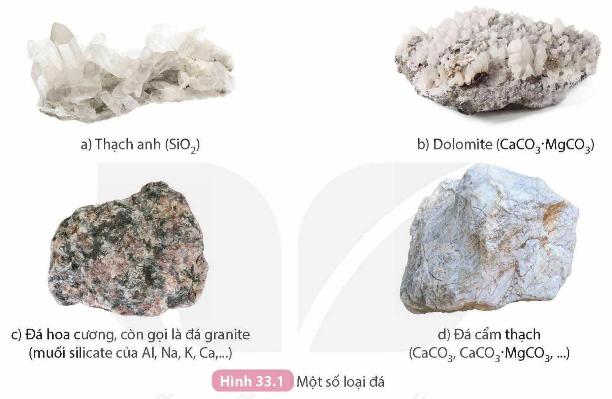

<!-- pdf:148 -->

# BÀI 33: SƠ LƯỢC VỀ HOÁ HỌC VỎ TRÁI ĐẤT VÀ KHAI THÁC TÀI NGUYÊN TỪ VỎ TRÁI ĐẤT

## 🎯 Mục tiêu

- Nêu được hàm lượng các nguyên tố hoá học chủ yếu trong vỏ Trái Đất.
- Phân loại được các dạng chất chủ yếu trong vỏ Trái Đất (oxide, muối,...).
- Trình bày được những lợi ích cơ bản về kinh tế, xã hội từ việc khai thác vỏ Trái Đất (nhiên liệu, vật liệu, nguyên liệu); lợi ích của sự tiết kiệm và bảo vệ nguồn tài nguyên, sử dụng vật liệu tái chế,... phục vụ cho sự phát triển bền vững.

## 🔴 Mở đầu

Hãy kể tên một số nguyên tố hoá học chủ yếu trong vỏ Trái Đất. Chúng ở trong các loại hợp chất nào? Các chất này có có phải là nguồn tài nguyên vô tận để con người khai thác không?

## I. Hàm lượng các nguyên tố hoá học chủ yếu trong vỏ Trái Đất

**Vỏ Trái Đất** là phần cứng (đất, đá) ở ngoài cùng của Trái Đất$^{(1)}$. Hầu hết các nguyên tố hoá học đều được tìm thấy ở vỏ Trái Đất, trong đó nhiều nhất là oxygen, silicon, nhôm, sắt, calcium, natri, kali (potassium), magnesium.

Bảng 33.1. Hàm lượng của các nguyên tố hoá học chủ yếu trong vỏ Trái Đất $^{(2)}$

| Nguyên tố | Thành phần ($\%$) | Nguyên tố | Thành phần ($\%$) |
| :---: | :---: | :---: | :---: |
| $\ce{O}$ | $46,10$ | $\ce{Ca}$ | $4,15$ |
| $\ce{Si}$ | $28,20$ | $\ce{Na}$ | $2,36$ |
| $\ce{Al}$ | $8,23$ | $\ce{K}$ | $2,09$ |
| $\ce{Fe}$ | $5,63$ | $\ce{Mg}$ | $2,33$ |

> ❓ Dựa vào số liệu ở Bảng 33.1, vẽ biểu đồ thành phần phần trăm về khối lượng các nguyên tố dưới dạng hình tròn và dạng cột. Đọc biểu đồ và rút ra nhận xét về hàm lượng các nguyên tố trong vỏ Trái Đất.

> $^{(1)}$ Vỏ Trái Đất có bề dày trung bình khoảng $7\text{ km}$ (dưới đáy đại dương) và $35\text{ km}$ (trên các lục địa) (nguồn: Haynes, W. M., Lide, D. R. & Bruno, T. J. 2017. *CRC Handbook of Chemistry and Physics*, 97th Edition, CRC Press LLC.)
>
> $^{(2)}$ Nguồn: Haynes, W. M., Lide, D. R. & Bruno, T. J. 2017. *CRC Handbook of Chemistry and Physics*, 97th Edition, CRC Press LLC.
<!-- ocr-ok: đối chiếu trực tiếp ảnh trang PDF 148 (chú thích chân trang chữ nhỏ) -->

<!-- pdf:149 -->

## II. Các dạng chất chủ yếu trong vỏ Trái Đất

<!-- term: Khoáng chất -->
Lớp vỏ cứng của vỏ Trái Đất được tạo thành từ nhiều loại đất, đá và chứa các khoáng chất khác nhau. Thành phần chủ yếu của các khoáng chất này là các oxide và muối.

Các oxide phổ biến nhất là $\ce{SiO2}$ và $\ce{Al2O3}$. Silicon oxide là thành phần chính của cát trắng, thạch anh (quartz). Aluminium oxide có nhiều trong quặng bauxite.

Muối silicate có trong mica, feldspar, đá hoa cương,... Muối carbonate có trong đá vôi, đá phấn, dolomite, đá cẩm thạch,...

Hình 33.1. Một số loại đá
<!-- ocr-ok: đối chiếu trực tiếp ảnh trang PDF 149 (chú thích Hình 33.1 bị OCR đọc sót) -->

> ✋ Tìm hiểu thành phần hoá học của một số loại đá
>
> Quan sát Hình 33.1 và cho biết:
>
> 1. Các loại đá trong hình được tạo thành chủ yếu từ các nguyên tố hoá học nào?
>
> 2. Các chất có trong thành phần chủ yếu của các loại đá trên thuộc loại hợp chất hoá học nào?

> ❓ Hãy cho biết các dạng chất chủ yếu trong vỏ Trái Đất.

## III. Khai thác tài nguyên từ vỏ Trái Đất

Nhiều nhiên liệu, nguyên liệu, vật liệu phục vụ cho hoạt động sống và sản xuất của con người được khai thác từ vỏ Trái Đất. Các nhiên liệu như dầu, than và khí đốt được khai thác từ mỏ dầu, mỏ than và mỏ khí thiên nhiên. Các quặng giàu nguyên tố kim loại nhôm, sắt, đồng,... được khai thác để sản xuất kim loại hay hợp kim, dùng làm vật liệu cho các ngành công nghiệp. Các quặng giàu nguyên tố phi kim như lưu huỳnh, phosphorus, nitrogen dùng làm nguyên liệu để sản xuất hoá chất và phân bón. Đá vôi dùng làm nguyên liệu cho ngành sản xuất vật liệu xây dựng, công nghiệp silicate,...

<!-- pdf:150 -->

Hoạt động khai thác tài nguyên sẵn có từ vỏ Trái Đất đã đem lại lợi ích kinh tế, xã hội to lớn. Tuy nhiên, sau nhiều năm khai thác, các mỏ này đang dần cạn kiệt, đồng thời xuất hiện các bãi phế thải khổng lồ, gây ô nhiễm môi trường. Do đó, bắt buộc con người phải biết cùng nhau tiết kiệm, bảo vệ nguồn tài nguyên, sử dụng vật liệu tái chế,... để hướng tới sự phát triển bền vững.

> ✋ 1. Hãy tìm hiểu thành phần hoá học và ứng dụng của cát. Việc khai thác cát trái phép ở các lòng sông, bãi biển có thể gây ra hậu quả gì?
>
> 2. Viết bài thuyết trình và trình bày trước lớp về:
>
> - Lợi ích cơ bản về kinh tế, xã hội của việc khai thác tài nguyên từ vỏ Trái Đất.
> - Lợi ích của việc tiết kiệm, bảo vệ nguồn tài nguyên và sử dụng vật liệu tái chế.

## 📌 Em đã học

- Các nguyên tố hoá học chủ yếu trong vỏ Trái Đất là $\ce{O}$, $\ce{Si}$, $\ce{Al}$, $\ce{Fe}$, $\ce{Ca}$, $\ce{Na}$, $\ce{K}$,...
- Lớp đất, đá tạo thành vỏ Trái Đất, có thành phần hoá học là các oxide ($\ce{SiO2}$, $\ce{Al2O3}$,...), các muối (silicate, carbonate,...), các loại quặng giàu các nguyên tố kim loại và phi kim,... Các mỏ dầu, mỏ than, khí thiên nhiên là nguồn năng lượng quý của con người.
- Việc khai thác tài nguyên từ vỏ Trái Đất để làm nhiên liệu, vật liệu, nguyên liệu đem lại nguồn lợi ích kinh tế khổng lồ. Cần tiết kiệm và bảo vệ nguồn tài nguyên, sử dụng vật liệu tái chế,... phục vụ cho sự phát triển bền vững.

## ✏️ Em có thể

- Nêu được thành phần hoá học và công dụng của một số loại đất, đá thông dụng trong cuộc sống.
- Giải thích được vì sao cần sử dụng tiết kiệm các nguyên liệu, vật liệu và nhiên liệu khai thác từ tài nguyên thiên nhiên, ưu tiên sử dụng vật liệu tái chế.

## 📷 Danh sách hình trong bài

| Mã hình | Trang PDF | Vị trí trong bài | Chú thích gốc |
|---|---|---|---|
| H9-khoa_hoc_tu_nhien-b33-01 | 149 | Mục II | Hình 33.1. Một số loại đá |
