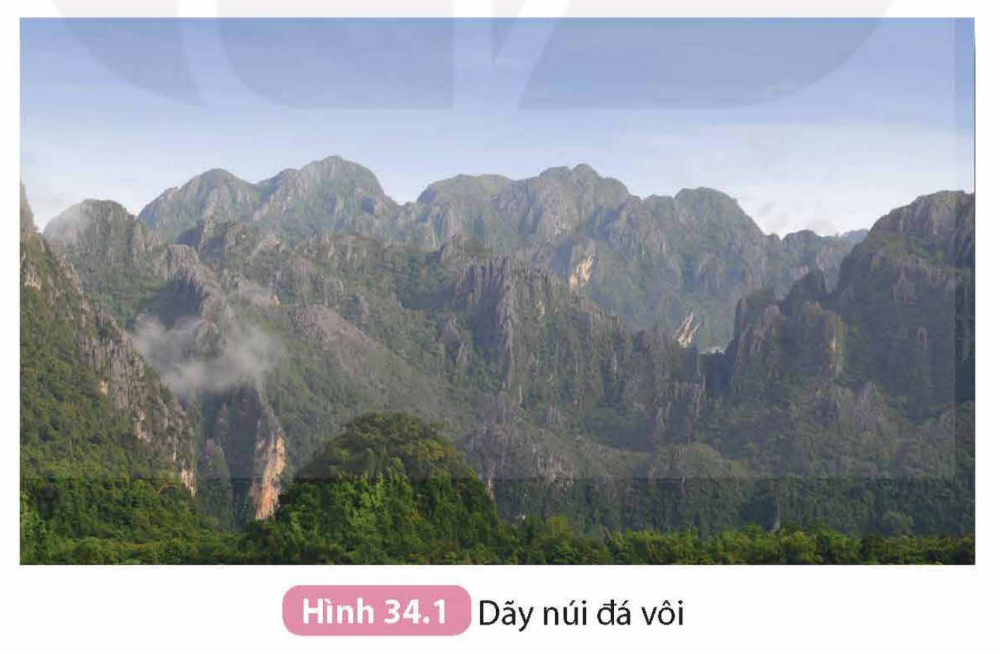
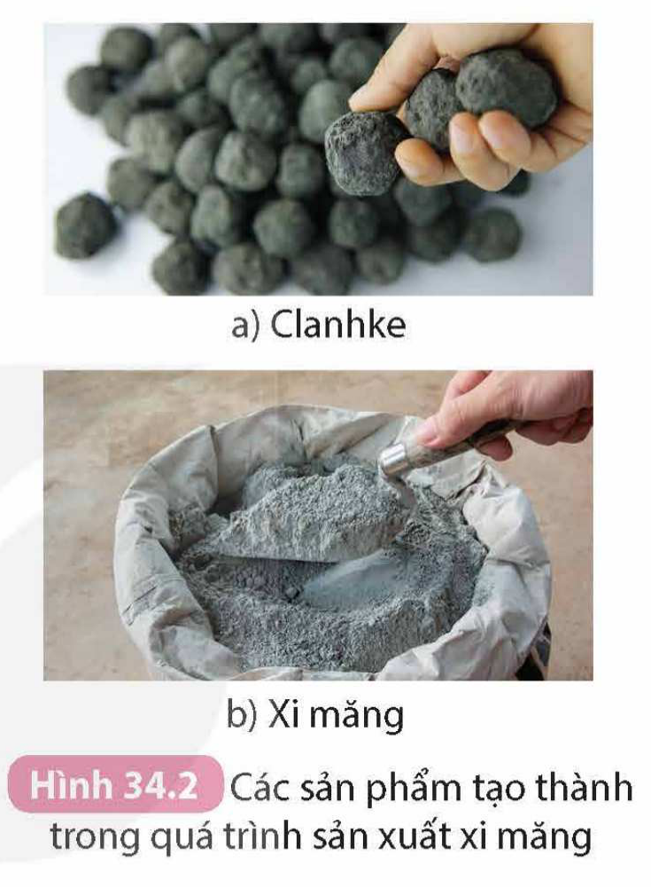

<!-- pdf:151 -->

# BÀI 34: KHAI THÁC ĐÁ VÔI. CÔNG NGHIỆP SILICATE

## 🎯 Mục tiêu

- Trình bày được nguồn đá vôi, thành phần chính của đá vôi trong tự nhiên; các ứng dụng từ đá vôi: sản phẩm đá vôi nghiền, calcium oxide, calcium hydroxide, nguyên liệu sản xuất xi măng.
- Nêu được một số ứng dụng quan trọng của silicon và hợp chất của silicon.
- Trình bày được sơ lược ngành công nghiệp silicate.
- Mô tả được các công đoạn chính sản xuất đồ gốm, thuỷ tinh, xi măng.

## 🔴 Mở đầu

Nhỏ dung dịch hydrochloric acid vào đá vôi, thấy bề mặt đá sủi bọt. Vậy đá vôi có thành phần chính là gì? Đá vôi được khai thác từ đâu và có những ứng dụng gì?

## I. Khai thác đá vôi

### 1. Nguồn đá vôi

<!-- term: Đá vôi -->
Đá vôi có nhiều ở vỏ Trái Đất, được tìm thấy ở những dãy núi đá, mỏ đá hay những bãi vỏ, xương động vật (san hô, vỏ ngao, ốc,...) ở ven biển (hoặc trước đây là ven biển). Ở nước ta, các dãy núi đá vôi tập trung nhiều ở các tỉnh thuộc Bắc Bộ và Bắc Trung Bộ.

Hình 34.1. Dãy núi đá vôi
<!-- ocr-ok: đối chiếu trực tiếp ảnh trang PDF 151 (chú thích Hình 34.1 bị OCR đọc lỗi) -->

> 🔍 Khai thác đá vôi có các bước chính sau:
>
> - Khoan và nổ mìn: khoan lỗ vào đá và lấp đầy chúng bằng chất nổ. Chất nổ sau đó được kích nổ, phá vỡ đá thành nhiều mảnh nhỏ hơn.
> - Bốc xếp và vận chuyển đá đến nhà máy.
> - Chế biến đá vôi: đá vôi được đập nhỏ và phân loại. Đá vôi đã xử lí sẽ được sử dụng trong các ngành công nghiệp khác nhau.
>
> Cần lưu ý là việc khai thác đá vôi có thể gây ra các tác động đến môi trường, bao gồm xói mòn đất, ô nhiễm nước và phá huỷ môi trường sống. Vì vậy, việc khai thác đá vôi cần phải được quy hoạch, cấp phép và thực hiện các biện pháp để giảm thiểu những tác động này.

<!-- pdf:152 -->

> ❓ Ở Việt Nam, đá vôi được khai thác chủ yếu từ nguồn tự nhiên nào?

### 2. Thành phần chính của đá vôi

<!-- term: Đá vôi -->
Đá vôi có thành phần chính là calcium carbonate ($\ce{CaCO3}$). Calcium carbonate là chất rắn màu trắng, không tan trong nước. Đá vôi thường lẫn tạp chất nên có nhiều màu sắc khác nhau.

> 🔍 Calcium carbonate tan dần trong nước có chứa khí carbon dioxide tạo ra muối tan là calcium hydrogen carbonate $\ce{Ca(HCO3)2}$. Muối này dưới tác động của môi trường có thể chuyển hoá thành $\ce{CaCO3}$ (rắn), khí $\ce{CO2}$ và hơi nước. Vì vậy, đá vôi trong tự nhiên bị bào mòn bởi nước mưa, đặc biệt là mưa acid, tạo thành các hang động.

### 3. Ứng dụng từ đá vôi

Đá vôi được sử dụng trong nhiều ngành như: xây dựng, công nghiệp, nông nghiệp.

**a) Đá vôi nghiền**

Đá vôi được nghiền thành hạt nhỏ mịn, dùng làm chất độn cao su trong sản xuất săm lốp xe, chất độn trong sản xuất chất dẻo,...; được sử dụng nhiều trong công nghiệp thuỷ tinh, xi măng,...

**b) Calcium oxide, calcium hydroxide**

Nung nóng đá vôi ở nhiệt độ cao xảy ra phản ứng phân huỷ tạo thành **vôi sống** (thành phần chính là calcium oxide) và khí carbon dioxide.

<!-- term: Calcium oxide -->
Calcium oxide ($\ce{CaO}$) là chất rắn, màu trắng, hút ẩm mạnh, phản ứng với nước tạo calcium hydroxide.

<!-- term: Calcium oxide -->
Calcium oxide được sử dụng làm nguyên liệu trong sản xuất thuỷ tinh, làm chất tạo xỉ trong luyện kim và còn được sử dụng trong xử lí nước thải, khử chua cho đất, khử trùng.

Calcium hydroxide ($\ce{Ca(OH)2}$) là chất rắn, màu trắng, ít tan trong nước, tạo dung dịch base mạnh (gọi là **nước vôi trong**).

Calcium hydroxide có nhiều ứng dụng như khử chua đất trồng, sản xuất clorua vôi dùng để tẩy trắng và khử trùng,...

> ❓ 1. Viết phương trình hoá học của phản ứng nhiệt phân đá vôi và phản ứng vôi sống tác dụng với nước.
>
> 2. Việc khai thác đá vôi có ảnh hưởng gì đến môi trường? Em hãy đề xuất một số biện pháp để giảm thiểu những tác động xấu đến môi trường do việc khai thác đá vôi.

<!-- pdf:153 -->

## II. Công nghiệp silicate

### 1. Ứng dụng của silicon và hợp chất chứa silicon

<!-- term: Silicon -->
Silicon là nguyên tố phổ biến thứ hai trong vỏ Trái Đất (chiếm $28,2\%$ về khối lượng, chỉ sau oxygen).

Trong tự nhiên, silicon chỉ tồn tại ở dạng hợp chất, chủ yếu là oxide ($\ce{SiO2}$) có trong thạch anh, các loại cát,... hoặc muối silicate có trong đất sét, cao lanh, mica,... Các hợp chất và khoáng chất này được sử dụng làm nguyên liệu cho công nghiệp silicate, sản xuất gốm, sứ, thuỷ tinh, xi măng,...

<!-- term: Silicon -->
Silicon tinh khiết là vật liệu bán dẫn, được sử dụng rộng rãi để chế tạo các vi mạch điện tử, thiết bị quang điện, cảm biến, pin Mặt Trời,...

<!-- term: Thạch anh -->
Thạch anh ($\ce{SiO2}$ gần nguyên chất) được sử dụng trong máy phát siêu âm, dụng cụ quang học, sản phẩm thuỷ tinh chịu nhiệt, sợi cáp quang,...

> ❓ 1. Hãy quan sát các vật dụng trong gia đình làm từ thuỷ tinh và cho biết vật dụng nào làm từ thuỷ tinh thường? Vật dụng nào làm từ thuỷ tinh chịu nhiệt.
>
> 2. Đất sét trắng (cao lanh) là nguồn tài nguyên có giá trị kinh tế lớn của Việt Nam. Em hãy tìm hiểu và cho biết các ứng dụng của đất sét trắng.

### 2. Ngành công nghiệp silicate

**Công nghiệp silicate** bao gồm các ngành sản xuất đồ gốm, thuỷ tinh, xi măng.

**a) Sản xuất đồ gốm**

- Gạch ngói:
  + Nghiền, phối trộn nguyên liệu (đất sét, nước,...) thành khối dẻo; tạo hình; phơi (sấy) khô sản phẩm thô.
  + Nung sản phẩm thô trong lò ở nhiệt độ cao trong khoảng thời gian thích hợp.
- Đồ sứ:
  + Nghiền, phối trộn nguyên liệu (đất sét trắng, cát trắng, nước,...) thành khối dẻo; tạo hình; phơi (sấy) khô sản phẩm thô.
  + Nung sản phẩm thô lần thứ nhất trong lò ở nhiệt độ cao trong khoảng thời gian thích hợp.
  + Tráng men, trang trí lên sản phẩm rồi nung lần hai.

Nước ta có nhiều nhà máy sản xuất gốm, sứ lớn ở Hà Nội, Hải Dương, Thành phố Hồ Chí Minh, Bình Dương, Đồng Nai,... và các làng nghề sản xuất gốm như Bát Tràng (Hà Nội), Phù Lãng (Bắc Ninh), Thổ Hà (Bắc Giang), Thanh Hà (Hội An), Bàu Trúc (Ninh Thuận),...

**b) Sản xuất thuỷ tinh**

<!-- term: Thuỷ tinh -->
Thuỷ tinh loại thông thường (được dùng làm cửa kính, chai lọ,...) là hỗn hợp của sodium silicate, calcium silicate. Thuỷ tinh loại này được sản xuất từ các nguyên liệu: cát thạch anh (cát trắng), đá vôi và soda ($\ce{Na2CO3}$).

Các công đoạn chính sản xuất thuỷ tinh:

- Trộn hỗn hợp cát trắng, đá vôi, soda theo một tỉ lệ thích hợp.

<!-- pdf:154 -->

- Nung hỗn hợp trong lò ở nhiệt độ cao khoảng $1\,400\ ^\circ\text{C}$ thành thuỷ tinh dạng nhão.
- Làm nguội từ từ được thuỷ tinh dẻo, ép thổi thuỷ tinh dẻo thành các đồ vật.

Các phương trình hoá học:

$$\ce{CaCO3 ->[t^\circ] CaO + CO2}$$
<!-- ocr-ok: đối chiếu trực tiếp ảnh trang PDF 154 (phương trình nhiệt phân CaCO3 trong sản xuất thuỷ tinh) -->

$$\ce{CaO + SiO2 ->[t^\circ] CaSiO3}$$
<!-- ocr-ok: đối chiếu trực tiếp ảnh trang PDF 154 (phương trình tạo CaSiO3 trong sản xuất thuỷ tinh) -->

$$\ce{Na2CO3 + SiO2 ->[t^\circ] Na2SiO3 + CO2}$$
<!-- ocr-ok: đối chiếu trực tiếp ảnh trang PDF 154 (phương trình tạo Na2SiO3 trong sản xuất thuỷ tinh) -->

Nước ta có nhiều cơ sở sản xuất thuỷ tinh ở Hải Phòng, Hà Nội, Bắc Ninh, Đà Nẵng, TP Hồ Chí Minh,...

**c) Sản xuất xi măng**

**Xi măng** là một loại vật liệu kết dính, được dùng trong xây dựng, đó là chất bột mịn, thường có màu lục xám.

Xi măng được sản xuất bằng cách nghiền nhỏ đá vôi, trộn với đất sét có nhiều $\ce{SiO2}$ và một ít quặng sắt rồi nung hỗn hợp trong lò quay, hoặc lò đứng ở $1\,400$ – $1\,600\ ^\circ\text{C}$. Sau khi nung, thu được hỗn hợp rắn, màu xám gọi là **clanhke** (clinker) (Hình 34.2a). Nghiền clanhke với thạch cao ($\ce{CaSO4.2H2O}$) (khoảng $5\%$) và một số chất phụ gia khác thành bột mịn sẽ thu được xi măng (Hình 34.2b).

Hình 34.2. Các sản phẩm tạo thành trong quá trình sản xuất xi măng
<!-- ocr-ok: đối chiếu trực tiếp ảnh trang PDF 154 (chú thích Hình 34.2 bên lề phải bị OCR đọc thiếu chữ đầu) -->

Nước ta có nhiều cơ sở sản xuất xi măng ở Hải Dương, Thanh Hoá, Hải Phòng, Hà Nam, Nghệ An, Tây Ninh, Hà Tiên,...

> ✋ Tìm hiểu thông tin trên sách, báo, internet về ngành công nghiệp silicate ở Việt Nam, viết bài thuyết trình theo dàn ý sau:
>
> 1. Ngành công nghiệp silicate gồm những ngành sản xuất nào? Kể tên một số nơi sản xuất chính ở Việt Nam.
>
> 2. Vì sao ở công đoạn ép, thổi thuỷ tinh dẻo thành các đồ vật, phải làm nguội từ từ?

## 📌 Em đã học

- Thành phần chính của đá vôi là $\ce{CaCO3}$. Đá vôi được dùng làm nguyên liệu sản xuất vôi, xi măng, thuỷ tinh, cao su, chất dẻo, gang,...
- Các hợp chất của silicon có trong cát, cao lanh, đất sét,... là nguyên liệu cho các ngành sản xuất gốm, sứ, thuỷ tinh, xi măng,...
- Silicon là vật liệu bán dẫn được sử dụng trong ngành công nghiệp điện tử.

## ✏️ Em có thể

- Đưa ra được ví dụ minh hoạ cho các ứng dụng quan trọng của silicon và các hợp chất của nó trong đời sống.
- Kể được tên các ngành sản xuất sử dụng nguyên liệu là đá vôi, đất sét, cát.

## 📷 Danh sách hình trong bài

| Mã hình | Trang PDF | Vị trí trong bài | Chú thích gốc |
|---|---|---|---|
| H9-khoa_hoc_tu_nhien-b34-01 | 151 | Mục I.1 | Hình 34.1. Dãy núi đá vôi |
| H9-khoa_hoc_tu_nhien-b34-02 | 154 | Mục II.2.c (mép trái nhãn sát cột văn bản) | Hình 34.2. Các sản phẩm tạo thành trong quá trình sản xuất xi măng |
