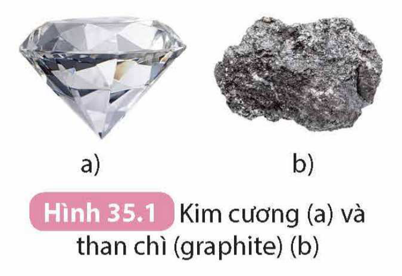
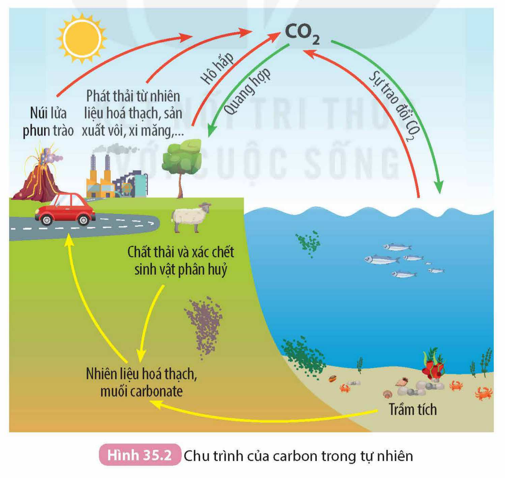

<!-- pdf:155 -->

# BÀI 35: KHAI THÁC NHIÊN LIỆU HOÁ THẠCH. NGUỒN CARBON. CHU TRÌNH CARBON VÀ SỰ ẤM LÊN TOÀN CẦU

## 🎯 Mục tiêu

- Nêu được khái niệm nhiên liệu hoá thạch.
- Trình bày được nguồn gốc tự nhiên và nguồn gốc nhân tạo của methane.
- Trình bày được lợi ích của việc sử dụng nhiên liệu hoá thạch và thực trạng của việc khai thác nhiên liệu hoá thạch hiện nay.
- Nêu được một số giải pháp hạn chế việc sử dụng nhiên liệu hoá thạch.
- Nêu được một số dạng tồn tại phổ biến của nguyên tố carbon trong tự nhiên (than, kim cương, carbon dioxide, các muối carbonate, các hợp chất hữu cơ).
- Trình bày được sản phẩm và sự phát năng lượng từ quá trình đốt cháy than, các hợp chất hữu cơ; chu trình carbon trong tự nhiên và vai trò của carbon dioxide trong chu trình đó.
- Nêu được khí carbon dioxide và methane là nguyên nhân chính gây hiệu ứng nhà kính, sự ấm lên toàn cầu.
- Trình bày được những bằng chứng của biến đổi khí hậu, thời tiết do tác động của sự ấm lên toàn cầu trong thời gian gần đây; những dự đoán về các tác động tiêu cực trước mắt và lâu dài.
- Nêu được một số biện pháp giảm lượng khí thải carbon dioxide ở trong nước và ở phạm vi toàn cầu.

## 🔴 Mở đầu

Nhiên liệu hoá thạch là gì? Việc khai thác và sử dụng nhiên liệu hoá thạch đã đem đến cho con người những lợi ích gì và việc này đã ảnh hưởng đến môi trường như thế nào?

## I. Khái niệm về nhiên liệu hoá thạch. Nguồn gốc hình thành khí methane

**Nhiên liệu hoá thạch** là các loại nhiên liệu tự nhiên được tạo thành từ quá trình phân huỷ các sinh vật bị chôn vùi cách đây hàng trăm triệu năm. Các nhiên liệu này chứa hàm lượng carbon cao.

<!-- term: Băng cháy -->
Nhiên liệu hoá thạch tồn tại ở thể rắn, lỏng và khí. Dạng rắn là than mỏ (than đá, than nâu, than bùn,...) chứa hàm lượng chính là carbon. Dạng lỏng là dầu mỏ, có thành phần chủ yếu là các hydrocarbon. Dạng khí chủ yếu là khí mỏ dầu và khí thiên nhiên (có hàm lượng methane lớn), băng cháy (hỗn hợp đông lạnh của nước và khí tự nhiên đậm đặc ở áp suất cao trên $30\text{ bar}$ và nhiệt độ thấp dưới $0\ ^\circ\text{C}$).

Khí methane được hình thành từ các quá trình biến đổi sinh học và địa chất trong tự nhiên. Ngoài ra, một lượng lớn khí methane còn được sinh ra nhân tạo từ các hoạt động của con người như từ sự phân huỷ sinh học các chất hữu cơ trong các bãi rác thải, quá trình sản xuất nông nghiệp, tiêu hoá thức ăn của gia súc, sản xuất công nghiệp và các quá trình chế biến, chưng cất hay sản xuất khí mỏ dầu.

> 🔍 Theo số liệu thống kê của BP (British Petroleum), cuối năm 2020, Việt nam có trữ lượng có thể khai thác: than đá $3,36$ tỉ tấn, dầu mỏ $4,4$ tỉ thùng và khí thiên nhiên $600$ tỉ $\text{m}^3$ $^{(1)}$.

> $^{(1)}$ Nguồn: BP 2021. *Statistical Review of World Energy 2021* | 70th edition. In: BP (ed.) *Statistical Review of World Energy*.
<!-- ocr-ok: đối chiếu trực tiếp ảnh trang PDF 155 (chú thích chân trang tiếng Anh chữ nhỏ) -->

<!-- pdf:156 -->

> ❓ 1. Em hãy cho biết: củi gỗ có phải là nhiên liệu hoá thạch không? Vì sao?
>
> 2. Em hãy tìm hiểu và cho biết ở nước ta, nhiên liệu hoá thạch tập trung nhiều tại các khu vực nào.
>
> 3. Các nhiên liệu hoá thạch có nguồn gốc hình thành là tự nhiên hay nhân tạo? Các nguồn nhiên liệu hoá thạch có phải vô tận không?

## II. Khai thác và sử dụng nhiên liệu hoá thạch

### 1. Thực trạng khai thác nhiên liệu hoá thạch hiện nay

Năng lượng hoá thạch là nguồn năng lượng chiếm tỉ lệ lớn nhất trong tổng các nguồn năng lượng khai thác hiện nay. Lượng nhiên liệu hoá thạch được khai thác và tiêu thụ hằng năm trên toàn cầu là rất lớn. Năm 2021, tổng lượng khai thác trên toàn cầu của dầu mỏ khoảng $95,70$ triệu thùng/ngày$^{(1)}$, khí đốt tự nhiên khoảng $4,177$ tỉ mét khối/ngày$^{(2)}$ và than đá khoảng $7,7$ tỉ tấn/năm$^{(3)}$.

Năm 1986, tấn dầu mỏ đầu tiên được khai thác ở mỏ Bạch Hổ đã đánh dấu bước phát triển đầu tiên của ngành công nghiệp dầu khí của Việt Nam. Năm 1987, Việt Nam bắt đầu xuất khẩu dầu thô và đến năm 2022, Việt Nam xếp thứ tư trong khối Đông Nam Á về xuất khẩu dầu mỏ$^{(4)}$. Sự phát triển của ngành công nghiệp dầu khí đã đóng góp rất quan trọng vào nền kinh tế quốc gia và khẳng định vấn đề chủ quyền của Việt Nam ở Biển Đông.

> ✋ 1. Dựa vào số liệu ở Bảng 35.1, hãy vẽ đồ thị sản lượng khai thác dầu thô của thế giới theo thời gian (năm). Từ đó rút ra nhận xét về tốc độ gia tăng khai thác dầu thô mỗi năm.
>
> Bảng 35.1. Sản lượng khai thác dầu thô của thế giới từ năm 1988 đến năm 2016$^{(5)}$
>
> | Năm | 1988 | 1992 | 1996 | 2000 | 2004 | 2008 | 2012 | 2016 |
> | :---: | :---: | :---: | :---: | :---: | :---: | :---: | :---: | :---: |
> | Sản lượng (tỉ thùng) | $23,7$ | $24,5$ | $26,2$ | $28,2$ | $30,5$ | $31,8$ | $33,2$ | $35,4$ |
>
> 2. Em hãy tìm hiểu thông tin trên sách, báo, internet,... thảo luận với các bạn trong lớp và viết báo cáo về thực trạng khai thác nhiên liệu hoá thạch ở Việt Nam: địa điểm khai thác, sản lượng và các lợi ích của việc sử dụng nguồn tài nguyên này.

### 2. Lợi ích và những hạn chế của việc sử dụng nhiên liệu hoá thạch

Nhiên liệu hoá thạch mang đến cho con người rất nhiều lợi ích thiết thực trong cuộc sống. Nhiên liệu này có sẵn trong tự nhiên với trữ lượng lớn, quá trình khai thác dễ dàng và nhanh chóng. Nhiên liệu hoá thạch giữ vai trò rất lớn trong các cuộc cách mạng công nghiệp trên toàn thế giới: than đá, dầu mỏ và khí thiên nhiên là nguồn nhiên liệu chính cho các nhà máy nhiệt điện, luyện kim, sản xuất xi măng, sản xuất hoá chất, giao thông

> $^{(1)}$ Nguồn: https://www.eia.gov/outlooks/steo/report/global_oil.php
>
> $^{(2)}$ Nguồn: https://yearbook.enerdata.net/natural-gas/world-natural-gas-production-statistics.html
>
> $^{(3)}$ Nguồn: *Coal 2021 Analysis and forecast to 2024* (IEA Publications)
>
> $^{(4)}$ Nguồn: pvn.vn
>
> $^{(5)}$ Nguồn: https://www.worldometers.info/oil/
<!-- ocr-ok: đối chiếu trực tiếp ảnh trang PDF 156 (chú thích chân trang URL chữ nhỏ) -->

<!-- pdf:157 -->

vận tải,... Chúng đáp ứng được các nhu cầu đa dạng của con người: thắp sáng, sưởi ấm, nấu nướng, đi lại,... Quá trình vận chuyển và bảo quản nhiên liệu hoá thạch dễ dàng, chi phí rẻ hơn rất nhiều so với năng lượng tái tạo.

Việc khai thác nhiên liệu hoá thạch với sản lượng lớn đang dẫn đến nguy cơ cạn kiệt nguồn tài nguyên này. Mặt khác, quá trình đốt cháy nhiên liệu hoá thạch sinh ra một lượng lớn các chất thải như carbon dioxide, carbon monoxide, các oxide của lưu huỳnh, oxide của nitrogen,... tác động tiêu cực đến môi trường và sức khoẻ con người. Hiện nay, nhiên liệu hoá thạch vẫn là nguồn năng lượng chính được sử dụng trên thế giới. Tuy nhiên, nguồn năng lượng này ngày càng cạn kiệt, ảnh hưởng tới môi trường ngày càng nặng nề nên việc nghiên cứu và sử dụng các nguồn năng lượng tái tạo để thay thế năng lượng hoá thạch trở thành vấn đề cấp thiết của tất cả các quốc gia trên toàn thế giới.

> ❓ 1. Viết phương trình hoá học của phản ứng đốt cháy ethylic alcohol, methane ($\ce{CH4}$), than ($\ce{C}$).
>
> 2. Đốt cháy gỗ, than đá, dầu hoả với cùng khối lượng, nhiên liệu nào giải phóng ra nhiều nhiệt nhất? Cho biết năng suất toả nhiệt (nhiệt lượng giải phóng khi đốt cháy $1\text{ gam}$ chất) của các nhiên liệu đó như sau:
>
> - Gỗ: khoảng $15$ – $20\text{ kJ/g}$.
> - Than đá: khoảng $20$ – $30\text{ kJ/g}$.
> - Dầu hoả: khoảng $42$ – $45\text{ kJ/g}$

### 3. Giải pháp hạn chế sử dụng nhiên liệu hoá thạch

Để hạn chế sử dụng nhiên liệu hoá thạch, các giải pháp sau cần được con người thực hiện đồng bộ, tích cực và liên tục: sử dụng tiết kiệm nhiên liệu hoá thạch; tăng cường đi lại bằng phương tiện giao thông công cộng và xe điện; ưu tiên sử dụng xăng pha ethanol, sinh khối$^{(1)}$, biodiesel$^{(2)}$,...

> ✋ Em hãy phân tích ý nghĩa của các việc làm theo gợi ý dưới đây và thuyết phục mọi người trong cộng đồng cùng thực hiện:
>
> 1. Đề xuất với gia đình một giải pháp để thay thế một phần năng lượng hoá thạch đang sử dụng.
>
> 2. Sử dụng các thiết bị tiết kiệm năng lượng; sử dụng lại đồ dùng hay phân loại để có thể tái chế đồ dùng bỏ đi.
>
> 3. Sử dụng phương tiện giao thông công cộng và xe điện.
>
> 4. Sử dụng nhiên liệu thân thiện với môi trường như sinh khối, xăng E5, biodiesel,...

> ❓ Gia đình em và địa phương nơi em sinh sống đã có hoạt động gì để hạn chế sử dụng nhiên liệu hoá thạch?

> $^{(1)}$ **Sinh khối** là dạng vật liệu từ sinh vật sống. Sinh khối có thể chuyển thành năng lượng theo ba cách: chuyển đổi nhiệt, chuyển đổi hoá học, chuyển đổi sinh hoá.
>
> $^{(2)}$ **Biodiesel** hay còn gọi là “**diesel sinh học**” là thuật ngữ dùng để chỉ loại nhiên liệu dùng cho động cơ diesel, được làm từ dầu thực vật hoặc mỡ động vật.

<!-- pdf:158 -->

> 🔍 Việc giảm thiểu phát thải khí nhà kính được nhiều nước thành viên Liên hiệp quốc thực hiện theo các công ước quốc tế. Các quốc gia thành viên cam kết giảm lượng khí thải nhà kính của họ đến mức tối thiểu để giữ cho nhiệt độ trung bình của Trái Đất không tăng quá $2\ ^\circ\text{C}$ so với thời kì đầu của nền công nghiệp thế giới, đồng thời thực hiện các biện pháp để tăng cường khả năng chống chịu với tác động của biến đổi khí hậu và hỗ trợ nhau trong việc chuyển đổi sang năng lượng sạch.

## III. Nguồn carbon trong tự nhiên

### 1. Trạng thái tự nhiên của carbon

Trong tự nhiên, carbon có thể tồn tại ở dạng đơn chất (than chì, kim cương), dạng hợp chất vô cơ (carbon dioxide, muối carbonate,...), hợp chất hữu cơ (hydrocarbon, carbohydrate, protein,...).

Hình 35.1. Kim cương (a) và than chì (graphite) (b)
<!-- ocr-ok: đối chiếu trực tiếp ảnh trang PDF 158 (chú thích Hình 35.1 bên lề phải bị OCR đọc lỗi) -->

### 2. Chu trình carbon trong tự nhiên và vai trò của carbon dioxide

Trong tự nhiên luôn có sự chuyển hoá carbon từ dạng này sang dạng khác. Sự chuyển hoá này diễn ra thường xuyên, liên tục và tạo thành chu trình khép kín như được mô tả trong Hình 35.2.

> ✋ Quan sát Hình 35.2 và cho biết vai trò của carbon dioxide trong tự nhiên.

Hình 35.2. Chu trình của carbon trong tự nhiên

<!-- pdf:159 -->

**Chu trình carbon** trong tự nhiên là một quá trình phức tạp, liên quan đến sự chuyển động và trao đổi carbon giữa khí quyển, đại dương, đất đai và các hệ sinh thái. Trong chu trình này, $\ce{CO2}$ đóng vai trò quan trọng trong việc duy trì sự cân bằng carbon trong hệ sinh thái và khí quyển của Trái Đất, thông qua các quá trình sau:

- Quá trình phát thải carbon ở dạng khí $\ce{CO2}$: $\ce{CO2}$ được chuyển vào khí quyển thông qua nhiều quá trình khác nhau như quá trình hô hấp của sinh vật, quá trình đốt cháy nhiên liệu hoá thạch, cháy rừng,...
- Quá trình hấp thụ carbon ở dạng khí $\ce{CO2}$: $\ce{CO2}$ được cây xanh sử dụng trong quá trình quang hợp để tạo ra các hợp chất hữu cơ. Các chất này sẽ được chuyển hoá thành hợp chất hữu cơ trong động vật khi động vật sử dụng thực vật làm nguồn dinh dưỡng. Khi thực vật, động vật bị vùi lấp, các hợp chất của carbon trong chúng phân huỷ thành muối carbonate, nhiên liệu hoá thạch,... Ngoài ra, $\ce{CO2}$ còn được hoà tan vào nước biển, sông, hồ,...

> ❓ 1. Nêu các dạng tồn tại của carbon trong tự nhiên ở dạng đơn chất, hợp chất vô cơ, hợp chất hữu cơ.
>
> 2. Hãy liệt kê một số nguồn phát thải khí carbon dioxide vào khí quyển. Để giảm thiểu phát thải carbon dioxide vào khí quyển chúng ta cần phải làm gì?

> ✋ Trình bày bằng bài viết hoặc nói về chu trình của carbon trong tự nhiên.

### 3. Nguyên nhân và hệ quả của hiệu ứng nhà kính, sự ấm lên toàn cầu

<!-- term: Hiệu ứng nhà kính -->
Khí carbon dioxide và khí methane trong khí quyển tuy chiếm hàm lượng rất thấp nhưng lại là các nguyên nhân chính gây ra hiệu ứng nhà kính trên Trái Đất. Trong thời đại công nghiệp (khoảng hơn $200$ năm gần đây), hàm lượng carbon dioxide và methane trong không khí tăng dần, làm cho nhiệt độ trên bề mặt Trái Đất nóng lên.

<!-- term: Sự ấm lên toàn cầu -->
Sự ấm lên toàn cầu diễn ra liên tục trong nhiều năm gần đây đã dẫn đến một số hệ quả như:

<!-- term: Sự ấm lên toàn cầu -->
- Thời tiết cực đoan: xuất hiện nhiều cơn bão lớn, lũ lụt và hạn hán kéo dài, gây thiệt hại cho mùa màng, nông sản.
- Băng tan, nước biển dâng: băng, tuyết ở các vùng cực và núi cao tan thành nước chảy ra biển, gây ra hiện tượng nước biển dâng. Nước biển dâng có thể gây lở đất ven biển, ngập lụt các khu vực đồng bằng, triều cường và xâm thực mặn, ảnh hưởng đến cuộc sống của hàng triệu người dân sống ở khu vực bờ biển.
- Sự acid hoá nước biển: lượng khí $\ce{CO2}$ tan trong nước biển tăng lên, ảnh hưởng tiêu cực đến môi trường sống của sinh vật biển.
- Thảm thực vật bị co hẹp, gia tăng tình trạng sa mạc hoá trên Trái Đất. Giới động vật bị suy giảm tính đa dạng sinh học,...

Để giảm thiểu lượng khí thải carbon dioxide, Việt Nam và các quốc gia cùng thực hiện hạn chế sử dụng năng lượng hoá thạch, tăng cường sử dụng năng lượng tái tạo, áp dụng công nghệ tiên tiến trong xử lí rác thải, tăng cường trồng cây gây rừng, phủ xanh đồi trọc, cải tạo đất hoang,...

<!-- pdf:160 -->

> ✋ Trình bày về:
>
> 1. Bằng chứng của sự biến đổi khí hậu do việc gia tăng hiệu ứng nhà kính.
>
> 2. Nêu một số biện pháp giảm lượng khí thải carbon dioxide ở phạm vi trong nước và phạm vi toàn cầu.
>
> 3. Trên cơ sở một số hệ quả của sự ấm lên toàn cầu, hãy dự đoán về các tác động tiêu cực trước mắt và lâu dài nếu không có các biện pháp giảm thiểu sự phát thải khí nhà kính.

> ❓ 1. Hãy cho biết nguyên nhân của sự gia tăng hàm lượng carbon dioxide, methane trong khí quyển, dẫn tới sự tăng nhiệt độ trung bình toàn cầu.
>
> 2. Vì sao nhiệt độ trung bình toàn cầu tăng lại dẫn tới nước biển dâng? Hiện tượng này gây ra tác hại gì?

> 🔍 Từ năm 1901 đến năm 2020, hàm lượng $\ce{CO2}$ trong khí quyển tăng từ $0,030\%$ đến $0,040\%$ góp phần quan trọng làm cho nhiệt độ Trái Đất tăng thêm $1,5\ ^\circ\text{C}$$^{(1)}$.

## 📌 Em đã học

- Nhiên liệu hoá thạch gồm than mỏ, dầu mỏ, khí mỏ dầu và khí thiên nhiên; chứa hàm lượng carbon cao; khi đốt cháy sinh ra khí carbon dioxide và toả nhiều nhiệt.
- Nhiên liệu hoá thạch có trữ lượng lớn, là nguồn năng lượng chủ yếu, đem lại lợi ích khổng lồ cho nền kinh tế. Tuy nhiên, việc khai thác và sử dụng quá mức đang dẫn đến nguy cơ cạn kiệt tài nguyên và gây ra ô nhiễm môi trường, biến đổi khí hậu trên Trái Đất. Vì vậy, cần hạn chế sử dụng nhiên liệu hoá thạch và tăng cường sử dụng các nguồn nhiên liệu có thể tái tạo được.
- Methane ($\ce{CH4}$) là thành phần chính của khí thiên nhiên, ngoài ra, chúng còn được sinh ra nhiều từ các bãi rác thải, từ quá trình chăn nuôi. Methane cùng với carbon dioxide là những khí gây hiệu ứng nhà kính, biến đổi khí hậu toàn cầu.
- Carbon trong tự nhiên tồn tại ở dạng đơn chất, hợp chất vô cơ và hợp chất hữu cơ. Sự chuyển hoá carbon từ dạng này sang dạng khác diễn ra thường xuyên, liên tục và tạo thành chu trình khép kín trong tự nhiên.

## ✏️ Em có thể

- Vận động mọi người hạn chế sử dụng nhiên liệu hoá thạch (thay bếp than, gas bằng bếp điện, từ; đi xe đạp, xe điện thay ô tô chạy xăng, dầu,...).
- Trồng rừng và bảo vệ rừng.

> $^{(1)}$ Nguồn: https://archive.epa.gov/climatechange/kids/documents/temp-and-co2.pdf
<!-- ocr-ok: đối chiếu trực tiếp ảnh trang PDF 160 (chú thích chân trang URL chữ nhỏ) -->

## 📷 Danh sách hình trong bài

| Mã hình | Trang PDF | Vị trí trong bài | Chú thích gốc |
|---|---|---|---|
| H9-khoa_hoc_tu_nhien-b35-01 | 158 | Mục III.1 | Hình 35.1. Kim cương (a) và than chì (graphite) (b) |
| H9-khoa_hoc_tu_nhien-b35-02 | 158 | Mục III.2 | Hình 35.2. Chu trình của carbon trong tự nhiên |
