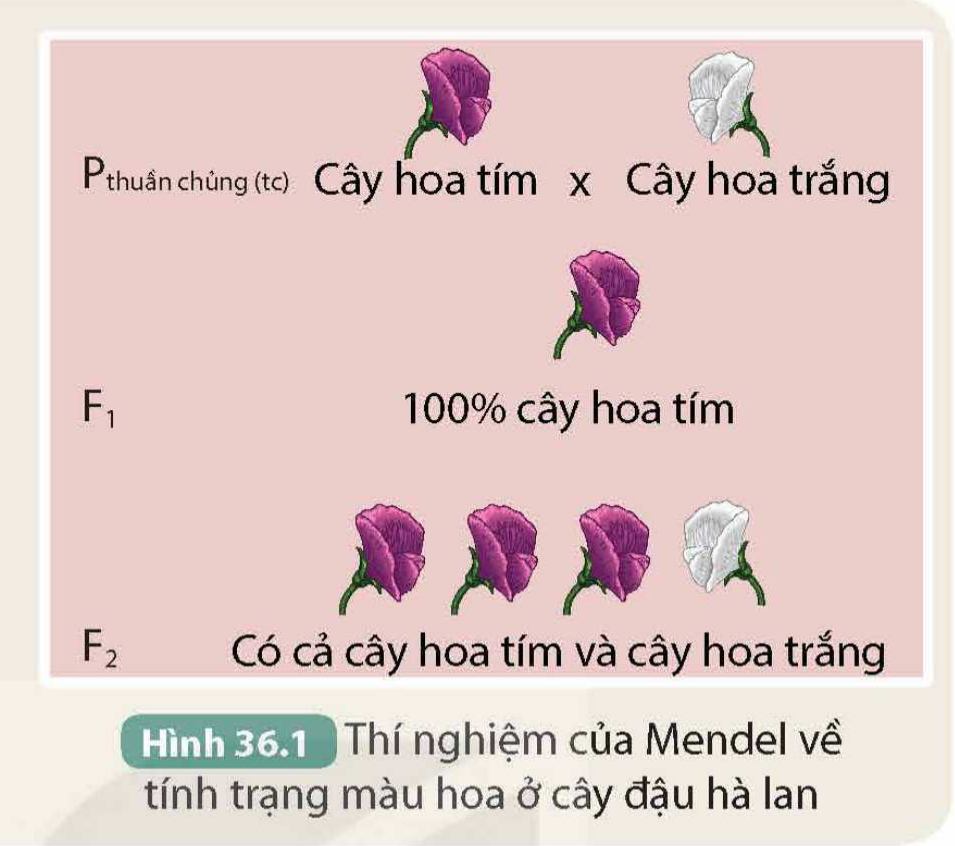

<!-- pdf:161 -->

# BÀI 36: KHÁI QUÁT VỀ DI TRUYỀN HỌC

## 🎯 Mục tiêu

- Nêu được khái niệm di truyền, khái niệm biến dị.
- Nêu được gene quy định di truyền và biến dị ở sinh vật, qua đó gene được xem là trung tâm của di truyền học.
- Nêu được ý tưởng của Mendel về nhân tố di truyền là cơ sở cho những nghiên cứu về gene.
- Dựa vào thí nghiệm lai một tính trạng, nêu được các thuật ngữ trong nghiên cứu các quy luật di truyền: tính trạng, nhân tố di truyền, cơ thể thuần chủng, tính trạng tương phản, tính trạng trội, tính trạng lặn, kiểu hình, kiểu gene, allele, dòng thuần.
- Phân biệt, sử dụng được một số kí hiệu trong nghiên cứu di truyền ($P$, $F_1$, $F_2$,...).

## 🔴 Mở đầu

Con sinh ra có những đặc điểm giống bố mẹ và có những đặc điểm khác bố mẹ. Theo em đó là hiện tượng gì?

## I. Khái niệm di truyền và biến dị

> ✋ Một cặp vợ chồng đều có tóc xoăn, người con thứ nhất của họ có tóc xoăn, đây là một ví dụ về hiện tượng di truyền; người con thứ hai của họ có tóc thẳng, đây là một ví dụ về hiện tượng biến dị.
>
> Đọc thông tin trên và thực hiện các yêu cầu sau:
>
> 1. Cho biết di truyền và biến dị là gì.
> 2. Lấy thêm ví dụ về hiện tượng di truyền và biến dị trong thực tế.

**Di truyền học** là khoa học nghiên cứu về tính di truyền và biến dị ở các sinh vật. Hiện tượng di truyền và biến dị do nhân tố di truyền nằm trong tế bào (sau này gọi là gene) quy định, do đó gene được xem là trung tâm của di truyền học.

## II. Mendel – người đặt nền móng cho di truyền học

### 1. Thí nghiệm của Mendel

Grego Johann Mendel (1822 – 1884) là người đầu tiên vận dụng phương pháp khoa học vào việc nghiên cứu di truyền, ông đã chọn đậu hà lan (*Pisum sativum*) là đối tượng nghiên cứu. Đặc điểm khác biệt giữa các cá thể đậu hà lan như màu hoa, màu hạt, hình dạng hạt,... được Mendel gọi là tính trạng, còn những trạng thái biểu hiện trái ngược nhau của một loại tính trạng như hạt vàng, hạt xanh,... được gọi là tính trạng tương phản.

<!-- pdf:162 -->

Trước khi tiến hành thí nghiệm, Mendel cho các cây đậu hà lan tự thụ phấn qua nhiều thế hệ để đảm bảo những cây con có tính trạng giống bố mẹ. Những cây đậu được tạo ra qua nhiều thế hệ tự thụ phấn được Mendel gọi là thuần chủng.

Một thí nghiệm lai điển hình của Mendel được mô tả trong Hình 36.1.

> ✋ Quan sát thí nghiệm trong Hình 36.1 và thực hiện các yêu cầu sau:
>
> 1. Trình bày các bước tiến hành và kết quả thí nghiệm.
> 2. Ở thế hệ $F_1$ và $F_2$ có xuất hiện dạng màu hoa pha trộn giữa hoa tím và hoa trắng hay không? Yếu tố quy định tính trạng hoa trắng (ở thế hệ $P$) có biến mất trong phép lai không?

Hình 36.1. Thí nghiệm của Mendel về tính trạng màu hoa ở cây đậu hà lan

Trong thí nghiệm trên, tính trạng hoa tím di truyền không hoà trộn vào tính trạng hoa trắng nên không xuất hiện hoa màu tím nhạt. Nhân tố quy định tính trạng hoa trắng không biến mất trong quá trình lai vì ở $F_2$ vẫn xuất hiện hoa trắng. Như vậy, nhân tố quy định hoa trắng bị che khuất khi đứng cạnh nhân tố quy định hoa tím, hoa tím là tính trạng trội, hoa trắng là tính trạng lặn. Từ kết quả đó, Mendel cho rằng mỗi tính trạng do một cặp nhân tố di truyền quy định (sau này gọi là gene), mỗi nhân tố di truyền là một allele, các nhân tố di truyền không hoà trộn vào nhau.

> ❓ Thế nào là nhân tố di truyền? Hãy chỉ ra tính trạng tương phản, tính trạng trội, tính trạng lặn trong phép lai của Mendel.

### 2. Ý tưởng của Mendel về nhân tố di truyền

Ở thế kỉ XIX, các nhà khoa học tin rằng vật chất di truyền của bố mẹ hoà trộn với nhau trong tế bào của cơ thể con như hai chất lỏng hoà trộn vào nhau. Kết quả thí nghiệm của Mendel được công nhận năm 1900 bác bỏ hoàn toàn quan niệm này. Mendel cho rằng đơn vị quy định sự di truyền của một tính trạng tồn tại thành từng cặp, gọi là cặp nhân tố di truyền (ngày nay gọi là cặp gene hay cặp allele, kí hiệu bằng cùng một chữ cái); các nhân tố di truyền không pha trộn vào nhau. Như vậy, mặc dù Mendel không đưa ra thuật ngữ gene hay allele, nhưng thực chất Mendel là người đầu tiên đưa ra khái niệm về gene và đây chính là cơ sở cho việc nghiên cứu về gene sau này.

> ❓ Vì sao ý tưởng của Mendel về nhân tố di truyền là cơ sở cho việc nghiên cứu về gene sau này?

## III. Một số thuật ngữ và kí hiệu dùng trong nghiên cứu di truyền

### 1. Một số thuật ngữ

- **Tính trạng** là đặc điểm về hình thái, cấu tạo, sinh lí của một cơ thể.
- **Tính trạng tương phản** là hai trạng thái biểu hiện trái ngược nhau của cùng một loại tính trạng.

<!-- pdf:163 -->

- **Tính trạng trội** biểu hiện ra kiểu hình khi có kiểu gene đồng hợp trội hoặc dị hợp; **tính trạng lặn** chỉ được biểu hiện ra kiểu hình khi có kiểu gene đồng hợp lặn.
- **Nhân tố di truyền** tồn tại thành từng cặp trong nhân tế bào, không hoà trộn vào nhau, quy định tính trạng của cơ thể sinh vật. Nhân tố di truyền chính là gene hay allele.
- **Kiểu hình** là tổ hợp toàn bộ tính trạng của cơ thể sinh vật. Trên thực tế, khi nói đến kiểu hình của một cơ thể, người ta chỉ xét đến một vài tính trạng quan tâm.
- **Kiểu gene** là tổ hợp toàn bộ gene trong tế bào của cơ thể sinh vật. Trên thực tế, khi nói đến kiểu gene của một cơ thể, người ta chỉ xét một vài cặp gene liên quan đến các tính trạng được quan tâm.
- **Allele** là các trạng thái biểu hiện khác nhau của cùng một gene (mỗi allele chính là một gene). Một gene có thể có hai, ba hoặc nhiều allele khác nhau.
- **Cơ thể thuần chủng** về một tính trạng khi cơ thể có kiểu gene quy định tính trạng đó đồng hợp (gồm các allele giống nhau).
- **Dòng thuần** (còn gọi là giống thuần chủng) là các cơ thể đồng hợp về tất cả các cặp gene. Dòng thuần có đặc tính di truyền đồng nhất và ổn định, các thế hệ sau giống các thế hệ trước. Thực tế khi nói đến dòng thuần là chỉ nói đến sự thuần chủng ở một hoặc một số tính trạng được nghiên cứu.

> ❓ Lấy ví dụ về tính trạng, tính trạng tương phản, kiểu hình, kiểu gene ở đậu hà lan.

### 2. Một số kí hiệu

> - $P$: cặp bố mẹ thế hệ xuất phát.
> - $\times$: kí hiệu phép lai.
> - $G$: giao tử.
> - ♀: con cái, ♂: con đực.
> - $F$: thế hệ con, $F_1$: thế hệ con lai đời thứ nhất, $F_2$: thế hệ con sinh ra từ $F_1$ tự thụ phấn hoặc giao phấn giữa các cá thể $F_1$,...

> ❓ Ở đậu hà lan, tiến hành lai giữa các cá thể thuần chủng thân cao với thân thấp. $F_1$ thu được 100% cây thân cao. $F_2$ thu được cả cây thân cao và cây thân thấp với tỉ lệ 3 cây thân cao : 1 cây thân thấp.
>
> 1. Hãy sử dụng các kí hiệu và thuật ngữ để mô tả thí nghiệm trên bằng sơ đồ lai.
> 2. Dự đoán tính trạng trội, tính trạng lặn trong phép lai trên.

## 📌 Em đã học

- **Di truyền** là hiện tượng truyền đạt các tính trạng của bố mẹ, tổ tiên cho các thế hệ con cháu. **Biến dị** là hiện tượng con sinh ra có các đặc điểm khác nhau và khác bố mẹ.
- Hiện tượng di truyền và biến dị là do nhân tố di truyền nằm trong tế bào (sau này gọi là gene) quy định, do đó, gene được xem là trung tâm của di truyền học.
- Ý tưởng về nhân tố di truyền của Mendel là cơ sở cho những nghiên cứu về gene sau này.

## ✏️ Em có thể

- Nhận biết đặc điểm di truyền, biến dị trên cơ thể em.
- Sử dụng được một số thuật ngữ, kí hiệu để xây dựng sơ đồ lai.

## 📷 Danh sách hình trong bài

| Mã hình | Trang PDF | Vị trí | Chú thích gốc |
| --- | --- | --- | --- |
| H9-khoa_hoc_tu_nhien-b36-01 | 162 | Mục II.1 | Hình 36.1. Thí nghiệm của Mendel về tính trạng màu hoa ở cây đậu hà lan |
