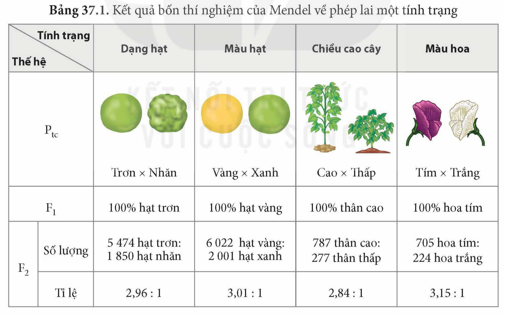
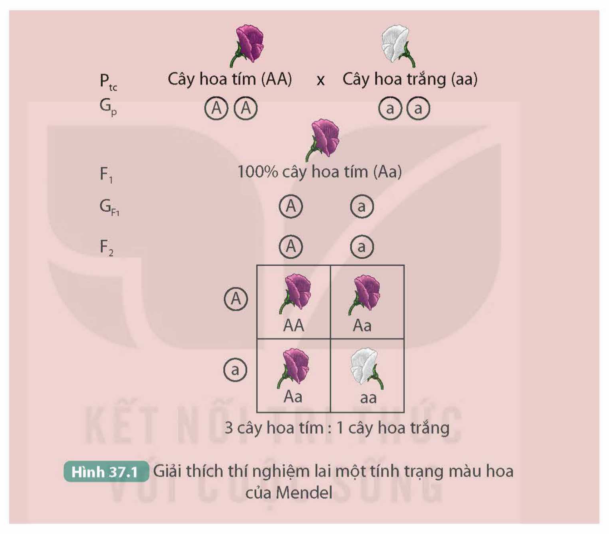
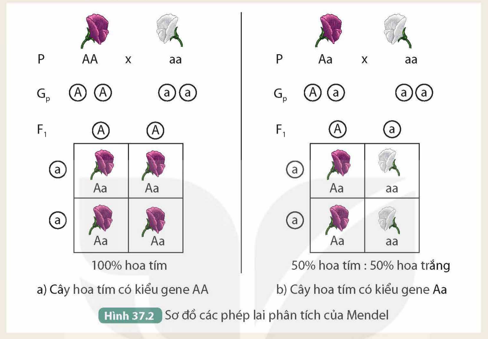
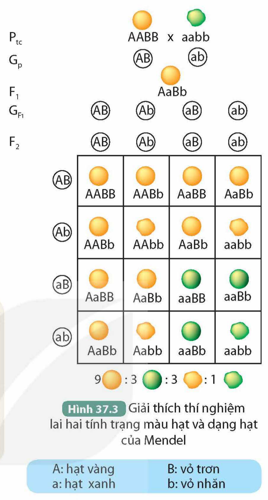

<!-- pdf:164 -->

# BÀI 37: CÁC QUY LUẬT DI TRUYỀN CỦA MENDEL

## 🎯 Mục tiêu

- Dựa vào công thức lai một tính trạng và kết quả lai trong thí nghiệm của Mendel; giải thích được kết quả thí nghiệm theo Mendel; phát biểu được quy luật phân li.
- Trình bày được thí nghiệm lai phân tích. Nêu được vai trò của phép lai phân tích.
- Dựa vào công thức lai hai tính trạng và kết quả lai trong thí nghiệm của Mendel. Giải thích được kết quả thí nghiệm theo Mendel. Phát biểu được quy luật phân li độc lập.

## 🔴 Mở đầu

Trong thí nghiệm của Mendel, tại sao khi cho các cây đậu hà lan có hoa tím giao phấn với nhau thì thu được đời con có cây hoa tím và cây hoa trắng nhưng không thu được cây có hoa màu tím nhạt?

## I. Quy luật phân li

### 1. Thí nghiệm

Mendel cho lai giữa các giống đậu hà lan khác nhau về một tính trạng tương phản, thuần chủng. Kết quả một số thí nghiệm thu được ở Bảng 37.1.

Bảng 37.1. Kết quả bốn thí nghiệm của Mendel về phép lai một tính trạng

| Thế hệ | Tính trạng | Dạng hạt | Màu hạt | Chiều cao cây | Màu hoa |
| --- | --- | --- | --- | --- | --- |
| $P_{\text{tc}}$ | | Trơn $\times$ Nhăn | Vàng $\times$ Xanh | Cao $\times$ Thấp | Tím $\times$ Trắng |
| $F_1$ | | 100% hạt trơn | 100% hạt vàng | 100% thân cao | 100% hoa tím |
| $F_2$ | Số lượng | 5 474 hạt trơn: 1 850 hạt nhăn | 6 022 hạt vàng: 2 001 hạt xanh | 787 thân cao: 277 thân thấp | 705 hoa tím: 224 hoa trắng |
| $F_2$ | Tỉ lệ | $2,96 : 1$ | $3,01 : 1$ | $2,84 : 1$ | $3,15 : 1$ |
<!-- ocr-ok: Bảng 37.1 có hình minh hoạ xen chữ nên OCR đọc dính từ ('1850hạtnhăn', '2001hạtxanh'), đã đối chiếu ảnh gốc p164.png -->

> ✋ Quan sát kết quả thí nghiệm ở Bảng 37.1, nhận xét về kiểu hình và tỉ lệ kiểu hình thu được ở $F_1$, $F_2$.

<!-- pdf:165 -->

### 2. Giải thích thí nghiệm

$P$ thuần chủng, $F_1$ **đồng tính** (con lai đồng nhất về một loại kiểu hình), tính trạng thu được ở $F_1$ là tính trạng trội. $F_2$ **phân tính** (có cả tính trạng trội và tính trạng lặn) với tỉ lệ 3 trội : 1 lặn.

Kết quả này được Mendel giải thích bằng sự phân li của cặp nhân tố di truyền (cặp allele). Mỗi tính trạng do một cặp allele quy định, một có nguồn gốc từ bố, một có nguồn gốc từ mẹ, tồn tại một cách riêng rẽ, không hoà trộn vào nhau. Khi giảm phân hình thành giao tử, các allele này phân li (tách rời nhau) và đi về các giao tử, nên 50% số giao tử chứa allele này, còn 50% giao tử chứa allele kia. Sự tổ hợp tự do và ngẫu nhiên của các loại giao tử khi thụ tinh đã thu được ở $F_2$ bốn tổ hợp giao tử với tỉ lệ kiểu hình là 3 trội : 1 lặn.

Hình 37.1. Giải thích thí nghiệm lai một tính trạng màu hoa của Mendel

> ✋ Dựa vào giải thích thí nghiệm và quan sát Hình 37.1, thực hiện các yêu cầu sau:
>
> 1. Giải thích vì sao $F_1$ hình thành được hai loại giao tử; $F_2$ thu được bốn tổ hợp giao tử với tỉ lệ kiểu hình 3 trội : 1 lặn.
> 2. Phát biểu nội dung quy luật phân li.

### 3. Lai phân tích

Khi tiến hành thí nghiệm phép lai một tính trạng từ $P$ đến $F_2$, Mendel thu được ở $F_2$ các cây hoa tím, nhưng ông không biết cây hoa tím nào là thuần chủng. Để biết được cây hoa tím nào ở $F_2$ là thuần chủng, ông cho các cây hoa tím này lai với cây hoa trắng. Phép lai giữa cơ thể mang tính trạng trội với với cơ thể mang tính trạng lặn để kiểm tra kiểu gene của cơ thể mang tính trạng trội được gọi là **phép lai phân tích**. Thí nghiệm lai phân tích được mô tả ở Hình 37.2.

<!-- pdf:166 -->

> ✋ Quan sát Hình 37.2, thực hiện các yêu cầu sau:
>
> 1. Mô tả thí nghiệm phép lai phân tích của Mendel.
> 2. Nếu kết quả phép lai phân tính thì kiểu gene của cơ thể cần kiểm tra là đồng hợp hay dị hợp?
> 3. Nêu vai trò của phép lai phân tích.

Hình 37.2. Sơ đồ các phép lai phân tích của Mendel

## II. Quy luật phân li độc lập

### 1. Thí nghiệm

Mendel cho lai giữa các giống đậu hà lan khác nhau về hai tính trạng (màu hạt và dạng hạt) tương phản, thuần chủng. Thí nghiệm được tóm tắt như sau:

> - $P_{\text{tc}}$: Cây hạt vàng, vỏ trơn $\times$ Cây hạt xanh, vỏ nhăn
> - $F_1$: 100% cây hạt vàng, vỏ trơn.
> - Cho 15 cây $F_1$ tự thụ phấn
> - $F_2$: Gồm 556 hạt, bốn loại kiểu hình:
>   - 315 cây hạt vàng, vỏ trơn; 108 cây hạt vàng, vỏ nhăn;
>   - 101 cây hạt xanh, vỏ trơn; 32 cây hạt xanh, vỏ nhăn.

> ❓ Dựa vào kết quả thí nghiệm, thực hiện các yêu cầu sau:
>
> 1. Xác định tỉ lệ các loại kiểu hình chung của cả hai tính trạng và tỉ lệ các loại kiểu hình riêng của từng tính trạng ở $F_2$.
> 2. Căn cứ vào tỉ lệ kiểu hình riêng của từng tính trạng ở $F_2$, cho biết sự di truyền tính trạng màu hạt có phụ thuộc vào sự di truyền của tính trạng dạng hạt không. Giải thích.

<!-- pdf:167 -->

### 2. Giải thích kết quả thí nghiệm

Khi xét riêng sự di truyền của từng tính trạng thì tỉ lệ kiểu hình của mỗi tính trạng (màu hạt, dạng hạt) là $3 : 1$, vẫn nghiệm đúng với quy luật phân li. Như vậy, sự di truyền của tính trạng màu hạt và dạng hạt không phụ thuộc vào nhau. Mỗi tính trạng do một cặp allele quy định, trong quá trình hình thành giao tử, mỗi cặp allele phân li độc lập với cặp allele khác nên đã hình thành các giao tử có tỉ lệ bằng nhau, sự tổ hợp ngẫu nhiên của các loại giao tử đực và cái khi thụ tinh đã thu được ở $F_2$ 16 kiểu tổ hợp với tỉ lệ kiểu hình là $9 : 3 : 3 : 1$.

Hình 37.3. Giải thích thí nghiệm lai hai tính trạng màu hạt và dạng hạt của Mendel

> ❓ Dựa vào giải thích thí nghiệm và quan sát Hình 37.3, thực hiện các yêu cầu sau:
>
> 1. Giải thích vì sao $F_1$ giảm phân cho bốn loại giao tử với tỉ lệ bằng nhau và $F_2$ thu được tỉ lệ kiểu hình là $9 : 3 : 3 : 1$.
> 2. Phát biểu nội dung quy luật phân li độc lập.

## 📌 Em đã học

- Nội dung **quy luật phân li**: Mỗi tính trạng do một cặp nhân tố di truyền (cặp allele) quy định. Khi giảm phân hình thành giao tử, các allele trong cặp phân li đồng đều về các giao tử nên mỗi giao tử chỉ chứa một allele của cặp.
- Phép lai phân tích là phép lai giữa cơ thể mang tính trạng trội chưa biết kiểu gene với cơ thể mang tính trạng lặn. Phép lai phân tích có vai trò xác định kiểu gene của cơ thể cần kiểm tra.
- Nội dung **quy luật phân li độc lập**: Các cặp nhân tố di truyền (cặp allele) quy định các tính trạng khác nhau. Trong quá trình hình thành giao tử, cặp allele này phân li độc lập với cặp allele khác.

## ✏️ Em có thể

- Dự đoán được kiểu hình ở các thế hệ lai $F_1$ và $F_2$ nếu thế hệ bố mẹ thuần chủng, tương phản về một hoặc một số tính trạng.
- Vận dụng được kiến thức về sự phân li độc lập, tổ hợp tự do của các cặp allele trong giảm phân và thụ tinh để giải thích sự đa dạng, phong phú của các loài giao phối.

## 📷 Danh sách hình trong bài

| Mã hình | Trang PDF | Vị trí | Chú thích gốc |
| --- | --- | --- | --- |
| H9-khoa_hoc_tu_nhien-b37-01 | 164 | Mục I.1 | Bảng 37.1. Kết quả bốn thí nghiệm của Mendel về phép lai một tính trạng |
| H9-khoa_hoc_tu_nhien-b37-02 | 165 | Mục I.2 | Hình 37.1. Giải thích thí nghiệm lai một tính trạng màu hoa của Mendel |
| H9-khoa_hoc_tu_nhien-b37-03 | 166 | Mục I.3 | Hình 37.2. Sơ đồ các phép lai phân tích của Mendel |
| H9-khoa_hoc_tu_nhien-b37-04 | 167 | Mục II.2 | Hình 37.3. Giải thích thí nghiệm lai hai tính trạng màu hạt và dạng hạt của Mendel |
