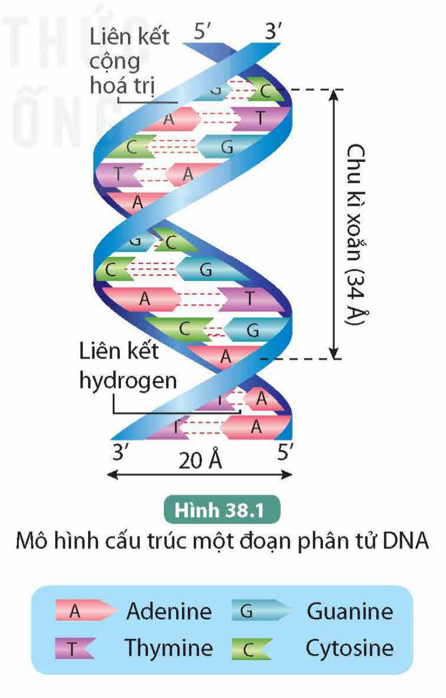
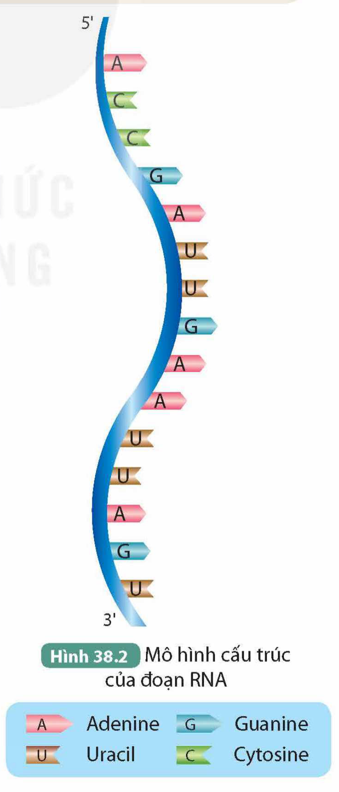
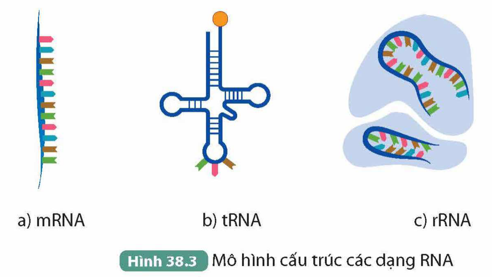

<!-- pdf:168 -->

# BÀI 38: NUCLEIC ACID VÀ GENE

## 🎯 Mục tiêu

- Nêu được khái niệm nucleic acid. Kể tên được các loại nucleic acid: DNA và RNA.
- Thông qua hình ảnh, mô tả được DNA với cấu trúc xoắn kép, gồm các đơn phân là bốn loại nucleotide, các nucleotide liên kết giữa hai mạch theo nguyên tắc bổ sung.
- Nêu được chức năng của DNA trong việc lưu giữ, bảo quản, truyền đạt thông tin di truyền.
- Nêu được khái niệm gene.
- Giải thích được vì sao chỉ từ bốn loại nucleotide nhưng tạo ra được sự đa dạng của phân tử DNA.
- Nêu được sơ lược về tính đặc trưng cá thể của hệ gene và một số ứng dụng của phân tích DNA trong xác định huyết thống, truy tìm tội phạm,...
- Trình bày được RNA có cấu trúc 1 mạch, chứa 4 loại ribonucleotide. Phân biệt được các loại RNA dựa vào chức năng.

## 🔴 Mở đầu

Xét nghiệm DNA cho phép xác định danh tính và nhận dạng mỗi cá nhân với độ tin cậy cao. Em đã biết những gì về DNA?

## I. Khái niệm nucleic acid

**Nucleic acid** là những phân tử sinh học cấu tạo từ các nguyên tố $\ce{C}$, $\ce{H}$, $\ce{O}$, $\ce{N}$, $\ce{P}$, chúng có cấu trúc đa phân và được tìm thấy trong tế bào của cơ thể sinh vật, trong virus.

Nucleic acid có hai loại là deoxyribonucleic acid (DNA) và ribonucleic acid (RNA).

> ❓ Cho các đối tượng sau: da, tóc, tiểu cầu, lục lạp, virus HIV, ti thể. Đối tượng nào có chứa nucleic acid?

## II. Deoxyribonucleic acid (DNA)

### 1. Cấu trúc của phân tử DNA

> ✋ Quan sát Hình 38.1, thực hiện các yêu cầu sau:
>
> 1. Mô tả cấu trúc phân tử DNA. Cấu trúc đó được hình thành và ổn định nhờ yếu tố nào?
> 2. Gọi tên các đơn phân cấu tạo nên phân tử DNA.

Hình 38.1. Mô hình cấu trúc một đoạn phân tử DNA

<!-- pdf:169 -->

DNA là đại phân tử cấu trúc từ các đơn phân adenine (A), thymine (T), cytosine (C) và guanine (G). Mỗi DNA dài tới hàng trăm micromet, khối lượng đạt tới hàng triệu hoặc chục triệu amu.

Theo mô hình của James Watson và Francis Crick năm 1953, DNA có cấu trúc xoắn kép, gồm hai mạch song song, ngược chiều, xoắn quanh một trục từ trái sang phải (xoắn phải) (Hình 38.1). Trên mỗi mạch, các nucleotide liên kết với nhau bằng liên kết cộng hoá trị, tạo thành chuỗi polynucleotide theo chiều $5'$ tới $3'$. Giữa hai mạch đơn, các nucleotide liên kết với nhau bằng liên kết hydrogen theo **nguyên tắc bổ sung**, nghĩa là A của mạch đơn này liên kết với T của mạch đơn kia và G của mạch đơn này liên kết với C của mạch đơn kia (hoặc ngược lại) tạo thành cặp nucleotide, đảm bảo cho phân tử DNA có đường kính $20\text{ \AA}$, với nhiều chu kì xoắn, mỗi chu kì xoắn dài $34\text{ \AA}$ tương ứng với 10 cặp nucleotide.

> ❓ Quan sát Hình 38.1 và đọc thông tin trên để thực hiện các yêu cầu sau:
>
> 1. Kích thước của mỗi cặp nucleotide là bao nhiêu $\text{\AA}$?
> 2. Các nucleotide trong mỗi cặp liên kết bổ sung với nhau bằng bao nhiêu liên kết hydrogen?
> 3. Trình tự các nucleotide trên một đoạn của DNA như sau:
>    ...A–T–G–C–T–G–A–T–C–A–C–G–T...
>    Hãy xác định trình tự các nucleotide trên mạch bổ sung với mạch đó.

### 2. Chức năng của phân tử DNA

DNA là nơi lưu giữ, bảo quản thông tin di truyền. Trình tự các nucleotide trên DNA là thông tin di truyền chỉ dẫn cho tế bào tổng hợp phân tử protein để từ đó tạo ra những phân tử hữu cơ cần thiết, tham gia vào cấu trúc và hoạt động của tế bào, cơ thể. Liên kết cộng hoá trị giữa các nucleotide đảm bảo cấu trúc của phân tử DNA được duy trì ổn định.

Phân tử DNA có khả năng tự nhân đôi (tái bản), nhờ đó thông tin di truyền được truyền đạt qua các thế hệ tế bào và cơ thể, đảm bảo cho các đặc tính của loài được duy trì, ổn định.

> ❓ 1. Những đặc điểm nào của phân tử DNA đảm bảo cho nó thực hiện chức năng lưu giữ, bảo quản và truyền đạt thông tin di truyền?
>
> 2. Con sinh ra có nhiều đặc điểm giống bố mẹ là nhờ chức năng nào của phân tử DNA?

### 3. Khái niệm gene

Ở cơ thể sinh vật, mỗi phân tử DNA có chứa vài trăm đến hàng nghìn gene. Mỗi gene quy định một sản phẩm xác định là phân tử RNA hoặc chuỗi polypeptide.

Mỗi gene thường có từ 600 đến 1 500 cặp nucleotide có trình tự xác định. Tế bào của mỗi loài chứa nhiều gene, ví dụ: vi khuẩn *E. coli* có khoảng 4 400 gene, ruồi giấm khoảng 14 000 gene, ở người có khoảng 21 300 gene.

Ngày nay, con người đã hiểu biết khá sâu về cấu trúc và chức năng của gene, đã xác lập được bản đồ gene của nhiều loài. Những hiểu biết về gene là cơ sở của những ứng dụng trong chọn giống, y học và kĩ thuật di truyền, mở ra những triển vọng mới trong tương lai.

<!-- pdf:170 -->

> ❓ Đọc thông tin trên và nêu khái niệm gene.

### 4. Tính đa dạng và đặc trưng của phân tử DNA

Bốn loại nucleotide (A, T, G, C) liên kết theo chiều dọc và sắp xếp theo nhiều cách đã tạo nên tính đa dạng và đặc trưng cho phân tử DNA. Trong hệ gene, các phân tử DNA khác nhau bởi số lượng, thành phần và trình tự sắp xếp các nucleotide. Trình tự sắp xếp các nucleotide trong phân tử DNA đặc trưng cho từng loài, thậm chí từng cá thể.

<!-- term: Phân tích DNA -->
Do DNA đặc trưng cho từng cá thể nên có thể ứng dụng phương pháp phân tích DNA trong việc xác định quan hệ huyết thống, xác định nghi phạm (truy tìm tội phạm),... Trên cơ sở các dữ liệu phân tích DNA của mẫu sinh phẩm như chân tóc, máu, tế bào niêm mạc miệng, xương,... tiến hành so sánh, đối chiếu giữa các mẫu với nhau để đưa ra kết quả về thông tin di truyền. Phân tích DNA còn được ứng dụng trong dự đoán nguy cơ mắc các bệnh di truyền và điều trị y tế; nghiên cứu phát sinh chủng loại sinh vật thông qua việc so sánh mức độ tương đồng giữa phân tử DNA của các đối tượng sinh học.

> ❓ 1. Giải thích vì sao chỉ từ bốn loại nucleotide tạo ra được sự đa dạng của phân tử DNA.
>
> 2. Phương pháp phân tích DNA đem lại những ứng dụng gì trong thực tiễn? Cơ sở của các ứng dụng đó là gì?

## III. Ribonucleic acid (RNA)

### 1. Cấu trúc của phân tử RNA

> ✋ Dựa vào kiến thức đã học và quan sát Hình 38.2, thực hiện các yêu cầu sau:
>
> 1. Mô tả cấu trúc của phân tử RNA.
> 2. Dự đoán trong tế bào, RNA được tổng hợp từ cấu trúc nào.

**RNA** có cấu tạo đa phân, các đơn phân là bốn loại ribonucleotide: A, U, G và C. Mỗi phân tử RNA gồm hàng trăm hoặc hàng nghìn đơn phân. Các đơn phân liên kết với nhau bằng liên kết cộng hoá trị tạo thành mạch RNA (chuỗi polyribonucleotide) (Hình 38.2).

RNA là đại phân tử nhưng kích thước và khối lượng thường nhỏ hơn DNA. Trong tế bào, phân tử RNA có cấu trúc một mạch, được tổng hợp ở nhân hoặc vùng nhân nhưng hầu hết RNA thực hiện chức năng ở tế bào chất.

Hình 38.2. Mô hình cấu trúc của đoạn RNA

### 2. Các loại RNA trong tế bào

Tuỳ theo cấu trúc và chức năng, RNA được chia thành các loại khác nhau, trong đó có RNA thông tin (mRNA), RNA vận chuyển (tRNA) và RNA ribosome (rRNA) (Hình 38.3).

<!-- pdf:171 -->

Hình 38.3. Mô hình cấu trúc các dạng RNA

Phân tử **mRNA** là chuỗi polyribonucleotide dạng thẳng, có chức năng truyền đạt thông tin di truyền vì nó trực tiếp làm khuôn cho quá trình tổng hợp chuỗi polypeptide.

tRNA và rRNA cũng là chuỗi polyribonucleotide nhưng một số vùng có sự tự bắt cặp theo nguyên tắc bổ sung giữa các ribonucleotide trong một mạch theo kiểu A liên kết với U, G liên kết với C và ngược lại, tạo cấu trúc không gian ba chiều đặc trưng và phù hợp với chức năng của mỗi loại RNA. **tRNA** có chức năng vận chuyển amino acid đến nơi tổng hợp protein, còn **rRNA** là thành phần chủ yếu cấu tạo nên ribosome – nơi tổng hợp protein.

> ❓ Phân biệt các loại RNA dựa vào chức năng.

## 📌 Em đã học

- Nucleic acid là những đại phân tử sinh học, cấu tạo đa phân với đơn phân là nucleotide. Nucleic acid gồm DNA và RNA.
- **DNA** cấu tạo từ bốn loại đơn phân A, T, G, C; có cấu trúc xoắn kép gồm hai mạch polynucleotide song song nhờ các nucleotide giữa hai mạch liên kết hydrogen theo nguyên tắc bổ sung. DNA rất đa dạng và đặc trưng bởi số lượng, thành phần và trình tự sắp xếp các nucleotide. DNA có chức năng lưu giữ, bảo quản và truyền đạt thông tin di truyền.
- RNA có cấu trúc một mạch, cấu tạo từ bốn loại đơn phân A, U, G, C. Ba loại RNA khác nhau về cấu trúc và chức năng.
- **Gene** là một đoạn của phân tử DNA có chức năng di truyền xác định.

## ✏️ Em có thể

- Giải thích được cơ sở của những ứng dụng DNA trong việc xác định quan hệ huyết thống, định danh cá thể hoặc truy tìm tội phạm.
<!-- ocr-ok: Hộp Em có thể cột hẹp nền màu làm OCR đọc lỗi dấu ('cửa nhữn g', 'đình', 'dinh danh', 'tôi'), đã đối chiếu ảnh gốc p171.png -->

> 🔍 Khái niệm nucleic acid và gene có thể thay đổi qua thời gian giống hầu hết các khái niệm khoa học. Khái niệm “gene” đã trải qua ít nhất 3 giai đoạn thay đổi căn bản, phản ánh sự mở rộng nhận thức của con người. Cuối thế kỉ XIX, Mendel gọi các nhân tố quy định tính trạng ở sinh vật là nhân tố di truyền. Tới năm 1909, Johansen đặt tên cho những nhân tố này là gene. Như vậy, gene là nhân tố quy định tính trạng. Vào những năm 1960, những hiểu biết về bản chất gene dẫn đến khái niệm một gene – một chuỗi polynucleotide. Những hiểu biết từ năm 1960 đến nay cho thấy khái niệm như vậy chưa bao hàm hết ý nghĩa của gene (chẳng hạn, nhiều gene chỉ quy định sản phẩm là RNA hay tính trạng do sự tương tác phức tạp giữa nhiều gene và sản phẩm của gene). Do vậy, hiện nay khái niệm gene được dùng là một đoạn của phân tử DNA có chức năng di truyền xác định.

## 📷 Danh sách hình trong bài

| Mã hình | Trang PDF | Vị trí | Chú thích gốc |
| --- | --- | --- | --- |
| H9-khoa_hoc_tu_nhien-b38-01 | 168 | Mục II.1 | Hình 38.1. Mô hình cấu trúc một đoạn phân tử DNA |
| H9-khoa_hoc_tu_nhien-b38-02 | 170 | Mục III.1 | Hình 38.2. Mô hình cấu trúc của đoạn RNA |
| H9-khoa_hoc_tu_nhien-b38-03 | 171 | Mục III.2 | Hình 38.3. Mô hình cấu trúc các dạng RNA |
