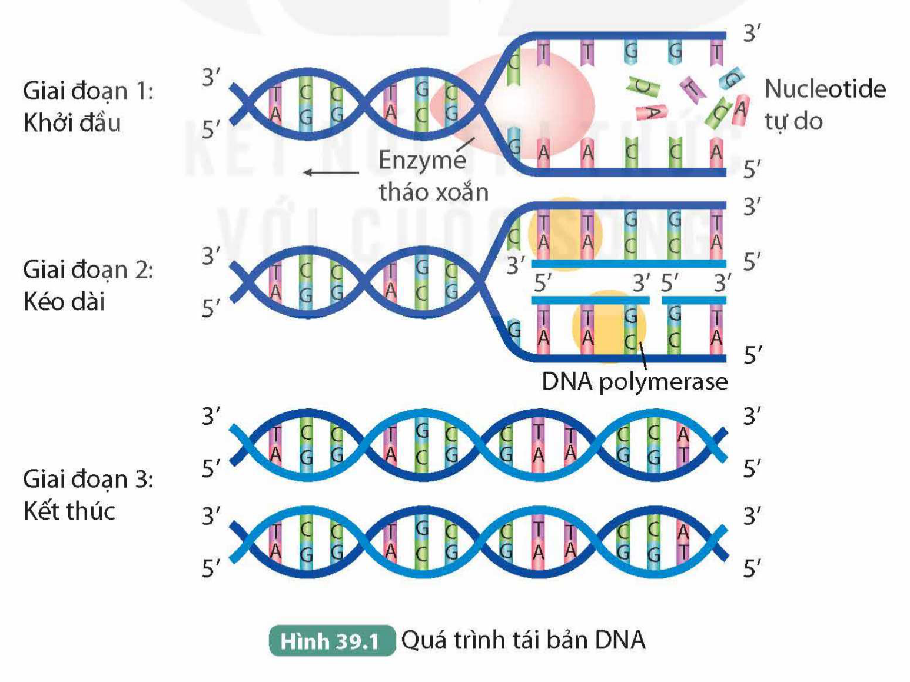
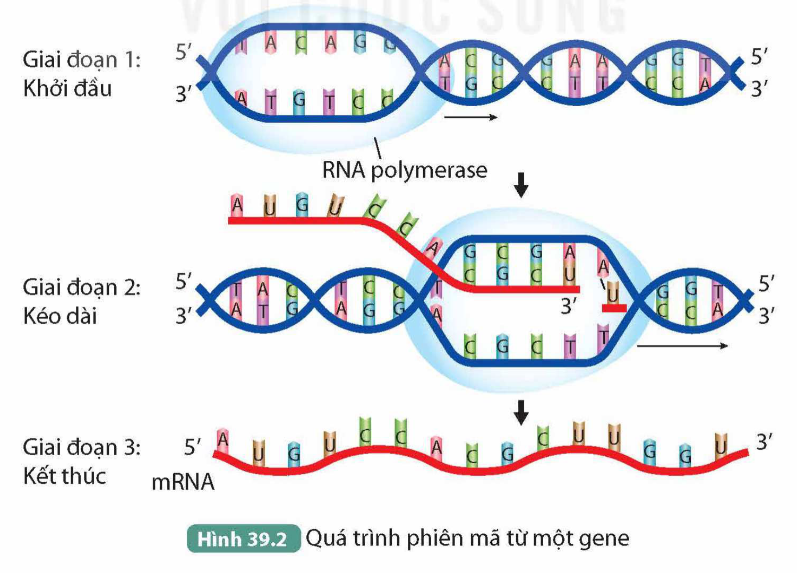
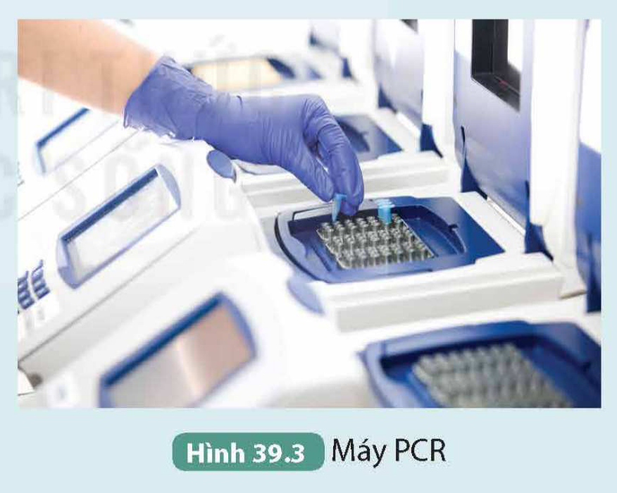

<!-- pdf:172 -->

# BÀI 39: TÁI BẢN DNA VÀ PHIÊN MÃ TẠO RNA

## 🎯 Mục tiêu

- Quan sát hình ảnh (hoặc sơ đồ), mô tả sơ lược quá trình tái bản của DNA và kết quả của quá trình.
- Nêu được ý nghĩa di truyền của tái bản DNA.
- Dựa vào hình ảnh (sơ đồ) quá trình phiên mã, nêu được khái niệm phiên mã.

## 🔴 Mở đầu

Tế bào có khả năng sinh sản tạo ra những tế bào con giống tế bào mẹ ban đầu. Sự sinh sản của tế bào dựa trên cơ sở của quá trình nào?

## I. Quá trình tái bản DNA

> ✋ Quan sát Hình 39.1, thực hiện các yêu cầu sau:
>
> 1. Mô tả ba giai đoạn của quá trình tái bản DNA.
> 2. Nhận xét về kết quả của quá trình tái bản DNA.

Hình 39.1. Quá trình tái bản DNA

<!-- term: Quá trình tái bản DNA -->
Quá trình tái bản DNA diễn ra trong nhân tế bào ở sinh vật nhân thực (hoặc vùng nhân ở sinh vật nhân sơ) trước khi tế bào bước vào giai đoạn phân chia.

<!-- pdf:173 -->

<!-- term: Quá trình tái bản DNA -->
Quá trình tái bản DNA gồm ba giai đoạn:

<!-- term: Quá trình tái bản DNA -->
- Giai đoạn 1: DNA tháo xoắn tách thành hai mạch đơn.
- Giai đoạn 2: Các nucleotide tự do trong môi trường tế bào liên kết với các nucleotide trên mỗi mạch khuôn của DNA theo nguyên tắc bổ sung: A liên kết với T bằng 2 liên kết hydrogen, G liên kết với C bằng 3 liên kết hydrogen.
- Giai đoạn 3: Hai mạch đơn gồm một mạch mới tổng hợp và một mạch khuôn xoắn trở lại với nhau, tạo ra hai phân tử DNA mới giống như phân tử DNA ban đầu.

> ❓ 1. Một đoạn DNA có trình tự nucleotide trên hai mạch như sau:
>
>    Mạch 1: A–A–G–C–T–C–G–C–G–A–T–A–G–C–C
>
>    Mạch 2: T–T–C–G–A–G–C–G–C–T–A–T–C–G–G
>
>    a) Xác định trình tự nucleotide của hai DNA được tổng hợp từ đoạn DNA trên.
>
>    b) Nhận xét trình tự nucleotide giữa các DNA mới được tổng hợp và với DNA ban đầu.
>
> 2. Quá trình tái bản DNA có ý nghĩa gì?

## II. Quá trình phiên mã

Thông tin di truyền được lưu trữ trong chuỗi polynucleotide của DNA (gene) được tế bào chuyển hoá thành chức năng hay tính trạng của cơ thể. Các chức năng hay tính trạng này là do hoạt động của các phân tử protein. Tuy vậy, ở mọi sinh vật, dòng thông tin di truyền trên chuỗi polynucleotide của DNA không được chuyển trực tiếp thành chuỗi polypeptide tương ứng trên protein mà qua hai quá trình: phiên mã và dịch mã.

Quá trình phiên mã diễn ra trong nhân tế bào ở sinh vật nhân thực (hoặc vùng nhân ở sinh vật nhân sơ) trước khi tế bào bước vào giai đoạn phân chia. Trong quá trình này, thông tin di truyền trên chuỗi polynucleotide của gene được dùng làm khuôn để tổng hợp chuỗi polyribonucleotide tương ứng của phân tử RNA theo nguyên tắc bổ sung: A liên kết với U, T liên kết với A, G liên kết với C và C liên kết với G (Hình 39.2).

Hình 39.2. Quá trình phiên mã từ một gene

<!-- pdf:174 -->

Ở giai đoạn dịch mã (Bài 40), chuỗi polynucleotide của mRNA được dùng làm khuôn để tổng hợp sản phẩm protein (chuỗi polypeptide) tương ứng.

> ✋ Quan sát Hình 39.2, thực hiện các yêu cầu sau:
>
> 1. Mô tả ba giai đoạn của quá trình phiên mã.
> 2. Quá trình phiên mã dựa trên mạch nào của DNA?
> 3. Phiên mã là gì?

## 📌 Em đã học

<!-- term: Quá trình tái bản DNA -->
- Quá trình tái bản DNA diễn ra qua ba giai đoạn tạo ra hai bản sao giống nhau và giống DNA ban đầu, đảm bảo quá trình truyền thông tin di truyền qua các thế hệ tế bào và cơ thể được ổn định và liên tục.

- **Phiên mã** là quá trình tổng hợp các phân tử RNA dựa trên trình tự polynucleotide của gene (DNA).

## ✏️ Em có thể

- Xác định được số nucleotide mỗi loại cần thiết cho một quá trình tái bản và phiên mã từ một phân tử DNA.
- Xác định được trình tự nucleotide trên phân tử RNA được phiên mã từ một đoạn DNA nếu biết trình tự nucleotide của đoạn DNA đó.

<!-- term: Kĩ thuật PCR -->
> 🔍 Kĩ thuật PCR (Polymerase Chain Reaction) được phát minh năm 1983. Kĩ thuật này mô phỏng quá trình tái bản DNA trong điều kiện nhân tạo, cho phép tạo số lượng lớn bản sao của một đoạn DNA nào đó. Kĩ thuật PCR được thực hiện với các thành phần chính của quá trình tái bản DNA và đặt trong các điều kiện thích hợp. Ngày nay, PCR đã trở thành kĩ thuật cơ bản trong hầu hết các phòng thí nghiệm sinh học trên toàn cầu, đồng thời nó cũng được ứng dụng trong nhiều lĩnh vực như nông nghiệp, y tế, pháp y,...

Hình 39.3. Máy PCR
<!-- ocr-ok: Chú thích Hình 39.3 chữ nhỏ trên nền màu bị OCR bỏ sót, đã đối chiếu ảnh gốc p174.png -->

## 📷 Danh sách hình trong bài

| Mã hình | Trang PDF | Vị trí | Chú thích gốc |
| --- | --- | --- | --- |
| H9-khoa_hoc_tu_nhien-b39-01 | 172 | Mục I | Hình 39.1. Quá trình tái bản DNA |
| H9-khoa_hoc_tu_nhien-b39-02 | 173 | Mục II | Hình 39.2. Quá trình phiên mã từ một gene |
| H9-khoa_hoc_tu_nhien-b39-03 | 174 | Hộp thông tin mở rộng | Hình 39.3. Máy PCR |
