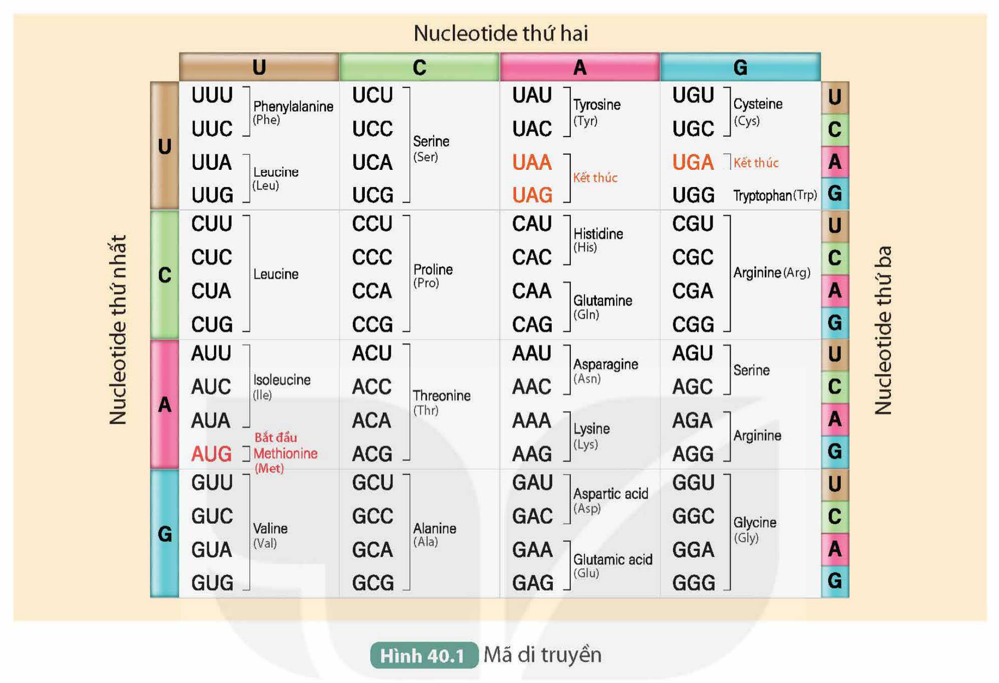
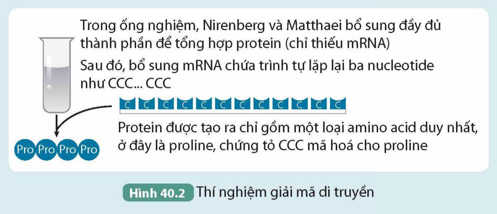
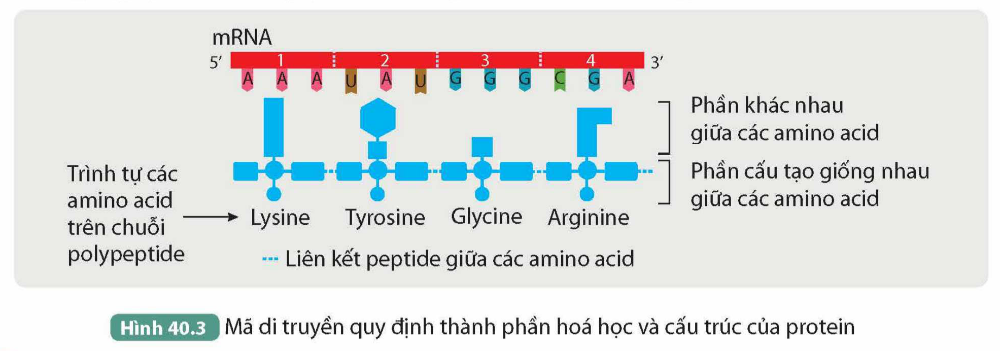
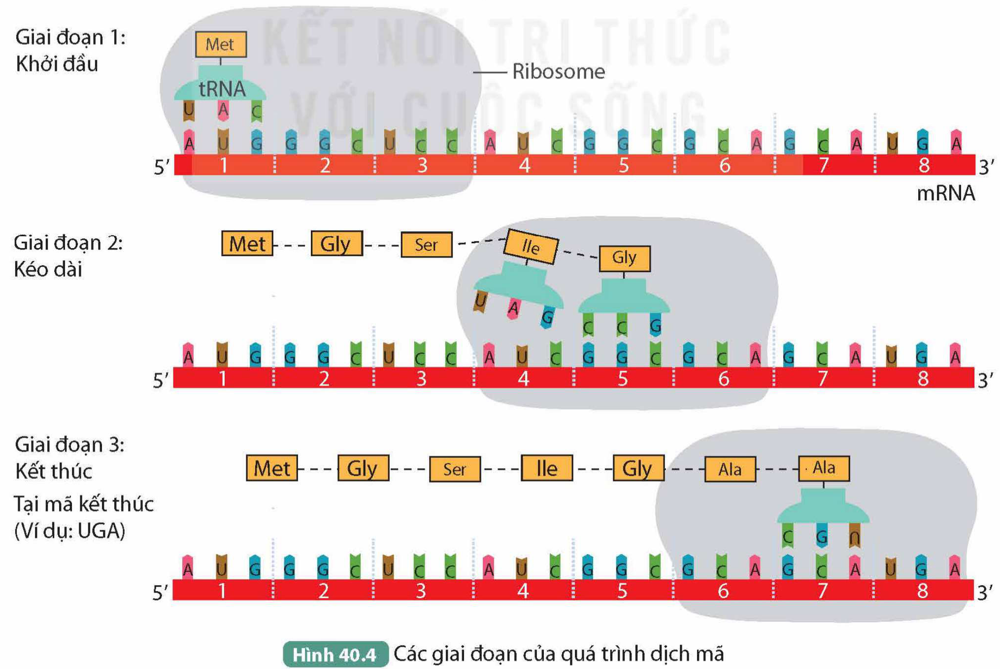
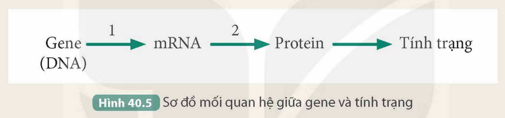

<!-- pdf:175 -->

# BÀI 40: DỊCH MÃ VÀ MỐI QUAN HỆ TỪ GENE ĐẾN TÍNH TRẠNG

## 🎯 Mục tiêu

- Nêu được khái niệm mã di truyền; giải thích được từ bốn loại nucleotide tạo ra được sự đa dạng của mã di truyền; nêu được ý nghĩa của đa dạng mã di truyền, mã di truyền quy định thành phần hoá học và cấu trúc của protein.
- Dựa vào sơ đồ hoặc hình ảnh quá trình dịch mã, nêu được khái niệm dịch mã.
- Dựa vào sơ đồ, hình ảnh, nêu được mối quan hệ giữa DNA – mRNA – protein – tính trạng thông qua phiên mã, dịch mã và ý nghĩa di truyền của mối quan hệ này.
- Vận dụng kiến thức từ gene đến tính trạng, nêu được cơ sở của sự đa dạng về tính trạng của các loài.

## 🔴 Mở đầu

Thông tin di truyền trên gene được phiên mã thành trình tự các ribonucleotide trên mRNA. mRNA tham gia quá trình tổng hợp chuỗi polypeptide. Quá trình đó diễn ra như thế nào?

## I. Mã di truyền là gì?

> ✋ Giả thiết mã di truyền là các đoạn ngắn ribonucleotide liền kề trên mRNA (có cùng số lượng ribonucleotide, kí hiệu là $n$) quy định loại amino acid tương ứng trên chuỗi polypeptide.
>
> a) Xác định số loại mã di truyền và số loại amino acid tương ứng tối đa có thể có với mỗi $n$. Hoàn thành vào vở theo mẫu Bảng 40.1.
>
> Bảng 40.1. Số loại mã di truyền tương ứng số lượng ribonucleotide ($n$) trong mã
>
> | Số ribonucleotide trong mã ($n$) | Số loại mã có thể có | Số loại amino acid tối đa có thể được mã hoá |
> | --- | --- | --- |
> | 1 | $4$ ($4^1$) | 4 |
> | 2 | ? | ? |
> | 3 | ? | ? |
> | 4 | $256$ ($4^4$) | 256 |
>
> b) Nếu các tế bào có xu hướng tiết kiệm tối đa để thực hiện chức năng sinh học thì mã di truyền gồm bao nhiêu ribonucleotide? Biết rằng có 20 loại amino acid cấu tạo nên protein.

**Mã di truyền** là mật mã sinh học quy định thông tin về trình tự các amino acid trên chuỗi polypeptide được mã hoá bằng trình tự các nucleotide trên gene, qua phân tử trung gian mRNA. Mỗi amino acid trên chuỗi polypeptide được mã hoá bởi một bộ ba ribonucleotide liền kề trên mRNA, được gọi là **codon**. Trong tổng số 64 codon được hình thành từ 4 loại ribonucleotide (A, U, G, C), có 61 codon quy định tương ứng 20 loại amino acid,

<!-- pdf:176 -->

còn 3 codon (UAA, UAG và UGA) không mã hoá amino acid mà có vai trò kết thúc tổng hợp protein, được gọi là các **codon kết thúc**; codon AUG vừa là **codon mở đầu** quá trình tổng hợp protein, vừa là codon mã hoá amino acid methionine (Hình 40.1).

Hình 40.1. Mã di truyền

| Nucleotide thứ nhất | Nucleotide thứ hai: U | Nucleotide thứ hai: C | Nucleotide thứ hai: A | Nucleotide thứ hai: G | Nucleotide thứ ba |
| --- | --- | --- | --- | --- | --- |
| U | UUU, UUC: Phenylalanine (Phe); UUA, UUG: Leucine (Leu) | UCU, UCC, UCA, UCG: Serine (Ser) | UAU, UAC: Tyrosine (Tyr); UAA, UAG: Kết thúc | UGU, UGC: Cysteine (Cys); UGA: Kết thúc; UGG: Tryptophan (Trp) | U, C, A, G |
| C | CUU, CUC, CUA, CUG: Leucine | CCU, CCC, CCA, CCG: Proline (Pro) | CAU, CAC: Histidine (His); CAA, CAG: Glutamine (Gln) | CGU, CGC, CGA, CGG: Arginine (Arg) | U, C, A, G |
| A | AUU, AUC, AUA: Isoleucine (Ile); AUG: Bắt đầu / Methionine (Met) | ACU, ACC, ACA, ACG: Threonine (Thr) | AAU, AAC: Asparagine (Asn); AAA, AAG: Lysine (Lys) | AGU, AGC: Serine; AGA, AGG: Arginine | U, C, A, G |
| G | GUU, GUC, GUA, GUG: Valine (Val) | GCU, GCC, GCA, GCG: Alanine (Ala) | GAU, GAC: Aspartic acid (Asp); GAA, GAG: Glutamic acid (Glu) | GGU, GGC, GGA, GGG: Glycine (Gly) | U, C, A, G |
<!-- ocr-ok: Bảng mã di truyền Hình 40.1 chữ in rất nhỏ trong ô màu nên OCR đọc lỗi, đã đối chiếu trực tiếp ảnh gốc p176.png -->

> ❓ Quan sát Hình 40.1 các codon cùng nghĩa (cùng mã hoá cho một loại amino acid hoặc các codon kết thúc) thường giống nhau về loại nucleotide tại vị trí nào của codon?

> 🔍 Năm 1961, hai nhà khoa học là Marshall Warren Nirenberg và Johannes Heinrich Matthaei đã thiết kế thí nghiệm để giải mã di truyền. Thí nghiệm của họ được tóm tắt ở Hình 40.2.

Hình 40.2. Thí nghiệm giải mã di truyền

<!-- pdf:177 -->

## II. Mã di truyền quy định thành phần hoá học và cấu trúc của protein

Mã di truyền quy định loại amino acid trong chuỗi polypeptide. Trình tự mã di truyền trên gene và bản phiên mã của gene (mRNA) quy định thành phần và trình tự amino acid trên chuỗi polypeptide, từ đó quy định thành phần và cấu trúc của protein.

Hình 40.3. Mã di truyền quy định thành phần hoá học và cấu trúc của protein

> ❓ 1. Quan sát Hình 40.3 cho biết mã di truyền quy định thành phần hoá học và cấu trúc của protein như thế nào.
>
> 2. Nêu ý nghĩa của đa dạng mã di truyền.

## III. Quá trình dịch mã

<!-- term: Bộ ba đối mã -->
Quá trình dịch mã được sơ đồ hoá ở Hình 40.4. Theo đó, trình tự mã di truyền trên mRNA được RNA vận chuyển (tRNA) dịch thành trình tự các amino acid trên chuỗi polypeptide. Để thực hiện chức năng dịch mã, phân tử tRNA có bộ ba đối mã với mã di truyền trên mRNA, đồng thời vận chuyển loại amino acid tương ứng do mã di truyền trên mRNA quy định.

Hình 40.4. Các giai đoạn của quá trình dịch mã

<!-- pdf:178 -->

> ✋ Đọc thông tin trên và quan sát Hình 40.4, trả lời các câu hỏi sau:
>
> 1. Có những thành phần nào tham gia quá trình dịch mã? Nêu vai trò của mỗi thành phần trong quá trình dịch mã.
> 2. Quá trình dịch mã gồm những giai đoạn nào? Mô tả khái quát diễn biến quá trình dịch mã.
> 3. Dịch mã là gì?

## IV. Mối quan hệ giữa gene và tính trạng

### 1. Sự biểu hiện của gene thành tính trạng

> ✋ Dựa vào kiến thức đã học kết hợp quan sát Hình 40.5, thực hiện các yêu cầu sau:
>
> 1. Nêu tên và sản phẩm của quá trình 1, quá trình 2.
> 2. Giải thích mối quan hệ giữa gene (DNA), mRNA, protein và tính trạng.

Hình 40.5. Sơ đồ mối quan hệ giữa gene và tính trạng

Các tính trạng ở sinh vật đều do gene quy định. Trong tế bào, gene không trực tiếp hình thành tính trạng mà phải thông qua sự tương tác giữa các phân tử mRNA, protein và có thể chịu tác động của các nhân tố môi trường.

### 2. Ý nghĩa di truyền của mối quan hệ giữa gene và tính trạng

Mọi tính trạng ở sinh vật đều có cơ sở vật chất di truyền là gene trong tế bào. Gene không trực tiếp tạo ra tính trạng, thông tin di truyền trên gene biểu hiện thành tính trạng phải thông qua các quá trình phiên mã, dịch mã.

<!-- term: Mối quan hệ giữa gene và tính trạng -->
Bản chất di truyền của mối quan hệ giữa gene và tính trạng là trình tự các nucleotide trên mạch đơn của gene quy định trình tự các nucleotide trên phân tử mRNA, từ đó quy định trình tự các amino acid trong chuỗi polypeptide và protein, hình thành nên tính trạng của cơ thể.

Sự tác động của các nhân tố bên trong tế bào hoặc môi trường bên ngoài lên các quá trình biểu hiện gene thành tính trạng có thể dẫn đến làm thay đổi tính trạng ở sinh vật. Ví dụ: Ức chế quá trình dịch mã của gene quy định tổng hợp ethylene ($\ce{C2H4}$) ở cây cà chua tạo ra giống cà chua cho quả chín chậm.

Trong tế bào của mỗi cơ thể có chứa hàng nghìn đến hàng vạn gene, hình thành nên hệ gene quy định hệ thống các tính trạng của tế bào và của cơ thể. Mặt khác, thông tin di truyền chứa trong mỗi hệ gene ở các loài sinh vật cũng khác nhau; qua phiên mã, dịch mã đã tạo ra tập hợp các RNA và protein khác nhau ở các loài, từ đó hình thành nên hệ thống tính trạng khác nhau giữa các loài. Đó chính là cơ sở di truyền học của sự đa dạng về tính trạng ở các loài sinh vật.

<!-- pdf:179 -->

> ❓ Dựa vào kiến thức về mối quan hệ giữa gene và tính trạng, cho biết khi muốn thay đổi một tính trạng ở một loài thực vật bằng tác nhân nhân tạo, có thể tác động vào quá trình nào.

## 📌 Em đã học

- Mã di truyền là trình tự nucleotide trên gene (DNA) quy định thành phần và trình tự amino acid trên phân tử protein, qua phân tử trung gian mRNA. Mã di truyền là mã bộ ba (codon), từ bốn loại nucleotide khác nhau tạo ra được 64 loại codon.
- Sự đa dạng của mã di truyền trên phân tử mRNA tạo nên sự đa dạng về thành phần hoá học và cấu trúc của protein.
- **Dịch mã** là quá trình tổng hợp chuỗi polypeptide (protein) dựa trên trình tự nucleotide trên bản phiên mã của gene (mRNA).

<!-- term: Mối quan hệ giữa gene và tính trạng -->
- Các tính trạng ở sinh vật đều do gene quy định. Mối quan hệ giữa gene và tính trạng thể hiện qua dòng thông tin: $\text{gene (DNA)} \rightarrow \text{mRNA} \rightarrow \text{protein} \rightarrow \text{tính trạng}$.

- Mỗi loài và cơ thể sinh vật có một hệ gene riêng, trong đó mỗi gene có thể quy định nhiều loại mRNA và protein khác nhau, do đó quy định các tính trạng khác nhau, tạo nên sự đa dạng về tính trạng của các loài.

## ✏️ Em có thể

- Sử dụng kiến thức về mã di truyền để giải thích cách gene quy định tính trạng (điều khiển các hoạt động sống của tế bào và cơ thể) thông qua dòng thông tin được truyền từ DNA tới protein qua mRNA.
- Giải thích được tại sao cùng một loài sinh vật (ví dụ: cây hoa hồng) nhưng mỗi cá thể lại có những đặc điểm khác nhau (ví dụ: có cây hoa đỏ, có cây hoa trắng, có cây hoa hồng,...).

> 🔍
> - Tính trạng của sinh vật do gene quy định, song có thể bị chi phối bởi các yếu tố của môi trường bên trong và bên ngoài cơ thể. Ví dụ: Một cây cẩm tú cầu sẽ có màu hoa khác nhau khi trồng ở những vùng đất có độ pH khác nhau.
> - Trong tế bào, hầu hết các gene có sản phẩm phiên mã tham gia dịch mã tạo chuỗi polypeptide. Tuy vậy, có một số nhóm gene (như các gene mã hoá tRNA) có sản phẩm phiên mã không được dịch mã. Ở đây, sản phẩm được gene mã hoá không phải protein mà là RNA.

## 📷 Danh sách hình trong bài

| Mã hình | Trang PDF | Vị trí | Chú thích gốc |
| --- | --- | --- | --- |
| H9-khoa_hoc_tu_nhien-b40-01 | 176 | Mục I | Hình 40.1. Mã di truyền |
| H9-khoa_hoc_tu_nhien-b40-02 | 176 | Hộp thông tin mở rộng mục I | Hình 40.2. Thí nghiệm giải mã di truyền |
| H9-khoa_hoc_tu_nhien-b40-03 | 177 | Mục II | Hình 40.3. Mã di truyền quy định thành phần hoá học và cấu trúc của protein |
| H9-khoa_hoc_tu_nhien-b40-04 | 177 | Mục III | Hình 40.4. Các giai đoạn của quá trình dịch mã |
| H9-khoa_hoc_tu_nhien-b40-05 | 178 | Mục IV.1 | Hình 40.5. Sơ đồ mối quan hệ giữa gene và tính trạng |
