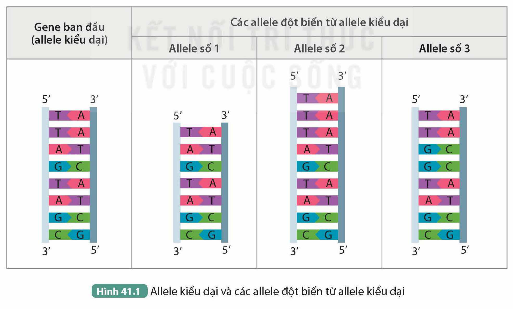
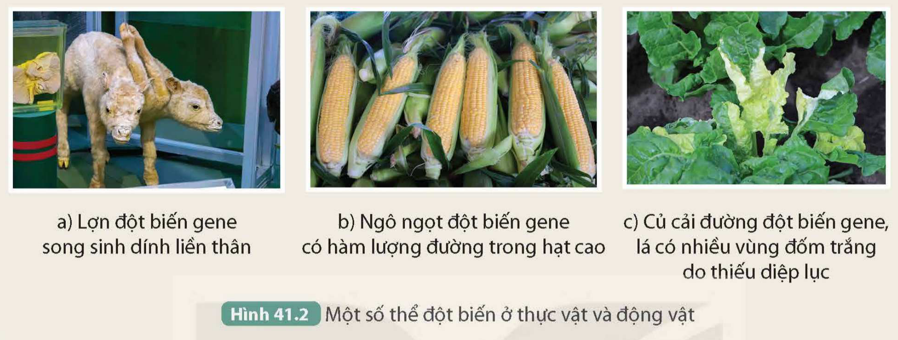

<!-- pdf:180 -->

# BÀI 41: ĐỘT BIẾN GENE

## 🎯 Mục tiêu

- Phát biểu được khái niệm đột biến gene. Lấy được ví dụ minh hoạ.
- Trình bày được ý nghĩa và tác hại của đột biến gene.

## 🔴 Mở đầu

Bằng các kĩ thuật tác động vào cấu trúc của gene, các nhà khoa học đã tạo ra giống cà chua đột biến gene có hàm lượng gamma aminobutyric acid (GABA) trong quả cao hơn khoảng 5 – 6 lần so với cà chua trong tự nhiên. Đột biến gene là gì và có ý nghĩa, tác hại như thế nào đối với con người?

## I. Khái niệm đột biến gene

> ✋ Quan sát Hình 41.1, trả lời các câu hỏi sau:
>
> 1. Các allele đột biến số 1, số 2 và số 3 có thay đổi gì so với allele kiểu dại?
> 2. Đột biến gene là gì?
> 3. Đột biến gene gồm những dạng nào?

Hình 41.1. Allele kiểu dại và các allele đột biến từ allele kiểu dại

<!-- pdf:181 -->

Ở mỗi gene, đột biến có thể phát sinh theo nhiều hướng khác nhau tạo ra nhiều allele khác nhau của gene đó. Ví dụ: Các allele số 1, 2, 3 trong Hình 41.1 là sản phẩm đột biến theo ba hướng khác nhau của allele kiểu dại. Đột biến chỉ liên quan đến một cặp nucleotide trên gene được gọi là **đột biến điểm**.

Ví dụ: Ở người, allele $\text{Hb}\beta^+$ mã hoá chuỗi beta globin dạng sợi, hoà tan. Do đột biến thay thế một cặp nucleotide T – A bằng một cặp A – T làm xuất hiện allele $\text{Hb}\beta$ đột biến mã hoá chuỗi beta globin dạng tinh thể, không tan. Người mang allele $\text{Hb}\beta$ đột biến bị mắc bệnh thiếu máu hồng cầu hình liềm.

## II. Ý nghĩa và tác hại của đột biến gene

### 1. Ý nghĩa của đột biến gene

**a) Đối với đa dạng sinh học**

Do đột biến, mỗi gene có thể có nhiều allele. Vì hệ gene của mỗi loài thường chứa số lượng gene lớn nên trong mỗi quần thể sinh vật thường mang nhiều allele đột biến khác nhau. Qua giao phối sẽ xuất hiện nhiều loại kiểu gene và kiểu hình mới, góp phần tạo nên sự đa dạng sinh học. Ví dụ: Gene $I$ quy định nhóm máu ở người (hệ thống ABO), do đột biến đã tạo ra ba allele: $I^A$, $I^B$, $I^O$, qua giao phối đã tạo ra sáu loại kiểu gene và bốn loại kiểu hình là các nhóm máu: O, A, B và AB trong quần thể người.

> ❓ Từ các allele đột biến: $I^A$, $I^B$, $I^O$, viết các kiểu gene quy định nhóm máu ở người.

**b) Đối với thực tiễn**

Có những đột biến gene làm thay đổi cấu trúc và chức năng của protein theo hướng có lợi cho thể đột biến. Ví dụ: Giống lúa CM5 (do Viện Di truyền Nông nghiệp, Việt Nam tạo ra) mang gene bị biến đổi cấu trúc, dẫn đến thay đổi chức năng protein do gene mã hoá. Kết quả là giống lúa CM5 biểu hiện những tính trạng tốt: năng suất cao, chịu rét, chống chịu sâu bệnh khá và đặc biệt là chịu mặn tốt.

Ngày nay, các nhà khoa học đã và đang sử dụng tác nhân vật lí, hoá học và kĩ thuật di truyền để chủ động gây đột biến gene trên nhiều đối tượng sinh vật phục vụ cho công tác tạo giống mới. Ví dụ: Sử dụng tia gamma ($\gamma$) để tạo nấm sợi đột biến có hiệu suất sản sinh kháng sinh penicillin gấp nhiều lần so với dạng tự nhiên.

### 2. Tác hại của đột biến gene

Do đột biến, một gene nào đó trong hệ gene có thể trở nên không hoạt động (bất hoạt) dẫn tới các tế bào mang gene đột biến bị thiếu hoặc không có sản phẩm của gene đó. Sự thiếu hoặc không có sản phẩm của gene sẽ ảnh hưởng đến các quá trình sinh lí, sinh hoá trong tế bào, khi đó cơ thể dễ mắc các bệnh, tật di truyền.

Đa số đột biến gene là lặn và có hại cho thể đột biến vì chúng phá vỡ sự hài hoà trong kiểu gene đã được duy trì qua lịch sử phát triển của loài. Ngoài ra, tính chất có lợi hay có hại của đột biến gene còn phụ thuộc vào chức năng gene, các điều kiện môi trường bên trong và bên ngoài cơ thể.

<!-- pdf:182 -->

> ✋ 1. Đúng hay sai khi cho rằng đột biến gene vừa có lợi vừa có hại? Lấy ví dụ.
>
> 2. Quan sát Hình 41.2, cho biết thể đột biến nào có lợi, thể đột biến nào không có lợi đối với con người.

Hình 41.2. Một số thể đột biến ở thực vật và động vật

## 📌 Em đã học

- Những biến đổi trong cấu trúc của gene được gọi là **đột biến gene**. Có ba dạng đột biến: mất một cặp nucleotide, thêm một cặp nucleotide, thay thế một cặp nucleotide.
- Đột biến gene có thể có lợi, có thể có hại cho thể đột biến. Tính có lợi hoặc có hại phụ thuộc vào tổ hợp gene và điều kiện môi trường.
- Đột biến gene tạo ra sự đa dạng sinh học và cung cấp nguyên liệu cho chọn giống.

## ✏️ Em có thể

- Giải thích được tại sao các nhà khoa học sử dụng tia phóng xạ có thể tạo ra các cây trồng mới có nhiều đặc tính tốt.
- Giải thích được cơ sở của việc con người cần đảm bảo an toàn lao động khi tiếp xúc với môi trường độc hại.

> 🔍 Trong tự nhiên, đột biến gene có thể phát sinh do những sai sót trong quá trình tái bản DNA. Các nhà khoa học đã ước tính, qua mỗi lần DNA tái bản, tần số đột biến của một gene từ $10^{-6}$ đến $10^{-4}$. Các nhân tố gây đột biến trong môi trường như tia UV, tia X, tia $\gamma$, hoá chất ô nhiễm,... làm tăng tần số đột biến gene.

## 📷 Danh sách hình trong bài

| Mã hình | Trang PDF | Vị trí | Chú thích gốc |
| --- | --- | --- | --- |
| H9-khoa_hoc_tu_nhien-b41-01 | 180 | Mục I | Hình 41.1. Allele kiểu dại và các allele đột biến từ allele kiểu dại |
| H9-khoa_hoc_tu_nhien-b41-02 | 182 | Mục II.2 | Hình 41.2. Một số thể đột biến ở thực vật và động vật |
