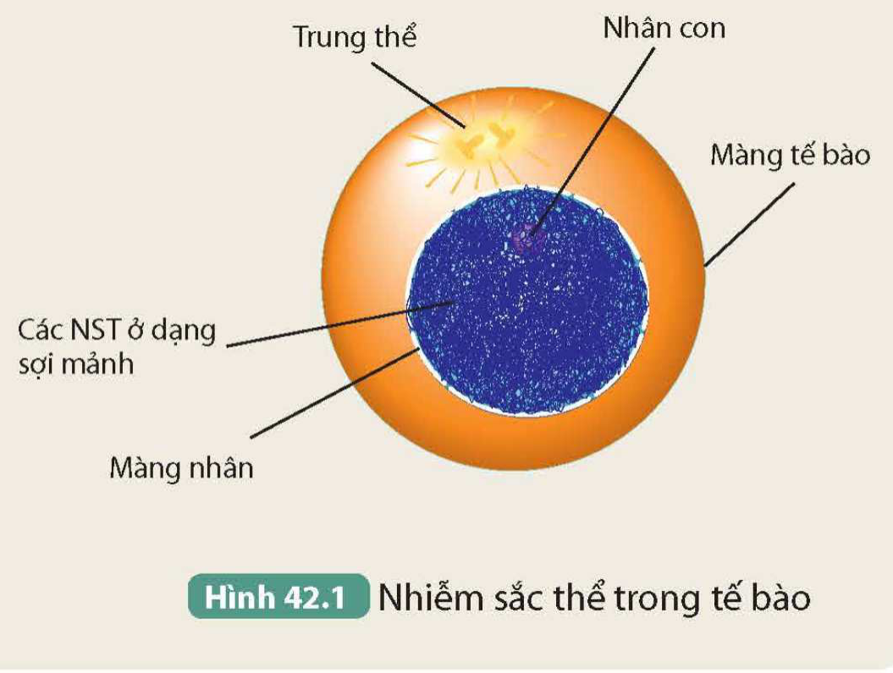
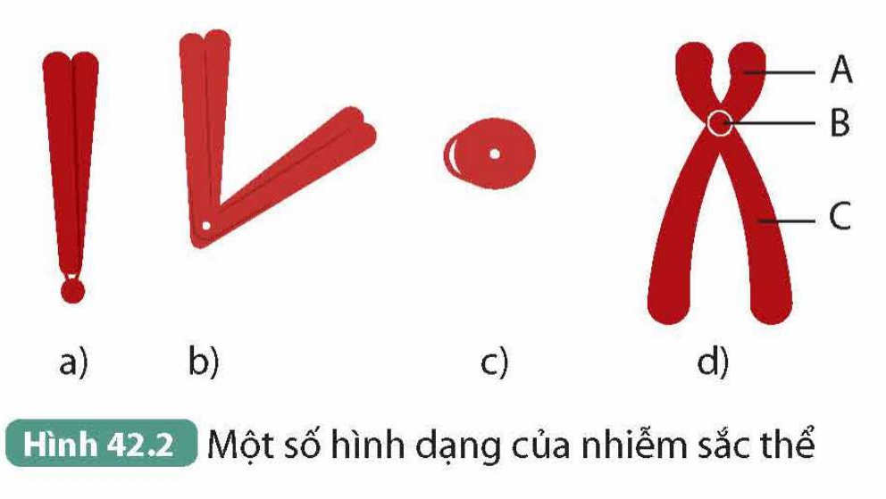
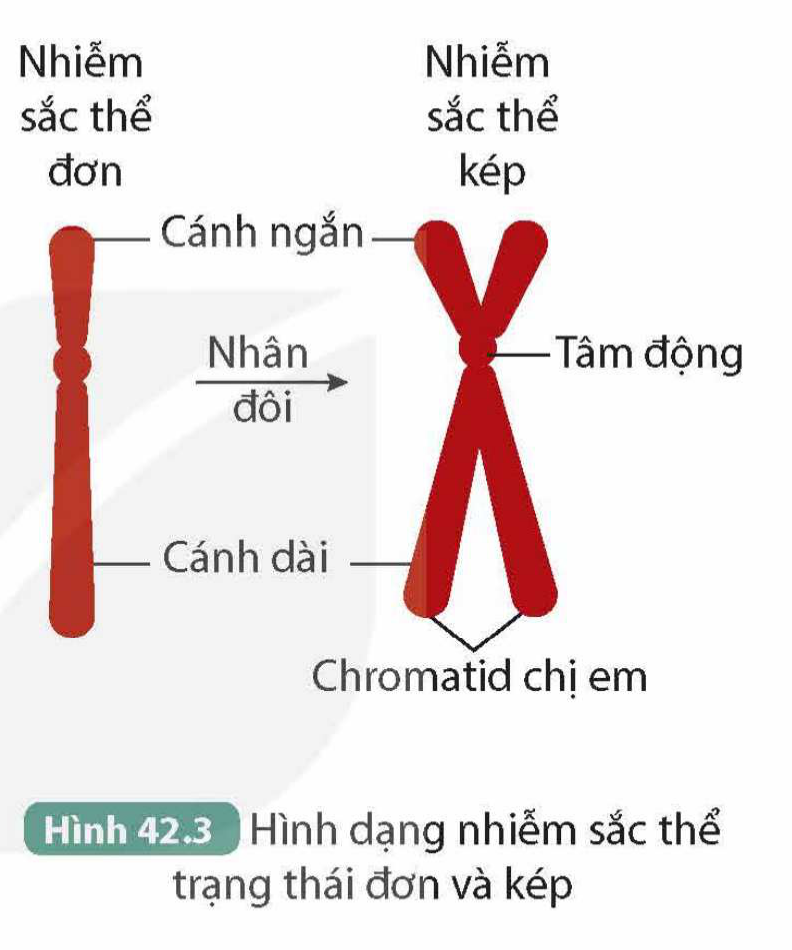
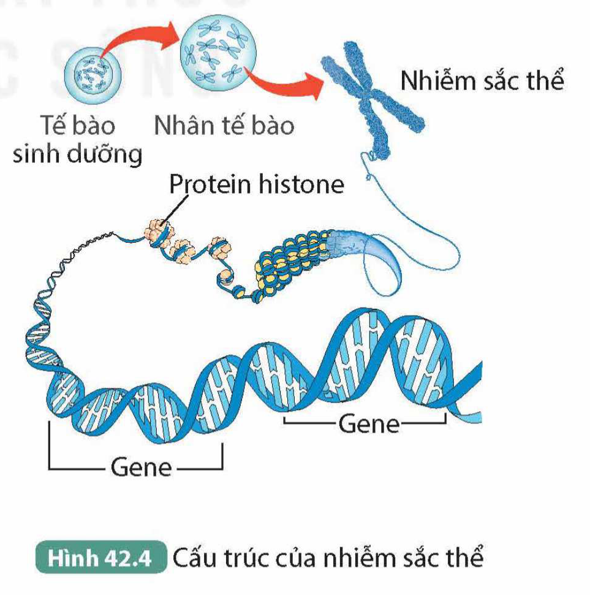
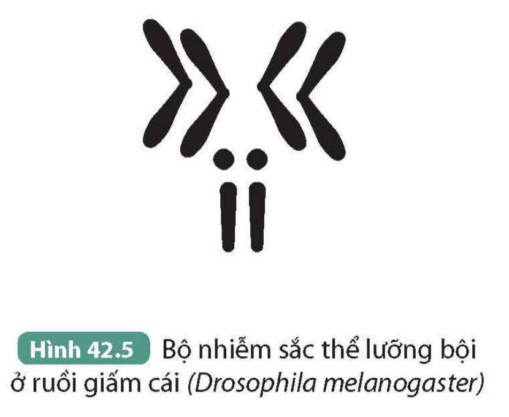
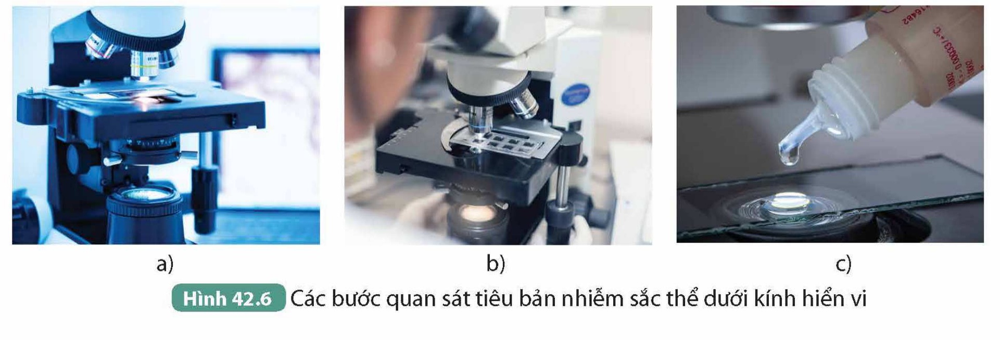

<!-- pdf:183 -->

# BÀI 42: NHIỄM SẮC THỂ VÀ BỘ NHIỄM SẮC THỂ

## 🎯 Mục tiêu

- Nêu được khái niệm nhiễm sắc thể.
- Mô tả được hình dạng nhiễm sắc thể thông qua hình vẽ nhiễm sắc thể ở kì giữa với tâm động, các cánh.
- Mô tả được cấu trúc nhiễm sắc thể có lõi là DNA và cách sắp xếp của gene trên nhiễm sắc thể.
- Phân biệt được bộ nhiễm sắc thể lưỡng bội, đơn bội. Lấy được ví dụ minh hoạ.
- Lấy được ví dụ chứng minh mỗi loài có bộ nhiễm sắc thể đặc trưng.
- Thực hành: Quan sát được tiêu bản nhiễm sắc thể dưới kính hiển vi.

## 🔴 Mở đầu

Các nghiên cứu khoa học công bố gần đây cho thấy hệ gene của người gồm nhiều phân tử DNA kích thước lớn, cấu tạo từ khoảng 3 tỉ cặp nucleotide và có tổng chiều dài lên tới hàng mét. Bằng cách nào, với tổng kích thước DNA lớn như vậy có thể sắp xếp ở trong nhân có đường kính chỉ $5\text{ }\mu\text{m}$?

## I. Nhiễm sắc thể

### 1. Khái niệm nhiễm sắc thể

Khi nhuộm tế bào bằng thuốc nhuộm kiềm tính và quan sát dưới kính hiển vi quang học, trong nhân tế bào xuất hiện các cấu trúc bắt màu đậm với thuốc nhuộm (Hình 42.1) và chúng biến đổi hình dạng trong quá trình tế bào phân chia. Những cấu trúc này gọi là **nhiễm sắc thể** (NST).

> ✋ Đọc thông tin trên kết hợp quan sát Hình 42.1, trả lời các câu hỏi sau:
>
> 1. NST phân bố ở đâu trong tế bào?
> 2. Nêu khái niệm NST.

Hình 42.1. Nhiễm sắc thể trong tế bào

<!-- pdf:184 -->

### 2. Hình dạng và cấu trúc của nhiễm sắc thể

**a) Hình dạng nhiễm sắc thể**

Hình dạng NST được quan sát ở kì giữa của quá trình phân bào, khi đó các NST ở trạng thái kép và đóng xoắn cực đại, thể hiện hình dạng đặc trưng. Ở thời điểm này, NST thường có dạng hình que, hình chữ V, hình chữ X hoặc hình hạt,... (Hình 42.2).

Hình 42.2. Một số hình dạng của nhiễm sắc thể

<!-- term: Tâm động -->
Mỗi NST kép gồm hai chromatid (nhiễm sắc tử) chị em, gắn với nhau ở tâm động. Tâm động giúp NST gắn vào thoi phân bào khi tế bào phân chia. Tâm động có thể nằm ở vị trí giữa (tâm cân) hoặc ở đầu mút (tâm mút) hoặc ở các vị trí còn lại của NST (tâm lệch). Ở các NST tâm lệch, tâm động là điểm giới hạn giữa một bên là cánh ngắn và một bên là cánh dài của NST đó (Hình 42.3).

Hình 42.3. Hình dạng nhiễm sắc thể trạng thái đơn và kép

> ❓ 1. Mô tả hình dạng và gọi tên vị trí tâm động của mỗi NST trong Hình 42.2a, b, c, d.
>
> 2. Các vị trí A, B, C ở Hình 42.2d tương ứng với những bộ phận nào của NST?

**b) Cấu trúc nhiễm sắc thể**

NST được cấu tạo bởi DNA và protein histone . Mỗi chromatid gồm một phân tử DNA liên kết với nhiều phân tử protein histone tạo thành **sợi nhiễm sắc**, sợi nhiễm sắc được cuộn xoắn qua nhiều mức độ khác nhau tạo nên NST (Hình 42.4).

Hình 42.4. Cấu trúc của nhiễm sắc thể

> ❓ 1. Mỗi NST trong tế bào ở Hình 42.4 chứa bao nhiêu phân tử DNA?
>
> 2. Các gene được sắp xếp như thế nào trên NST?

Nhờ cách cấu trúc đặc biệt mà phân tử DNA có kích thước lớn, mang nhiều gene được “đóng gói” bên trong mỗi NST và nằm gọn trong nhân tế bào. Trong nhân tế bào, NST là cấu trúc mang gene, các gene sắp xếp theo chiều dọc trên NST.

<!-- pdf:185 -->

## II. Bộ nhiễm sắc thể

### 1. Khái niệm bộ nhiễm sắc thể

Trong nhân tế bào sinh dưỡng, các NST tồn tại thành từng cặp, mỗi cặp gồm hai chiếc giống nhau về hình dạng, kích thước và cấu trúc gọi là **cặp NST tương đồng**. Ví dụ: các NST trong tế bào sinh dưỡng của ruồi giấm cái (Hình 42.5).

Bộ NST gồm các cặp NST tương đồng gọi là **bộ NST lưỡng bội**, kí hiệu là $2n$.

Trong các giao tử, số lượng NST giảm đi một nửa so với tế bào sinh dưỡng, gọi là **bộ NST đơn bội**, kí hiệu là $n$.

Hình 42.5. Bộ nhiễm sắc thể lưỡng bội ở ruồi giấm cái (*Drosophila melanogaster*)

> ❓ Nghiên cứu Bảng 42.1, thực hiện các yêu cầu sau:
>
> 1. Xác định số lượng NST trong giao tử của mỗi loài bằng cách hoàn thành vào vở theo mẫu Bảng 42.1.
> 2. Nêu điểm khác nhau giữa bộ NST lưỡng bội và bộ NST đơn bội.
> 3. Nhận xét về số lượng NST trong bộ NST ở các loài.
>
> Bảng 42.1. Bộ nhiễm sắc thể lưỡng bội ($2n$) và đơn bội ($n$) của một số loài
>
> | Số lượng NST trong tế bào \ Loài | Người | Tinh tinh | Gà | Cà chua | Ruồi giấm | Đậu hà lan | Ngô | Lúa nước | Bắp cải |
> | --- | --- | --- | --- | --- | --- | --- | --- | --- | --- |
> | Tế bào sinh dưỡng | 46 | 48 | 78 | 24 | 8 | 14 | 20 | 24 | 18 |
> | Tế bào giao tử | ? | ? | ? | ? | ? | ? | ? | ? | ? |

### 2. Tính chất đặc trưng của bộ nhiễm sắc thể

> ✋ Tìm hiểu thông tin trong Bảng 42.1, trả lời các câu hỏi sau:
>
> 1. Dựa vào thông tin nào có thể nhận biết được sự khác biệt về bộ NST giữa các loài?
> 2. Đúng hay sai khi nói rằng cà chua và lúa nước cùng có chung một bộ NST? Giải thích.

Mỗi loài sinh vật có một bộ NST riêng, đặc trưng về số lượng, hình dạng và cấu trúc của NST. Các cá thể cùng loài đều mang bộ NST đặc trưng của loài. Ví dụ: Các giống ngô hiện nay được trồng ở nhiều quốc gia đều có bộ NST $2n = 20$; nhiều giống chó nhà được nuôi ở nhiều nơi trên thế giới đều có bộ NST $2n = 78$,...

Sự khác nhau về số lượng NST trong bộ NST lưỡng bội giữa các loài sinh vật không phản ánh sự khác nhau về mức độ tiến hoá (thời kì phát sinh loài) giữa chúng.

Bộ NST của các loài có thể giống nhau về số lượng NST nhưng hình dạng và đặc biệt là cấu trúc NST sẽ khác nhau.

<!-- pdf:186 -->

## III. Thực hành: Quan sát tiêu bản nhiễm sắc thể dưới kính hiển vi

### 1. Chuẩn bị

**a) Dụng cụ**

- Kính hiển vi quang học có chỉ số phóng đại vật kính $10\times$, $40\times$, $100\times$.
- Dầu soi kính hiển vi.
- Giấy mềm, cồn $70^\circ$.
- Bút vẽ, vở ghi.
- Máy ảnh (nếu có).

**b) Mẫu vật**

Tiêu bản cố định NST tế bào một số loài.

**c) Tìm hiểu cơ sở quan sát tiêu bản nhiễm sắc thể**

- Dùng vật kính có độ phóng đại nhỏ để lựa chọn điểm quan sát đạt yêu cầu.
- Trong tiêu bản có các tế bào đang ở các kì khác nhau: Tế bào ở kì trung gian không nhìn rõ hình dạng NST; NST quan sát rõ nhất ở kì giữa, khi đó NST tập trung thành một hàng ở giữa tế bào. Để quan sát rõ hình dạng NST cần xác định tế bào ở kì giữa của quá trình phân bào.
- Chuyển sang vật kính có độ phóng đại lớn hơn để quan sát rõ số lượng, hình dạng NST.

### 2. Cách tiến hành

- Bước 1: Chọn vật kính có độ phóng đại thấp ($10\times$) để điều chỉnh độ hội tụ ánh sáng (Hình 42.6a).
- Bước 2: Đặt tiêu bản lên bàn kính, dùng kẹp để giữ tiêu bản. Vặn ốc sơ cấp để đưa vật kính $10\times$ tiến gần vào tiêu bản.
- Bước 3: Vặn ốc sơ cấp kết hợp vặn ốc thứ cấp để điều chỉnh hình ảnh NST cho rõ nét.
- Bước 4: Chuyển sang quan sát tiêu bản ở vật kính $40\times$ (Hình 42.6b).
- Bước 5: Quan sát tiêu bản ở vật kính $100\times$.
  - Nhỏ một giọt dầu soi kính vào tiêu bản cần quan sát (Hình 42.6c).
  - Vặn ốc sơ cấp để đưa vật kính $100\times$ tiến gần vào tiêu bản, đầu vật kính ngập vào giọt dầu vừa nhỏ.
  - Vặn ốc thứ cấp để điều chỉnh hình ảnh cho rõ nét.
- Bước 6: Lau sạch dầu soi kính trên vật kính $100\times$.
  - Dùng giấy mềm có tẩm cồn $70^\circ$ đặt nhẹ nhàng lên bề mặt vật kính $100\times$.
  - Giữ yên vài giây để giấy tẩm cồn hút hết dầu soi trên bề mặt vật kính.
  - Kiểm tra mâm kính, nếu có dính dầu soi kính, dùng giấy mềm có tẩm cồn $70^\circ$ lau sạch.

Hình 42.6. Các bước quan sát tiêu bản nhiễm sắc thể dưới kính hiển vi

<!-- pdf:187 -->

### 3. Kết quả

> **BÁO CÁO THỰC HÀNH**
>
> Họ và tên: ... Lớp: ...
>
> 1. **Mục đích thí nghiệm:** Quan sát NST dưới kính hiển vi
> 2. **Chuẩn bị:** Dụng cụ thí nghiệm: ...
> 3. **Các bước tiến hành:** Mô tả các bước tiến hành: ...
> 4. **Kết quả thí nghiệm:** Dựa vào kết quả quan sát NST dưới kính hiển vi hoặc ảnh chụp, vẽ hình NST vào vở và hoàn thành thông tin theo mẫu Bảng 42.2.
>
> Bảng 42.2. Kết quả quan sát tiêu bản nhiễm sắc thể
>
> | Loại tế bào \ Nội dung | Số lượng NST | Mô tả hình dạng NST | Kiểu sắp xếp NST (giữa tế bào/ ở 2 cực tế bào/ sắp xếp ngẫu nhiên) |
> | --- | --- | --- | --- |
> | ? | ? | ? | ? |
> | ? | ? | ? | ? |

## 📌 Em đã học

- NST là cấu trúc mang gene nằm trong nhân tế bào, là cơ sở vật chất chủ yếu của tính di truyền ở cấp độ tế bào của sinh vật nhân thực.
- Mỗi loài sinh vật có bộ NST đặc trưng về số lượng, hình dạng và cấu trúc. Trong tế bào sinh dưỡng, các NST tồn tại thành từng cặp tương đồng. Bộ NST lưỡng bội có chứa các cặp NST tương đồng, mỗi cặp gồm hai chiếc. Bộ NST trong các giao tử là bộ NST đơn bội, có số lượng NST giảm đi một nửa so với tế bào sinh dưỡng.
- NST được cấu tạo bởi chất nhiễm sắc, bao gồm DNA và protein histone. Mỗi NST đơn chứa một phân tử DNA và nhiều phân tử histone. Khi DNA tái bản, NST đơn biến đổi thành NST kép.
- Trong nhân tế bào, NST là cấu trúc mang gene, các gene sắp xếp theo chiều dọc trên NST.
- Quan sát hoặc chụp ảnh được hình dạng và vị trí phân bố của NST trong tế bào dưới kính hiển vi, vẽ hình ảnh NST quan sát được vào vở.

## ✏️ Em có thể

- Nhận biết được trong cơ thể sinh vật, tế bào ở cơ quan nào mang bộ NST lưỡng bội hoặc đơn bội.
- Xác định được số lượng và phân biệt được hình dạng các NST trong tế bào của một sinh vật thông qua quan sát tiêu bản NST của sinh vật đó dưới kính hiển vi.

> 🔍 Ở các loài sinh vật, NST là cấu trúc mang gene, tuy nhiên các nhà khoa học đã phát hiện ra NST Y ở loài ruồi giấm không mang gene nào mặc dù NST này vẫn tồn tại trong tế bào.

## 📷 Danh sách hình trong bài

| Mã hình | Trang PDF | Vị trí | Chú thích gốc |
| --- | --- | --- | --- |
| H9-khoa_hoc_tu_nhien-b42-01 | 183 | Mục I.1 | Hình 42.1. Nhiễm sắc thể trong tế bào |
| H9-khoa_hoc_tu_nhien-b42-02 | 184 | Mục I.2a | Hình 42.2. Một số hình dạng của nhiễm sắc thể |
| H9-khoa_hoc_tu_nhien-b42-03 | 184 | Mục I.2a | Hình 42.3. Hình dạng nhiễm sắc thể trạng thái đơn và kép |
| H9-khoa_hoc_tu_nhien-b42-04 | 184 | Mục I.2b | Hình 42.4. Cấu trúc của nhiễm sắc thể |
| H9-khoa_hoc_tu_nhien-b42-05 | 185 | Mục II.1 | Hình 42.5. Bộ nhiễm sắc thể lưỡng bội ở ruồi giấm cái (*Drosophila melanogaster*) |
| H9-khoa_hoc_tu_nhien-b42-06 | 186 | Mục III.2 | Hình 42.6. Các bước quan sát tiêu bản nhiễm sắc thể dưới kính hiển vi |
