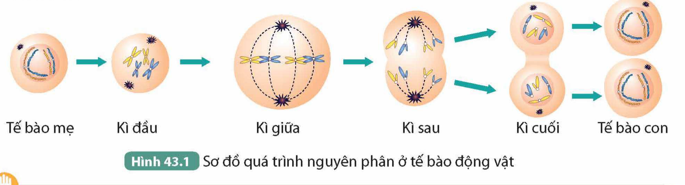
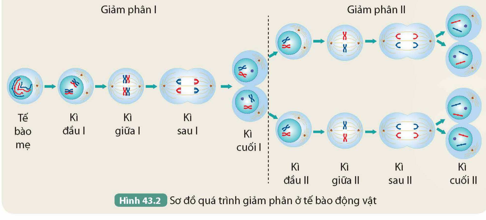
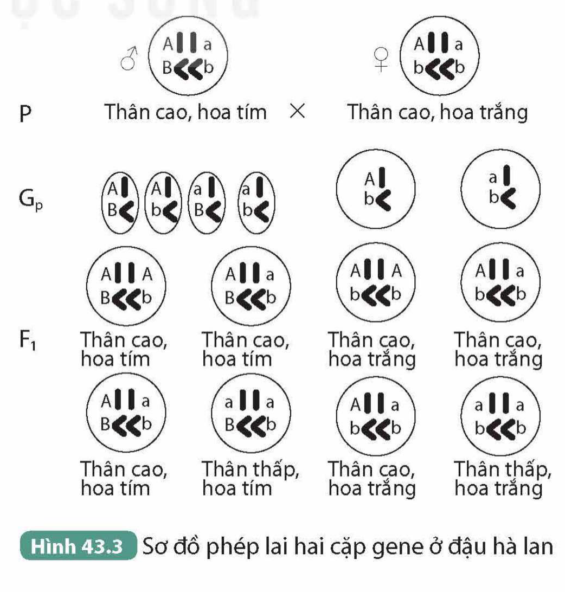
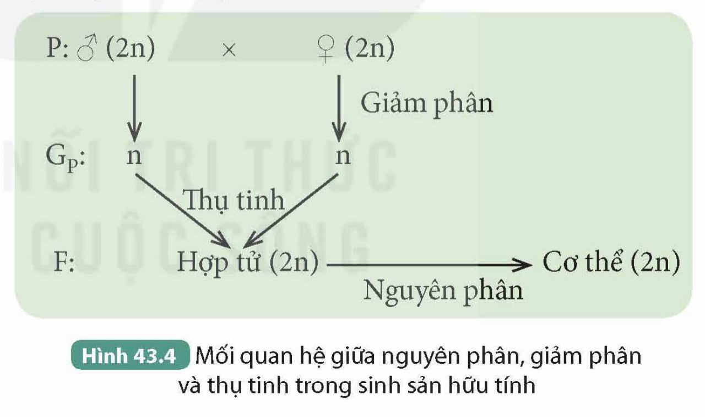
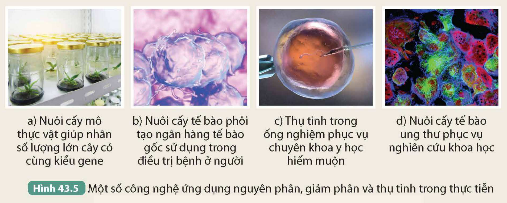

<!-- pdf:188 -->

# BÀI 43: NGUYÊN PHÂN VÀ GIẢM PHÂN

## 🎯 Mục tiêu

- Nêu được khái niệm nguyên phân và giảm phân, lấy được ví dụ. Nêu được ý nghĩa về mặt di truyền học của nguyên phân và giảm phân.
- Phân biệt được nguyên phân, giảm phân và mối liên hệ giữa hai quá trình này trong sinh sản hữu tính.
- Thông qua sơ đồ lai hai cặp gene, trình bày được cơ chế biến dị tổ hợp trong giảm phân và thụ tinh.
- Nêu được nhiễm sắc thể vừa là vật chất mang thông tin di truyền, vừa là đơn vị truyền đạt vật chất di truyền qua các thế hệ tế bào và cơ thể.
- Trình bày được các ứng dụng của nguyên phân và giảm phân trong thực tiễn.

## 🔴 Mở đầu

Tại sao từ một quả trứng gà ban đầu chỉ chứa một tế bào hợp tử, sau thời gian được gà mẹ ấp sẽ nở ra một gà con gồm hàng tỉ tế bào?

## I. Nguyên phân

### 1. Khái niệm nguyên phân

Ở sinh vật nhân thực, các tế bào được sinh ra và lớn lên thường đến một giới hạn nhất định sẽ phân chia bằng hình thức nguyên phân để tạo ra các tế bào mới.

Nguyên phân là hình thức phân bào có ở hầu hết tế bào sinh dưỡng và tế bào sinh sản đang ở giai đoạn sinh trưởng. Quá trình nguyên phân diễn ra qua hai giai đoạn: phân chia nhân và phân chia tế bào chất. Phân chia nhân diễn ra qua bốn kì (Hình 43.1), trong đó các NST nhân đôi trước khi bước vào kì đầu. Phân chia tế bào chất diễn ra đồng thời với kì cuối của phân chia nhân.

Hình 43.1. Sơ đồ quá trình nguyên phân ở tế bào động vật

> ✋ Đọc thông tin trên kết hợp quan sát Hình 43.1, thực hiện các yêu cầu sau:
>
> 1. Cho biết từ một tế bào mẹ, qua một lần nguyên phân tạo ra bao nhiêu tế bào con.
> 2. So sánh bộ NST ở các tế bào con với bộ NST ở tế bào mẹ.
> 3. Cho biết nguyên phân là gì.

<!-- pdf:189 -->

Qua mỗi lần nguyên phân, từ một tế bào mẹ tạo ra hai tế bào con. Các tế bào con này có thể lại bước vào những đợt nguyên phân tiếp theo để tạo ra nhiều thế hệ tế bào con mới, các tế bào này cấu trúc nên các mô, cơ quan hoặc thay thế các tế bào bị thương, tế bào già bị chết.

Ví dụ về nguyên phân: Ở thực vật, khi hạt nảy mầm, tế bào phôi ở trong hạt nguyên phân liên tiếp và biệt hoá tạo ra số lượng lớn tế bào hình thành các cơ quan như rễ, thân, lá,... Ở người, tế bào ở tầng tế bào sống của da nguyên phân liên tục để tạo các tế bào mới thay thế các tế bào da bị chết.

> ❓ Nêu thêm ví dụ về nguyên phân mà em biết.

### 2. Ý nghĩa di truyền học của nguyên phân

Đối với cơ thể đa bào, trong quá trình sinh trưởng và phát triển, nhờ nguyên phân, các thế hệ tế bào của cơ thể luôn nhận được bộ NST giống nhau và giống với tế bào mẹ. Ở những loài sinh sản vô tính, vật chất di truyền (bộ NST) của cơ thể mẹ cũng được truyền nguyên vẹn cho các thế hệ con cháu nhờ nguyên phân.

Đối với cơ thể đơn bào nhân thực, nguyên phân là hình thức sinh sản của tế bào mẹ để sinh ra các thế hệ con cháu có vật chất di truyền giống tế bào mẹ.

## II. Giảm phân

### 1. Khái niệm giảm phân

Trong sinh sản hữu tính, vật chất di truyền của hợp tử là sự tổ hợp vật chất di truyền của bố và mẹ. Để duy trì bộ NST đặc trưng của loài qua các thế hệ con cháu thì quá trình giảm phân ở bố mẹ phải tạo ra giao tử có số lượng NST giảm đi một nửa so với tế bào sinh dưỡng.

> ✋ Quan sát Hình 43.2 và thực hiện các yêu cầu sau:
>
> 1. Cho biết từ một tế bào mẹ, qua giảm phân tạo ra bao nhiêu tế bào con.
> 2. So sánh bộ NST ở các tế bào con so với bộ NST ở tế bào mẹ.
> 3. Cho biết giảm phân là gì.

Hình 43.2. Sơ đồ quá trình giảm phân ở tế bào động vật

<!-- pdf:190 -->

Giảm phân diễn ra ở các tế bào tham gia sinh sản hữu tính (tế bào sinh dục giai đoạn chín). Quá trình giảm phân gồm hai lần phân chia tế bào kế tiếp nhau (giảm phân I và giảm phân II), trong đó NST chỉ nhân đôi một lần trước khi tế bào bước vào giảm phân I.

Ví dụ về giảm phân: Ở nam giới, khi đến tuổi dậy thì, các tế bào sinh tinh ($2n$) trong tinh hoàn giảm phân tạo ra các tinh trùng ($n$). Ở cây ngô, sự hình thành tế bào trứng ($n$) diễn ra ở noãn nằm trong bầu nhuỵ; trong noãn, mỗi tế bào mẹ đại bào tử ($2n$) tiến hành giảm phân cho ra bốn đại bào tử ($n$).

> ❓ Nêu thêm ví dụ về giảm phân mà em biết.

### 2. Ý nghĩa di truyền học của giảm phân

Quá trình giảm phân tạo ra các giao tử đơn bội. Trong thụ tinh, sự kết hợp giữa giao tử đực với giao tử cái sẽ khôi phục lại bộ NST lưỡng bội ở các hợp tử. Nhờ có giảm phân kết hợp với thụ tinh đã giúp thế hệ con nhận được vật chất di truyền của cả bố và mẹ. Mặt khác, giảm phân tạo ra các giao tử chứa tổ hợp NST khác nhau nên trong thụ tinh, các giao tử đực và giao tử cái kết hợp với nhau một cách ngẫu nhiên sẽ tạo ra vô số kiểu tổ hợp NST trong các hợp tử (**biến dị tổ hợp**), dẫn tới xuất hiện nhiều loại kiểu gene và kiểu hình ở đời con. Sự đa dạng về kiểu gene và kiểu hình cung cấp nguồn biến dị di truyền phong phú cho quần thể sinh vật.

> ❓ Quan sát Hình 43.3 kết hợp kiến thức đã học, trả lời các câu hỏi sau:
>
> 1. Thế hệ $F_1$ có bao nhiêu loại kiểu gene và kiểu hình mới được tạo thành do tổ hợp lại các allele của bố mẹ?
> 2. Những quá trình nào đã làm xuất hiện các biến dị tổ hợp ở phép lai này? Giải thích.

Xét phép lai hai cặp gene quy định chiều cao cây và màu hoa ở đậu hà lan. Quy ước: $A$: thân cao, $a$: thân thấp; $B$: hoa tím, $b$: hoa trắng. Hai cặp gene này nằm trên hai cặp NST tương đồng.

Hình 43.3. Sơ đồ phép lai hai cặp gene ở đậu hà lan

<!-- pdf:191 -->

## III. Phân biệt nguyên phân, giảm phân và mối quan hệ giữa nguyên phân, giảm phân

### 1. Phân biệt nguyên phân, giảm phân

Trong cơ thể đa bào, phần lớn các tế bào chỉ có duy nhất kiểu phân bào nguyên phân. Tuy nhiên, các tế bào tham gia sinh sản hữu tính có thể thực hiện cả phân bào nguyên phân và giảm phân. Hai quá trình phân bào này có những điểm khác biệt nhưng cũng có mối quan hệ qua lại với nhau.

> ✋ Cho các từ khoá sau: bộ NST $n$; bộ NST $2n$; khác nhau; giống nhau; hai tế bào con; bốn tế bào con; tế bào sinh dưỡng; tế bào sinh dục giai đoạn chín.
>
> Dựa vào kiến thức đã học, sử dụng các từ khoá đã cho để hoàn thành vào vở bảng phân biệt nguyên phân, giảm phân theo mẫu Bảng 43.1.
>
> Bảng 43.1. Phân biệt nguyên phân, giảm phân
>
> | Nội dung phân biệt | Nguyên phân | Giảm phân |
> | --- | --- | --- |
> | Tế bào thực hiện phân bào | ? | ? |
> | Kết quả phân bào từ một tế bào mẹ ($2n$) | ? | ? |
> | Số lượng NST trong tế bào con | ? | ? |
> | Các tế bào con có bộ NST giống hay khác nhau | ? | ? |

### 2. Mối quan hệ giữa nguyên phân và giảm phân trong sinh sản hữu tính

Ở sinh vật sinh sản hữu tính, bộ NST đặc trưng của loài được duy trì ổn định qua các thế hệ cơ thể nhờ các quá trình nguyên phân, giảm phân và thụ tinh. Mối quan hệ giữa ba quá trình này được thể hiện trong Hình 43.4.

Hình 43.4. Mối quan hệ giữa nguyên phân, giảm phân và thụ tinh trong sinh sản hữu tính

> ❓ 1. Nêu mối quan hệ giữa nguyên phân, giảm phân trong sinh sản hữu tính.
>
> 2. Đúng hay sai khi nói rằng NST vừa là vật chất mang thông tin di truyền vừa là đơn vị truyền đạt vật chất di truyền qua các thế hệ tế bào và thế hệ cơ thể? Giải thích.

## IV. Ứng dụng của nguyên phân và giảm phân trong thực tiễn

Nguyên phân và giảm phân là những quá trình giúp sinh vật sinh trưởng, phát triển và sinh sản. Con người đã và đang ứng dụng các quá trình này vào thực tiễn trên những đối tượng sinh vật khác nhau.

<!-- pdf:192 -->

> ❓ Quan sát Hình 43.5, cho biết công nghệ nào ứng dụng nguyên phân, công nghệ nào ứng dụng giảm phân và thụ tinh.

Hình 43.5. Một số công nghệ ứng dụng nguyên phân, giảm phân và thụ tinh trong thực tiễn

## 📌 Em đã học

- **Nguyên phân** là hình thức phân chia tế bào mà trong đó các tế bào con được tạo ra có bộ NST giống nhau và giống tế bào mẹ ban đầu.
- **Giảm phân** là hình thức phân bào diễn ra ở các tế bào tham gia sinh sản hữu tính, từ một tế bào mẹ tạo ra bốn tế bào con có số lượng NST giảm đi một nửa, các tế bào con chứa tổ hợp NST khác nhau.
- Sự phối hợp giữa nguyên phân, giảm phân và thụ tinh là cơ chế duy trì bộ NST đặc trưng của loài qua các thế hệ tế bào và qua các thế hệ cơ thể. Giảm phân và thụ tinh là hai cơ chế làm xuất hiện các biến dị tổ hợp ở các loài sinh sản hữu tính.
- NST vừa là vật chất mang thông tin di truyền, vừa là đơn vị truyền đạt vật chất di truyền qua các thế hệ tế bào và cơ thể.

## ✏️ Em có thể

- Giải thích được hiện tượng vết thương ở người liền lại sau một thời gian.

> 🔍 **Kỉ lục về thời gian phân bào**
>
> Mỗi bé gái khi còn đang ở trong bụng mẹ thì các tế bào sinh trứng (noãn nguyên bào) đã tiến hành giảm phân và dừng lại ở giai đoạn đầu giảm phân I (noãn bào bậc 1). Đến tuổi dậy thì, trứng chín thì noãn bào bậc 1 mới kết thúc giảm phân I, chuyển sang giảm phân II và dừng lại khi giảm phân II chưa kết thúc (noãn bào bậc 2). Khi trứng chín và rụng, nếu tinh trùng xâm nhập vào trứng thì trứng mới kết thúc giảm phân II và sự thụ tinh xảy ra, hợp tử được tạo thành. Giả sử một người phụ nữ sinh con đầu lòng khi 24 tuổi thì tế bào sinh trứng trong buồng trứng của người phụ nữ này đã thực hiện giảm phân từ $24 + 1 = 25$ năm về trước.
>
> Khác với nữ giới, ở nam giới, các tế bào sinh tinh trong tinh hoàn chỉ bắt đầu giảm phân khi đến tuổi dậy thì. Như vậy, kỉ lục về thời gian phân bào thuộc về các tế bào sinh trứng ở nữ giới.

## 📷 Danh sách hình trong bài

| Mã hình | Trang PDF | Vị trí | Chú thích gốc |
| --- | --- | --- | --- |
| H9-khoa_hoc_tu_nhien-b43-01 | 188 | Mục I.1 (allow_edge_ink: đỉnh tế bào Kì cuối sát chân dòng 'chia nhân.' phía trên và biểu tượng bàn tay màu cam chồng lấn góc dưới trái) | Hình 43.1. Sơ đồ quá trình nguyên phân ở tế bào động vật |
| H9-khoa_hoc_tu_nhien-b43-02 | 189 | Mục II.1 | Hình 43.2. Sơ đồ quá trình giảm phân ở tế bào động vật |
| H9-khoa_hoc_tu_nhien-b43-03 | 190 | Mục II.2 | Hình 43.3. Sơ đồ phép lai hai cặp gene ở đậu hà lan |
| H9-khoa_hoc_tu_nhien-b43-04 | 191 | Mục III.2 | Hình 43.4. Mối quan hệ giữa nguyên phân, giảm phân và thụ tinh trong sinh sản hữu tính |
| H9-khoa_hoc_tu_nhien-b43-05 | 192 | Mục IV | Hình 43.5. Một số công nghệ ứng dụng nguyên phân, giảm phân và thụ tinh trong thực tiễn |
